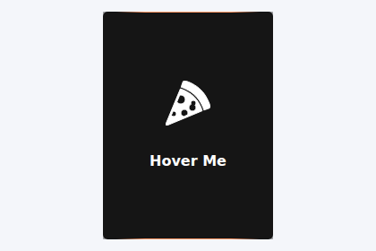
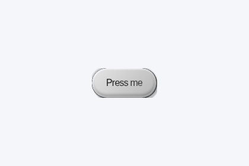
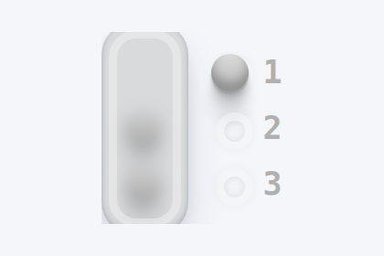
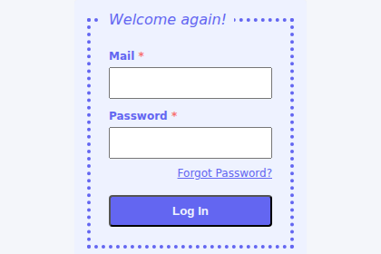

# Anteprime dei componenti — annas-diary

**41 componenti associati**, dal solo catalogo Design-App; l'associazione non prova che il componente sia integrato nell'app.

[Tutte le app](./README.md) · [Catalogo completo](../TABELLA_478.md) · [Vista con filtro app](../../docs/componenti.html?app=annas-diary)

Le immagini qui mostrate sono catture documentali, **non** una verifica di riuso Flutter, compatibilità nativa o licenze degli asset di terzi. In assenza di una PNG realmente acquisita la cella dichiara «Non disponibile» e punta alla fonte originale.

| Anteprima | ID | Componente | Fonte | Categoria | App associate | Codice |
|---|---|---|---|---|---|---|
| <small>Non disponibile</small> · <a href="https://fluttercomponentlibrary.com/pages/components/docking-bar.html" target="_blank" rel="noopener noreferrer">Fonte</a> | <code>FCL-001</code> | Docking Bar | <a href="https://fluttercomponentlibrary.com/pages/components/docking-bar.html" target="_blank" rel="noopener noreferrer">FLUTTER_COMPONENT_LIBRARY</a> | navigation | annas-diary, framelab | Solo riferimento |
| <small>Non disponibile</small> · <a href="https://fluttercomponentlibrary.com/pages/components/bottom-sheet.html" target="_blank" rel="noopener noreferrer">Fonte</a> | <code>FCL-005</code> | Bottom Sheet | <a href="https://fluttercomponentlibrary.com/pages/components/bottom-sheet.html" target="_blank" rel="noopener noreferrer">FLUTTER_COMPONENT_LIBRARY</a> | dialogs | annas-diary, battery-guard, camperboss, framelab, notes-ecosistema | Solo riferimento |
| <small>Non disponibile</small> · <a href="https://fluttercomponentlibrary.com/pages/components/book-shelf.html" target="_blank" rel="noopener noreferrer">Fonte</a> | <code>FCL-006</code> | Book Shelf | <a href="https://fluttercomponentlibrary.com/pages/components/book-shelf.html" target="_blank" rel="noopener noreferrer">FLUTTER_COMPONENT_LIBRARY</a> | animation | annas-diary | Solo riferimento |
|  | <code>UIV-002</code> | Pulsante pill con riempimento gradiente on-hover | <a href="https://uiverse.io/xueyuantan/rotten-pig-19" target="_blank" rel="noopener noreferrer">UIVERSE</a> | BUTTON | annas-diary, beerclass-ai, camperboss, cooking-anime, web-utility-factory, wonderlog, world-days | Sorgente archiviata |
|  | <code>UIV-004</code> | Card editoriale con header gradiente, segnalibro e icona aereo SVG | <a href="https://uiverse.io/JohnnyCSilva/jolly-elephant-67" target="_blank" rel="noopener noreferrer">UIVERSE</a> | CARD | annas-diary, camperboss, framelab, notes-ecosistema, web-utility-factory, wonderlog, world-days | Sorgente archiviata |
|  | <code>UIV-005</code> | Card proposta dall&#x27;utente come sfondo decorativo per varie app; effetto esatto non verificato | <a href="https://uiverse.io/amir_6539/red-duck-82" target="_blank" rel="noopener noreferrer">UIVERSE</a> | CARD_BACKGROUND | annas-diary, app-factory-dashboard, battery-guard, cashmate-ai, deskland-android, focussense, notes-ecosistema, omni-cleaner | Sorgente archiviata |
|  | <code>UIV-006</code> | Switch interattivo Uiverse, sorgente HTML/CSS non individuato | <a href="https://uiverse.io/JustCode14/red-dingo-61" target="_blank" rel="noopener noreferrer">UIVERSE</a> | SWITCH | 180flipcharge, annas-diary, battery-guard, easy-debloat, focussense, omni-cleaner, phone-guard, pocket-guard | Sorgente archiviata |
|  | <code>UIV-007</code> | Loader per processi reali, testo UX proposto: Stiamo facendo la magia; animazione specifica non verificata | <a href="https://uiverse.io/arthur_6104/orange-walrus-50" target="_blank" rel="noopener noreferrer">UIVERSE</a> | LOADER | annas-diary, app-factory-dashboard, cashmate-ai, framelab, notes-ecosistema, omni-cleaner, web-utility-factory, world-days | Sorgente archiviata |
|  | <code>UIV-009</code> | Book card in CSS 3D con copertina che si apre su hover: preferenza utente per Ricordi Anna&#x27;s Diary | <a href="https://uiverse.io/eslam-hany/selfish-bobcat-73" target="_blank" rel="noopener noreferrer">UIVERSE</a> | BOOK_CARD | annas-diary, cooking-anime, framelab, notes-ecosistema, wonderlog, world-days | Sorgente archiviata |
|  | <code>UIV-010</code> | Scheda pubblica Uiverse classificata come CARD; il codice HTML/CSS non è presente nell&#x27;archivio Galaxy e non è stato acquisito. | <a href="https://uiverse.io/00Kubi/fluffy-jellyfish-87" target="_blank" rel="noopener noreferrer">UIVERSE</a> | CARD | annas-diary, beerclass-ai, cooking-anime, framelab, notes-ecosistema, wonderlog, world-days | Sorgente archiviata |
|  | <code>UIV-014</code> | Componente Uiverse nella categoria CARD; HTML/CSS originale archiviato con blob SHA. L&#x27;effetto specifico richiede ispezione del sorgente e collaudo visivo. | <a href="https://uiverse.io/ElSombrero2/tricky-robin-67" target="_blank" rel="noopener noreferrer">UIVERSE</a> | CARD | annas-diary, beerclass-ai, cooking-anime, framelab, notes-ecosistema, wonderlog, world-days | Sorgente archiviata |
|  | <code>UIV-015</code> | Scheda pubblica Uiverse classificata come BUTTON; il codice HTML/CSS non è presente nell&#x27;archivio Galaxy e non è stato acquisito. | <a href="https://uiverse.io/FColombati/spotty-snake-82" target="_blank" rel="noopener noreferrer">UIVERSE</a> | BUTTON | annas-diary, beerclass-ai, camperboss, cooking-anime, easy-debloat, framelab | Sorgente archiviata |
|  | <code>UIV-017</code> | Scheda pubblica Uiverse classificata come CARD; il codice HTML/CSS non è presente nell&#x27;archivio Galaxy e non è stato acquisito. | <a href="https://uiverse.io/Gidarx/moody-falcon-73" target="_blank" rel="noopener noreferrer">UIVERSE</a> | CARD | annas-diary, camperboss, deskland-android, edu-01-corpo-umano, notes-ecosistema, wonderlog, world-days | Sorgente archiviata |
|  | <code>UIV-021</code> | Componente Uiverse nella categoria CARD; HTML/CSS originale archiviato con blob SHA. L&#x27;effetto specifico richiede ispezione del sorgente e collaudo visivo. | <a href="https://uiverse.io/JohnnyCSilva/black-rabbit-68" target="_blank" rel="noopener noreferrer">UIVERSE</a> | CARD | annas-diary, camperboss, deskland-android, edu-01-corpo-umano, notes-ecosistema, wonderlog, world-days | Sorgente archiviata |
|  | <code>UIV-023</code> | Componente Uiverse nella categoria RADIO; HTML/CSS originale archiviato con blob SHA. L&#x27;effetto specifico richiede ispezione del sorgente e collaudo visivo. | <a href="https://uiverse.io/LilaRest/soft-baboon-75" target="_blank" rel="noopener noreferrer">UIVERSE</a> | RADIO | annas-diary, battery-guard, cashmate-ai, notes-ecosistema, wonderlog, world-days | Sorgente archiviata |
|  | <code>UIV-024</code> | Componente Uiverse nella categoria CARD; HTML/CSS originale archiviato con blob SHA. L&#x27;effetto specifico richiede ispezione del sorgente e collaudo visivo. | <a href="https://uiverse.io/MuhammadHasann/fast-badger-70" target="_blank" rel="noopener noreferrer">UIVERSE</a> | CARD | annas-diary, beerclass-ai, cooking-anime, framelab, notes-ecosistema, wonderlog, world-days | Sorgente archiviata |
|  | <code>UIV-027</code> | Componente Uiverse nella categoria SWITCH; HTML/CSS originale archiviato con blob SHA. L&#x27;effetto specifico richiede ispezione del sorgente e collaudo visivo. | <a href="https://uiverse.io/Nawsome/empty-snail-69" target="_blank" rel="noopener noreferrer">UIVERSE</a> | SWITCH | 180flipcharge, annas-diary, battery-guard, focussense, notes-ecosistema, omni-cleaner, pocket-guard | Sorgente archiviata |
|  | <code>UIV-033</code> | Componente Uiverse nella categoria BUTTON; HTML/CSS originale archiviato con blob SHA. L&#x27;effetto specifico richiede ispezione del sorgente e collaudo visivo. | <a href="https://uiverse.io/Praashoo7/smooth-crab-52" target="_blank" rel="noopener noreferrer">UIVERSE</a> | BUTTON | annas-diary, app-factory-dashboard, notes-ecosistema, web-utility-factory, wonderlog, world-days | Sorgente archiviata |
|  | <code>UIV-035</code> | Componente Uiverse nella categoria RADIO; HTML/CSS originale archiviato con blob SHA. L&#x27;effetto specifico richiede ispezione del sorgente e collaudo visivo. | <a href="https://uiverse.io/Pradeepsaranbishnoi/hungry-bat-66" target="_blank" rel="noopener noreferrer">UIVERSE</a> | RADIO | annas-diary, battery-guard, cashmate-ai, notes-ecosistema, trailpath, world-days | Sorgente archiviata |
|  | <code>UIV-038</code> | Scheda pubblica Uiverse classificata come BUTTON; il codice HTML/CSS non è presente nell&#x27;archivio Galaxy e non è stato acquisito. | <a href="https://uiverse.io/Priyanshu02020/popular-puma-87" target="_blank" rel="noopener noreferrer">UIVERSE</a> | BUTTON | annas-diary, beerclass-ai, cooking-anime, framelab, wonderlog, world-days | Sorgente archiviata |
|  | <code>UIV-047</code> | Componente Uiverse nella categoria BUTTON; HTML/CSS originale archiviato con blob SHA. L&#x27;effetto specifico richiede ispezione del sorgente e collaudo visivo. | <a href="https://uiverse.io/Yaya12085/plastic-quail-42" target="_blank" rel="noopener noreferrer">UIVERSE</a> | BUTTON | annas-diary, app-factory-dashboard, camperboss, easy-debloat, notes-ecosistema, web-utility-factory | Sorgente archiviata |
|  | <code>UIV-048</code> | Componente Uiverse nella categoria CARD; HTML/CSS originale archiviato con blob SHA. L&#x27;effetto specifico richiede ispezione del sorgente e collaudo visivo. | <a href="https://uiverse.io/akshat-patel28/quick-baboon-29" target="_blank" rel="noopener noreferrer">UIVERSE</a> | CARD | annas-diary, beerclass-ai, cooking-anime, framelab, notes-ecosistema, wonderlog, world-days | Sorgente archiviata |
|  | <code>UIV-049</code> | Componente Uiverse nella categoria SWITCH; HTML/CSS originale archiviato con blob SHA. L&#x27;effetto specifico richiede ispezione del sorgente e collaudo visivo. | <a href="https://uiverse.io/andrew-demchenk0/honest-stingray-90" target="_blank" rel="noopener noreferrer">UIVERSE</a> | SWITCH | 180flipcharge, annas-diary, battery-guard, easy-debloat, notes-ecosistema, phone-guard, pocket-guard | Sorgente archiviata |
|  | <code>UIV-056</code> | Scheda pubblica Uiverse classificata come CARD; il codice HTML/CSS non è presente nell&#x27;archivio Galaxy e non è stato acquisito. | <a href="https://uiverse.io/chase2k25/warm-chicken-23" target="_blank" rel="noopener noreferrer">UIVERSE</a> | CARD | annas-diary, camperboss, deskland-android, edu-01-corpo-umano, notes-ecosistema, wonderlog, world-days | Sorgente archiviata |
|  | <code>UIV-060</code> | Scheda pubblica Uiverse classificata come BUTTON; il codice HTML/CSS non è presente nell&#x27;archivio Galaxy e non è stato acquisito. | <a href="https://uiverse.io/dexter-st/breezy-zebra-94" target="_blank" rel="noopener noreferrer">UIVERSE</a> | BUTTON | annas-diary, cooking-anime, framelab, notes-ecosistema, wonderlog, world-days | Sorgente archiviata |
|  | <code>UIV-067</code> | Scheda pubblica Uiverse classificata come RADIO; il codice HTML/CSS non è presente nell&#x27;archivio Galaxy e non è stato acquisito. | <a href="https://uiverse.io/elijahgummer/young-horse-7" target="_blank" rel="noopener noreferrer">UIVERSE</a> | RADIO | annas-diary, beerclass-ai, cashmate-ai, notes-ecosistema, sleepmax-coach, web-utility-factory | Sorgente archiviata |
|  | <code>UIV-069</code> | Scheda pubblica Uiverse classificata come BUTTON; il codice HTML/CSS non è presente nell&#x27;archivio Galaxy e non è stato acquisito. | <a href="https://uiverse.io/fthisilak/bitter-termite-36" target="_blank" rel="noopener noreferrer">UIVERSE</a> | BUTTON | annas-diary, app-factory-dashboard, easy-debloat, notes-ecosistema, web-utility-factory, wonderlog | Sorgente archiviata |
|  | <code>UIV-075</code> | Componente Uiverse nella categoria CARD; HTML/CSS originale archiviato con blob SHA. L&#x27;effetto specifico richiede ispezione del sorgente e collaudo visivo. | <a href="https://uiverse.io/joe-watson-sbf/honest-bullfrog-6" target="_blank" rel="noopener noreferrer">UIVERSE</a> | CARD | annas-diary, camperboss, deskland-android, edu-01-corpo-umano, notes-ecosistema, wonderlog, world-days | Sorgente archiviata |
|  | <code>UIV-080</code> | Componente Uiverse nella categoria CARD; HTML/CSS originale archiviato con blob SHA. L&#x27;effetto specifico richiede ispezione del sorgente e collaudo visivo. | <a href="https://uiverse.io/kennyotsu/short-ape-5" target="_blank" rel="noopener noreferrer">UIVERSE</a> | CARD | annas-diary, beerclass-ai, cooking-anime, framelab, notes-ecosistema, wonderlog, world-days | Sorgente archiviata |
|  | <code>UIV-087</code> | Componente Uiverse nella categoria BUTTON; HTML/CSS originale archiviato con blob SHA. L&#x27;effetto specifico richiede ispezione del sorgente e collaudo visivo. | <a href="https://uiverse.io/marcelodolza/fat-zebra-11" target="_blank" rel="noopener noreferrer">UIVERSE</a> | BUTTON | annas-diary, app-factory-dashboard, camperboss, easy-debloat, notes-ecosistema, web-utility-factory | Sorgente archiviata |
|  | <code>UIV-088</code> | Componente Uiverse nella categoria SWITCH; HTML/CSS originale archiviato con blob SHA. L&#x27;effetto specifico richiede ispezione del sorgente e collaudo visivo. | <a href="https://uiverse.io/mobinkakei/great-skunk-8" target="_blank" rel="noopener noreferrer">UIVERSE</a> | SWITCH | 180flipcharge, annas-diary, battery-guard, focussense, notes-ecosistema, omni-cleaner, pocket-guard | Sorgente archiviata |
|  | <code>UIV-091</code> | Scheda pubblica Uiverse classificata come CARD; il codice HTML/CSS non è presente nell&#x27;archivio Galaxy e non è stato acquisito. | <a href="https://uiverse.io/monkey_8812/curly-moth-56" target="_blank" rel="noopener noreferrer">UIVERSE</a> | CARD | annas-diary, camperboss, deskland-android, edu-01-corpo-umano, notes-ecosistema, wonderlog, world-days | Sorgente archiviata |
|  | <code>UIV-092</code> | Scheda pubblica Uiverse classificata come CARD; il codice HTML/CSS non è presente nell&#x27;archivio Galaxy e non è stato acquisito. | <a href="https://uiverse.io/mymiamo/quiet-dragon-5" target="_blank" rel="noopener noreferrer">UIVERSE</a> | CARD | annas-diary, beerclass-ai, cooking-anime, framelab, notes-ecosistema, wonderlog, world-days | Sorgente archiviata |
|  | <code>UIV-095</code> | Scheda pubblica Uiverse classificata come CARD; il codice HTML/CSS non è presente nell&#x27;archivio Galaxy e non è stato acquisito. | <a href="https://uiverse.io/seoulchik/funny-seahorse-89" target="_blank" rel="noopener noreferrer">UIVERSE</a> | CARD | annas-diary, camperboss, deskland-android, edu-01-corpo-umano, notes-ecosistema, wonderlog, world-days | Sorgente archiviata |
|  | <code>UIV-098</code> | Scheda pubblica Uiverse classificata come PATTERN; il codice HTML/CSS non è presente nell&#x27;archivio Galaxy e non è stato acquisito. | <a href="https://uiverse.io/whoisyourdeadie/foolish-rabbit-13" target="_blank" rel="noopener noreferrer">UIVERSE</a> | PATTERN | annas-diary, battery-guard, cashmate-ai, deskland-android, notes-ecosistema, world-days | Sorgente archiviata |
|  | <code>UIV-101</code> | Blue modern login form; use only where an input or optional account flow already exists. Categoria FORM verificata nel post pubblico Uiverse. Tag originali: blue, form, login form, tailwind, rounded, input, button, blue, border, modern. | <a href="https://uiverse.io/Javierrocadev/chatty-ladybug-95" target="_blank" rel="noopener noreferrer">UIVERSE</a> | FORM | annas-diary, app-factory-dashboard, beerclass-ai, cashmate-ai, notes-ecosistema, wonderlog, world-days | Sorgente archiviata |
|  | <code>UIV-102</code> | Warm stitched beige/orange login form; adapt to product typography and contrast. Categoria FORM verificata nel post pubblico Uiverse. Tag originali: login, form, stitched, rounded, shadow, beige, orange, password, form, submit. | <a href="https://uiverse.io/Praashoo7/bitter-pig-24" target="_blank" rel="noopener noreferrer">UIVERSE</a> | FORM | annas-diary, app-factory-dashboard, camperboss, cooking-anime, notes-ecosistema, sleepmax-coach, wonderlog | Sorgente archiviata |
|  | <code>UIV-104</code> | Minimal purple login form; adapt palette and semantics rather than add authentication. Categoria FORM verificata nel post pubblico Uiverse. Tag originali: login, form, input, button, password, white, form, signin, username, purple. | <a href="https://uiverse.io/alexmaracinaru/tall-owl-30" target="_blank" rel="noopener noreferrer">UIVERSE</a> | FORM | annas-diary, app-factory-dashboard, cashmate-ai, cooking-anime, notes-ecosistema, wonderlog, world-days | Sorgente archiviata |
|  | <code>UIV-105</code> | Welcome/social login form; explicit consent and existing optional provider only. Categoria FORM verificata nel post pubblico Uiverse. Tag originali: login, email, social, form, submit, confirm, password, welcome, rounded, shadow. | <a href="https://uiverse.io/ayyjayy2/sour-dog-94" target="_blank" rel="noopener noreferrer">UIVERSE</a> | FORM | annas-diary, app-factory-dashboard, beerclass-ai, cashmate-ai, cooking-anime, framelab, notes-ecosistema, wonderlog | Sorgente archiviata |
|  | <code>UIV-109</code> | Pink retro/pastel stars form; adapt to approved rose palette and reduced-motion. Categoria FORM verificata nel post pubblico Uiverse. Tag originali: form, button, bold, pink, password, email, retro, toggle, switch, login. | <a href="https://uiverse.io/mamyapro123/curvy-bear-51" target="_blank" rel="noopener noreferrer">UIVERSE</a> | FORM | annas-diary, beerclass-ai, camperboss, cooking-anime, notes-ecosistema, sleepmax-coach, wonderlog, world-days | Sorgente archiviata |
|  | <code>UIV-111</code> | Minimal purple account form; use existing opt-in or non-auth input surfaces only. Categoria FORM verificata nel post pubblico Uiverse. Tag originali: purple, form, log in, button, modern, forgot, password, form, submit, username. | <a href="https://uiverse.io/vinodjangid07/horrible-warthog-14" target="_blank" rel="noopener noreferrer">UIVERSE</a> | FORM | annas-diary, app-factory-dashboard, camperboss, cashmate-ai, notes-ecosistema, wonderlog, world-days | Sorgente archiviata |
