# Anteprime dei componenti — annas-diary

**82 componenti associati**, dal solo catalogo Design-App; l'associazione non prova che il componente sia integrato nell'app.

[Tutte le app](./README.md) · [Catalogo completo](../TABELLA_478.md) · [Vista con filtro app](../../docs/componenti.html?app=annas-diary)

Le immagini qui mostrate sono catture documentali, **non** una verifica di riuso Flutter, compatibilità nativa o licenze degli asset di terzi. In assenza di una PNG realmente acquisita la cella dichiara «Non disponibile» e punta alla fonte originale. Le colonne Codice originale e Codice Flutter sono INDIPENDENTI; una variante Dart non implica test su app consumer.

| Anteprima | UID | ID canonico | Componente | Fonte | Categoria | App associate | Codice originale | Codice Flutter |
|---|---|---|---|---|---|---|---|---|
|  | <code>UID-0001</code> | <code>AMX-001</code> | CurtainReveal | <a href="https://github.com/Subhan-code/Amicro--Micro-transitions-/blob/fa5f8ffbe39537a8db191806066b8773c47c82e9/src/components/css-animations/physics/CurtainReveal.tsx" target="_blank" rel="noopener noreferrer">DEVLIBRARIES_AMICRO</a> | CONTEXTUAL_CONTENT_REVEAL | anna-s-diary, app-factory-dashboard, cooking-anime, deskland-android, framelab, notes-ecosistema, web-utility-factory, wonderlog, world-days | <a href="../../BIBLIOTECA_COMPONENTI/sorgenti/amicro/amx-001.tsx" target="_blank" rel="noopener noreferrer">Apri TypeScript/React</a> | Da convertire |
| <small>Non disponibile</small> · <a href="https://devlibraries.com/libraries/amicro/perspective-flip" target="_blank" rel="noopener noreferrer">Fonte</a> | <code>UID-0003</code> | <code>AMX-003</code> | Perspective Flip | <a href="https://devlibraries.com/libraries/amicro/perspective-flip" target="_blank" rel="noopener noreferrer">DEVLIBRARIES_AMICRO</a> | UNVERIFIED_CARD_3D_FLIP | anna-s-diary, app-factory-dashboard, beerclass-ai, cooking-anime, edu-01-corpo-umano, notes-ecosistema, wonderlog, world-days | <a href="https://devlibraries.com/libraries/amicro/perspective-flip" target="_blank" rel="noopener noreferrer">Solo riferimento</a> | Sorgente non archiviata |
| <a href="../../docs/assets/componenti/AMX-004.png">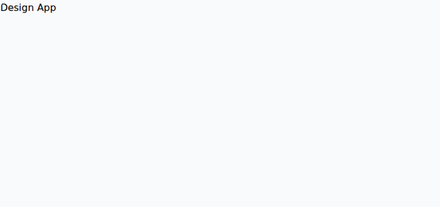</a> | <code>UID-0004</code> | <code>AMX-004</code> | Scroll Reveal | <a href="https://github.com/Subhan-code/Amicro--Micro-transitions-/blob/fa5f8ffbe39537a8db191806066b8773c47c82e9/registry/ui/scroll/scroll-reveal.tsx" target="_blank" rel="noopener noreferrer">DEVLIBRARIES_AMICRO</a> | SCROLL_TRIGGERED_ENTRANCE | anna-s-diary, app-factory-dashboard, battery-guard, beerclass-ai, camperboss, cashmate-ai, cooking-anime, edu-01-corpo-umano, framelab, notes-ecosistema, omni-cleaner, trailpath, web-utility-factory, wonderlog, world-days | <a href="../../BIBLIOTECA_COMPONENTI/sorgenti/amicro/amx-004.tsx" target="_blank" rel="noopener noreferrer">Apri TypeScript/React</a> | Da convertire |
| <small>Non disponibile</small> · <a href="https://devlibraries.com/libraries/amicro/spatial-door-portal" target="_blank" rel="noopener noreferrer">Fonte</a> | <code>UID-0005</code> | <code>AMX-005</code> | Spatial Door Portal | <a href="https://devlibraries.com/libraries/amicro/spatial-door-portal" target="_blank" rel="noopener noreferrer">DEVLIBRARIES_AMICRO</a> | UNVERIFIED_SPATIAL_PAGE_TRANSITION | anna-s-diary, app-factory-dashboard, cooking-anime, deskland-android, framelab, notes-ecosistema, wonderlog, world-days | <a href="https://devlibraries.com/libraries/amicro/spatial-door-portal" target="_blank" rel="noopener noreferrer">Solo riferimento</a> | Sorgente non archiviata |
|  | <code>UID-0006</code> | <code>AMX-006</code> | Accordion Loader | <a href="https://github.com/Subhan-code/Amicro--Micro-transitions-/blob/fa5f8ffbe39537a8db191806066b8773c47c82e9/registry/ui/loading/accordion-loader.tsx" target="_blank" rel="noopener noreferrer">DEVLIBRARIES_AMICRO</a> | INDETERMINATE_LOADING | anna-s-diary, app-factory-dashboard, battery-guard, camperboss, cooking-anime, deskland-android, easy-debloat, focussense, framelab, notes-ecosistema, omni-cleaner, send-to-pc, web-utility-factory, wonderlog, world-days | <a href="../../BIBLIOTECA_COMPONENTI/sorgenti/amicro/amx-006.tsx" target="_blank" rel="noopener noreferrer">Apri TypeScript/React</a> | <a href="../../BIBLIOTECA_COMPONENTI/flutter_adapters/lib/src/amx_006_accordion_loader.dart" target="_blank" rel="noopener noreferrer">Apri codice Flutter (bozza)</a> |
| <a href="../../docs/assets/componenti/DBM-002.png">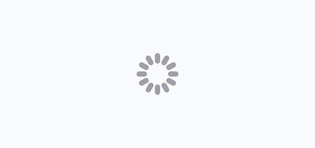</a> | <code>UID-0007</code> | <code>DBM-002</code> | Classic Spinner | <a href="https://github.com/riccardopinato/Design-App/blob/main/BIBLIOTECA_COMPONENTI/sorgenti/amicro/dbm-002.tsx" target="_blank" rel="noopener noreferrer">DEVLIBRARIES_BOOKMARKS</a> | LOADER_INDETERMINATE | anna-s-diary, cooking-anime, notes-ecosistema, omni-cleaner, world-days | <a href="../../BIBLIOTECA_COMPONENTI/sorgenti/amicro/dbm-002.tsx" target="_blank" rel="noopener noreferrer">Apri TypeScript/React (source path not necessarily verified)</a> | Da convertire |
| <a href="../../docs/assets/componenti/DBM-003.png">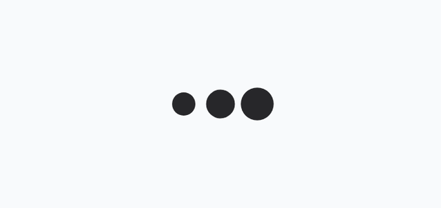</a> | <code>UID-0008</code> | <code>DBM-003</code> | Pulsating Dots | <a href="https://github.com/riccardopinato/Design-App/blob/main/BIBLIOTECA_COMPONENTI/sorgenti/amicro/dbm-003.tsx" target="_blank" rel="noopener noreferrer">DEVLIBRARIES_BOOKMARKS</a> | LOADER_SUBTLE | anna-s-diary, notes-ecosistema, wonderlog, world-days | <a href="../../BIBLIOTECA_COMPONENTI/sorgenti/amicro/dbm-003.tsx" target="_blank" rel="noopener noreferrer">Apri TypeScript/React (source path not necessarily verified)</a> | Da convertire |
|  | <code>UID-0010</code> | <code>DBM-005</code> | Face Id Scan | <a href="https://github.com/riccardopinato/Design-App/blob/main/BIBLIOTECA_COMPONENTI/sorgenti/amicro/dbm-005.tsx" target="_blank" rel="noopener noreferrer">DEVLIBRARIES_BOOKMARKS</a> | BIOMETRIC_STATUS_VISUAL_ONLY | anna-s-diary, pocket-guard, tabletop-motion-alarm | <a href="../../BIBLIOTECA_COMPONENTI/sorgenti/amicro/dbm-005.tsx" target="_blank" rel="noopener noreferrer">Apri TypeScript/React (source path not necessarily verified)</a> | Da convertire |
| <a href="../../docs/assets/componenti/DBM-007.png">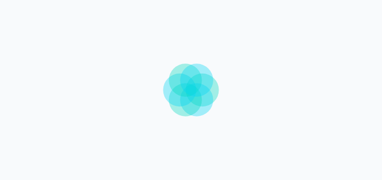</a> | <code>UID-0012</code> | <code>DBM-007</code> | Apple Breathe | <a href="https://github.com/riccardopinato/Design-App/blob/main/BIBLIOTECA_COMPONENTI/sorgenti/amicro/dbm-007.tsx" target="_blank" rel="noopener noreferrer">DEVLIBRARIES_BOOKMARKS</a> | LOADER_CALM | anna-s-diary, notes-ecosistema, sleepmax-coach, wonderlog | <a href="../../BIBLIOTECA_COMPONENTI/sorgenti/amicro/dbm-007.tsx" target="_blank" rel="noopener noreferrer">Apri TypeScript/React (source path not necessarily verified)</a> | Da convertire |
| <a href="../../docs/assets/componenti/DBM-008.png">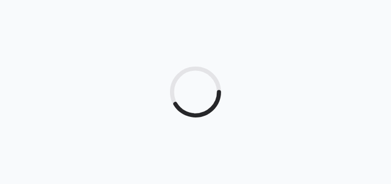</a> | <code>UID-0013</code> | <code>DBM-008</code> | Fade Arc | <a href="https://github.com/riccardopinato/Design-App/blob/main/BIBLIOTECA_COMPONENTI/sorgenti/amicro/dbm-008.tsx" target="_blank" rel="noopener noreferrer">DEVLIBRARIES_BOOKMARKS</a> | LOADER_MINIMAL | anna-s-diary, battery-guard, cooking-anime, world-days | <a href="../../BIBLIOTECA_COMPONENTI/sorgenti/amicro/dbm-008.tsx" target="_blank" rel="noopener noreferrer">Apri TypeScript/React (source path not necessarily verified)</a> | Da convertire |
| <a href="../../docs/assets/componenti/DBM-010.png">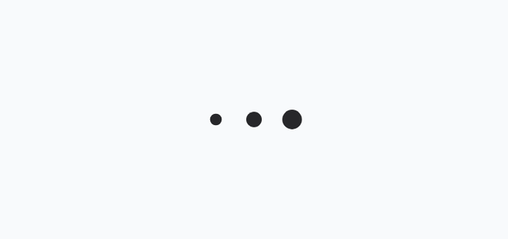</a> | <code>UID-0015</code> | <code>DBM-010</code> | Apple Pulse Dots | <a href="https://github.com/riccardopinato/Design-App/blob/main/BIBLIOTECA_COMPONENTI/sorgenti/amicro/dbm-010.tsx" target="_blank" rel="noopener noreferrer">DEVLIBRARIES_BOOKMARKS</a> | LOADER_SUBTLE | anna-s-diary, notes-ecosistema, sleepmax-coach, world-days | <a href="../../BIBLIOTECA_COMPONENTI/sorgenti/amicro/dbm-010.tsx" target="_blank" rel="noopener noreferrer">Apri TypeScript/React (source path not necessarily verified)</a> | Da convertire |
| <a href="../../docs/assets/componenti/DBM-015.png">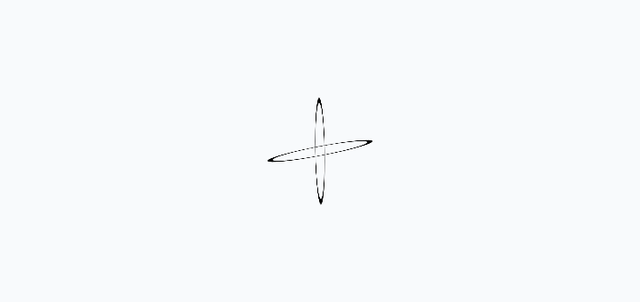</a> | <code>UID-0020</code> | <code>DBM-015</code> | Intersecting Rings | <a href="https://github.com/riccardopinato/Design-App/blob/main/BIBLIOTECA_COMPONENTI/sorgenti/amicro/dbm-015.tsx" target="_blank" rel="noopener noreferrer">DEVLIBRARIES_BOOKMARKS</a> | LOADER_SYNC | anna-s-diary, notes-ecosistema, send-to-pc, world-days | <a href="../../BIBLIOTECA_COMPONENTI/sorgenti/amicro/dbm-015.tsx" target="_blank" rel="noopener noreferrer">Apri TypeScript/React (source path not necessarily verified)</a> | Da convertire |
| <a href="../../docs/assets/componenti/DBM-016.png">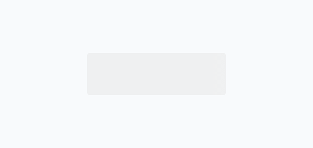</a> | <code>UID-0021</code> | <code>DBM-016</code> | Skeleton | <a href="https://github.com/riccardopinato/Design-App/blob/main/BIBLIOTECA_COMPONENTI/sorgenti/amicro/dbm-016.tsx" target="_blank" rel="noopener noreferrer">DEVLIBRARIES_BOOKMARKS</a> | CONTENT_PLACEHOLDER | anna-s-diary, app-factory-dashboard, cooking-anime, notes-ecosistema, world-days | <a href="../../BIBLIOTECA_COMPONENTI/sorgenti/amicro/dbm-016.tsx" target="_blank" rel="noopener noreferrer">Apri TypeScript/React (source path not necessarily verified)</a> | Da convertire |
| <a href="../../docs/assets/componenti/DBM-024.png">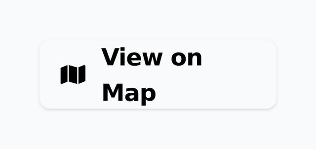</a> | <code>UID-0027</code> | <code>DBM-024</code> | View On Map | <a href="https://github.com/riccardopinato/Design-App/blob/main/BIBLIOTECA_COMPONENTI/sorgenti/watermelon/dbm-024.tsx" target="_blank" rel="noopener noreferrer">DEVLIBRARIES_BOOKMARKS</a> | MAP_PREVIEW_OVERLAY | anna-s-diary, camperboss, trailpath, wonderlog, world-days | <a href="../../BIBLIOTECA_COMPONENTI/sorgenti/watermelon/dbm-024.tsx" target="_blank" rel="noopener noreferrer">Apri TypeScript/React (source path not necessarily verified)</a> | Da convertire |
| <a href="../../docs/assets/componenti/DBM-025.png">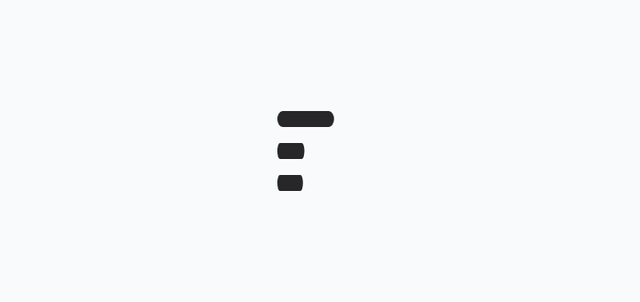</a> | <code>UID-0028</code> | <code>DBM-025</code> | Bouncing Lines | <a href="https://github.com/riccardopinato/Design-App/blob/main/BIBLIOTECA_COMPONENTI/sorgenti/amicro/dbm-025.tsx" target="_blank" rel="noopener noreferrer">DEVLIBRARIES_BOOKMARKS</a> | LOADER_PLAYFUL | anna-s-diary, cooking-anime, sleepmax-coach, world-days | <a href="../../BIBLIOTECA_COMPONENTI/sorgenti/amicro/dbm-025.tsx" target="_blank" rel="noopener noreferrer">Apri TypeScript/React (source path not necessarily verified)</a> | Da convertire |
|  | <code>UID-0034</code> | <code>DSP-001</code> | EaseUI Theme Toggle | <a href="https://devlibraries.com/libraries/easeui" target="_blank" rel="noopener noreferrer">DEVLIBRARIES_EASEUI</a> | THEME_LIGHT_DARK | anna-s-diary, app-factory-dashboard, battery-guard, beerclass-ai, camperboss, cashmate-ai, cooking-anime, deskland-android, easy-debloat, focussense, framelab, notes-ecosistema, omni-cleaner, sleepmax-coach, trailpath, web-utility-factory, wonderlog, world-days | <a href="../../BIBLIOTECA_COMPONENTI/sorgenti/easeui/dsp-001.tsx" target="_blank" rel="noopener noreferrer">Apri TypeScript/React</a> | Da convertire |
|  | <code>UID-0035</code> | <code>DSP-002</code> | Card Stack Peel | <a href="https://devlibraries.com/libraries/amicro/card-stack-peel" target="_blank" rel="noopener noreferrer">DEVLIBRARIES_AMICRO</a> | SECTION_CARD_TRANSITION | anna-s-diary, app-factory-dashboard, beerclass-ai, cooking-anime, framelab, notes-ecosistema, omni-cleaner, wonderlog, world-days | <a href="../../BIBLIOTECA_COMPONENTI/sorgenti/amicro/dsp-002.tsx" target="_blank" rel="noopener noreferrer">Apri TypeScript/React</a> | Da convertire |
| <a href="../../docs/assets/componenti/DSP-003.png">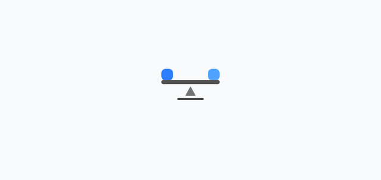</a> | <code>UID-0036</code> | <code>DSP-003</code> | Accordion Blind Pull | <a href="https://devlibraries.com/libraries/amicro" target="_blank" rel="noopener noreferrer">DEVLIBRARIES_AMICRO</a> | EXPANDABLE_PANEL_TRANSITION | anna-s-diary, app-factory-dashboard, battery-guard, beerclass-ai, camperboss, cashmate-ai, cooking-anime, easy-debloat, notes-ecosistema, omni-cleaner, trailpath, wonderlog, world-days | <a href="../../BIBLIOTECA_COMPONENTI/sorgenti/amicro/dsp-003.tsx" target="_blank" rel="noopener noreferrer">Apri TypeScript/React</a> | Da convertire |
| <a href="../../docs/assets/componenti/DSP-005.png">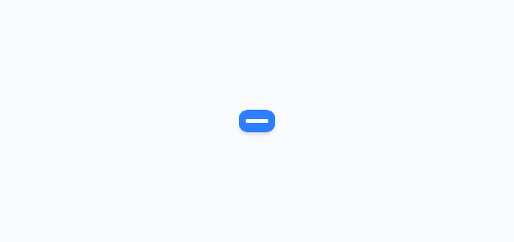</a> | <code>UID-0038</code> | <code>DSP-005</code> | Shutter Step Slices | <a href="https://devlibraries.com/libraries/amicro" target="_blank" rel="noopener noreferrer">DEVLIBRARIES_AMICRO</a> | STAGGERED_REVEAL | anna-s-diary, app-factory-dashboard, camperboss, cooking-anime, deskland-android, framelab, notes-ecosistema, omni-cleaner, wonderlog, world-days | <a href="../../BIBLIOTECA_COMPONENTI/sorgenti/amicro/dsp-005.tsx" target="_blank" rel="noopener noreferrer">Apri TypeScript/React</a> | Da convertire |
| <small>Non disponibile</small> | <code>UID-0039</code> | <code>DSP-006</code> | Loading &amp; Waiting Visual References (user screenshot) | USER_IMAGE | LOADING_WAIT_STATE_REFERENCE | anna-s-diary, app-factory-dashboard, battery-guard, camperboss, cashmate-ai, cooking-anime, deskland-android, easy-debloat, focussense, framelab, notes-ecosistema, omni-cleaner, send-to-pc, trailpath, web-utility-factory, wonderlog, world-days | Non disponibile | Sorgente non archiviata |
| <a href="../../docs/assets/componenti/FCL-001.png">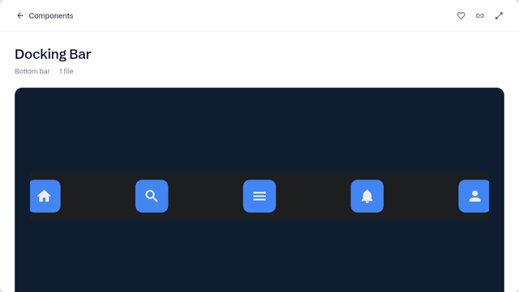</a> | <code>UID-0040</code> | <code>FCL-001</code> | Docking Bar | <a href="https://fluttercomponentlibrary.com/pages/components/docking-bar.html" target="_blank" rel="noopener noreferrer">FLUTTER_COMPONENT_LIBRARY</a> | navigation | annas-diary, framelab | <a href="https://fluttercomponentlibrary.com/pages/components/docking-bar.html" target="_blank" rel="noopener noreferrer">Solo riferimento</a> | Sorgente non archiviata |
| <small>Non disponibile</small> · <a href="https://fluttercomponentlibrary.com/pages/components/bottom-sheet.html" target="_blank" rel="noopener noreferrer">Fonte</a> | <code>UID-0044</code> | <code>FCL-005</code> | Bottom Sheet | <a href="https://fluttercomponentlibrary.com/pages/components/bottom-sheet.html" target="_blank" rel="noopener noreferrer">FLUTTER_COMPONENT_LIBRARY</a> | dialogs | annas-diary, battery-guard, camperboss, framelab, notes-ecosistema | <a href="https://fluttercomponentlibrary.com/pages/components/bottom-sheet.html" target="_blank" rel="noopener noreferrer">Solo riferimento</a> | Sorgente non archiviata |
| <small>Non disponibile</small> · <a href="https://fluttercomponentlibrary.com/pages/components/book-shelf.html" target="_blank" rel="noopener noreferrer">Fonte</a> | <code>UID-0045</code> | <code>FCL-006</code> | Book Shelf | <a href="https://fluttercomponentlibrary.com/pages/components/book-shelf.html" target="_blank" rel="noopener noreferrer">FLUTTER_COMPONENT_LIBRARY</a> | animation | annas-diary | <a href="https://fluttercomponentlibrary.com/pages/components/book-shelf.html" target="_blank" rel="noopener noreferrer">Solo riferimento</a> | Sorgente non archiviata |
| <a href="../../docs/assets/componenti/ICO-001.png">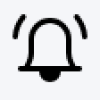</a> | <code>UID-0055</code> | <code>ICO-001</code> | Icona notifica / promemoria | <a href="https://gentleface.com/icons/bell-ring" target="_blank" rel="noopener noreferrer">GENTLEFACE</a> | ICON | anna-s-diary, battery-guard, sleepmax-coach, the-luminous-infinite-circle, world-days | <a href="../../BIBLIOTECA_COMPONENTI/sorgenti/gentleface/ICO-001.svg" target="_blank" rel="noopener noreferrer">Apri SVG (original, archived)</a> | <a href="../../BIBLIOTECA_COMPONENTI/flutter_adapters/lib/src/gentleface/ico_001.dart" target="_blank" rel="noopener noreferrer">Apri codice Flutter (bozza)</a> |
|  | <code>UID-0056</code> | <code>ICO-002</code> | Vista calendario | <a href="https://gentleface.com/icons/calendar" target="_blank" rel="noopener noreferrer">GENTLEFACE</a> | ICON | anna-s-diary, camperboss, sleepmax-coach, wonderlog, world-days | <a href="../../BIBLIOTECA_COMPONENTI/sorgenti/gentleface/ICO-002.svg" target="_blank" rel="noopener noreferrer">Apri SVG (original, archived)</a> | <a href="../../BIBLIOTECA_COMPONENTI/flutter_adapters/lib/src/gentleface/ico_002.dart" target="_blank" rel="noopener noreferrer">Apri codice Flutter (bozza)</a> |
|  | <code>UID-0061</code> | <code>ICO-007</code> | Importa | <a href="https://gentleface.com/icons/import" target="_blank" rel="noopener noreferrer">GENTLEFACE</a> | ICON | anna-s-diary, camperboss, notes-ecosistema, wonderlog | <a href="../../BIBLIOTECA_COMPONENTI/sorgenti/gentleface/ICO-007.svg" target="_blank" rel="noopener noreferrer">Apri SVG (original, archived)</a> | <a href="../../BIBLIOTECA_COMPONENTI/flutter_adapters/lib/src/gentleface/ico_007.dart" target="_blank" rel="noopener noreferrer">Apri codice Flutter (bozza)</a> |
|  | <code>UID-0062</code> | <code>ICO-008</code> | Galleria immagini | <a href="https://gentleface.com/icons/images" target="_blank" rel="noopener noreferrer">GENTLEFACE</a> | ICON | anna-s-diary, framelab, notes-ecosistema, omni-cleaner, wonderlog | <a href="../../BIBLIOTECA_COMPONENTI/sorgenti/gentleface/ICO-008.svg" target="_blank" rel="noopener noreferrer">Apri SVG (original, archived)</a> | <a href="../../BIBLIOTECA_COMPONENTI/flutter_adapters/lib/src/gentleface/ico_008.dart" target="_blank" rel="noopener noreferrer">Apri codice Flutter (bozza)</a> |
|  | <code>UID-0064</code> | <code>ICO-010</code> | Salva nei preferiti | <a href="https://gentleface.com/icons/bookmark" target="_blank" rel="noopener noreferrer">GENTLEFACE</a> | ICON | anna-s-diary, notes-ecosistema, wonderlog, world-days | <a href="../../BIBLIOTECA_COMPONENTI/sorgenti/gentleface/ICO-010.svg" target="_blank" rel="noopener noreferrer">Apri SVG (original, archived)</a> | <a href="../../BIBLIOTECA_COMPONENTI/flutter_adapters/lib/src/gentleface/ico_010.dart" target="_blank" rel="noopener noreferrer">Apri codice Flutter (bozza)</a> |
|  | <code>UID-0068</code> | <code>ICO-014</code> | Completato | <a href="https://gentleface.com/icons/check" target="_blank" rel="noopener noreferrer">GENTLEFACE</a> | ICON | anna-s-diary, app-factory-dashboard, notes-ecosistema, omni-cleaner, world-days | <a href="../../BIBLIOTECA_COMPONENTI/sorgenti/gentleface/ICO-014.svg" target="_blank" rel="noopener noreferrer">Apri SVG (original, archived)</a> | <a href="../../BIBLIOTECA_COMPONENTI/flutter_adapters/lib/src/gentleface/ico_014.dart" target="_blank" rel="noopener noreferrer">Apri codice Flutter (bozza)</a> |
|  | <code>UID-0071</code> | <code>ICO-017</code> | Stato cloud/sync | <a href="https://gentleface.com/icons/cloud" target="_blank" rel="noopener noreferrer">GENTLEFACE</a> | ICON | anna-s-diary, cashmate-ai, notes-ecosistema, world-days | <a href="../../BIBLIOTECA_COMPONENTI/sorgenti/gentleface/ICO-017.svg" target="_blank" rel="noopener noreferrer">Apri SVG (original, archived)</a> | <a href="../../BIBLIOTECA_COMPONENTI/flutter_adapters/lib/src/gentleface/ico_017.dart" target="_blank" rel="noopener noreferrer">Apri codice Flutter (bozza)</a> |
|  | <code>UID-0077</code> | <code>ICO-023</code> | Visibilità / anteprima | <a href="https://gentleface.com/icons/eye" target="_blank" rel="noopener noreferrer">GENTLEFACE</a> | ICON | anna-s-diary, easy-debloat, notes-ecosistema, omni-cleaner | <a href="../../BIBLIOTECA_COMPONENTI/sorgenti/gentleface/ICO-023.svg" target="_blank" rel="noopener noreferrer">Apri SVG (original, archived)</a> | <a href="../../BIBLIOTECA_COMPONENTI/flutter_adapters/lib/src/gentleface/ico_023.dart" target="_blank" rel="noopener noreferrer">Apri codice Flutter (bozza)</a> |
|  | <code>UID-0078</code> | <code>ICO-024</code> | Archiviazione | <a href="https://gentleface.com/icons/archive" target="_blank" rel="noopener noreferrer">GENTLEFACE</a> | ICON | anna-s-diary, notes-ecosistema, world-days | <a href="../../BIBLIOTECA_COMPONENTI/sorgenti/gentleface/ICO-024.svg" target="_blank" rel="noopener noreferrer">Apri SVG (original, archived)</a> | <a href="../../BIBLIOTECA_COMPONENTI/flutter_adapters/lib/src/gentleface/ico_024.dart" target="_blank" rel="noopener noreferrer">Apri codice Flutter (bozza)</a> |
|  | <code>UID-0079</code> | <code>ICO-025</code> | Messaggi / conversazioni | <a href="https://gentleface.com/icons/messages" target="_blank" rel="noopener noreferrer">GENTLEFACE</a> | ICON | anna-s-diary, notes-ecosistema, send-to-pc, wonderlog | <a href="../../BIBLIOTECA_COMPONENTI/sorgenti/gentleface/ICO-025.svg" target="_blank" rel="noopener noreferrer">Apri SVG (original, archived)</a> | <a href="../../BIBLIOTECA_COMPONENTI/flutter_adapters/lib/src/gentleface/ico_025.dart" target="_blank" rel="noopener noreferrer">Apri codice Flutter (bozza)</a> |
|  | <code>UID-0080</code> | <code>ICO-026</code> | Pagina iniziale | <a href="https://gentleface.com/icons/home" target="_blank" rel="noopener noreferrer">GENTLEFACE</a> | ICON | anna-s-diary, deskland-android, wonderlog, world-days | <a href="../../BIBLIOTECA_COMPONENTI/sorgenti/gentleface/ICO-026.svg" target="_blank" rel="noopener noreferrer">Apri SVG (original, archived)</a> | <a href="../../BIBLIOTECA_COMPONENTI/flutter_adapters/lib/src/gentleface/ico_026.dart" target="_blank" rel="noopener noreferrer">Apri codice Flutter (bozza)</a> |
|  | <code>UID-0082</code> | <code>ICO-028</code> | Blocco / riservatezza | <a href="https://gentleface.com/icons/lock" target="_blank" rel="noopener noreferrer">GENTLEFACE</a> | ICON | anna-s-diary, notes-ecosistema, pocket-guard, tabletop-motion-alarm | <a href="../../BIBLIOTECA_COMPONENTI/sorgenti/gentleface/ICO-028.svg" target="_blank" rel="noopener noreferrer">Apri SVG (original, archived)</a> | <a href="../../BIBLIOTECA_COMPONENTI/flutter_adapters/lib/src/gentleface/ico_028.dart" target="_blank" rel="noopener noreferrer">Apri codice Flutter (bozza)</a> |
|  | <code>UID-0361</code> | <code>UIV-002</code> | Pulsante pill con riempimento gradiente on-hover | <a href="https://uiverse.io/xueyuantan/rotten-pig-19" target="_blank" rel="noopener noreferrer">UIVERSE</a> | BUTTON | annas-diary, beerclass-ai, camperboss, cooking-anime, web-utility-factory, wonderlog, world-days | <a href="../../UI-UX/UIVERSE/CODICE_SORGENTE/UIV-002_original.html" target="_blank" rel="noopener noreferrer">Apri HTML/CSS</a> | <a href="../../BIBLIOTECA_COMPONENTI/flutter_adapters/lib/src/uiv_002_gradient_pill_button.dart" target="_blank" rel="noopener noreferrer">Apri codice Flutter (bozza)</a> |
| <a href="../../docs/assets/componenti/UIV-004.png">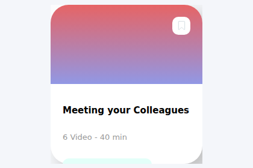</a> | <code>UID-0363</code> | <code>UIV-004</code> | Card editoriale con header gradiente, segnalibro e icona aereo SVG | <a href="https://uiverse.io/JohnnyCSilva/jolly-elephant-67" target="_blank" rel="noopener noreferrer">UIVERSE</a> | CARD | annas-diary, camperboss, framelab, notes-ecosistema, web-utility-factory, wonderlog, world-days | <a href="../../UI-UX/UIVERSE/CODICE_SORGENTE/UIV-004_original.html" target="_blank" rel="noopener noreferrer">Apri HTML/CSS</a> | Da convertire |
| <a href="../../docs/assets/componenti/UIV-005.png">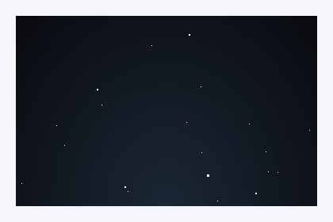</a> | <code>UID-0364</code> | <code>UIV-005</code> | Card proposta dall&#x27;utente come sfondo decorativo per varie app; effetto esatto non verificato | <a href="https://uiverse.io/amir_6539/red-duck-82" target="_blank" rel="noopener noreferrer">UIVERSE</a> | CARD_BACKGROUND | annas-diary, app-factory-dashboard, battery-guard, cashmate-ai, deskland-android, focussense, notes-ecosistema, omni-cleaner | <a href="../../UI-UX/UIVERSE/CODICE_SORGENTE/UIV-005_original.html" target="_blank" rel="noopener noreferrer">Apri HTML/CSS</a> | Da convertire |
|  | <code>UID-0365</code> | <code>UIV-006</code> | Switch interattivo Uiverse, sorgente HTML/CSS non individuato | <a href="https://uiverse.io/JustCode14/red-dingo-61" target="_blank" rel="noopener noreferrer">UIVERSE</a> | SWITCH | 180flipcharge, annas-diary, battery-guard, easy-debloat, focussense, omni-cleaner, phone-guard, pocket-guard | <a href="../../UI-UX/UIVERSE/CODICE_SORGENTE/UIV-006_original.html" target="_blank" rel="noopener noreferrer">Apri HTML/CSS</a> | Da convertire |
|  | <code>UID-0366</code> | <code>UIV-007</code> | Loader per processi reali, testo UX proposto: Stiamo facendo la magia; animazione specifica non verificata | <a href="https://uiverse.io/arthur_6104/orange-walrus-50" target="_blank" rel="noopener noreferrer">UIVERSE</a> | LOADER | annas-diary, app-factory-dashboard, cashmate-ai, framelab, notes-ecosistema, omni-cleaner, web-utility-factory, world-days | <a href="../../UI-UX/UIVERSE/CODICE_SORGENTE/UIV-007_original.html" target="_blank" rel="noopener noreferrer">Apri HTML/CSS</a> | Da convertire |
|  | <code>UID-0368</code> | <code>UIV-009</code> | Book card in CSS 3D con copertina che si apre su hover: preferenza utente per Ricordi Anna&#x27;s Diary | <a href="https://uiverse.io/eslam-hany/selfish-bobcat-73" target="_blank" rel="noopener noreferrer">UIVERSE</a> | BOOK_CARD | annas-diary, cooking-anime, framelab, notes-ecosistema, wonderlog, world-days | <a href="../../UI-UX/UIVERSE/CODICE_SORGENTE/UIV-009_original.html" target="_blank" rel="noopener noreferrer">Apri HTML/CSS</a> | <a href="../../BIBLIOTECA_COMPONENTI/flutter_adapters/lib/src/uiv_009_book_card.dart" target="_blank" rel="noopener noreferrer">Apri codice Flutter (bozza)</a> |
|  | <code>UID-0369</code> | <code>UIV-010</code> | Scheda pubblica Uiverse classificata come CARD; il codice HTML/CSS non è presente nell&#x27;archivio Galaxy e non è stato acquisito. | <a href="https://uiverse.io/00Kubi/fluffy-jellyfish-87" target="_blank" rel="noopener noreferrer">UIVERSE</a> | CARD | annas-diary, beerclass-ai, cooking-anime, framelab, notes-ecosistema, wonderlog, world-days | <a href="../../UI-UX/UIVERSE/CODICE_SORGENTE/UIV-010_original.html" target="_blank" rel="noopener noreferrer">Apri HTML/CSS</a> | Da convertire |
|  | <code>UID-0373</code> | <code>UIV-014</code> | Componente Uiverse nella categoria CARD; HTML/CSS originale archiviato con blob SHA. L&#x27;effetto specifico richiede ispezione del sorgente e collaudo visivo. | <a href="https://uiverse.io/ElSombrero2/tricky-robin-67" target="_blank" rel="noopener noreferrer">UIVERSE</a> | CARD | annas-diary, beerclass-ai, cooking-anime, framelab, notes-ecosistema, wonderlog, world-days | <a href="../../UI-UX/UIVERSE/CODICE_SORGENTE/UIV-014_original.html" target="_blank" rel="noopener noreferrer">Apri HTML/CSS</a> | Da convertire |
|  | <code>UID-0374</code> | <code>UIV-015</code> | Scheda pubblica Uiverse classificata come BUTTON; il codice HTML/CSS non è presente nell&#x27;archivio Galaxy e non è stato acquisito. | <a href="https://uiverse.io/FColombati/spotty-snake-82" target="_blank" rel="noopener noreferrer">UIVERSE</a> | BUTTON | annas-diary, beerclass-ai, camperboss, cooking-anime, easy-debloat, framelab | <a href="../../UI-UX/UIVERSE/CODICE_SORGENTE/UIV-015_original.html" target="_blank" rel="noopener noreferrer">Apri HTML/CSS</a> | Da convertire |
|  | <code>UID-0376</code> | <code>UIV-017</code> | Scheda pubblica Uiverse classificata come CARD; il codice HTML/CSS non è presente nell&#x27;archivio Galaxy e non è stato acquisito. | <a href="https://uiverse.io/Gidarx/moody-falcon-73" target="_blank" rel="noopener noreferrer">UIVERSE</a> | CARD | annas-diary, camperboss, deskland-android, edu-01-corpo-umano, notes-ecosistema, wonderlog, world-days | <a href="../../UI-UX/UIVERSE/CODICE_SORGENTE/UIV-017_original.html" target="_blank" rel="noopener noreferrer">Apri HTML/CSS</a> | Da convertire |
|  | <code>UID-0380</code> | <code>UIV-021</code> | Componente Uiverse nella categoria CARD; HTML/CSS originale archiviato con blob SHA. L&#x27;effetto specifico richiede ispezione del sorgente e collaudo visivo. | <a href="https://uiverse.io/JohnnyCSilva/black-rabbit-68" target="_blank" rel="noopener noreferrer">UIVERSE</a> | CARD | annas-diary, camperboss, deskland-android, edu-01-corpo-umano, notes-ecosistema, wonderlog, world-days | <a href="../../UI-UX/UIVERSE/CODICE_SORGENTE/UIV-021_original.html" target="_blank" rel="noopener noreferrer">Apri HTML/CSS</a> | Da convertire |
|  | <code>UID-0382</code> | <code>UIV-023</code> | Componente Uiverse nella categoria RADIO; HTML/CSS originale archiviato con blob SHA. L&#x27;effetto specifico richiede ispezione del sorgente e collaudo visivo. | <a href="https://uiverse.io/LilaRest/soft-baboon-75" target="_blank" rel="noopener noreferrer">UIVERSE</a> | RADIO | annas-diary, battery-guard, cashmate-ai, notes-ecosistema, wonderlog, world-days | <a href="../../UI-UX/UIVERSE/CODICE_SORGENTE/UIV-023_original.html" target="_blank" rel="noopener noreferrer">Apri HTML/CSS</a> | Da convertire |
|  | <code>UID-0383</code> | <code>UIV-024</code> | Componente Uiverse nella categoria CARD; HTML/CSS originale archiviato con blob SHA. L&#x27;effetto specifico richiede ispezione del sorgente e collaudo visivo. | <a href="https://uiverse.io/MuhammadHasann/fast-badger-70" target="_blank" rel="noopener noreferrer">UIVERSE</a> | CARD | annas-diary, beerclass-ai, cooking-anime, framelab, notes-ecosistema, wonderlog, world-days | <a href="../../UI-UX/UIVERSE/CODICE_SORGENTE/UIV-024_original.html" target="_blank" rel="noopener noreferrer">Apri HTML/CSS</a> | Da convertire |
|  | <code>UID-0386</code> | <code>UIV-027</code> | Componente Uiverse nella categoria SWITCH; HTML/CSS originale archiviato con blob SHA. L&#x27;effetto specifico richiede ispezione del sorgente e collaudo visivo. | <a href="https://uiverse.io/Nawsome/empty-snail-69" target="_blank" rel="noopener noreferrer">UIVERSE</a> | SWITCH | 180flipcharge, annas-diary, battery-guard, focussense, notes-ecosistema, omni-cleaner, pocket-guard | <a href="../../UI-UX/UIVERSE/CODICE_SORGENTE/UIV-027_original.html" target="_blank" rel="noopener noreferrer">Apri HTML/CSS</a> | Da convertire |
|  | <code>UID-0392</code> | <code>UIV-033</code> | Componente Uiverse nella categoria BUTTON; HTML/CSS originale archiviato con blob SHA. L&#x27;effetto specifico richiede ispezione del sorgente e collaudo visivo. | <a href="https://uiverse.io/Praashoo7/smooth-crab-52" target="_blank" rel="noopener noreferrer">UIVERSE</a> | BUTTON | annas-diary, app-factory-dashboard, notes-ecosistema, web-utility-factory, wonderlog, world-days | <a href="../../UI-UX/UIVERSE/CODICE_SORGENTE/UIV-033_original.html" target="_blank" rel="noopener noreferrer">Apri HTML/CSS</a> | Da convertire |
|  | <code>UID-0394</code> | <code>UIV-035</code> | Componente Uiverse nella categoria RADIO; HTML/CSS originale archiviato con blob SHA. L&#x27;effetto specifico richiede ispezione del sorgente e collaudo visivo. | <a href="https://uiverse.io/Pradeepsaranbishnoi/hungry-bat-66" target="_blank" rel="noopener noreferrer">UIVERSE</a> | RADIO | annas-diary, battery-guard, cashmate-ai, notes-ecosistema, trailpath, world-days | <a href="../../UI-UX/UIVERSE/CODICE_SORGENTE/UIV-035_original.html" target="_blank" rel="noopener noreferrer">Apri HTML/CSS</a> | Da convertire |
|  | <code>UID-0397</code> | <code>UIV-038</code> | Scheda pubblica Uiverse classificata come BUTTON; il codice HTML/CSS non è presente nell&#x27;archivio Galaxy e non è stato acquisito. | <a href="https://uiverse.io/Priyanshu02020/popular-puma-87" target="_blank" rel="noopener noreferrer">UIVERSE</a> | BUTTON | annas-diary, beerclass-ai, cooking-anime, framelab, wonderlog, world-days | <a href="../../UI-UX/UIVERSE/CODICE_SORGENTE/UIV-038_original.html" target="_blank" rel="noopener noreferrer">Apri HTML/CSS</a> | Da convertire |
|  | <code>UID-0406</code> | <code>UIV-047</code> | Componente Uiverse nella categoria BUTTON; HTML/CSS originale archiviato con blob SHA. L&#x27;effetto specifico richiede ispezione del sorgente e collaudo visivo. | <a href="https://uiverse.io/Yaya12085/plastic-quail-42" target="_blank" rel="noopener noreferrer">UIVERSE</a> | BUTTON | annas-diary, app-factory-dashboard, camperboss, easy-debloat, notes-ecosistema, web-utility-factory | <a href="../../UI-UX/UIVERSE/CODICE_SORGENTE/UIV-047_original.html" target="_blank" rel="noopener noreferrer">Apri HTML/CSS</a> | Da convertire |
|  | <code>UID-0407</code> | <code>UIV-048</code> | Componente Uiverse nella categoria CARD; HTML/CSS originale archiviato con blob SHA. L&#x27;effetto specifico richiede ispezione del sorgente e collaudo visivo. | <a href="https://uiverse.io/akshat-patel28/quick-baboon-29" target="_blank" rel="noopener noreferrer">UIVERSE</a> | CARD | annas-diary, beerclass-ai, cooking-anime, framelab, notes-ecosistema, wonderlog, world-days | <a href="../../UI-UX/UIVERSE/CODICE_SORGENTE/UIV-048_original.html" target="_blank" rel="noopener noreferrer">Apri HTML/CSS</a> | Da convertire |
|  | <code>UID-0408</code> | <code>UIV-049</code> | Componente Uiverse nella categoria SWITCH; HTML/CSS originale archiviato con blob SHA. L&#x27;effetto specifico richiede ispezione del sorgente e collaudo visivo. | <a href="https://uiverse.io/andrew-demchenk0/honest-stingray-90" target="_blank" rel="noopener noreferrer">UIVERSE</a> | SWITCH | 180flipcharge, annas-diary, battery-guard, easy-debloat, notes-ecosistema, phone-guard, pocket-guard | <a href="../../UI-UX/UIVERSE/CODICE_SORGENTE/UIV-049_original.html" target="_blank" rel="noopener noreferrer">Apri HTML/CSS</a> | Da convertire |
|  | <code>UID-0415</code> | <code>UIV-056</code> | Scheda pubblica Uiverse classificata come CARD; il codice HTML/CSS non è presente nell&#x27;archivio Galaxy e non è stato acquisito. | <a href="https://uiverse.io/chase2k25/warm-chicken-23" target="_blank" rel="noopener noreferrer">UIVERSE</a> | CARD | annas-diary, camperboss, deskland-android, edu-01-corpo-umano, notes-ecosistema, wonderlog, world-days | <a href="../../UI-UX/UIVERSE/CODICE_SORGENTE/UIV-056_original.html" target="_blank" rel="noopener noreferrer">Apri HTML/CSS</a> | Da convertire |
|  | <code>UID-0419</code> | <code>UIV-060</code> | Scheda pubblica Uiverse classificata come BUTTON; il codice HTML/CSS non è presente nell&#x27;archivio Galaxy e non è stato acquisito. | <a href="https://uiverse.io/dexter-st/breezy-zebra-94" target="_blank" rel="noopener noreferrer">UIVERSE</a> | BUTTON | annas-diary, cooking-anime, framelab, notes-ecosistema, wonderlog, world-days | <a href="../../UI-UX/UIVERSE/CODICE_SORGENTE/UIV-060_original.html" target="_blank" rel="noopener noreferrer">Apri HTML/CSS</a> | Da convertire |
| <a href="../../docs/assets/componenti/UIV-067.png">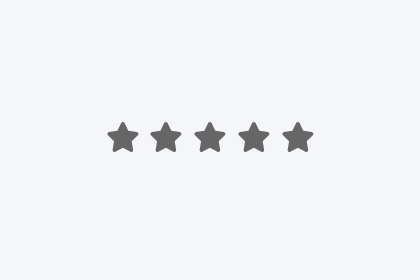</a> | <code>UID-0426</code> | <code>UIV-067</code> | Scheda pubblica Uiverse classificata come RADIO; il codice HTML/CSS non è presente nell&#x27;archivio Galaxy e non è stato acquisito. | <a href="https://uiverse.io/elijahgummer/young-horse-7" target="_blank" rel="noopener noreferrer">UIVERSE</a> | RADIO | annas-diary, beerclass-ai, cashmate-ai, notes-ecosistema, sleepmax-coach, web-utility-factory | <a href="../../UI-UX/UIVERSE/CODICE_SORGENTE/UIV-067_original.html" target="_blank" rel="noopener noreferrer">Apri HTML/CSS</a> | Da convertire |
|  | <code>UID-0428</code> | <code>UIV-069</code> | Scheda pubblica Uiverse classificata come BUTTON; il codice HTML/CSS non è presente nell&#x27;archivio Galaxy e non è stato acquisito. | <a href="https://uiverse.io/fthisilak/bitter-termite-36" target="_blank" rel="noopener noreferrer">UIVERSE</a> | BUTTON | annas-diary, app-factory-dashboard, easy-debloat, notes-ecosistema, web-utility-factory, wonderlog | <a href="../../UI-UX/UIVERSE/CODICE_SORGENTE/UIV-069_original.html" target="_blank" rel="noopener noreferrer">Apri HTML/CSS</a> | Da convertire |
|  | <code>UID-0434</code> | <code>UIV-075</code> | Componente Uiverse nella categoria CARD; HTML/CSS originale archiviato con blob SHA. L&#x27;effetto specifico richiede ispezione del sorgente e collaudo visivo. | <a href="https://uiverse.io/joe-watson-sbf/honest-bullfrog-6" target="_blank" rel="noopener noreferrer">UIVERSE</a> | CARD | annas-diary, camperboss, deskland-android, edu-01-corpo-umano, notes-ecosistema, wonderlog, world-days | <a href="../../UI-UX/UIVERSE/CODICE_SORGENTE/UIV-075_original.html" target="_blank" rel="noopener noreferrer">Apri HTML/CSS</a> | Da convertire |
|  | <code>UID-0439</code> | <code>UIV-080</code> | Componente Uiverse nella categoria CARD; HTML/CSS originale archiviato con blob SHA. L&#x27;effetto specifico richiede ispezione del sorgente e collaudo visivo. | <a href="https://uiverse.io/kennyotsu/short-ape-5" target="_blank" rel="noopener noreferrer">UIVERSE</a> | CARD | annas-diary, beerclass-ai, cooking-anime, framelab, notes-ecosistema, wonderlog, world-days | <a href="../../UI-UX/UIVERSE/CODICE_SORGENTE/UIV-080_original.html" target="_blank" rel="noopener noreferrer">Apri HTML/CSS</a> | Da convertire |
|  | <code>UID-0446</code> | <code>UIV-087</code> | Componente Uiverse nella categoria BUTTON; HTML/CSS originale archiviato con blob SHA. L&#x27;effetto specifico richiede ispezione del sorgente e collaudo visivo. | <a href="https://uiverse.io/marcelodolza/fat-zebra-11" target="_blank" rel="noopener noreferrer">UIVERSE</a> | BUTTON | annas-diary, app-factory-dashboard, camperboss, easy-debloat, notes-ecosistema, web-utility-factory | <a href="../../UI-UX/UIVERSE/CODICE_SORGENTE/UIV-087_original.html" target="_blank" rel="noopener noreferrer">Apri HTML/CSS</a> | Da convertire |
|  | <code>UID-0447</code> | <code>UIV-088</code> | Componente Uiverse nella categoria SWITCH; HTML/CSS originale archiviato con blob SHA. L&#x27;effetto specifico richiede ispezione del sorgente e collaudo visivo. | <a href="https://uiverse.io/mobinkakei/great-skunk-8" target="_blank" rel="noopener noreferrer">UIVERSE</a> | SWITCH | 180flipcharge, annas-diary, battery-guard, focussense, notes-ecosistema, omni-cleaner, pocket-guard | <a href="../../UI-UX/UIVERSE/CODICE_SORGENTE/UIV-088_original.html" target="_blank" rel="noopener noreferrer">Apri HTML/CSS</a> | Da convertire |
|  | <code>UID-0450</code> | <code>UIV-091</code> | Scheda pubblica Uiverse classificata come CARD; il codice HTML/CSS non è presente nell&#x27;archivio Galaxy e non è stato acquisito. | <a href="https://uiverse.io/monkey_8812/curly-moth-56" target="_blank" rel="noopener noreferrer">UIVERSE</a> | CARD | annas-diary, camperboss, deskland-android, edu-01-corpo-umano, notes-ecosistema, wonderlog, world-days | <a href="../../UI-UX/UIVERSE/CODICE_SORGENTE/UIV-091_original.html" target="_blank" rel="noopener noreferrer">Apri HTML/CSS</a> | Da convertire |
|  | <code>UID-0451</code> | <code>UIV-092</code> | Scheda pubblica Uiverse classificata come CARD; il codice HTML/CSS non è presente nell&#x27;archivio Galaxy e non è stato acquisito. | <a href="https://uiverse.io/mymiamo/quiet-dragon-5" target="_blank" rel="noopener noreferrer">UIVERSE</a> | CARD | annas-diary, beerclass-ai, cooking-anime, framelab, notes-ecosistema, wonderlog, world-days | <a href="../../UI-UX/UIVERSE/CODICE_SORGENTE/UIV-092_original.html" target="_blank" rel="noopener noreferrer">Apri HTML/CSS</a> | Da convertire |
|  | <code>UID-0454</code> | <code>UIV-095</code> | Scheda pubblica Uiverse classificata come CARD; il codice HTML/CSS non è presente nell&#x27;archivio Galaxy e non è stato acquisito. | <a href="https://uiverse.io/seoulchik/funny-seahorse-89" target="_blank" rel="noopener noreferrer">UIVERSE</a> | CARD | annas-diary, camperboss, deskland-android, edu-01-corpo-umano, notes-ecosistema, wonderlog, world-days | <a href="../../UI-UX/UIVERSE/CODICE_SORGENTE/UIV-095_original.html" target="_blank" rel="noopener noreferrer">Apri HTML/CSS</a> | Da convertire |
|  | <code>UID-0457</code> | <code>UIV-098</code> | Scheda pubblica Uiverse classificata come PATTERN; il codice HTML/CSS non è presente nell&#x27;archivio Galaxy e non è stato acquisito. | <a href="https://uiverse.io/whoisyourdeadie/foolish-rabbit-13" target="_blank" rel="noopener noreferrer">UIVERSE</a> | PATTERN | annas-diary, battery-guard, cashmate-ai, deskland-android, notes-ecosistema, world-days | <a href="../../UI-UX/UIVERSE/CODICE_SORGENTE/UIV-098_original.html" target="_blank" rel="noopener noreferrer">Apri HTML/CSS</a> | Da convertire |
|  | <code>UID-0460</code> | <code>UIV-101</code> | Blue modern login form; use only where an input or optional account flow already exists. Categoria FORM verificata nel post pubblico Uiverse. Tag originali: blue, form, login form, tailwind, rounded, input, button, blue, border, modern. | <a href="https://uiverse.io/Javierrocadev/chatty-ladybug-95" target="_blank" rel="noopener noreferrer">UIVERSE</a> | FORM | annas-diary, app-factory-dashboard, beerclass-ai, cashmate-ai, notes-ecosistema, wonderlog, world-days | <a href="../../UI-UX/UIVERSE/CODICE_SORGENTE/UIV-101_original.html" target="_blank" rel="noopener noreferrer">Apri HTML/CSS</a> | Da convertire |
|  | <code>UID-0461</code> | <code>UIV-102</code> | Warm stitched beige/orange login form; adapt to product typography and contrast. Categoria FORM verificata nel post pubblico Uiverse. Tag originali: login, form, stitched, rounded, shadow, beige, orange, password, form, submit. | <a href="https://uiverse.io/Praashoo7/bitter-pig-24" target="_blank" rel="noopener noreferrer">UIVERSE</a> | FORM | annas-diary, app-factory-dashboard, camperboss, cooking-anime, notes-ecosistema, sleepmax-coach, wonderlog | <a href="../../UI-UX/UIVERSE/CODICE_SORGENTE/UIV-102_original.html" target="_blank" rel="noopener noreferrer">Apri HTML/CSS</a> | Da convertire |
|  | <code>UID-0463</code> | <code>UIV-104</code> | Minimal purple login form; adapt palette and semantics rather than add authentication. Categoria FORM verificata nel post pubblico Uiverse. Tag originali: login, form, input, button, password, white, form, signin, username, purple. | <a href="https://uiverse.io/alexmaracinaru/tall-owl-30" target="_blank" rel="noopener noreferrer">UIVERSE</a> | FORM | annas-diary, app-factory-dashboard, cashmate-ai, cooking-anime, notes-ecosistema, wonderlog, world-days | <a href="../../UI-UX/UIVERSE/CODICE_SORGENTE/UIV-104_original.html" target="_blank" rel="noopener noreferrer">Apri HTML/CSS</a> | Da convertire |
| <a href="../../docs/assets/componenti/UIV-105.png">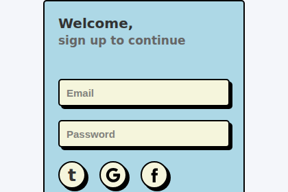</a> | <code>UID-0464</code> | <code>UIV-105</code> | Welcome/social login form; explicit consent and existing optional provider only. Categoria FORM verificata nel post pubblico Uiverse. Tag originali: login, email, social, form, submit, confirm, password, welcome, rounded, shadow. | <a href="https://uiverse.io/ayyjayy2/sour-dog-94" target="_blank" rel="noopener noreferrer">UIVERSE</a> | FORM | annas-diary, app-factory-dashboard, beerclass-ai, cashmate-ai, cooking-anime, framelab, notes-ecosistema, wonderlog | <a href="../../UI-UX/UIVERSE/CODICE_SORGENTE/UIV-105_original.html" target="_blank" rel="noopener noreferrer">Apri HTML/CSS</a> | Da convertire |
|  | <code>UID-0467</code> | <code>UIV-109</code> | Pink retro/pastel stars form; adapt to approved rose palette and reduced-motion. Categoria FORM verificata nel post pubblico Uiverse. Tag originali: form, button, bold, pink, password, email, retro, toggle, switch, login. | <a href="https://uiverse.io/mamyapro123/curvy-bear-51" target="_blank" rel="noopener noreferrer">UIVERSE</a> | FORM | annas-diary, beerclass-ai, camperboss, cooking-anime, notes-ecosistema, sleepmax-coach, wonderlog, world-days | <a href="../../UI-UX/UIVERSE/CODICE_SORGENTE/UIV-109_original.html" target="_blank" rel="noopener noreferrer">Apri HTML/CSS</a> | Da convertire |
|  | <code>UID-0469</code> | <code>UIV-111</code> | Minimal purple account form; use existing opt-in or non-auth input surfaces only. Categoria FORM verificata nel post pubblico Uiverse. Tag originali: purple, form, log in, button, modern, forgot, password, form, submit, username. | <a href="https://uiverse.io/vinodjangid07/horrible-warthog-14" target="_blank" rel="noopener noreferrer">UIVERSE</a> | FORM | annas-diary, app-factory-dashboard, camperboss, cashmate-ai, notes-ecosistema, wonderlog, world-days | <a href="../../UI-UX/UIVERSE/CODICE_SORGENTE/UIV-111_original.html" target="_blank" rel="noopener noreferrer">Apri HTML/CSS</a> | Da convertire |
| <a href="../../docs/assets/componenti/WML-001.png">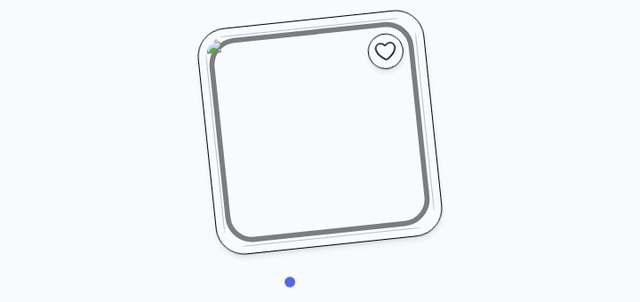</a> | <code>UID-0470</code> | <code>WML-001</code> | Carousel Slider | <a href="https://devlibraries.com/libraries/watermelon/carousel-slider" target="_blank" rel="noopener noreferrer">DEVLIBRARIES_WATERMELON</a> | CAROUSEL_GESTURE | anna-s-diary, beerclass-ai, camperboss, cooking-anime, framelab, notes-ecosistema, omni-cleaner, wonderlog, world-days | <a href="../../BIBLIOTECA_COMPONENTI/sorgenti/watermelon/wml-001.tsx" target="_blank" rel="noopener noreferrer">Apri TypeScript/React</a> | Da convertire |
| <a href="../../docs/assets/componenti/WML-002.png">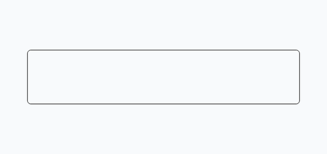</a> | <code>UID-0471</code> | <code>WML-002</code> | Fractional Picker | <a href="https://devlibraries.com/libraries/watermelon/fractional-picker" target="_blank" rel="noopener noreferrer">DEVLIBRARIES_WATERMELON</a> | RULER_PICKER | anna-s-diary, battery-guard, beerclass-ai, camperboss, cooking-anime, focussense, sleepmax-coach, world-days | <a href="../../BIBLIOTECA_COMPONENTI/sorgenti/watermelon/wml-002.tsx" target="_blank" rel="noopener noreferrer">Apri TypeScript/React</a> | Da convertire |
| <a href="../../docs/assets/componenti/WML-003.png">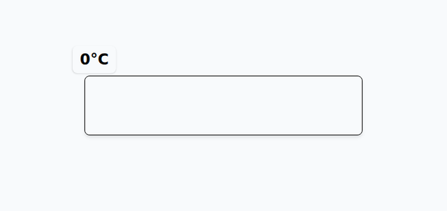</a> | <code>UID-0472</code> | <code>WML-003</code> | Scrub Slider (base) | <a href="https://devlibraries.com/libraries/watermelon/scrub-slider-base" target="_blank" rel="noopener noreferrer">DEVLIBRARIES_WATERMELON</a> | SCRUB_PRECISION | anna-s-diary, beerclass-ai, cooking-anime, focussense, framelab, notes-ecosistema, omni-cleaner, trailpath, wonderlog | <a href="../../BIBLIOTECA_COMPONENTI/sorgenti/watermelon/wml-003.tsx" target="_blank" rel="noopener noreferrer">Apri TypeScript/React</a> | Da convertire |
| <a href="../../docs/assets/componenti/WML-004.png">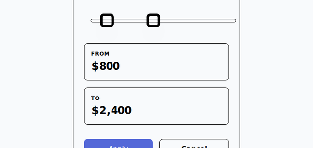</a> | <code>UID-0473</code> | <code>WML-004</code> | Range Selection Slider | <a href="https://devlibraries.com/libraries/watermelon/range-selection-slider" target="_blank" rel="noopener noreferrer">DEVLIBRARIES_WATERMELON</a> | TWO_HANDLE_RANGE | anna-s-diary, battery-guard, camperboss, cashmate-ai, focussense, framelab, notes-ecosistema, omni-cleaner, wonderlog, world-days | <a href="../../BIBLIOTECA_COMPONENTI/sorgenti/watermelon/wml-004.tsx" target="_blank" rel="noopener noreferrer">Apri TypeScript/React</a> | Da convertire |
| <a href="../../docs/assets/componenti/WML-005.png">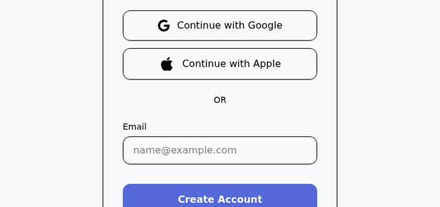</a> | <code>UID-0474</code> | <code>WML-005</code> | Swap Form | <a href="https://devlibraries.com/libraries/watermelon/swap-form" target="_blank" rel="noopener noreferrer">DEVLIBRARIES_WATERMELON</a> | AUTH_FORM_TRANSITION | anna-s-diary, app-factory-dashboard, cashmate-ai, cooking-anime, notes-ecosistema, wonderlog, world-days | <a href="../../BIBLIOTECA_COMPONENTI/sorgenti/watermelon/wml-005.tsx" target="_blank" rel="noopener noreferrer">Apri TypeScript/React</a> | Da convertire |
| <small>Non disponibile</small> · <a href="https://devlibraries.com/libraries/watermelon/text-gradient" target="_blank" rel="noopener noreferrer">Fonte</a> | <code>UID-0475</code> | <code>WML-006</code> | Text Gradient | <a href="https://devlibraries.com/libraries/watermelon/text-gradient" target="_blank" rel="noopener noreferrer">DEVLIBRARIES_WATERMELON</a> | TYPOGRAPHY_DECORATION | anna-s-diary, app-factory-dashboard, cooking-anime, framelab, web-utility-factory, wonderlog, world-days | <a href="https://devlibraries.com/libraries/watermelon/text-gradient" target="_blank" rel="noopener noreferrer">Solo riferimento</a> | Sorgente non archiviata |
| <a href="../../docs/assets/componenti/WML-007.png">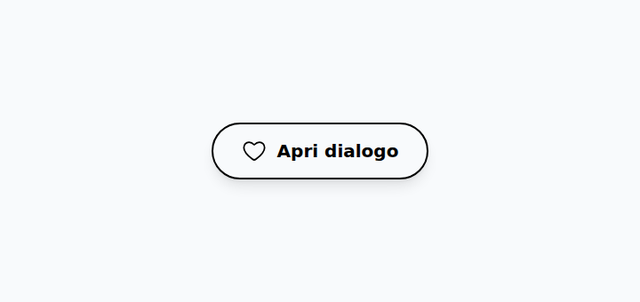</a> | <code>UID-0476</code> | <code>WML-007</code> | Dialog Stack (base) | <a href="https://devlibraries.com/libraries/watermelon/dialog-stack-base" target="_blank" rel="noopener noreferrer">DEVLIBRARIES_WATERMELON</a> | MULTISTEP_MODAL | anna-s-diary, app-factory-dashboard, camperboss, cashmate-ai, cooking-anime, notes-ecosistema, wonderlog | <a href="../../BIBLIOTECA_COMPONENTI/sorgenti/watermelon/wml-007.tsx" target="_blank" rel="noopener noreferrer">Apri TypeScript/React</a> | Da convertire |
| <small>Non disponibile</small> · <a href="https://devlibraries.com/libraries/watermelon/notification-list" target="_blank" rel="noopener noreferrer">Fonte</a> | <code>UID-0477</code> | <code>WML-008</code> | Notification List | <a href="https://devlibraries.com/libraries/watermelon/notification-list" target="_blank" rel="noopener noreferrer">DEVLIBRARIES_WATERMELON</a> | TODAY_IN_APP_REMINDER_SUMMARY | anna-s-diary, app-factory-dashboard, camperboss, cashmate-ai, notes-ecosistema, sleepmax-coach, wonderlog, world-days | <a href="https://devlibraries.com/libraries/watermelon/notification-list" target="_blank" rel="noopener noreferrer">Solo riferimento</a> | Sorgente non archiviata |
| <small>Non disponibile</small> · <a href="https://devlibraries.com/libraries/watermelon/flip-clock" target="_blank" rel="noopener noreferrer">Fonte</a> | <code>UID-0478</code> | <code>WML-009</code> | Flip Clock | <a href="https://devlibraries.com/libraries/watermelon/flip-clock" target="_blank" rel="noopener noreferrer">DEVLIBRARIES_WATERMELON</a> | COUNTDOWN_CLOCK_VISUAL | anna-s-diary, camperboss, cooking-anime, focussense, sleepmax-coach, tabletop-motion-alarm, wonderlog, world-days | <a href="https://devlibraries.com/libraries/watermelon/flip-clock" target="_blank" rel="noopener noreferrer">Solo riferimento</a> | Sorgente non archiviata |
