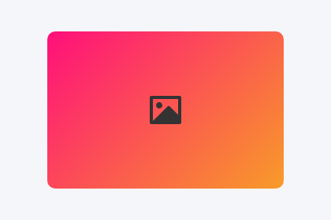
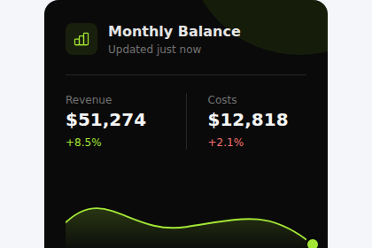
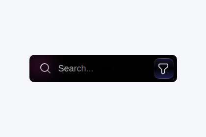
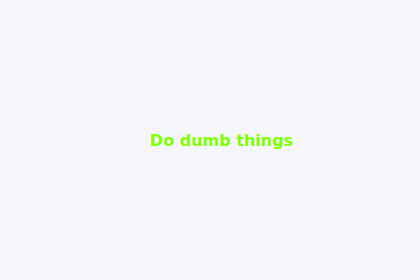
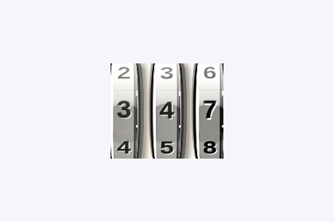
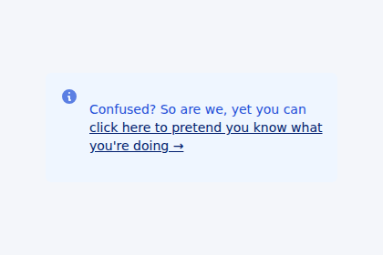
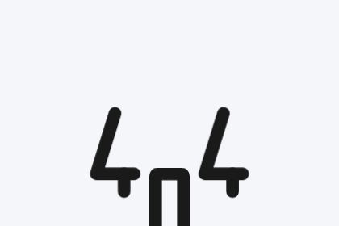

# Anteprime dei componenti — app-factory-dashboard

**85 componenti associati**, dal solo catalogo Design-App; l'associazione non prova che il componente sia integrato nell'app.

[Tutte le app](./README.md) · [Catalogo completo](../TABELLA_478.md) · [Vista con filtro app](../../docs/componenti.html?app=app-factory-dashboard)

Le immagini qui mostrate sono catture documentali, **non** una verifica di riuso Flutter, compatibilità nativa o licenze degli asset di terzi. In assenza di una PNG realmente acquisita la cella dichiara «Non disponibile» e punta alla fonte originale.

| Anteprima | ID | Componente | Fonte | Categoria | App associate | Codice |
|---|---|---|---|---|---|---|
| <small>Non disponibile</small> · <a href="https://github.com/Subhan-code/Amicro--Micro-transitions-/blob/fa5f8ffbe39537a8db191806066b8773c47c82e9/src/components/css-animations/physics/CurtainReveal.tsx" target="_blank" rel="noopener noreferrer">Fonte</a> | <code>AMX-001</code> | CurtainReveal | <a href="https://github.com/Subhan-code/Amicro--Micro-transitions-/blob/fa5f8ffbe39537a8db191806066b8773c47c82e9/src/components/css-animations/physics/CurtainReveal.tsx" target="_blank" rel="noopener noreferrer">DEVLIBRARIES_AMICRO</a> | CONTEXTUAL_CONTENT_REVEAL | anna-s-diary, app-factory-dashboard, cooking-anime, deskland-android, framelab, notes-ecosistema, web-utility-factory, wonderlog, world-days | Sorgente archiviata |
| <small>Non disponibile</small> · <a href="https://github.com/Subhan-code/Amicro--Micro-transitions-/blob/fa5f8ffbe39537a8db191806066b8773c47c82e9/registry/ui/cursor/cursor-trail.tsx" target="_blank" rel="noopener noreferrer">Fonte</a> | <code>AMX-002</code> | Cursor Trail | <a href="https://github.com/Subhan-code/Amicro--Micro-transitions-/blob/fa5f8ffbe39537a8db191806066b8773c47c82e9/registry/ui/cursor/cursor-trail.tsx" target="_blank" rel="noopener noreferrer">DEVLIBRARIES_AMICRO</a> | POINTER_FEEDBACK | app-factory-dashboard, deskland-android, framelab, notes-ecosistema, web-utility-factory | Sorgente archiviata |
| <small>Non disponibile</small> · <a href="https://devlibraries.com/libraries/amicro/perspective-flip" target="_blank" rel="noopener noreferrer">Fonte</a> | <code>AMX-003</code> | Perspective Flip | <a href="https://devlibraries.com/libraries/amicro/perspective-flip" target="_blank" rel="noopener noreferrer">DEVLIBRARIES_AMICRO</a> | UNVERIFIED_CARD_3D_FLIP | anna-s-diary, app-factory-dashboard, beerclass-ai, cooking-anime, edu-01-corpo-umano, notes-ecosistema, wonderlog, world-days | Solo riferimento |
| <small>Non disponibile</small> · <a href="https://github.com/Subhan-code/Amicro--Micro-transitions-/blob/fa5f8ffbe39537a8db191806066b8773c47c82e9/registry/ui/scroll/scroll-reveal.tsx" target="_blank" rel="noopener noreferrer">Fonte</a> | <code>AMX-004</code> | Scroll Reveal | <a href="https://github.com/Subhan-code/Amicro--Micro-transitions-/blob/fa5f8ffbe39537a8db191806066b8773c47c82e9/registry/ui/scroll/scroll-reveal.tsx" target="_blank" rel="noopener noreferrer">DEVLIBRARIES_AMICRO</a> | SCROLL_TRIGGERED_ENTRANCE | anna-s-diary, app-factory-dashboard, battery-guard, beerclass-ai, camperboss, cashmate-ai, cooking-anime, edu-01-corpo-umano, framelab, notes-ecosistema, omni-cleaner, trailpath, web-utility-factory, wonderlog, world-days | Sorgente archiviata |
| <small>Non disponibile</small> · <a href="https://devlibraries.com/libraries/amicro/spatial-door-portal" target="_blank" rel="noopener noreferrer">Fonte</a> | <code>AMX-005</code> | Spatial Door Portal | <a href="https://devlibraries.com/libraries/amicro/spatial-door-portal" target="_blank" rel="noopener noreferrer">DEVLIBRARIES_AMICRO</a> | UNVERIFIED_SPATIAL_PAGE_TRANSITION | anna-s-diary, app-factory-dashboard, cooking-anime, deskland-android, framelab, notes-ecosistema, wonderlog, world-days | Solo riferimento |
| <small>Non disponibile</small> · <a href="https://github.com/Subhan-code/Amicro--Micro-transitions-/blob/fa5f8ffbe39537a8db191806066b8773c47c82e9/registry/ui/loading/accordion-loader.tsx" target="_blank" rel="noopener noreferrer">Fonte</a> | <code>AMX-006</code> | Accordion Loader | <a href="https://github.com/Subhan-code/Amicro--Micro-transitions-/blob/fa5f8ffbe39537a8db191806066b8773c47c82e9/registry/ui/loading/accordion-loader.tsx" target="_blank" rel="noopener noreferrer">DEVLIBRARIES_AMICRO</a> | INDETERMINATE_LOADING | anna-s-diary, app-factory-dashboard, battery-guard, camperboss, cooking-anime, deskland-android, easy-debloat, focussense, framelab, notes-ecosistema, omni-cleaner, send-to-pc, web-utility-factory, wonderlog, world-days | Sorgente archiviata |
| <small>Non disponibile</small> | <code>DBM-006</code> | Stacked Bar Pulse | <a href="https://github.com/riccardopinato/Design-App/blob/main/BIBLIOTECA_COMPONENTI/sorgenti/amicro/dbm-006.tsx" target="_blank" rel="noopener noreferrer">DEVLIBRARIES_BOOKMARKS</a> | LOADER_SCAN | app-factory-dashboard, battery-guard, omni-cleaner, send-to-pc | Sorgente archiviata |
| <small>Non disponibile</small> | <code>DBM-009</code> | Terminal Loader | <a href="https://github.com/riccardopinato/Design-App/blob/main/BIBLIOTECA_COMPONENTI/sorgenti/amicro/dbm-009.tsx" target="_blank" rel="noopener noreferrer">DEVLIBRARIES_BOOKMARKS</a> | LOADER_TECHNICAL | app-factory-dashboard, deskland-android, easy-debloat, send-to-pc | Sorgente archiviata |
| <small>Non disponibile</small> | <code>DBM-012</code> | Grid Dots | <a href="https://github.com/riccardopinato/Design-App/blob/main/BIBLIOTECA_COMPONENTI/sorgenti/amicro/dbm-012.tsx" target="_blank" rel="noopener noreferrer">DEVLIBRARIES_BOOKMARKS</a> | LOADER_TECHNICAL | app-factory-dashboard, deskland-android, omni-cleaner | Sorgente archiviata |
| <small>Non disponibile</small> | <code>DBM-014</code> | Circular Bars | <a href="https://github.com/riccardopinato/Design-App/blob/main/BIBLIOTECA_COMPONENTI/sorgenti/amicro/dbm-014.tsx" target="_blank" rel="noopener noreferrer">DEVLIBRARIES_BOOKMARKS</a> | LOADER_DIAGNOSTICS | app-factory-dashboard, battery-guard, focussense, omni-cleaner | Sorgente archiviata |
| <small>Non disponibile</small> | <code>DBM-016</code> | Skeleton | <a href="https://github.com/riccardopinato/Design-App/blob/main/BIBLIOTECA_COMPONENTI/sorgenti/amicro/dbm-016.tsx" target="_blank" rel="noopener noreferrer">DEVLIBRARIES_BOOKMARKS</a> | CONTENT_PLACEHOLDER | anna-s-diary, app-factory-dashboard, cooking-anime, notes-ecosistema, world-days | Sorgente archiviata |
| <small>Non disponibile</small> | <code>DBM-019</code> | Bar Cascade | <a href="https://github.com/riccardopinato/Design-App/blob/main/BIBLIOTECA_COMPONENTI/sorgenti/amicro/dbm-019.tsx" target="_blank" rel="noopener noreferrer">DEVLIBRARIES_BOOKMARKS</a> | LOADER_BAR | app-factory-dashboard, focussense, omni-cleaner, send-to-pc | Sorgente archiviata |
| <small>Non disponibile</small> | <code>DBM-020</code> | Concentric Squares | <a href="https://github.com/riccardopinato/Design-App/blob/main/BIBLIOTECA_COMPONENTI/sorgenti/amicro/dbm-020.tsx" target="_blank" rel="noopener noreferrer">DEVLIBRARIES_BOOKMARKS</a> | LOADER_GEOMETRIC | app-factory-dashboard, cooking-anime, deskland-android, omni-cleaner | Sorgente archiviata |
| <small>Non disponibile</small> | <code>DBM-023</code> | Conveyor Loop | <a href="https://github.com/riccardopinato/Design-App/blob/main/BIBLIOTECA_COMPONENTI/sorgenti/amicro/dbm-023.tsx" target="_blank" rel="noopener noreferrer">DEVLIBRARIES_BOOKMARKS</a> | LOADER_TRANSFER | app-factory-dashboard, notes-ecosistema, omni-cleaner, send-to-pc | Sorgente archiviata |
| <small>Non disponibile</small> | <code>DBM-026</code> | Newtons Cradle | <a href="https://github.com/riccardopinato/Design-App/blob/main/BIBLIOTECA_COMPONENTI/sorgenti/amicro/dbm-026.tsx" target="_blank" rel="noopener noreferrer">DEVLIBRARIES_BOOKMARKS</a> | LOADER_PHYSICS | app-factory-dashboard, cooking-anime, focussense, omni-cleaner | Sorgente archiviata |
| <small>Non disponibile</small> | <code>DBM-028</code> | Loader | DEVLIBRARIES_BOOKMARKS | UNVERIFIED_LOADER_COLLECTION | app-factory-dashboard, notes-ecosistema, omni-cleaner | Solo riferimento |
| <small>Non disponibile</small> · <a href="https://devlibraries.com/libraries/easeui" target="_blank" rel="noopener noreferrer">Fonte</a> | <code>DSP-001</code> | EaseUI Theme Toggle | <a href="https://devlibraries.com/libraries/easeui" target="_blank" rel="noopener noreferrer">DEVLIBRARIES_EASEUI</a> | THEME_LIGHT_DARK | anna-s-diary, app-factory-dashboard, battery-guard, beerclass-ai, camperboss, cashmate-ai, cooking-anime, deskland-android, easy-debloat, focussense, framelab, notes-ecosistema, omni-cleaner, sleepmax-coach, trailpath, web-utility-factory, wonderlog, world-days | Sorgente archiviata |
| <small>Non disponibile</small> · <a href="https://devlibraries.com/libraries/amicro/card-stack-peel" target="_blank" rel="noopener noreferrer">Fonte</a> | <code>DSP-002</code> | Card Stack Peel | <a href="https://devlibraries.com/libraries/amicro/card-stack-peel" target="_blank" rel="noopener noreferrer">DEVLIBRARIES_AMICRO</a> | SECTION_CARD_TRANSITION | anna-s-diary, app-factory-dashboard, beerclass-ai, cooking-anime, framelab, notes-ecosistema, omni-cleaner, wonderlog, world-days | Sorgente archiviata |
| <small>Non disponibile</small> · <a href="https://devlibraries.com/libraries/amicro" target="_blank" rel="noopener noreferrer">Fonte</a> | <code>DSP-003</code> | Accordion Blind Pull | <a href="https://devlibraries.com/libraries/amicro" target="_blank" rel="noopener noreferrer">DEVLIBRARIES_AMICRO</a> | EXPANDABLE_PANEL_TRANSITION | anna-s-diary, app-factory-dashboard, battery-guard, beerclass-ai, camperboss, cashmate-ai, cooking-anime, easy-debloat, notes-ecosistema, omni-cleaner, trailpath, wonderlog, world-days | Sorgente archiviata |
| <small>Non disponibile</small> · <a href="https://devlibraries.com/libraries/amicro" target="_blank" rel="noopener noreferrer">Fonte</a> | <code>DSP-004</code> | Interlocking Gear Step | <a href="https://devlibraries.com/libraries/amicro" target="_blank" rel="noopener noreferrer">DEVLIBRARIES_AMICRO</a> | REAL_PROCESS_LOADING | app-factory-dashboard, battery-guard, easy-debloat, focussense, framelab, notes-ecosistema, omni-cleaner, send-to-pc, world-days | Sorgente archiviata |
| <small>Non disponibile</small> · <a href="https://devlibraries.com/libraries/amicro" target="_blank" rel="noopener noreferrer">Fonte</a> | <code>DSP-005</code> | Shutter Step Slices | <a href="https://devlibraries.com/libraries/amicro" target="_blank" rel="noopener noreferrer">DEVLIBRARIES_AMICRO</a> | STAGGERED_REVEAL | anna-s-diary, app-factory-dashboard, camperboss, cooking-anime, deskland-android, framelab, notes-ecosistema, omni-cleaner, wonderlog, world-days | Sorgente archiviata |
| <small>Non disponibile</small> | <code>DSP-006</code> | Loading &amp; Waiting Visual References (user screenshot) | USER_IMAGE | LOADING_WAIT_STATE_REFERENCE | anna-s-diary, app-factory-dashboard, battery-guard, camperboss, cashmate-ai, cooking-anime, deskland-android, easy-debloat, focussense, framelab, notes-ecosistema, omni-cleaner, send-to-pc, trailpath, web-utility-factory, wonderlog, world-days | Solo riferimento |
| <small>Non disponibile</small> · <a href="https://gentleface.com/icons/search" target="_blank" rel="noopener noreferrer">Fonte</a> | <code>ICO-011</code> | Ricerca | <a href="https://gentleface.com/icons/search" target="_blank" rel="noopener noreferrer">GENTLEFACE</a> | ICON | app-factory-dashboard, notes-ecosistema, omni-cleaner, wonderlog, world-days | Solo riferimento |
| <small>Non disponibile</small> · <a href="https://gentleface.com/icons/apps-sparkle" target="_blank" rel="noopener noreferrer">Fonte</a> | <code>ICO-012</code> | App / nuove funzionalità | <a href="https://gentleface.com/icons/apps-sparkle" target="_blank" rel="noopener noreferrer">GENTLEFACE</a> | ICON | app-factory-dashboard, cooking-anime, notes-ecosistema | Solo riferimento |
| <small>Non disponibile</small> · <a href="https://gentleface.com/icons/check" target="_blank" rel="noopener noreferrer">Fonte</a> | <code>ICO-014</code> | Completato | <a href="https://gentleface.com/icons/check" target="_blank" rel="noopener noreferrer">GENTLEFACE</a> | ICON | anna-s-diary, app-factory-dashboard, notes-ecosistema, omni-cleaner, world-days | Solo riferimento |
| <small>Non disponibile</small> · <a href="https://gentleface.com/icons/gauge" target="_blank" rel="noopener noreferrer">Fonte</a> | <code>ICO-018</code> | Indicatore / metriche | <a href="https://gentleface.com/icons/gauge" target="_blank" rel="noopener noreferrer">GENTLEFACE</a> | ICON | app-factory-dashboard, battery-guard, camperboss, cashmate-ai, focussense | Solo riferimento |
|  | <code>UIV-003</code> | Card gradiente rosa-arancio con testo rivelato su hover | <a href="https://uiverse.io/gharsh11032000/tricky-cheetah-78" target="_blank" rel="noopener noreferrer">UIVERSE</a> | CARD | app-factory-dashboard, beerclass-ai, cashmate-ai, cooking-anime, notes-ecosistema, wonderlog, world-days | Sorgente archiviata |
|  | <code>UIV-005</code> | Card proposta dall&#x27;utente come sfondo decorativo per varie app; effetto esatto non verificato | <a href="https://uiverse.io/amir_6539/red-duck-82" target="_blank" rel="noopener noreferrer">UIVERSE</a> | CARD_BACKGROUND | annas-diary, app-factory-dashboard, battery-guard, cashmate-ai, deskland-android, focussense, notes-ecosistema, omni-cleaner | Sorgente archiviata |
|  | <code>UIV-007</code> | Loader per processi reali, testo UX proposto: Stiamo facendo la magia; animazione specifica non verificata | <a href="https://uiverse.io/arthur_6104/orange-walrus-50" target="_blank" rel="noopener noreferrer">UIVERSE</a> | LOADER | annas-diary, app-factory-dashboard, cashmate-ai, framelab, notes-ecosistema, omni-cleaner, web-utility-factory, world-days | Sorgente archiviata |
|  | <code>UIV-011</code> | Componente Uiverse nella categoria LOADER; HTML/CSS originale archiviato con blob SHA. L&#x27;effetto specifico richiede ispezione del sorgente e collaudo visivo. | <a href="https://uiverse.io/Admin12121/black-sheep-17" target="_blank" rel="noopener noreferrer">UIVERSE</a> | LOADER | app-factory-dashboard, battery-guard, cashmate-ai, easy-debloat, omni-cleaner, send-to-pc, world-days | Sorgente archiviata |
|  | <code>UIV-016</code> | Scheda pubblica Uiverse classificata come CARD; il codice HTML/CSS non è presente nell&#x27;archivio Galaxy e non è stato acquisito. | <a href="https://uiverse.io/Gidarx/clever-panther-6" target="_blank" rel="noopener noreferrer">UIVERSE</a> | CARD | app-factory-dashboard, beerclass-ai, camperboss, cashmate-ai, deskland-android, edu-01-corpo-umano, notes-ecosistema | Sorgente archiviata |
|  | <code>UIV-020</code> | Componente Uiverse nella categoria LOADER; HTML/CSS originale archiviato con blob SHA. L&#x27;effetto specifico richiede ispezione del sorgente e collaudo visivo. | <a href="https://uiverse.io/JkHuger/selfish-bulldog-36" target="_blank" rel="noopener noreferrer">UIVERSE</a> | LOADER | app-factory-dashboard, battery-guard, framelab, notes-ecosistema, omni-cleaner, send-to-pc, world-days | Sorgente archiviata |
|  | <code>UIV-022</code> | Componente Uiverse nella categoria INPUT; HTML/CSS originale archiviato con blob SHA. L&#x27;effetto specifico richiede ispezione del sorgente e collaudo visivo. | <a href="https://uiverse.io/Lakshay-art/curvy-earwig-22" target="_blank" rel="noopener noreferrer">UIVERSE</a> | INPUT | app-factory-dashboard, cashmate-ai, notes-ecosistema, omni-cleaner, wonderlog, world-days | Sorgente archiviata |
|  | <code>UIV-025</code> | Componente Uiverse nella categoria LOADER; HTML/CSS originale archiviato con blob SHA. L&#x27;effetto specifico richiede ispezione del sorgente e collaudo visivo. | <a href="https://uiverse.io/Nawsome/ancient-yak-42" target="_blank" rel="noopener noreferrer">UIVERSE</a> | LOADER | app-factory-dashboard, camperboss, cashmate-ai, cooking-anime, easy-debloat, trailpath, wonderlog | Sorgente archiviata |
|  | <code>UIV-028</code> | Componente Uiverse nella categoria LOADER; HTML/CSS originale archiviato con blob SHA. L&#x27;effetto specifico richiede ispezione del sorgente e collaudo visivo. | <a href="https://uiverse.io/Nawsome/kind-mole-87" target="_blank" rel="noopener noreferrer">UIVERSE</a> | LOADER | app-factory-dashboard, battery-guard, framelab, notes-ecosistema, omni-cleaner, send-to-pc, world-days | Sorgente archiviata |
|  | <code>UIV-029</code> | Componente Uiverse nella categoria LOADER; HTML/CSS originale archiviato con blob SHA. L&#x27;effetto specifico richiede ispezione del sorgente e collaudo visivo. | <a href="https://uiverse.io/Nawsome/wet-mayfly-23" target="_blank" rel="noopener noreferrer">UIVERSE</a> | LOADER | app-factory-dashboard, battery-guard, cashmate-ai, easy-debloat, omni-cleaner, send-to-pc, world-days | Sorgente archiviata |
|  | <code>UIV-030</code> | Componente Uiverse nella categoria LOADER; HTML/CSS originale archiviato con blob SHA. L&#x27;effetto specifico richiede ispezione del sorgente e collaudo visivo. | <a href="https://uiverse.io/Nawsome/young-goat-78" target="_blank" rel="noopener noreferrer">UIVERSE</a> | LOADER | app-factory-dashboard, camperboss, cashmate-ai, cooking-anime, easy-debloat, omni-cleaner, wonderlog | Sorgente archiviata |
|  | <code>UIV-033</code> | Componente Uiverse nella categoria BUTTON; HTML/CSS originale archiviato con blob SHA. L&#x27;effetto specifico richiede ispezione del sorgente e collaudo visivo. | <a href="https://uiverse.io/Praashoo7/smooth-crab-52" target="_blank" rel="noopener noreferrer">UIVERSE</a> | BUTTON | annas-diary, app-factory-dashboard, notes-ecosistema, web-utility-factory, wonderlog, world-days | Sorgente archiviata |
|  | <code>UIV-034</code> | Componente Uiverse nella categoria LOADER; HTML/CSS originale archiviato con blob SHA. L&#x27;effetto specifico richiede ispezione del sorgente e collaudo visivo. | <a href="https://uiverse.io/Pradeepsaranbishnoi/fast-cobra-20" target="_blank" rel="noopener noreferrer">UIVERSE</a> | LOADER | app-factory-dashboard, battery-guard, cashmate-ai, easy-debloat, omni-cleaner, send-to-pc, world-days | Sorgente archiviata |
|  | <code>UIV-037</code> | Componente Uiverse nella categoria CARD; HTML/CSS originale archiviato con blob SHA. L&#x27;effetto specifico richiede ispezione del sorgente e collaudo visivo. | <a href="https://uiverse.io/Prince4fff/slippery-baboon-37" target="_blank" rel="noopener noreferrer">UIVERSE</a> | CARD | app-factory-dashboard, beerclass-ai, cashmate-ai, cooking-anime, framelab, notes-ecosistema, wonderlog | Sorgente archiviata |
|  | <code>UIV-039</code> | Componente Uiverse nella categoria LOADER; HTML/CSS originale archiviato con blob SHA. L&#x27;effetto specifico richiede ispezione del sorgente e collaudo visivo. | <a href="https://uiverse.io/SelfMadeSystem/pretty-treefrog-77" target="_blank" rel="noopener noreferrer">UIVERSE</a> | LOADER | app-factory-dashboard, battery-guard, cashmate-ai, easy-debloat, omni-cleaner, send-to-pc, world-days | Sorgente archiviata |
|  | <code>UIV-040</code> | Componente Uiverse nella categoria LOADER; HTML/CSS originale archiviato con blob SHA. L&#x27;effetto specifico richiede ispezione del sorgente e collaudo visivo. | <a href="https://uiverse.io/Shoh2008/curvy-bulldog-27" target="_blank" rel="noopener noreferrer">UIVERSE</a> | LOADER | app-factory-dashboard, camperboss, cashmate-ai, cooking-anime, easy-debloat, omni-cleaner, wonderlog | Sorgente archiviata |
|  | <code>UIV-044</code> | Componente Uiverse nella categoria LOADER; HTML/CSS originale archiviato con blob SHA. L&#x27;effetto specifico richiede ispezione del sorgente e collaudo visivo. | <a href="https://uiverse.io/Subaashbala/average-horse-18" target="_blank" rel="noopener noreferrer">UIVERSE</a> | LOADER | app-factory-dashboard, battery-guard, cashmate-ai, easy-debloat, omni-cleaner, send-to-pc, world-days | Sorgente archiviata |
|  | <code>UIV-045</code> | Categoria CHECKBOX confermata dall&#x27;endpoint pubblico Uiverse. Abbinamenti UI/UX proposti, non collaudati sui consumer. | <a href="https://uiverse.io/Uncannypotato69/honest-starfish-32" target="_blank" rel="noopener noreferrer">UIVERSE</a> | CHECKBOX | app-factory-dashboard, notes-ecosistema, omni-cleaner | Sorgente archiviata |
|  | <code>UIV-046</code> | Scheda pubblica Uiverse classificata come CHECKBOX; il codice HTML/CSS non è presente nell&#x27;archivio Galaxy e non è stato acquisito. | <a href="https://uiverse.io/Uncannypotato69/rotten-wasp-10" target="_blank" rel="noopener noreferrer">UIVERSE</a> | CHECKBOX | app-factory-dashboard, camperboss, easy-debloat, notes-ecosistema, wonderlog, world-days | Sorgente archiviata |
|  | <code>UIV-047</code> | Componente Uiverse nella categoria BUTTON; HTML/CSS originale archiviato con blob SHA. L&#x27;effetto specifico richiede ispezione del sorgente e collaudo visivo. | <a href="https://uiverse.io/Yaya12085/plastic-quail-42" target="_blank" rel="noopener noreferrer">UIVERSE</a> | BUTTON | annas-diary, app-factory-dashboard, camperboss, easy-debloat, notes-ecosistema, web-utility-factory | Sorgente archiviata |
|  | <code>UIV-051</code> | Scheda pubblica Uiverse classificata come LOADER; il codice HTML/CSS non è presente nell&#x27;archivio Galaxy e non è stato acquisito. | <a href="https://uiverse.io/andrew-manzyk/young-walrus-64" target="_blank" rel="noopener noreferrer">UIVERSE</a> | LOADER | app-factory-dashboard, battery-guard, framelab, notes-ecosistema, omni-cleaner, send-to-pc, world-days | Sorgente archiviata |
|  | <code>UIV-053</code> | Componente Uiverse nella categoria TOOLTIP; HTML/CSS originale archiviato con blob SHA. L&#x27;effetto specifico richiede ispezione del sorgente e collaudo visivo. | <a href="https://uiverse.io/barisdogansutcu/plastic-dolphin-67" target="_blank" rel="noopener noreferrer">UIVERSE</a> | TOOLTIP | app-factory-dashboard, battery-guard, edu-01-corpo-umano, notes-ecosistema, omni-cleaner, wonderlog | Sorgente archiviata |
|  | <code>UIV-054</code> | Scheda pubblica Uiverse classificata come CARD; il codice HTML/CSS non è presente nell&#x27;archivio Galaxy e non è stato acquisito. | <a href="https://uiverse.io/byllzz/great-wombat-13" target="_blank" rel="noopener noreferrer">UIVERSE</a> | CARD | app-factory-dashboard, beerclass-ai, cashmate-ai, cooking-anime, framelab, notes-ecosistema, wonderlog | Sorgente archiviata |
|  | <code>UIV-055</code> | Scheda pubblica Uiverse classificata come LOADER; il codice HTML/CSS non è presente nell&#x27;archivio Galaxy e non è stato acquisito. | <a href="https://uiverse.io/chase2k25/modern-stingray-54" target="_blank" rel="noopener noreferrer">UIVERSE</a> | LOADER | app-factory-dashboard, battery-guard, framelab, notes-ecosistema, omni-cleaner, send-to-pc, world-days | Sorgente archiviata |
|  | <code>UIV-057</code> | Componente Uiverse nella categoria LOADER; HTML/CSS originale archiviato con blob SHA. L&#x27;effetto specifico richiede ispezione del sorgente e collaudo visivo. | <a href="https://uiverse.io/cohencoo/dry-rat-94" target="_blank" rel="noopener noreferrer">UIVERSE</a> | LOADER | app-factory-dashboard, camperboss, cashmate-ai, cooking-anime, easy-debloat, trailpath, wonderlog | Sorgente archiviata |
|  | <code>UIV-061</code> | Scheda pubblica Uiverse classificata come LOADER; il codice HTML/CSS non è presente nell&#x27;archivio Galaxy e non è stato acquisito. | <a href="https://uiverse.io/dexter-st/bright-lizard-8" target="_blank" rel="noopener noreferrer">UIVERSE</a> | LOADER | app-factory-dashboard, battery-guard, cashmate-ai, easy-debloat, omni-cleaner, send-to-pc, world-days | Sorgente archiviata |
|  | <code>UIV-062</code> | Scheda pubblica Uiverse classificata come LOADER; il codice HTML/CSS non è presente nell&#x27;archivio Galaxy e non è stato acquisito. | <a href="https://uiverse.io/dexter-st/spicy-otter-30" target="_blank" rel="noopener noreferrer">UIVERSE</a> | LOADER | app-factory-dashboard, camperboss, cashmate-ai, cooking-anime, easy-debloat, omni-cleaner, wonderlog | Sorgente archiviata |
|  | <code>UIV-063</code> | Scheda pubblica Uiverse classificata come CARD; il codice HTML/CSS non è presente nell&#x27;archivio Galaxy e non è stato acquisito. | <a href="https://uiverse.io/dexter-st/tough-falcon-78" target="_blank" rel="noopener noreferrer">UIVERSE</a> | CARD | app-factory-dashboard, beerclass-ai, camperboss, cashmate-ai, deskland-android, edu-01-corpo-umano, notes-ecosistema | Sorgente archiviata |
|  | <code>UIV-065</code> | Scheda pubblica Uiverse classificata come LOADER; il codice HTML/CSS non è presente nell&#x27;archivio Galaxy e non è stato acquisito. | <a href="https://uiverse.io/dovatgabriel/massive-vampirebat-17" target="_blank" rel="noopener noreferrer">UIVERSE</a> | LOADER | app-factory-dashboard, battery-guard, framelab, notes-ecosistema, omni-cleaner, send-to-pc, world-days | Sorgente archiviata |
|  | <code>UIV-066</code> | Scheda pubblica Uiverse classificata come LOADER; il codice HTML/CSS non è presente nell&#x27;archivio Galaxy e non è stato acquisito. | <a href="https://uiverse.io/elijahgummer/polite-earwig-72" target="_blank" rel="noopener noreferrer">UIVERSE</a> | LOADER | app-factory-dashboard, battery-guard, cashmate-ai, easy-debloat, omni-cleaner, send-to-pc, world-days | Sorgente archiviata |
|  | <code>UIV-069</code> | Scheda pubblica Uiverse classificata come BUTTON; il codice HTML/CSS non è presente nell&#x27;archivio Galaxy e non è stato acquisito. | <a href="https://uiverse.io/fthisilak/bitter-termite-36" target="_blank" rel="noopener noreferrer">UIVERSE</a> | BUTTON | annas-diary, app-factory-dashboard, easy-debloat, notes-ecosistema, web-utility-factory, wonderlog | Sorgente archiviata |
|  | <code>UIV-070</code> | Componente Uiverse nella categoria CHECKBOX; HTML/CSS originale archiviato con blob SHA. L&#x27;effetto specifico richiede ispezione del sorgente e collaudo visivo. | <a href="https://uiverse.io/gagan-gv/unlucky-yak-4" target="_blank" rel="noopener noreferrer">UIVERSE</a> | CHECKBOX | app-factory-dashboard, camperboss, cashmate-ai, notes-ecosistema, omni-cleaner, world-days | Sorgente archiviata |
|  | <code>UIV-073</code> | Scheda pubblica Uiverse classificata come CARD; il codice HTML/CSS non è presente nell&#x27;archivio Galaxy e non è stato acquisito. | <a href="https://uiverse.io/ilkhoeri/thin-bobcat-83" target="_blank" rel="noopener noreferrer">UIVERSE</a> | CARD | app-factory-dashboard, beerclass-ai, cashmate-ai, cooking-anime, framelab, notes-ecosistema, wonderlog | Sorgente archiviata |
|  | <code>UIV-074</code> | Scheda pubblica Uiverse classificata come LOADER; il codice HTML/CSS non è presente nell&#x27;archivio Galaxy e non è stato acquisito. | <a href="https://uiverse.io/jeremy_4982/massive-falcon-52" target="_blank" rel="noopener noreferrer">UIVERSE</a> | LOADER | app-factory-dashboard, battery-guard, framelab, notes-ecosistema, omni-cleaner, send-to-pc, world-days | Sorgente archiviata |
|  | <code>UIV-076</code> | Scheda pubblica Uiverse classificata come LOADER; il codice HTML/CSS non è presente nell&#x27;archivio Galaxy e non è stato acquisito. | <a href="https://uiverse.io/kat_2522/rude-robin-51" target="_blank" rel="noopener noreferrer">UIVERSE</a> | LOADER | app-factory-dashboard, camperboss, cashmate-ai, cooking-anime, easy-debloat, omni-cleaner, wonderlog | Sorgente archiviata |
|  | <code>UIV-077</code> | Componente Uiverse nella categoria CARD; HTML/CSS originale archiviato con blob SHA. L&#x27;effetto specifico richiede ispezione del sorgente e collaudo visivo. | <a href="https://uiverse.io/kennyotsu/fast-emu-70" target="_blank" rel="noopener noreferrer">UIVERSE</a> | CARD | app-factory-dashboard, beerclass-ai, cashmate-ai, cooking-anime, framelab, notes-ecosistema, wonderlog | Sorgente archiviata |
|  | <code>UIV-078</code> | Scheda pubblica Uiverse classificata come CARD; il codice HTML/CSS non è presente nell&#x27;archivio Galaxy e non è stato acquisito. | <a href="https://uiverse.io/kennyotsu/giant-sloth-18" target="_blank" rel="noopener noreferrer">UIVERSE</a> | CARD | app-factory-dashboard, beerclass-ai, camperboss, cashmate-ai, deskland-android, edu-01-corpo-umano, notes-ecosistema | Sorgente archiviata |
|  | <code>UIV-081</code> | Scheda pubblica Uiverse classificata come CARD; il codice HTML/CSS non è presente nell&#x27;archivio Galaxy e non è stato acquisito. | <a href="https://uiverse.io/kennyotsu/tender-badger-21" target="_blank" rel="noopener noreferrer">UIVERSE</a> | CARD | app-factory-dashboard, beerclass-ai, cashmate-ai, cooking-anime, framelab, trailpath, wonderlog | Sorgente archiviata |
|  | <code>UIV-082</code> | Componente Uiverse nella categoria CARD; HTML/CSS originale archiviato con blob SHA. L&#x27;effetto specifico richiede ispezione del sorgente e collaudo visivo. | <a href="https://uiverse.io/kennyotsu/wise-rattlesnake-92" target="_blank" rel="noopener noreferrer">UIVERSE</a> | CARD | app-factory-dashboard, beerclass-ai, camperboss, cashmate-ai, deskland-android, edu-01-corpo-umano, notes-ecosistema | Sorgente archiviata |
|  | <code>UIV-084</code> | Componente Uiverse nella categoria LOADER; HTML/CSS originale archiviato con blob SHA. L&#x27;effetto specifico richiede ispezione del sorgente e collaudo visivo. | <a href="https://uiverse.io/lukepadiachy/funny-moose-89" target="_blank" rel="noopener noreferrer">UIVERSE</a> | LOADER | app-factory-dashboard, battery-guard, framelab, notes-ecosistema, omni-cleaner, send-to-pc, world-days | Sorgente archiviata |
|  | <code>UIV-087</code> | Componente Uiverse nella categoria BUTTON; HTML/CSS originale archiviato con blob SHA. L&#x27;effetto specifico richiede ispezione del sorgente e collaudo visivo. | <a href="https://uiverse.io/marcelodolza/fat-zebra-11" target="_blank" rel="noopener noreferrer">UIVERSE</a> | BUTTON | annas-diary, app-factory-dashboard, camperboss, easy-debloat, notes-ecosistema, web-utility-factory | Sorgente archiviata |
|  | <code>UIV-089</code> | Componente Uiverse nella categoria LOADER; HTML/CSS originale archiviato con blob SHA. L&#x27;effetto specifico richiede ispezione del sorgente e collaudo visivo. | <a href="https://uiverse.io/mobinkakei/grumpy-turtle-41" target="_blank" rel="noopener noreferrer">UIVERSE</a> | LOADER | app-factory-dashboard, battery-guard, framelab, notes-ecosistema, omni-cleaner, send-to-pc, world-days | Sorgente archiviata |
|  | <code>UIV-093</code> | Categoria CARD confermata dall&#x27;endpoint pubblico Uiverse. Abbinamenti UI/UX proposti, non collaudati sui consumer. | <a href="https://uiverse.io/preet_7613/new-cougar-63" target="_blank" rel="noopener noreferrer">UIVERSE</a> | CARD | app-factory-dashboard, notes-ecosistema, omni-cleaner | Sorgente archiviata |
|  | <code>UIV-094</code> | Componente Uiverse nella categoria LOADER; HTML/CSS originale archiviato con blob SHA. L&#x27;effetto specifico richiede ispezione del sorgente e collaudo visivo. | <a href="https://uiverse.io/satyamchaudharydev/splendid-husky-54" target="_blank" rel="noopener noreferrer">UIVERSE</a> | LOADER | app-factory-dashboard, battery-guard, framelab, notes-ecosistema, omni-cleaner, send-to-pc, world-days | Sorgente archiviata |
|  | <code>UIV-096</code> | Scheda pubblica Uiverse classificata come PATTERN; il codice HTML/CSS non è presente nell&#x27;archivio Galaxy e non è stato acquisito. | <a href="https://uiverse.io/solowzrd/wet-lionfish-63" target="_blank" rel="noopener noreferrer">UIVERSE</a> | PATTERN | app-factory-dashboard, battery-guard, deskland-android, focussense, omni-cleaner, web-utility-factory | Sorgente archiviata |
|  | <code>UIV-097</code> | Componente Uiverse nella categoria CARD; HTML/CSS originale archiviato con blob SHA. L&#x27;effetto specifico richiede ispezione del sorgente e collaudo visivo. | <a href="https://uiverse.io/vamsidevendrakumar/soft-shrimp-94" target="_blank" rel="noopener noreferrer">UIVERSE</a> | CARD | app-factory-dashboard, beerclass-ai, cashmate-ai, cooking-anime, framelab, notes-ecosistema, wonderlog | Sorgente archiviata |
|  | <code>UIV-099</code> | Componente Uiverse nella categoria LOADER; HTML/CSS originale archiviato con blob SHA. L&#x27;effetto specifico richiede ispezione del sorgente e collaudo visivo. | <a href="https://uiverse.io/xXJollyHAKERXx/lucky-falcon-75" target="_blank" rel="noopener noreferrer">UIVERSE</a> | LOADER | app-factory-dashboard, battery-guard, framelab, notes-ecosistema, omni-cleaner, send-to-pc, world-days | Sorgente archiviata |
|  | <code>UIV-101</code> | Blue modern login form; use only where an input or optional account flow already exists. Categoria FORM verificata nel post pubblico Uiverse. Tag originali: blue, form, login form, tailwind, rounded, input, button, blue, border, modern. | <a href="https://uiverse.io/Javierrocadev/chatty-ladybug-95" target="_blank" rel="noopener noreferrer">UIVERSE</a> | FORM | annas-diary, app-factory-dashboard, beerclass-ai, cashmate-ai, notes-ecosistema, wonderlog, world-days | Sorgente archiviata |
|  | <code>UIV-102</code> | Warm stitched beige/orange login form; adapt to product typography and contrast. Categoria FORM verificata nel post pubblico Uiverse. Tag originali: login, form, stitched, rounded, shadow, beige, orange, password, form, submit. | <a href="https://uiverse.io/Praashoo7/bitter-pig-24" target="_blank" rel="noopener noreferrer">UIVERSE</a> | FORM | annas-diary, app-factory-dashboard, camperboss, cooking-anime, notes-ecosistema, sleepmax-coach, wonderlog | Sorgente archiviata |
|  | <code>UIV-103</code> | Blue gradient and depth form; tone down gloss and 3D for readable mobile inputs. Categoria FORM verificata nel post pubblico Uiverse. Tag originali: simple, login, 3d, social, gradient, form, submit, login form, rounded, button. | <a href="https://uiverse.io/SyedShahzaib7/brave-dog-61" target="_blank" rel="noopener noreferrer">UIVERSE</a> | FORM | app-factory-dashboard, beerclass-ai, cashmate-ai, notes-ecosistema, send-to-pc, world-days | Sorgente archiviata |
|  | <code>UIV-104</code> | Minimal purple login form; adapt palette and semantics rather than add authentication. Categoria FORM verificata nel post pubblico Uiverse. Tag originali: login, form, input, button, password, white, form, signin, username, purple. | <a href="https://uiverse.io/alexmaracinaru/tall-owl-30" target="_blank" rel="noopener noreferrer">UIVERSE</a> | FORM | annas-diary, app-factory-dashboard, cashmate-ai, cooking-anime, notes-ecosistema, wonderlog, world-days | Sorgente archiviata |
|  | <code>UIV-105</code> | Welcome/social login form; explicit consent and existing optional provider only. Categoria FORM verificata nel post pubblico Uiverse. Tag originali: login, email, social, form, submit, confirm, password, welcome, rounded, shadow. | <a href="https://uiverse.io/ayyjayy2/sour-dog-94" target="_blank" rel="noopener noreferrer">UIVERSE</a> | FORM | annas-diary, app-factory-dashboard, beerclass-ai, cashmate-ai, cooking-anime, framelab, notes-ecosistema, wonderlog | Sorgente archiviata |
|  | <code>UIV-106</code> | Red suspension-ball animation; requires actual running job, retry/timeout, reduced motion. Categoria LOADER verificata nel post pubblico Uiverse. Tag originali: simple, material design, neumorphism, skeuomorphism, glassmorphism, flashy, loader, animated, loader, red. | <a href="https://uiverse.io/doniaskima/cowardly-frog-28" target="_blank" rel="noopener noreferrer">UIVERSE</a> | LOADER | app-factory-dashboard, battery-guard, easy-debloat, framelab, notes-ecosistema, omni-cleaner, send-to-pc, trailpath, world-days | Sorgente archiviata |
|  | <code>UIV-110</code> | Animated tooltip with real information; tap/focus/keyboard support, not hover-only. Categoria TOOLTIP verificata nel post pubblico Uiverse. Tag originali: tooltip. | <a href="https://uiverse.io/roroland/average-horse-2" target="_blank" rel="noopener noreferrer">UIVERSE</a> | TOOLTIP | app-factory-dashboard, battery-guard, cashmate-ai, edu-01-corpo-umano, focussense, notes-ecosistema, omni-cleaner, wonderlog, world-days | Sorgente archiviata |
|  | <code>UIV-111</code> | Minimal purple account form; use existing opt-in or non-auth input surfaces only. Categoria FORM verificata nel post pubblico Uiverse. Tag originali: purple, form, log in, button, modern, forgot, password, form, submit, username. | <a href="https://uiverse.io/vinodjangid07/horrible-warthog-14" target="_blank" rel="noopener noreferrer">UIVERSE</a> | FORM | annas-diary, app-factory-dashboard, camperboss, cashmate-ai, notes-ecosistema, wonderlog, world-days | Sorgente archiviata |
| <small>Non disponibile</small> · <a href="https://devlibraries.com/libraries/watermelon/swap-form" target="_blank" rel="noopener noreferrer">Fonte</a> | <code>WML-005</code> | Swap Form | <a href="https://devlibraries.com/libraries/watermelon/swap-form" target="_blank" rel="noopener noreferrer">DEVLIBRARIES_WATERMELON</a> | AUTH_FORM_TRANSITION | anna-s-diary, app-factory-dashboard, cashmate-ai, cooking-anime, notes-ecosistema, wonderlog, world-days | Sorgente archiviata |
| <small>Non disponibile</small> · <a href="https://devlibraries.com/libraries/watermelon/text-gradient" target="_blank" rel="noopener noreferrer">Fonte</a> | <code>WML-006</code> | Text Gradient | <a href="https://devlibraries.com/libraries/watermelon/text-gradient" target="_blank" rel="noopener noreferrer">DEVLIBRARIES_WATERMELON</a> | TYPOGRAPHY_DECORATION | anna-s-diary, app-factory-dashboard, cooking-anime, framelab, web-utility-factory, wonderlog, world-days | Solo riferimento |
| <small>Non disponibile</small> · <a href="https://devlibraries.com/libraries/watermelon/dialog-stack-base" target="_blank" rel="noopener noreferrer">Fonte</a> | <code>WML-007</code> | Dialog Stack (base) | <a href="https://devlibraries.com/libraries/watermelon/dialog-stack-base" target="_blank" rel="noopener noreferrer">DEVLIBRARIES_WATERMELON</a> | MULTISTEP_MODAL | anna-s-diary, app-factory-dashboard, camperboss, cashmate-ai, cooking-anime, notes-ecosistema, wonderlog | Sorgente archiviata |
| <small>Non disponibile</small> · <a href="https://devlibraries.com/libraries/watermelon/notification-list" target="_blank" rel="noopener noreferrer">Fonte</a> | <code>WML-008</code> | Notification List | <a href="https://devlibraries.com/libraries/watermelon/notification-list" target="_blank" rel="noopener noreferrer">DEVLIBRARIES_WATERMELON</a> | TODAY_IN_APP_REMINDER_SUMMARY | anna-s-diary, app-factory-dashboard, camperboss, cashmate-ai, notes-ecosistema, sleepmax-coach, wonderlog, world-days | Solo riferimento |
