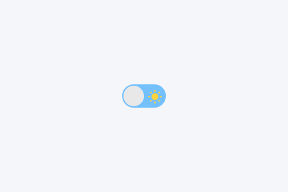
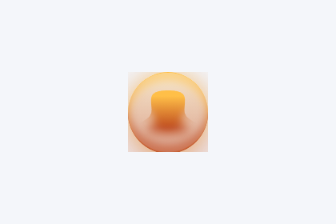
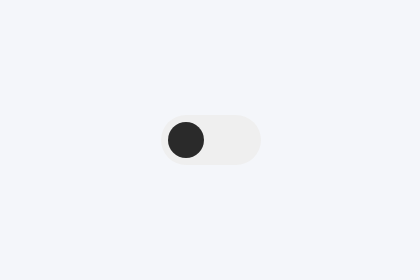
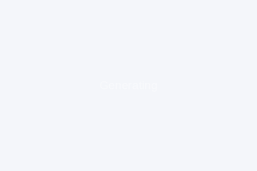
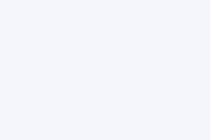
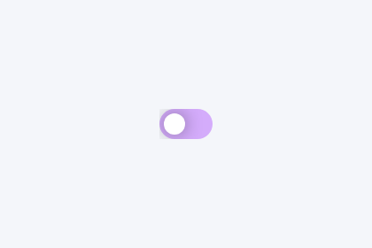
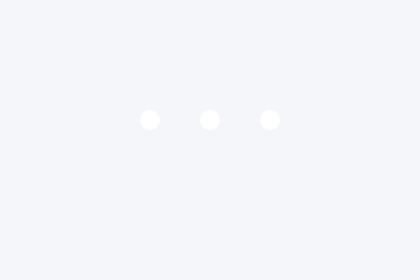
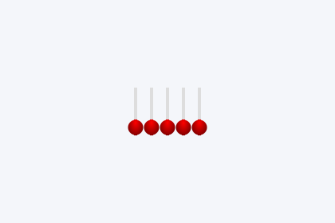

# Anteprime dei componenti — battery-guard

**61 componenti associati**, dal solo catalogo Design-App; l'associazione non prova che il componente sia integrato nell'app.

[Tutte le app](./README.md) · [Catalogo completo](../TABELLA_478.md) · [Vista con filtro app](../../docs/componenti.html?app=battery-guard)

Le immagini qui mostrate sono catture documentali, **non** una verifica di riuso Flutter, compatibilità nativa o licenze degli asset di terzi. In assenza di una PNG realmente acquisita la cella dichiara «Non disponibile» e punta alla fonte originale.

| Anteprima | ID | Componente | Fonte | Categoria | App associate | Codice |
|---|---|---|---|---|---|---|
| <small>Non disponibile</small> · <a href="https://github.com/Subhan-code/Amicro--Micro-transitions-/blob/fa5f8ffbe39537a8db191806066b8773c47c82e9/registry/ui/scroll/scroll-reveal.tsx" target="_blank" rel="noopener noreferrer">Fonte</a> | <code>AMX-004</code> | Scroll Reveal | <a href="https://github.com/Subhan-code/Amicro--Micro-transitions-/blob/fa5f8ffbe39537a8db191806066b8773c47c82e9/registry/ui/scroll/scroll-reveal.tsx" target="_blank" rel="noopener noreferrer">DEVLIBRARIES_AMICRO</a> | SCROLL_TRIGGERED_ENTRANCE | anna-s-diary, app-factory-dashboard, battery-guard, beerclass-ai, camperboss, cashmate-ai, cooking-anime, edu-01-corpo-umano, framelab, notes-ecosistema, omni-cleaner, trailpath, web-utility-factory, wonderlog, world-days | Sorgente archiviata |
| <small>Non disponibile</small> · <a href="https://github.com/Subhan-code/Amicro--Micro-transitions-/blob/fa5f8ffbe39537a8db191806066b8773c47c82e9/registry/ui/loading/accordion-loader.tsx" target="_blank" rel="noopener noreferrer">Fonte</a> | <code>AMX-006</code> | Accordion Loader | <a href="https://github.com/Subhan-code/Amicro--Micro-transitions-/blob/fa5f8ffbe39537a8db191806066b8773c47c82e9/registry/ui/loading/accordion-loader.tsx" target="_blank" rel="noopener noreferrer">DEVLIBRARIES_AMICRO</a> | INDETERMINATE_LOADING | anna-s-diary, app-factory-dashboard, battery-guard, camperboss, cooking-anime, deskland-android, easy-debloat, focussense, framelab, notes-ecosistema, omni-cleaner, send-to-pc, web-utility-factory, wonderlog, world-days | Sorgente archiviata |
| <small>Non disponibile</small> | <code>DBM-006</code> | Stacked Bar Pulse | <a href="https://github.com/riccardopinato/Design-App/blob/main/BIBLIOTECA_COMPONENTI/sorgenti/amicro/dbm-006.tsx" target="_blank" rel="noopener noreferrer">DEVLIBRARIES_BOOKMARKS</a> | LOADER_SCAN | app-factory-dashboard, battery-guard, omni-cleaner, send-to-pc | Sorgente archiviata |
| <small>Non disponibile</small> | <code>DBM-008</code> | Fade Arc | <a href="https://github.com/riccardopinato/Design-App/blob/main/BIBLIOTECA_COMPONENTI/sorgenti/amicro/dbm-008.tsx" target="_blank" rel="noopener noreferrer">DEVLIBRARIES_BOOKMARKS</a> | LOADER_MINIMAL | anna-s-diary, battery-guard, cooking-anime, world-days | Sorgente archiviata |
| <small>Non disponibile</small> | <code>DBM-014</code> | Circular Bars | <a href="https://github.com/riccardopinato/Design-App/blob/main/BIBLIOTECA_COMPONENTI/sorgenti/amicro/dbm-014.tsx" target="_blank" rel="noopener noreferrer">DEVLIBRARIES_BOOKMARKS</a> | LOADER_DIAGNOSTICS | app-factory-dashboard, battery-guard, focussense, omni-cleaner | Sorgente archiviata |
| <small>Non disponibile</small> | <code>DBM-017</code> | Concentric Ring | <a href="https://github.com/riccardopinato/Design-App/blob/main/BIBLIOTECA_COMPONENTI/sorgenti/amicro/dbm-017.tsx" target="_blank" rel="noopener noreferrer">DEVLIBRARIES_BOOKMARKS</a> | LOADER_RINGS | battery-guard, deskland-android, focussense, the-luminous-infinite-circle | Sorgente archiviata |
| <small>Non disponibile</small> | <code>DBM-022</code> | Bar Sweep | <a href="https://github.com/riccardopinato/Design-App/blob/main/BIBLIOTECA_COMPONENTI/sorgenti/amicro/dbm-022.tsx" target="_blank" rel="noopener noreferrer">DEVLIBRARIES_BOOKMARKS</a> | LOADER_BAR | battery-guard, omni-cleaner, send-to-pc, world-days | Sorgente archiviata |
| <small>Non disponibile</small> · <a href="https://devlibraries.com/libraries/easeui" target="_blank" rel="noopener noreferrer">Fonte</a> | <code>DSP-001</code> | EaseUI Theme Toggle | <a href="https://devlibraries.com/libraries/easeui" target="_blank" rel="noopener noreferrer">DEVLIBRARIES_EASEUI</a> | THEME_LIGHT_DARK | anna-s-diary, app-factory-dashboard, battery-guard, beerclass-ai, camperboss, cashmate-ai, cooking-anime, deskland-android, easy-debloat, focussense, framelab, notes-ecosistema, omni-cleaner, sleepmax-coach, trailpath, web-utility-factory, wonderlog, world-days | Sorgente archiviata |
| <small>Non disponibile</small> · <a href="https://devlibraries.com/libraries/amicro" target="_blank" rel="noopener noreferrer">Fonte</a> | <code>DSP-003</code> | Accordion Blind Pull | <a href="https://devlibraries.com/libraries/amicro" target="_blank" rel="noopener noreferrer">DEVLIBRARIES_AMICRO</a> | EXPANDABLE_PANEL_TRANSITION | anna-s-diary, app-factory-dashboard, battery-guard, beerclass-ai, camperboss, cashmate-ai, cooking-anime, easy-debloat, notes-ecosistema, omni-cleaner, trailpath, wonderlog, world-days | Sorgente archiviata |
| <small>Non disponibile</small> · <a href="https://devlibraries.com/libraries/amicro" target="_blank" rel="noopener noreferrer">Fonte</a> | <code>DSP-004</code> | Interlocking Gear Step | <a href="https://devlibraries.com/libraries/amicro" target="_blank" rel="noopener noreferrer">DEVLIBRARIES_AMICRO</a> | REAL_PROCESS_LOADING | app-factory-dashboard, battery-guard, easy-debloat, focussense, framelab, notes-ecosistema, omni-cleaner, send-to-pc, world-days | Sorgente archiviata |
| <small>Non disponibile</small> | <code>DSP-006</code> | Loading &amp; Waiting Visual References (user screenshot) | USER_IMAGE | LOADING_WAIT_STATE_REFERENCE | anna-s-diary, app-factory-dashboard, battery-guard, camperboss, cashmate-ai, cooking-anime, deskland-android, easy-debloat, focussense, framelab, notes-ecosistema, omni-cleaner, send-to-pc, trailpath, web-utility-factory, wonderlog, world-days | Solo riferimento |
| <small>Non disponibile</small> · <a href="https://fluttercomponentlibrary.com/pages/components/banner-info.html" target="_blank" rel="noopener noreferrer">Fonte</a> | <code>FCL-004</code> | Banner Info | <a href="https://fluttercomponentlibrary.com/pages/components/banner-info.html" target="_blank" rel="noopener noreferrer">FLUTTER_COMPONENT_LIBRARY</a> | cards | battery-guard, world-days | Solo riferimento |
| <small>Non disponibile</small> · <a href="https://fluttercomponentlibrary.com/pages/components/bottom-sheet.html" target="_blank" rel="noopener noreferrer">Fonte</a> | <code>FCL-005</code> | Bottom Sheet | <a href="https://fluttercomponentlibrary.com/pages/components/bottom-sheet.html" target="_blank" rel="noopener noreferrer">FLUTTER_COMPONENT_LIBRARY</a> | dialogs | annas-diary, battery-guard, camperboss, framelab, notes-ecosistema | Solo riferimento |
| <small>Non disponibile</small> · <a href="https://fluttercomponentlibrary.com/pages/components/slider.html" target="_blank" rel="noopener noreferrer">Fonte</a> | <code>FCL-010</code> | Slider | <a href="https://fluttercomponentlibrary.com/pages/components/slider.html" target="_blank" rel="noopener noreferrer">FLUTTER_COMPONENT_LIBRARY</a> | sliders | battery-guard | Solo riferimento |
| <small>Non disponibile</small> · <a href="https://gentleface.com/icons/bell-ring" target="_blank" rel="noopener noreferrer">Fonte</a> | <code>ICO-001</code> | Icona notifica / promemoria | <a href="https://gentleface.com/icons/bell-ring" target="_blank" rel="noopener noreferrer">GENTLEFACE</a> | ICON | anna-s-diary, battery-guard, sleepmax-coach, the-luminous-infinite-circle, world-days | Solo riferimento |
| <small>Non disponibile</small> · <a href="https://gentleface.com/icons/battery-charging" target="_blank" rel="noopener noreferrer">Fonte</a> | <code>ICO-003</code> | Batteria in carica | <a href="https://gentleface.com/icons/battery-charging" target="_blank" rel="noopener noreferrer">GENTLEFACE</a> | ICON | 180flipcharge, battery-guard, deskland-android | Solo riferimento |
| <small>Non disponibile</small> · <a href="https://gentleface.com/icons/battery-low" target="_blank" rel="noopener noreferrer">Fonte</a> | <code>ICO-004</code> | Batteria scarica | <a href="https://gentleface.com/icons/battery-low" target="_blank" rel="noopener noreferrer">GENTLEFACE</a> | ICON | battery-guard, pocket-guard | Solo riferimento |
| <small>Non disponibile</small> · <a href="https://gentleface.com/icons/loader" target="_blank" rel="noopener noreferrer">Fonte</a> | <code>ICO-013</code> | Attività in corso | <a href="https://gentleface.com/icons/loader" target="_blank" rel="noopener noreferrer">GENTLEFACE</a> | ICON | battery-guard, notes-ecosistema, omni-cleaner, send-to-pc, world-days | Solo riferimento |
| <small>Non disponibile</small> · <a href="https://gentleface.com/icons/gauge" target="_blank" rel="noopener noreferrer">Fonte</a> | <code>ICO-018</code> | Indicatore / metriche | <a href="https://gentleface.com/icons/gauge" target="_blank" rel="noopener noreferrer">GENTLEFACE</a> | ICON | app-factory-dashboard, battery-guard, camperboss, cashmate-ai, focussense | Solo riferimento |
|  | <code>UIV-001</code> | Pallina verde che rimbalza su gradini CSS | <a href="https://uiverse.io/alexruix/tame-fly-42" target="_blank" rel="noopener noreferrer">UIVERSE</a> | LOADER | battery-guard, framelab, notes-ecosistema, omni-cleaner, send-to-pc, world-days | Sorgente archiviata |
|  | <code>UIV-005</code> | Card proposta dall&#x27;utente come sfondo decorativo per varie app; effetto esatto non verificato | <a href="https://uiverse.io/amir_6539/red-duck-82" target="_blank" rel="noopener noreferrer">UIVERSE</a> | CARD_BACKGROUND | annas-diary, app-factory-dashboard, battery-guard, cashmate-ai, deskland-android, focussense, notes-ecosistema, omni-cleaner | Sorgente archiviata |
|  | <code>UIV-006</code> | Switch interattivo Uiverse, sorgente HTML/CSS non individuato | <a href="https://uiverse.io/JustCode14/red-dingo-61" target="_blank" rel="noopener noreferrer">UIVERSE</a> | SWITCH | 180flipcharge, annas-diary, battery-guard, easy-debloat, focussense, omni-cleaner, phone-guard, pocket-guard | Sorgente archiviata |
|  | <code>UIV-008</code> | Quadrato arancio animato che sale una diagonale a gradini | <a href="https://uiverse.io/Shoh2008/cold-walrus-85" target="_blank" rel="noopener noreferrer">UIVERSE</a> | LOADER | battery-guard, camperboss, easy-debloat, notes-ecosistema, omni-cleaner, send-to-pc, world-days | Sorgente archiviata |
|  | <code>UIV-011</code> | Componente Uiverse nella categoria LOADER; HTML/CSS originale archiviato con blob SHA. L&#x27;effetto specifico richiede ispezione del sorgente e collaudo visivo. | <a href="https://uiverse.io/Admin12121/black-sheep-17" target="_blank" rel="noopener noreferrer">UIVERSE</a> | LOADER | app-factory-dashboard, battery-guard, cashmate-ai, easy-debloat, omni-cleaner, send-to-pc, world-days | Sorgente archiviata |
|  | <code>UIV-012</code> | Componente Uiverse nella categoria SWITCH; HTML/CSS originale archiviato con blob SHA. L&#x27;effetto specifico richiede ispezione del sorgente e collaudo visivo. | <a href="https://uiverse.io/Admin12121/massive-dodo-67" target="_blank" rel="noopener noreferrer">UIVERSE</a> | SWITCH | battery-guard, camperboss, easy-debloat, phone-guard, pocket-guard, sleepmax-coach, the-luminous-infinite-circle | Sorgente archiviata |
|  | <code>UIV-018</code> | Componente Uiverse nella categoria SWITCH; HTML/CSS originale archiviato con blob SHA. L&#x27;effetto specifico richiede ispezione del sorgente e collaudo visivo. | <a href="https://uiverse.io/JaydipPrajapati1910/average-shrimp-57" target="_blank" rel="noopener noreferrer">UIVERSE</a> | SWITCH | battery-guard, camperboss, cashmate-ai, focussense, omni-cleaner, tabletop-motion-alarm, the-luminous-infinite-circle | Sorgente archiviata |
|  | <code>UIV-020</code> | Componente Uiverse nella categoria LOADER; HTML/CSS originale archiviato con blob SHA. L&#x27;effetto specifico richiede ispezione del sorgente e collaudo visivo. | <a href="https://uiverse.io/JkHuger/selfish-bulldog-36" target="_blank" rel="noopener noreferrer">UIVERSE</a> | LOADER | app-factory-dashboard, battery-guard, framelab, notes-ecosistema, omni-cleaner, send-to-pc, world-days | Sorgente archiviata |
|  | <code>UIV-023</code> | Componente Uiverse nella categoria RADIO; HTML/CSS originale archiviato con blob SHA. L&#x27;effetto specifico richiede ispezione del sorgente e collaudo visivo. | <a href="https://uiverse.io/LilaRest/soft-baboon-75" target="_blank" rel="noopener noreferrer">UIVERSE</a> | RADIO | annas-diary, battery-guard, cashmate-ai, notes-ecosistema, wonderlog, world-days | Sorgente archiviata |
|  | <code>UIV-027</code> | Componente Uiverse nella categoria SWITCH; HTML/CSS originale archiviato con blob SHA. L&#x27;effetto specifico richiede ispezione del sorgente e collaudo visivo. | <a href="https://uiverse.io/Nawsome/empty-snail-69" target="_blank" rel="noopener noreferrer">UIVERSE</a> | SWITCH | 180flipcharge, annas-diary, battery-guard, focussense, notes-ecosistema, omni-cleaner, pocket-guard | Sorgente archiviata |
|  | <code>UIV-028</code> | Componente Uiverse nella categoria LOADER; HTML/CSS originale archiviato con blob SHA. L&#x27;effetto specifico richiede ispezione del sorgente e collaudo visivo. | <a href="https://uiverse.io/Nawsome/kind-mole-87" target="_blank" rel="noopener noreferrer">UIVERSE</a> | LOADER | app-factory-dashboard, battery-guard, framelab, notes-ecosistema, omni-cleaner, send-to-pc, world-days | Sorgente archiviata |
|  | <code>UIV-029</code> | Componente Uiverse nella categoria LOADER; HTML/CSS originale archiviato con blob SHA. L&#x27;effetto specifico richiede ispezione del sorgente e collaudo visivo. | <a href="https://uiverse.io/Nawsome/wet-mayfly-23" target="_blank" rel="noopener noreferrer">UIVERSE</a> | LOADER | app-factory-dashboard, battery-guard, cashmate-ai, easy-debloat, omni-cleaner, send-to-pc, world-days | Sorgente archiviata |
|  | <code>UIV-034</code> | Componente Uiverse nella categoria LOADER; HTML/CSS originale archiviato con blob SHA. L&#x27;effetto specifico richiede ispezione del sorgente e collaudo visivo. | <a href="https://uiverse.io/Pradeepsaranbishnoi/fast-cobra-20" target="_blank" rel="noopener noreferrer">UIVERSE</a> | LOADER | app-factory-dashboard, battery-guard, cashmate-ai, easy-debloat, omni-cleaner, send-to-pc, world-days | Sorgente archiviata |
|  | <code>UIV-035</code> | Componente Uiverse nella categoria RADIO; HTML/CSS originale archiviato con blob SHA. L&#x27;effetto specifico richiede ispezione del sorgente e collaudo visivo. | <a href="https://uiverse.io/Pradeepsaranbishnoi/hungry-bat-66" target="_blank" rel="noopener noreferrer">UIVERSE</a> | RADIO | annas-diary, battery-guard, cashmate-ai, notes-ecosistema, trailpath, world-days | Sorgente archiviata |
|  | <code>UIV-039</code> | Componente Uiverse nella categoria LOADER; HTML/CSS originale archiviato con blob SHA. L&#x27;effetto specifico richiede ispezione del sorgente e collaudo visivo. | <a href="https://uiverse.io/SelfMadeSystem/pretty-treefrog-77" target="_blank" rel="noopener noreferrer">UIVERSE</a> | LOADER | app-factory-dashboard, battery-guard, cashmate-ai, easy-debloat, omni-cleaner, send-to-pc, world-days | Sorgente archiviata |
|  | <code>UIV-044</code> | Componente Uiverse nella categoria LOADER; HTML/CSS originale archiviato con blob SHA. L&#x27;effetto specifico richiede ispezione del sorgente e collaudo visivo. | <a href="https://uiverse.io/Subaashbala/average-horse-18" target="_blank" rel="noopener noreferrer">UIVERSE</a> | LOADER | app-factory-dashboard, battery-guard, cashmate-ai, easy-debloat, omni-cleaner, send-to-pc, world-days | Sorgente archiviata |
|  | <code>UIV-049</code> | Componente Uiverse nella categoria SWITCH; HTML/CSS originale archiviato con blob SHA. L&#x27;effetto specifico richiede ispezione del sorgente e collaudo visivo. | <a href="https://uiverse.io/andrew-demchenk0/honest-stingray-90" target="_blank" rel="noopener noreferrer">UIVERSE</a> | SWITCH | 180flipcharge, annas-diary, battery-guard, easy-debloat, notes-ecosistema, phone-guard, pocket-guard | Sorgente archiviata |
|  | <code>UIV-051</code> | Scheda pubblica Uiverse classificata come LOADER; il codice HTML/CSS non è presente nell&#x27;archivio Galaxy e non è stato acquisito. | <a href="https://uiverse.io/andrew-manzyk/young-walrus-64" target="_blank" rel="noopener noreferrer">UIVERSE</a> | LOADER | app-factory-dashboard, battery-guard, framelab, notes-ecosistema, omni-cleaner, send-to-pc, world-days | Sorgente archiviata |
|  | <code>UIV-053</code> | Componente Uiverse nella categoria TOOLTIP; HTML/CSS originale archiviato con blob SHA. L&#x27;effetto specifico richiede ispezione del sorgente e collaudo visivo. | <a href="https://uiverse.io/barisdogansutcu/plastic-dolphin-67" target="_blank" rel="noopener noreferrer">UIVERSE</a> | TOOLTIP | app-factory-dashboard, battery-guard, edu-01-corpo-umano, notes-ecosistema, omni-cleaner, wonderlog | Sorgente archiviata |
|  | <code>UIV-055</code> | Scheda pubblica Uiverse classificata come LOADER; il codice HTML/CSS non è presente nell&#x27;archivio Galaxy e non è stato acquisito. | <a href="https://uiverse.io/chase2k25/modern-stingray-54" target="_blank" rel="noopener noreferrer">UIVERSE</a> | LOADER | app-factory-dashboard, battery-guard, framelab, notes-ecosistema, omni-cleaner, send-to-pc, world-days | Sorgente archiviata |
|  | <code>UIV-058</code> | Componente Uiverse nella categoria SWITCH; HTML/CSS originale archiviato con blob SHA. L&#x27;effetto specifico richiede ispezione del sorgente e collaudo visivo. | <a href="https://uiverse.io/cssbuttons-io/mean-dolphin-24" target="_blank" rel="noopener noreferrer">UIVERSE</a> | SWITCH | battery-guard, camperboss, easy-debloat, notes-ecosistema, phone-guard, pocket-guard, sleepmax-coach | Sorgente archiviata |
|  | <code>UIV-059</code> | Componente Uiverse nella categoria SWITCH; HTML/CSS originale archiviato con blob SHA. L&#x27;effetto specifico richiede ispezione del sorgente e collaudo visivo. | <a href="https://uiverse.io/cuzpq/gentle-goat-72" target="_blank" rel="noopener noreferrer">UIVERSE</a> | SWITCH | battery-guard, camperboss, cashmate-ai, easy-debloat, sleepmax-coach, tabletop-motion-alarm, the-luminous-infinite-circle | Sorgente archiviata |
|  | <code>UIV-061</code> | Scheda pubblica Uiverse classificata come LOADER; il codice HTML/CSS non è presente nell&#x27;archivio Galaxy e non è stato acquisito. | <a href="https://uiverse.io/dexter-st/bright-lizard-8" target="_blank" rel="noopener noreferrer">UIVERSE</a> | LOADER | app-factory-dashboard, battery-guard, cashmate-ai, easy-debloat, omni-cleaner, send-to-pc, world-days | Sorgente archiviata |
|  | <code>UIV-065</code> | Scheda pubblica Uiverse classificata come LOADER; il codice HTML/CSS non è presente nell&#x27;archivio Galaxy e non è stato acquisito. | <a href="https://uiverse.io/dovatgabriel/massive-vampirebat-17" target="_blank" rel="noopener noreferrer">UIVERSE</a> | LOADER | app-factory-dashboard, battery-guard, framelab, notes-ecosistema, omni-cleaner, send-to-pc, world-days | Sorgente archiviata |
|  | <code>UIV-066</code> | Scheda pubblica Uiverse classificata come LOADER; il codice HTML/CSS non è presente nell&#x27;archivio Galaxy e non è stato acquisito. | <a href="https://uiverse.io/elijahgummer/polite-earwig-72" target="_blank" rel="noopener noreferrer">UIVERSE</a> | LOADER | app-factory-dashboard, battery-guard, cashmate-ai, easy-debloat, omni-cleaner, send-to-pc, world-days | Sorgente archiviata |
|  | <code>UIV-071</code> | Componente Uiverse nella categoria SWITCH; HTML/CSS originale archiviato con blob SHA. L&#x27;effetto specifico richiede ispezione del sorgente e collaudo visivo. | <a href="https://uiverse.io/gharsh11032000/sour-vampirebat-66" target="_blank" rel="noopener noreferrer">UIVERSE</a> | SWITCH | battery-guard, camperboss, easy-debloat, notes-ecosistema, phone-guard, pocket-guard, sleepmax-coach | Sorgente archiviata |
|  | <code>UIV-074</code> | Scheda pubblica Uiverse classificata come LOADER; il codice HTML/CSS non è presente nell&#x27;archivio Galaxy e non è stato acquisito. | <a href="https://uiverse.io/jeremy_4982/massive-falcon-52" target="_blank" rel="noopener noreferrer">UIVERSE</a> | LOADER | app-factory-dashboard, battery-guard, framelab, notes-ecosistema, omni-cleaner, send-to-pc, world-days | Sorgente archiviata |
|  | <code>UIV-084</code> | Componente Uiverse nella categoria LOADER; HTML/CSS originale archiviato con blob SHA. L&#x27;effetto specifico richiede ispezione del sorgente e collaudo visivo. | <a href="https://uiverse.io/lukepadiachy/funny-moose-89" target="_blank" rel="noopener noreferrer">UIVERSE</a> | LOADER | app-factory-dashboard, battery-guard, framelab, notes-ecosistema, omni-cleaner, send-to-pc, world-days | Sorgente archiviata |
|  | <code>UIV-085</code> | Scheda pubblica Uiverse classificata come SWITCH; il codice HTML/CSS non è presente nell&#x27;archivio Galaxy e non è stato acquisito. | <a href="https://uiverse.io/m1her/odd-fireant-56" target="_blank" rel="noopener noreferrer">UIVERSE</a> | SWITCH | battery-guard, camperboss, easy-debloat, notes-ecosistema, phone-guard, pocket-guard, sleepmax-coach | Sorgente archiviata |
|  | <code>UIV-086</code> | Scheda pubblica Uiverse classificata come SWITCH; il codice HTML/CSS non è presente nell&#x27;archivio Galaxy e non è stato acquisito. | <a href="https://uiverse.io/mamyapro123/cuddly-warthog-66" target="_blank" rel="noopener noreferrer">UIVERSE</a> | SWITCH | battery-guard, camperboss, cashmate-ai, easy-debloat, sleepmax-coach, tabletop-motion-alarm, the-luminous-infinite-circle | Sorgente archiviata |
|  | <code>UIV-088</code> | Componente Uiverse nella categoria SWITCH; HTML/CSS originale archiviato con blob SHA. L&#x27;effetto specifico richiede ispezione del sorgente e collaudo visivo. | <a href="https://uiverse.io/mobinkakei/great-skunk-8" target="_blank" rel="noopener noreferrer">UIVERSE</a> | SWITCH | 180flipcharge, annas-diary, battery-guard, focussense, notes-ecosistema, omni-cleaner, pocket-guard | Sorgente archiviata |
|  | <code>UIV-089</code> | Componente Uiverse nella categoria LOADER; HTML/CSS originale archiviato con blob SHA. L&#x27;effetto specifico richiede ispezione del sorgente e collaudo visivo. | <a href="https://uiverse.io/mobinkakei/grumpy-turtle-41" target="_blank" rel="noopener noreferrer">UIVERSE</a> | LOADER | app-factory-dashboard, battery-guard, framelab, notes-ecosistema, omni-cleaner, send-to-pc, world-days | Sorgente archiviata |
|  | <code>UIV-090</code> | Componente Uiverse nella categoria SWITCH; HTML/CSS originale archiviato con blob SHA. L&#x27;effetto specifico richiede ispezione del sorgente e collaudo visivo. | <a href="https://uiverse.io/mobinkakei/strong-lizard-79" target="_blank" rel="noopener noreferrer">UIVERSE</a> | SWITCH | battery-guard, camperboss, easy-debloat, phone-guard, pocket-guard, sleepmax-coach, the-luminous-infinite-circle | Sorgente archiviata |
|  | <code>UIV-094</code> | Componente Uiverse nella categoria LOADER; HTML/CSS originale archiviato con blob SHA. L&#x27;effetto specifico richiede ispezione del sorgente e collaudo visivo. | <a href="https://uiverse.io/satyamchaudharydev/splendid-husky-54" target="_blank" rel="noopener noreferrer">UIVERSE</a> | LOADER | app-factory-dashboard, battery-guard, framelab, notes-ecosistema, omni-cleaner, send-to-pc, world-days | Sorgente archiviata |
|  | <code>UIV-096</code> | Scheda pubblica Uiverse classificata come PATTERN; il codice HTML/CSS non è presente nell&#x27;archivio Galaxy e non è stato acquisito. | <a href="https://uiverse.io/solowzrd/wet-lionfish-63" target="_blank" rel="noopener noreferrer">UIVERSE</a> | PATTERN | app-factory-dashboard, battery-guard, deskland-android, focussense, omni-cleaner, web-utility-factory | Sorgente archiviata |
|  | <code>UIV-098</code> | Scheda pubblica Uiverse classificata come PATTERN; il codice HTML/CSS non è presente nell&#x27;archivio Galaxy e non è stato acquisito. | <a href="https://uiverse.io/whoisyourdeadie/foolish-rabbit-13" target="_blank" rel="noopener noreferrer">UIVERSE</a> | PATTERN | annas-diary, battery-guard, cashmate-ai, deskland-android, notes-ecosistema, world-days | Sorgente archiviata |
|  | <code>UIV-099</code> | Componente Uiverse nella categoria LOADER; HTML/CSS originale archiviato con blob SHA. L&#x27;effetto specifico richiede ispezione del sorgente e collaudo visivo. | <a href="https://uiverse.io/xXJollyHAKERXx/lucky-falcon-75" target="_blank" rel="noopener noreferrer">UIVERSE</a> | LOADER | app-factory-dashboard, battery-guard, framelab, notes-ecosistema, omni-cleaner, send-to-pc, world-days | Sorgente archiviata |
|  | <code>UIV-100</code> | Componente Uiverse nella categoria SWITCH; HTML/CSS originale archiviato con blob SHA. L&#x27;effetto specifico richiede ispezione del sorgente e collaudo visivo. | <a href="https://uiverse.io/zanina-yassine/afraid-eel-50" target="_blank" rel="noopener noreferrer">UIVERSE</a> | SWITCH | battery-guard, camperboss, cashmate-ai, easy-debloat, sleepmax-coach, tabletop-motion-alarm, the-luminous-infinite-circle | Sorgente archiviata |
|  | <code>UIV-106</code> | Red suspension-ball animation; requires actual running job, retry/timeout, reduced motion. Categoria LOADER verificata nel post pubblico Uiverse. Tag originali: simple, material design, neumorphism, skeuomorphism, glassmorphism, flashy, loader, animated, loader, red. | <a href="https://uiverse.io/doniaskima/cowardly-frog-28" target="_blank" rel="noopener noreferrer">UIVERSE</a> | LOADER | app-factory-dashboard, battery-guard, easy-debloat, framelab, notes-ecosistema, omni-cleaner, send-to-pc, trailpath, world-days | Sorgente archiviata |
|  | <code>UIV-110</code> | Animated tooltip with real information; tap/focus/keyboard support, not hover-only. Categoria TOOLTIP verificata nel post pubblico Uiverse. Tag originali: tooltip. | <a href="https://uiverse.io/roroland/average-horse-2" target="_blank" rel="noopener noreferrer">UIVERSE</a> | TOOLTIP | app-factory-dashboard, battery-guard, cashmate-ai, edu-01-corpo-umano, focussense, notes-ecosistema, omni-cleaner, wonderlog, world-days | Sorgente archiviata |
| <small>Non disponibile</small> · <a href="https://devlibraries.com/libraries/watermelon/fractional-picker" target="_blank" rel="noopener noreferrer">Fonte</a> | <code>WML-002</code> | Fractional Picker | <a href="https://devlibraries.com/libraries/watermelon/fractional-picker" target="_blank" rel="noopener noreferrer">DEVLIBRARIES_WATERMELON</a> | RULER_PICKER | anna-s-diary, battery-guard, beerclass-ai, camperboss, cooking-anime, focussense, sleepmax-coach, world-days | Sorgente archiviata |
| <small>Non disponibile</small> · <a href="https://devlibraries.com/libraries/watermelon/range-selection-slider" target="_blank" rel="noopener noreferrer">Fonte</a> | <code>WML-004</code> | Range Selection Slider | <a href="https://devlibraries.com/libraries/watermelon/range-selection-slider" target="_blank" rel="noopener noreferrer">DEVLIBRARIES_WATERMELON</a> | TWO_HANDLE_RANGE | anna-s-diary, battery-guard, camperboss, cashmate-ai, focussense, framelab, notes-ecosistema, omni-cleaner, wonderlog, world-days | Sorgente archiviata |
