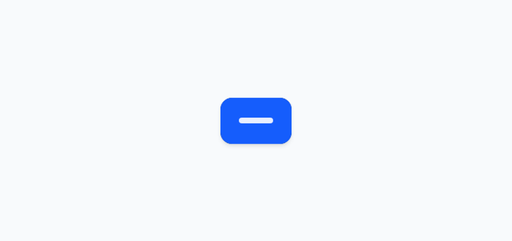
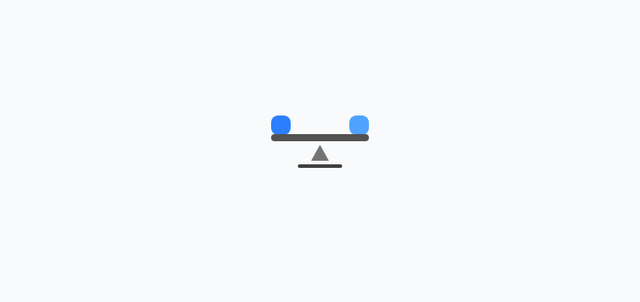
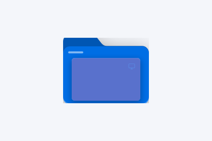
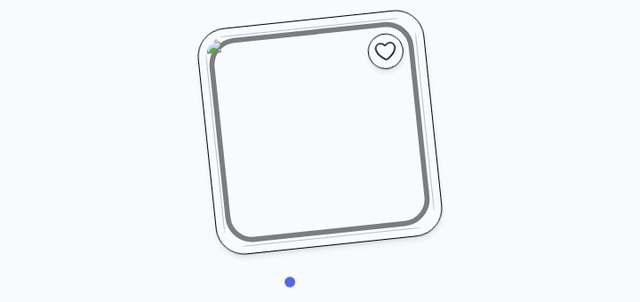
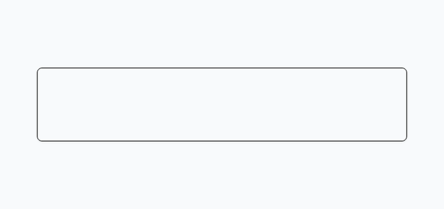
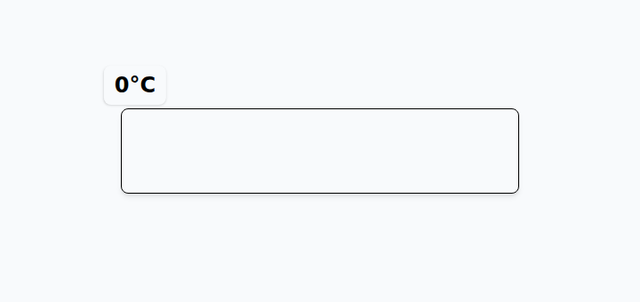

# Anteprime dei componenti — beerclass-ai

**34 componenti associati**, dal solo catalogo Design-App; l'associazione non prova che il componente sia integrato nell'app.

[Tutte le app](./README.md) · [Catalogo completo](../TABELLA_478.md) · [Vista con filtro app](../../docs/componenti.html?app=beerclass-ai)

Le immagini qui mostrate sono catture documentali, **non** una verifica di riuso Flutter, compatibilità nativa o licenze degli asset di terzi. In assenza di una PNG realmente acquisita la cella dichiara «Non disponibile» e punta alla fonte originale. Le colonne Codice originale e Codice Flutter sono INDIPENDENTI; una variante Dart non implica test su app consumer.

| Anteprima | UID | ID canonico | Componente | Fonte | Categoria | App associate | Codice originale | Codice Flutter |
|---|---|---|---|---|---|---|---|---|
| <small>Non disponibile</small> · <a href="https://devlibraries.com/libraries/amicro/perspective-flip" target="_blank" rel="noopener noreferrer">Fonte</a> | <code>UID-0003</code> | <code>AMX-003</code> | Perspective Flip | <a href="https://devlibraries.com/libraries/amicro/perspective-flip" target="_blank" rel="noopener noreferrer">DEVLIBRARIES_AMICRO</a> | UNVERIFIED_CARD_3D_FLIP | anna-s-diary, app-factory-dashboard, beerclass-ai, cooking-anime, edu-01-corpo-umano, notes-ecosistema, wonderlog, world-days | <a href="https://devlibraries.com/libraries/amicro/perspective-flip" target="_blank" rel="noopener noreferrer">Solo riferimento</a> | Sorgente non archiviata |
| <small>Non disponibile</small> · <a href="https://github.com/Subhan-code/Amicro--Micro-transitions-/blob/fa5f8ffbe39537a8db191806066b8773c47c82e9/registry/ui/scroll/scroll-reveal.tsx" target="_blank" rel="noopener noreferrer">Fonte</a> | <code>UID-0004</code> | <code>AMX-004</code> | Scroll Reveal | <a href="https://github.com/Subhan-code/Amicro--Micro-transitions-/blob/fa5f8ffbe39537a8db191806066b8773c47c82e9/registry/ui/scroll/scroll-reveal.tsx" target="_blank" rel="noopener noreferrer">DEVLIBRARIES_AMICRO</a> | SCROLL_TRIGGERED_ENTRANCE | anna-s-diary, app-factory-dashboard, battery-guard, beerclass-ai, camperboss, cashmate-ai, cooking-anime, edu-01-corpo-umano, framelab, notes-ecosistema, omni-cleaner, trailpath, web-utility-factory, wonderlog, world-days | <a href="../../BIBLIOTECA_COMPONENTI/sorgenti/amicro/amx-004.tsx" target="_blank" rel="noopener noreferrer">Apri TypeScript/React</a> | Da convertire |
| <small>Non disponibile</small> · <a href="https://devlibraries.com/libraries/easeui" target="_blank" rel="noopener noreferrer">Fonte</a> | <code>UID-0034</code> | <code>DSP-001</code> | EaseUI Theme Toggle | <a href="https://devlibraries.com/libraries/easeui" target="_blank" rel="noopener noreferrer">DEVLIBRARIES_EASEUI</a> | THEME_LIGHT_DARK | anna-s-diary, app-factory-dashboard, battery-guard, beerclass-ai, camperboss, cashmate-ai, cooking-anime, deskland-android, easy-debloat, focussense, framelab, notes-ecosistema, omni-cleaner, sleepmax-coach, trailpath, web-utility-factory, wonderlog, world-days | <a href="../../BIBLIOTECA_COMPONENTI/sorgenti/easeui/dsp-001.tsx" target="_blank" rel="noopener noreferrer">Apri TypeScript/React</a> | Da convertire |
|  | <code>UID-0035</code> | <code>DSP-002</code> | Card Stack Peel | <a href="https://devlibraries.com/libraries/amicro/card-stack-peel" target="_blank" rel="noopener noreferrer">DEVLIBRARIES_AMICRO</a> | SECTION_CARD_TRANSITION | anna-s-diary, app-factory-dashboard, beerclass-ai, cooking-anime, framelab, notes-ecosistema, omni-cleaner, wonderlog, world-days | <a href="../../BIBLIOTECA_COMPONENTI/sorgenti/amicro/dsp-002.tsx" target="_blank" rel="noopener noreferrer">Apri TypeScript/React</a> | Da convertire |
|  | <code>UID-0036</code> | <code>DSP-003</code> | Accordion Blind Pull | <a href="https://devlibraries.com/libraries/amicro" target="_blank" rel="noopener noreferrer">DEVLIBRARIES_AMICRO</a> | EXPANDABLE_PANEL_TRANSITION | anna-s-diary, app-factory-dashboard, battery-guard, beerclass-ai, camperboss, cashmate-ai, cooking-anime, easy-debloat, notes-ecosistema, omni-cleaner, trailpath, wonderlog, world-days | <a href="../../BIBLIOTECA_COMPONENTI/sorgenti/amicro/dsp-003.tsx" target="_blank" rel="noopener noreferrer">Apri TypeScript/React</a> | Da convertire |
|  | <code>UID-0073</code> | <code>ICO-019</code> | Valutazione / preferito | <a href="https://gentleface.com/icons/star" target="_blank" rel="noopener noreferrer">GENTLEFACE</a> | ICON | beerclass-ai, cooking-anime, wonderlog, world-days | <a href="../../BIBLIOTECA_COMPONENTI/sorgenti/gentleface/ICO-019.svg" target="_blank" rel="noopener noreferrer">Apri SVG (original, archived)</a> | <a href="../../BIBLIOTECA_COMPONENTI/flutter_adapters/lib/src/gentleface/ico_019.dart" target="_blank" rel="noopener noreferrer">Apri codice Flutter (bozza)</a> |
|  | <code>UID-0361</code> | <code>UIV-002</code> | Pulsante pill con riempimento gradiente on-hover | <a href="https://uiverse.io/xueyuantan/rotten-pig-19" target="_blank" rel="noopener noreferrer">UIVERSE</a> | BUTTON | annas-diary, beerclass-ai, camperboss, cooking-anime, web-utility-factory, wonderlog, world-days | <a href="../../UI-UX/UIVERSE/CODICE_SORGENTE/UIV-002_original.html" target="_blank" rel="noopener noreferrer">Apri HTML/CSS</a> | <a href="../../BIBLIOTECA_COMPONENTI/flutter_adapters/lib/src/uiv_002_gradient_pill_button.dart" target="_blank" rel="noopener noreferrer">Apri codice Flutter (bozza)</a> |
|  | <code>UID-0362</code> | <code>UIV-003</code> | Card gradiente rosa-arancio con testo rivelato su hover | <a href="https://uiverse.io/gharsh11032000/tricky-cheetah-78" target="_blank" rel="noopener noreferrer">UIVERSE</a> | CARD | app-factory-dashboard, beerclass-ai, cashmate-ai, cooking-anime, notes-ecosistema, wonderlog, world-days | <a href="../../UI-UX/UIVERSE/CODICE_SORGENTE/UIV-003_original.html" target="_blank" rel="noopener noreferrer">Apri HTML/CSS</a> | Da convertire |
|  | <code>UID-0369</code> | <code>UIV-010</code> | Scheda pubblica Uiverse classificata come CARD; il codice HTML/CSS non è presente nell&#x27;archivio Galaxy e non è stato acquisito. | <a href="https://uiverse.io/00Kubi/fluffy-jellyfish-87" target="_blank" rel="noopener noreferrer">UIVERSE</a> | CARD | annas-diary, beerclass-ai, cooking-anime, framelab, notes-ecosistema, wonderlog, world-days | <a href="../../UI-UX/UIVERSE/CODICE_SORGENTE/UIV-010_original.html" target="_blank" rel="noopener noreferrer">Apri HTML/CSS</a> | Da convertire |
|  | <code>UID-0373</code> | <code>UIV-014</code> | Componente Uiverse nella categoria CARD; HTML/CSS originale archiviato con blob SHA. L&#x27;effetto specifico richiede ispezione del sorgente e collaudo visivo. | <a href="https://uiverse.io/ElSombrero2/tricky-robin-67" target="_blank" rel="noopener noreferrer">UIVERSE</a> | CARD | annas-diary, beerclass-ai, cooking-anime, framelab, notes-ecosistema, wonderlog, world-days | <a href="../../UI-UX/UIVERSE/CODICE_SORGENTE/UIV-014_original.html" target="_blank" rel="noopener noreferrer">Apri HTML/CSS</a> | Da convertire |
|  | <code>UID-0374</code> | <code>UIV-015</code> | Scheda pubblica Uiverse classificata come BUTTON; il codice HTML/CSS non è presente nell&#x27;archivio Galaxy e non è stato acquisito. | <a href="https://uiverse.io/FColombati/spotty-snake-82" target="_blank" rel="noopener noreferrer">UIVERSE</a> | BUTTON | annas-diary, beerclass-ai, camperboss, cooking-anime, easy-debloat, framelab | <a href="../../UI-UX/UIVERSE/CODICE_SORGENTE/UIV-015_original.html" target="_blank" rel="noopener noreferrer">Apri HTML/CSS</a> | Da convertire |
|  | <code>UID-0375</code> | <code>UIV-016</code> | Scheda pubblica Uiverse classificata come CARD; il codice HTML/CSS non è presente nell&#x27;archivio Galaxy e non è stato acquisito. | <a href="https://uiverse.io/Gidarx/clever-panther-6" target="_blank" rel="noopener noreferrer">UIVERSE</a> | CARD | app-factory-dashboard, beerclass-ai, camperboss, cashmate-ai, deskland-android, edu-01-corpo-umano, notes-ecosistema | <a href="../../UI-UX/UIVERSE/CODICE_SORGENTE/UIV-016_original.html" target="_blank" rel="noopener noreferrer">Apri HTML/CSS</a> | Da convertire |
|  | <code>UID-0383</code> | <code>UIV-024</code> | Componente Uiverse nella categoria CARD; HTML/CSS originale archiviato con blob SHA. L&#x27;effetto specifico richiede ispezione del sorgente e collaudo visivo. | <a href="https://uiverse.io/MuhammadHasann/fast-badger-70" target="_blank" rel="noopener noreferrer">UIVERSE</a> | CARD | annas-diary, beerclass-ai, cooking-anime, framelab, notes-ecosistema, wonderlog, world-days | <a href="../../UI-UX/UIVERSE/CODICE_SORGENTE/UIV-024_original.html" target="_blank" rel="noopener noreferrer">Apri HTML/CSS</a> | Da convertire |
|  | <code>UID-0396</code> | <code>UIV-037</code> | Componente Uiverse nella categoria CARD; HTML/CSS originale archiviato con blob SHA. L&#x27;effetto specifico richiede ispezione del sorgente e collaudo visivo. | <a href="https://uiverse.io/Prince4fff/slippery-baboon-37" target="_blank" rel="noopener noreferrer">UIVERSE</a> | CARD | app-factory-dashboard, beerclass-ai, cashmate-ai, cooking-anime, framelab, notes-ecosistema, wonderlog | <a href="../../UI-UX/UIVERSE/CODICE_SORGENTE/UIV-037_original.html" target="_blank" rel="noopener noreferrer">Apri HTML/CSS</a> | Da convertire |
|  | <code>UID-0397</code> | <code>UIV-038</code> | Scheda pubblica Uiverse classificata come BUTTON; il codice HTML/CSS non è presente nell&#x27;archivio Galaxy e non è stato acquisito. | <a href="https://uiverse.io/Priyanshu02020/popular-puma-87" target="_blank" rel="noopener noreferrer">UIVERSE</a> | BUTTON | annas-diary, beerclass-ai, cooking-anime, framelab, wonderlog, world-days | <a href="../../UI-UX/UIVERSE/CODICE_SORGENTE/UIV-038_original.html" target="_blank" rel="noopener noreferrer">Apri HTML/CSS</a> | Da convertire |
|  | <code>UID-0407</code> | <code>UIV-048</code> | Componente Uiverse nella categoria CARD; HTML/CSS originale archiviato con blob SHA. L&#x27;effetto specifico richiede ispezione del sorgente e collaudo visivo. | <a href="https://uiverse.io/akshat-patel28/quick-baboon-29" target="_blank" rel="noopener noreferrer">UIVERSE</a> | CARD | annas-diary, beerclass-ai, cooking-anime, framelab, notes-ecosistema, wonderlog, world-days | <a href="../../UI-UX/UIVERSE/CODICE_SORGENTE/UIV-048_original.html" target="_blank" rel="noopener noreferrer">Apri HTML/CSS</a> | Da convertire |
|  | <code>UID-0413</code> | <code>UIV-054</code> | Scheda pubblica Uiverse classificata come CARD; il codice HTML/CSS non è presente nell&#x27;archivio Galaxy e non è stato acquisito. | <a href="https://uiverse.io/byllzz/great-wombat-13" target="_blank" rel="noopener noreferrer">UIVERSE</a> | CARD | app-factory-dashboard, beerclass-ai, cashmate-ai, cooking-anime, framelab, notes-ecosistema, wonderlog | <a href="../../UI-UX/UIVERSE/CODICE_SORGENTE/UIV-054_original.html" target="_blank" rel="noopener noreferrer">Apri HTML/CSS</a> | Da convertire |
|  | <code>UID-0422</code> | <code>UIV-063</code> | Scheda pubblica Uiverse classificata come CARD; il codice HTML/CSS non è presente nell&#x27;archivio Galaxy e non è stato acquisito. | <a href="https://uiverse.io/dexter-st/tough-falcon-78" target="_blank" rel="noopener noreferrer">UIVERSE</a> | CARD | app-factory-dashboard, beerclass-ai, camperboss, cashmate-ai, deskland-android, edu-01-corpo-umano, notes-ecosistema | <a href="../../UI-UX/UIVERSE/CODICE_SORGENTE/UIV-063_original.html" target="_blank" rel="noopener noreferrer">Apri HTML/CSS</a> | Da convertire |
|  | <code>UID-0426</code> | <code>UIV-067</code> | Scheda pubblica Uiverse classificata come RADIO; il codice HTML/CSS non è presente nell&#x27;archivio Galaxy e non è stato acquisito. | <a href="https://uiverse.io/elijahgummer/young-horse-7" target="_blank" rel="noopener noreferrer">UIVERSE</a> | RADIO | annas-diary, beerclass-ai, cashmate-ai, notes-ecosistema, sleepmax-coach, web-utility-factory | <a href="../../UI-UX/UIVERSE/CODICE_SORGENTE/UIV-067_original.html" target="_blank" rel="noopener noreferrer">Apri HTML/CSS</a> | Da convertire |
|  | <code>UID-0432</code> | <code>UIV-073</code> | Scheda pubblica Uiverse classificata come CARD; il codice HTML/CSS non è presente nell&#x27;archivio Galaxy e non è stato acquisito. | <a href="https://uiverse.io/ilkhoeri/thin-bobcat-83" target="_blank" rel="noopener noreferrer">UIVERSE</a> | CARD | app-factory-dashboard, beerclass-ai, cashmate-ai, cooking-anime, framelab, notes-ecosistema, wonderlog | <a href="../../UI-UX/UIVERSE/CODICE_SORGENTE/UIV-073_original.html" target="_blank" rel="noopener noreferrer">Apri HTML/CSS</a> | Da convertire |
|  | <code>UID-0436</code> | <code>UIV-077</code> | Componente Uiverse nella categoria CARD; HTML/CSS originale archiviato con blob SHA. L&#x27;effetto specifico richiede ispezione del sorgente e collaudo visivo. | <a href="https://uiverse.io/kennyotsu/fast-emu-70" target="_blank" rel="noopener noreferrer">UIVERSE</a> | CARD | app-factory-dashboard, beerclass-ai, cashmate-ai, cooking-anime, framelab, notes-ecosistema, wonderlog | <a href="../../UI-UX/UIVERSE/CODICE_SORGENTE/UIV-077_original.html" target="_blank" rel="noopener noreferrer">Apri HTML/CSS</a> | Da convertire |
|  | <code>UID-0437</code> | <code>UIV-078</code> | Scheda pubblica Uiverse classificata come CARD; il codice HTML/CSS non è presente nell&#x27;archivio Galaxy e non è stato acquisito. | <a href="https://uiverse.io/kennyotsu/giant-sloth-18" target="_blank" rel="noopener noreferrer">UIVERSE</a> | CARD | app-factory-dashboard, beerclass-ai, camperboss, cashmate-ai, deskland-android, edu-01-corpo-umano, notes-ecosistema | <a href="../../UI-UX/UIVERSE/CODICE_SORGENTE/UIV-078_original.html" target="_blank" rel="noopener noreferrer">Apri HTML/CSS</a> | Da convertire |
|  | <code>UID-0439</code> | <code>UIV-080</code> | Componente Uiverse nella categoria CARD; HTML/CSS originale archiviato con blob SHA. L&#x27;effetto specifico richiede ispezione del sorgente e collaudo visivo. | <a href="https://uiverse.io/kennyotsu/short-ape-5" target="_blank" rel="noopener noreferrer">UIVERSE</a> | CARD | annas-diary, beerclass-ai, cooking-anime, framelab, notes-ecosistema, wonderlog, world-days | <a href="../../UI-UX/UIVERSE/CODICE_SORGENTE/UIV-080_original.html" target="_blank" rel="noopener noreferrer">Apri HTML/CSS</a> | Da convertire |
|  | <code>UID-0440</code> | <code>UIV-081</code> | Scheda pubblica Uiverse classificata come CARD; il codice HTML/CSS non è presente nell&#x27;archivio Galaxy e non è stato acquisito. | <a href="https://uiverse.io/kennyotsu/tender-badger-21" target="_blank" rel="noopener noreferrer">UIVERSE</a> | CARD | app-factory-dashboard, beerclass-ai, cashmate-ai, cooking-anime, framelab, trailpath, wonderlog | <a href="../../UI-UX/UIVERSE/CODICE_SORGENTE/UIV-081_original.html" target="_blank" rel="noopener noreferrer">Apri HTML/CSS</a> | Da convertire |
|  | <code>UID-0441</code> | <code>UIV-082</code> | Componente Uiverse nella categoria CARD; HTML/CSS originale archiviato con blob SHA. L&#x27;effetto specifico richiede ispezione del sorgente e collaudo visivo. | <a href="https://uiverse.io/kennyotsu/wise-rattlesnake-92" target="_blank" rel="noopener noreferrer">UIVERSE</a> | CARD | app-factory-dashboard, beerclass-ai, camperboss, cashmate-ai, deskland-android, edu-01-corpo-umano, notes-ecosistema | <a href="../../UI-UX/UIVERSE/CODICE_SORGENTE/UIV-082_original.html" target="_blank" rel="noopener noreferrer">Apri HTML/CSS</a> | Da convertire |
|  | <code>UID-0451</code> | <code>UIV-092</code> | Scheda pubblica Uiverse classificata come CARD; il codice HTML/CSS non è presente nell&#x27;archivio Galaxy e non è stato acquisito. | <a href="https://uiverse.io/mymiamo/quiet-dragon-5" target="_blank" rel="noopener noreferrer">UIVERSE</a> | CARD | annas-diary, beerclass-ai, cooking-anime, framelab, notes-ecosistema, wonderlog, world-days | <a href="../../UI-UX/UIVERSE/CODICE_SORGENTE/UIV-092_original.html" target="_blank" rel="noopener noreferrer">Apri HTML/CSS</a> | Da convertire |
|  | <code>UID-0456</code> | <code>UIV-097</code> | Componente Uiverse nella categoria CARD; HTML/CSS originale archiviato con blob SHA. L&#x27;effetto specifico richiede ispezione del sorgente e collaudo visivo. | <a href="https://uiverse.io/vamsidevendrakumar/soft-shrimp-94" target="_blank" rel="noopener noreferrer">UIVERSE</a> | CARD | app-factory-dashboard, beerclass-ai, cashmate-ai, cooking-anime, framelab, notes-ecosistema, wonderlog | <a href="../../UI-UX/UIVERSE/CODICE_SORGENTE/UIV-097_original.html" target="_blank" rel="noopener noreferrer">Apri HTML/CSS</a> | Da convertire |
|  | <code>UID-0460</code> | <code>UIV-101</code> | Blue modern login form; use only where an input or optional account flow already exists. Categoria FORM verificata nel post pubblico Uiverse. Tag originali: blue, form, login form, tailwind, rounded, input, button, blue, border, modern. | <a href="https://uiverse.io/Javierrocadev/chatty-ladybug-95" target="_blank" rel="noopener noreferrer">UIVERSE</a> | FORM | annas-diary, app-factory-dashboard, beerclass-ai, cashmate-ai, notes-ecosistema, wonderlog, world-days | <a href="../../UI-UX/UIVERSE/CODICE_SORGENTE/UIV-101_original.html" target="_blank" rel="noopener noreferrer">Apri HTML/CSS</a> | Da convertire |
|  | <code>UID-0462</code> | <code>UIV-103</code> | Blue gradient and depth form; tone down gloss and 3D for readable mobile inputs. Categoria FORM verificata nel post pubblico Uiverse. Tag originali: simple, login, 3d, social, gradient, form, submit, login form, rounded, button. | <a href="https://uiverse.io/SyedShahzaib7/brave-dog-61" target="_blank" rel="noopener noreferrer">UIVERSE</a> | FORM | app-factory-dashboard, beerclass-ai, cashmate-ai, notes-ecosistema, send-to-pc, world-days | <a href="../../UI-UX/UIVERSE/CODICE_SORGENTE/UIV-103_original.html" target="_blank" rel="noopener noreferrer">Apri HTML/CSS</a> | Da convertire |
|  | <code>UID-0464</code> | <code>UIV-105</code> | Welcome/social login form; explicit consent and existing optional provider only. Categoria FORM verificata nel post pubblico Uiverse. Tag originali: login, email, social, form, submit, confirm, password, welcome, rounded, shadow. | <a href="https://uiverse.io/ayyjayy2/sour-dog-94" target="_blank" rel="noopener noreferrer">UIVERSE</a> | FORM | annas-diary, app-factory-dashboard, beerclass-ai, cashmate-ai, cooking-anime, framelab, notes-ecosistema, wonderlog | <a href="../../UI-UX/UIVERSE/CODICE_SORGENTE/UIV-105_original.html" target="_blank" rel="noopener noreferrer">Apri HTML/CSS</a> | Da convertire |
|  | <code>UID-0467</code> | <code>UIV-109</code> | Pink retro/pastel stars form; adapt to approved rose palette and reduced-motion. Categoria FORM verificata nel post pubblico Uiverse. Tag originali: form, button, bold, pink, password, email, retro, toggle, switch, login. | <a href="https://uiverse.io/mamyapro123/curvy-bear-51" target="_blank" rel="noopener noreferrer">UIVERSE</a> | FORM | annas-diary, beerclass-ai, camperboss, cooking-anime, notes-ecosistema, sleepmax-coach, wonderlog, world-days | <a href="../../UI-UX/UIVERSE/CODICE_SORGENTE/UIV-109_original.html" target="_blank" rel="noopener noreferrer">Apri HTML/CSS</a> | Da convertire |
|  | <code>UID-0470</code> | <code>WML-001</code> | Carousel Slider | <a href="https://devlibraries.com/libraries/watermelon/carousel-slider" target="_blank" rel="noopener noreferrer">DEVLIBRARIES_WATERMELON</a> | CAROUSEL_GESTURE | anna-s-diary, beerclass-ai, camperboss, cooking-anime, framelab, notes-ecosistema, omni-cleaner, wonderlog, world-days | <a href="../../BIBLIOTECA_COMPONENTI/sorgenti/watermelon/wml-001.tsx" target="_blank" rel="noopener noreferrer">Apri TypeScript/React</a> | Da convertire |
|  | <code>UID-0471</code> | <code>WML-002</code> | Fractional Picker | <a href="https://devlibraries.com/libraries/watermelon/fractional-picker" target="_blank" rel="noopener noreferrer">DEVLIBRARIES_WATERMELON</a> | RULER_PICKER | anna-s-diary, battery-guard, beerclass-ai, camperboss, cooking-anime, focussense, sleepmax-coach, world-days | <a href="../../BIBLIOTECA_COMPONENTI/sorgenti/watermelon/wml-002.tsx" target="_blank" rel="noopener noreferrer">Apri TypeScript/React</a> | Da convertire |
|  | <code>UID-0472</code> | <code>WML-003</code> | Scrub Slider (base) | <a href="https://devlibraries.com/libraries/watermelon/scrub-slider-base" target="_blank" rel="noopener noreferrer">DEVLIBRARIES_WATERMELON</a> | SCRUB_PRECISION | anna-s-diary, beerclass-ai, cooking-anime, focussense, framelab, notes-ecosistema, omni-cleaner, trailpath, wonderlog | <a href="../../BIBLIOTECA_COMPONENTI/sorgenti/watermelon/wml-003.tsx" target="_blank" rel="noopener noreferrer">Apri TypeScript/React</a> | Da convertire |
