# Anteprime dei componenti — camperboss

**63 componenti associati**, dal solo catalogo Design-App; l'associazione non prova che il componente sia integrato nell'app.

[Tutte le app](./README.md) · [Catalogo completo](../TABELLA_478.md) · [Vista con filtro app](../../docs/componenti.html?app=camperboss)

Le immagini qui mostrate sono catture documentali, **non** una verifica di riuso Flutter, compatibilità nativa o licenze degli asset di terzi. In assenza di una PNG realmente acquisita la cella dichiara «Non disponibile» e punta alla fonte originale.

| Anteprima | ID | Componente | Fonte | Categoria | App associate | Codice |
|---|---|---|---|---|---|---|
| <small>Non disponibile</small> · <a href="https://github.com/Subhan-code/Amicro--Micro-transitions-/blob/fa5f8ffbe39537a8db191806066b8773c47c82e9/registry/ui/scroll/scroll-reveal.tsx" target="_blank" rel="noopener noreferrer">Fonte</a> | <code>AMX-004</code> | Scroll Reveal | <a href="https://github.com/Subhan-code/Amicro--Micro-transitions-/blob/fa5f8ffbe39537a8db191806066b8773c47c82e9/registry/ui/scroll/scroll-reveal.tsx" target="_blank" rel="noopener noreferrer">DEVLIBRARIES_AMICRO</a> | SCROLL_TRIGGERED_ENTRANCE | anna-s-diary, app-factory-dashboard, battery-guard, beerclass-ai, camperboss, cashmate-ai, cooking-anime, edu-01-corpo-umano, framelab, notes-ecosistema, omni-cleaner, trailpath, web-utility-factory, wonderlog, world-days | Sorgente archiviata |
| <small>Non disponibile</small> · <a href="https://github.com/Subhan-code/Amicro--Micro-transitions-/blob/fa5f8ffbe39537a8db191806066b8773c47c82e9/registry/ui/loading/accordion-loader.tsx" target="_blank" rel="noopener noreferrer">Fonte</a> | <code>AMX-006</code> | Accordion Loader | <a href="https://github.com/Subhan-code/Amicro--Micro-transitions-/blob/fa5f8ffbe39537a8db191806066b8773c47c82e9/registry/ui/loading/accordion-loader.tsx" target="_blank" rel="noopener noreferrer">DEVLIBRARIES_AMICRO</a> | INDETERMINATE_LOADING | anna-s-diary, app-factory-dashboard, battery-guard, camperboss, cooking-anime, deskland-android, easy-debloat, focussense, framelab, notes-ecosistema, omni-cleaner, send-to-pc, web-utility-factory, wonderlog, world-days | Sorgente archiviata |
| <small>Non disponibile</small> | <code>DBM-024</code> | View On Map | <a href="https://github.com/riccardopinato/Design-App/blob/main/BIBLIOTECA_COMPONENTI/sorgenti/watermelon/dbm-024.tsx" target="_blank" rel="noopener noreferrer">DEVLIBRARIES_BOOKMARKS</a> | MAP_PREVIEW_OVERLAY | anna-s-diary, camperboss, trailpath, wonderlog, world-days | Sorgente archiviata |
| <small>Non disponibile</small> · <a href="https://devlibraries.com/libraries/easeui" target="_blank" rel="noopener noreferrer">Fonte</a> | <code>DSP-001</code> | EaseUI Theme Toggle | <a href="https://devlibraries.com/libraries/easeui" target="_blank" rel="noopener noreferrer">DEVLIBRARIES_EASEUI</a> | THEME_LIGHT_DARK | anna-s-diary, app-factory-dashboard, battery-guard, beerclass-ai, camperboss, cashmate-ai, cooking-anime, deskland-android, easy-debloat, focussense, framelab, notes-ecosistema, omni-cleaner, sleepmax-coach, trailpath, web-utility-factory, wonderlog, world-days | Sorgente archiviata |
| <small>Non disponibile</small> · <a href="https://devlibraries.com/libraries/amicro" target="_blank" rel="noopener noreferrer">Fonte</a> | <code>DSP-003</code> | Accordion Blind Pull | <a href="https://devlibraries.com/libraries/amicro" target="_blank" rel="noopener noreferrer">DEVLIBRARIES_AMICRO</a> | EXPANDABLE_PANEL_TRANSITION | anna-s-diary, app-factory-dashboard, battery-guard, beerclass-ai, camperboss, cashmate-ai, cooking-anime, easy-debloat, notes-ecosistema, omni-cleaner, trailpath, wonderlog, world-days | Sorgente archiviata |
| <small>Non disponibile</small> · <a href="https://devlibraries.com/libraries/amicro" target="_blank" rel="noopener noreferrer">Fonte</a> | <code>DSP-005</code> | Shutter Step Slices | <a href="https://devlibraries.com/libraries/amicro" target="_blank" rel="noopener noreferrer">DEVLIBRARIES_AMICRO</a> | STAGGERED_REVEAL | anna-s-diary, app-factory-dashboard, camperboss, cooking-anime, deskland-android, framelab, notes-ecosistema, omni-cleaner, wonderlog, world-days | Sorgente archiviata |
| <small>Non disponibile</small> | <code>DSP-006</code> | Loading &amp; Waiting Visual References (user screenshot) | USER_IMAGE | LOADING_WAIT_STATE_REFERENCE | anna-s-diary, app-factory-dashboard, battery-guard, camperboss, cashmate-ai, cooking-anime, deskland-android, easy-debloat, focussense, framelab, notes-ecosistema, omni-cleaner, send-to-pc, trailpath, web-utility-factory, wonderlog, world-days | Solo riferimento |
| <small>Non disponibile</small> · <a href="https://fluttercomponentlibrary.com/pages/components/bottom-sheet.html" target="_blank" rel="noopener noreferrer">Fonte</a> | <code>FCL-005</code> | Bottom Sheet | <a href="https://fluttercomponentlibrary.com/pages/components/bottom-sheet.html" target="_blank" rel="noopener noreferrer">FLUTTER_COMPONENT_LIBRARY</a> | dialogs | annas-diary, battery-guard, camperboss, framelab, notes-ecosistema | Solo riferimento |
| <small>Non disponibile</small> · <a href="https://fluttercomponentlibrary.com/pages/components/faq-widget.html" target="_blank" rel="noopener noreferrer">Fonte</a> | <code>FCL-008</code> | FAQ Widget | <a href="https://fluttercomponentlibrary.com/pages/components/faq-widget.html" target="_blank" rel="noopener noreferrer">FLUTTER_COMPONENT_LIBRARY</a> | other | camperboss, world-days | Solo riferimento |
| <small>Non disponibile</small> · <a href="https://fluttercomponentlibrary.com/pages/components/stepper.html" target="_blank" rel="noopener noreferrer">Fonte</a> | <code>FCL-009</code> | Stepper | <a href="https://fluttercomponentlibrary.com/pages/components/stepper.html" target="_blank" rel="noopener noreferrer">FLUTTER_COMPONENT_LIBRARY</a> | other | camperboss | Solo riferimento |
| <small>Non disponibile</small> · <a href="https://gentleface.com/icons/calendar" target="_blank" rel="noopener noreferrer">Fonte</a> | <code>ICO-002</code> | Vista calendario | <a href="https://gentleface.com/icons/calendar" target="_blank" rel="noopener noreferrer">GENTLEFACE</a> | ICON | anna-s-diary, camperboss, sleepmax-coach, wonderlog, world-days | Solo riferimento |
| <small>Non disponibile</small> · <a href="https://gentleface.com/icons/download" target="_blank" rel="noopener noreferrer">Fonte</a> | <code>ICO-005</code> | Download dati / file | <a href="https://gentleface.com/icons/download" target="_blank" rel="noopener noreferrer">GENTLEFACE</a> | ICON | camperboss, notes-ecosistema, omni-cleaner, wonderlog, world-days | Solo riferimento |
| <small>Non disponibile</small> · <a href="https://gentleface.com/icons/import" target="_blank" rel="noopener noreferrer">Fonte</a> | <code>ICO-007</code> | Importa | <a href="https://gentleface.com/icons/import" target="_blank" rel="noopener noreferrer">GENTLEFACE</a> | ICON | anna-s-diary, camperboss, notes-ecosistema, wonderlog | Solo riferimento |
| <small>Non disponibile</small> · <a href="https://gentleface.com/icons/map-pin" target="_blank" rel="noopener noreferrer">Fonte</a> | <code>ICO-016</code> | Punto mappa | <a href="https://gentleface.com/icons/map-pin" target="_blank" rel="noopener noreferrer">GENTLEFACE</a> | ICON | camperboss, trailpath, wonderlog, world-days | Solo riferimento |
| <small>Non disponibile</small> · <a href="https://gentleface.com/icons/gauge" target="_blank" rel="noopener noreferrer">Fonte</a> | <code>ICO-018</code> | Indicatore / metriche | <a href="https://gentleface.com/icons/gauge" target="_blank" rel="noopener noreferrer">GENTLEFACE</a> | ICON | app-factory-dashboard, battery-guard, camperboss, cashmate-ai, focussense | Solo riferimento |
|  | <code>UIV-002</code> | Pulsante pill con riempimento gradiente on-hover | <a href="https://uiverse.io/xueyuantan/rotten-pig-19" target="_blank" rel="noopener noreferrer">UIVERSE</a> | BUTTON | annas-diary, beerclass-ai, camperboss, cooking-anime, web-utility-factory, wonderlog, world-days | Sorgente archiviata |
|  | <code>UIV-004</code> | Card editoriale con header gradiente, segnalibro e icona aereo SVG | <a href="https://uiverse.io/JohnnyCSilva/jolly-elephant-67" target="_blank" rel="noopener noreferrer">UIVERSE</a> | CARD | annas-diary, camperboss, framelab, notes-ecosistema, web-utility-factory, wonderlog, world-days | Sorgente archiviata |
| <a href="../../docs/assets/componenti/UIV-008.png">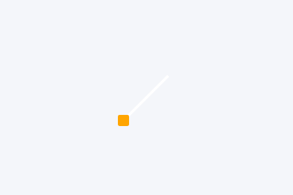</a> | <code>UIV-008</code> | Quadrato arancio animato che sale una diagonale a gradini | <a href="https://uiverse.io/Shoh2008/cold-walrus-85" target="_blank" rel="noopener noreferrer">UIVERSE</a> | LOADER | battery-guard, camperboss, easy-debloat, notes-ecosistema, omni-cleaner, send-to-pc, world-days | Sorgente archiviata |
|  | <code>UIV-012</code> | Componente Uiverse nella categoria SWITCH; HTML/CSS originale archiviato con blob SHA. L&#x27;effetto specifico richiede ispezione del sorgente e collaudo visivo. | <a href="https://uiverse.io/Admin12121/massive-dodo-67" target="_blank" rel="noopener noreferrer">UIVERSE</a> | SWITCH | battery-guard, camperboss, easy-debloat, phone-guard, pocket-guard, sleepmax-coach, the-luminous-infinite-circle | Sorgente archiviata |
|  | <code>UIV-013</code> | Componente Uiverse nella categoria LOADER; HTML/CSS originale archiviato con blob SHA. L&#x27;effetto specifico richiede ispezione del sorgente e collaudo visivo. | <a href="https://uiverse.io/AqFox/young-dragon-29" target="_blank" rel="noopener noreferrer">UIVERSE</a> | LOADER | camperboss, cooking-anime, deskland-android, focussense, omni-cleaner, sleepmax-coach, wonderlog | Sorgente archiviata |
|  | <code>UIV-015</code> | Scheda pubblica Uiverse classificata come BUTTON; il codice HTML/CSS non è presente nell&#x27;archivio Galaxy e non è stato acquisito. | <a href="https://uiverse.io/FColombati/spotty-snake-82" target="_blank" rel="noopener noreferrer">UIVERSE</a> | BUTTON | annas-diary, beerclass-ai, camperboss, cooking-anime, easy-debloat, framelab | Sorgente archiviata |
|  | <code>UIV-016</code> | Scheda pubblica Uiverse classificata come CARD; il codice HTML/CSS non è presente nell&#x27;archivio Galaxy e non è stato acquisito. | <a href="https://uiverse.io/Gidarx/clever-panther-6" target="_blank" rel="noopener noreferrer">UIVERSE</a> | CARD | app-factory-dashboard, beerclass-ai, camperboss, cashmate-ai, deskland-android, edu-01-corpo-umano, notes-ecosistema | Sorgente archiviata |
|  | <code>UIV-017</code> | Scheda pubblica Uiverse classificata come CARD; il codice HTML/CSS non è presente nell&#x27;archivio Galaxy e non è stato acquisito. | <a href="https://uiverse.io/Gidarx/moody-falcon-73" target="_blank" rel="noopener noreferrer">UIVERSE</a> | CARD | annas-diary, camperboss, deskland-android, edu-01-corpo-umano, notes-ecosistema, wonderlog, world-days | Sorgente archiviata |
|  | <code>UIV-018</code> | Componente Uiverse nella categoria SWITCH; HTML/CSS originale archiviato con blob SHA. L&#x27;effetto specifico richiede ispezione del sorgente e collaudo visivo. | <a href="https://uiverse.io/JaydipPrajapati1910/average-shrimp-57" target="_blank" rel="noopener noreferrer">UIVERSE</a> | SWITCH | battery-guard, camperboss, cashmate-ai, focussense, omni-cleaner, tabletop-motion-alarm, the-luminous-infinite-circle | Sorgente archiviata |
|  | <code>UIV-021</code> | Componente Uiverse nella categoria CARD; HTML/CSS originale archiviato con blob SHA. L&#x27;effetto specifico richiede ispezione del sorgente e collaudo visivo. | <a href="https://uiverse.io/JohnnyCSilva/black-rabbit-68" target="_blank" rel="noopener noreferrer">UIVERSE</a> | CARD | annas-diary, camperboss, deskland-android, edu-01-corpo-umano, notes-ecosistema, wonderlog, world-days | Sorgente archiviata |
| <a href="../../docs/assets/componenti/UIV-025.png">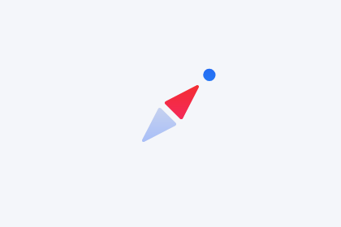</a> | <code>UIV-025</code> | Componente Uiverse nella categoria LOADER; HTML/CSS originale archiviato con blob SHA. L&#x27;effetto specifico richiede ispezione del sorgente e collaudo visivo. | <a href="https://uiverse.io/Nawsome/ancient-yak-42" target="_blank" rel="noopener noreferrer">UIVERSE</a> | LOADER | app-factory-dashboard, camperboss, cashmate-ai, cooking-anime, easy-debloat, trailpath, wonderlog | Sorgente archiviata |
|  | <code>UIV-026</code> | Componente Uiverse nella categoria LOADER; HTML/CSS originale archiviato con blob SHA. L&#x27;effetto specifico richiede ispezione del sorgente e collaudo visivo. | <a href="https://uiverse.io/Nawsome/brave-turtle-26" target="_blank" rel="noopener noreferrer">UIVERSE</a> | LOADER | camperboss, cooking-anime, deskland-android, focussense, omni-cleaner, sleepmax-coach, wonderlog | Sorgente archiviata |
|  | <code>UIV-030</code> | Componente Uiverse nella categoria LOADER; HTML/CSS originale archiviato con blob SHA. L&#x27;effetto specifico richiede ispezione del sorgente e collaudo visivo. | <a href="https://uiverse.io/Nawsome/young-goat-78" target="_blank" rel="noopener noreferrer">UIVERSE</a> | LOADER | app-factory-dashboard, camperboss, cashmate-ai, cooking-anime, easy-debloat, omni-cleaner, wonderlog | Sorgente archiviata |
|  | <code>UIV-031</code> | Scheda pubblica Uiverse classificata come LOADER; il codice HTML/CSS non è presente nell&#x27;archivio Galaxy e non è stato acquisito. | <a href="https://uiverse.io/Novaxlo/rotten-lionfish-4" target="_blank" rel="noopener noreferrer">UIVERSE</a> | LOADER | camperboss, cooking-anime, deskland-android, focussense, omni-cleaner, sleepmax-coach, wonderlog | Sorgente archiviata |
| <a href="../../docs/assets/componenti/UIV-036.png">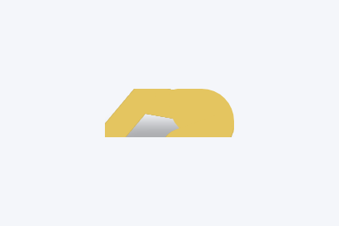</a> | <code>UIV-036</code> | Componente Uiverse nella categoria LOADER; HTML/CSS originale archiviato con blob SHA. L&#x27;effetto specifico richiede ispezione del sorgente e collaudo visivo. | <a href="https://uiverse.io/Pradeepsaranbishnoi/tall-fish-38" target="_blank" rel="noopener noreferrer">UIVERSE</a> | LOADER | camperboss, cooking-anime, deskland-android, focussense, omni-cleaner, sleepmax-coach, wonderlog | Sorgente archiviata |
|  | <code>UIV-040</code> | Componente Uiverse nella categoria LOADER; HTML/CSS originale archiviato con blob SHA. L&#x27;effetto specifico richiede ispezione del sorgente e collaudo visivo. | <a href="https://uiverse.io/Shoh2008/curvy-bulldog-27" target="_blank" rel="noopener noreferrer">UIVERSE</a> | LOADER | app-factory-dashboard, camperboss, cashmate-ai, cooking-anime, easy-debloat, omni-cleaner, wonderlog | Sorgente archiviata |
|  | <code>UIV-041</code> | Componente Uiverse nella categoria LOADER; HTML/CSS originale archiviato con blob SHA. L&#x27;effetto specifico richiede ispezione del sorgente e collaudo visivo. | <a href="https://uiverse.io/Shoh2008/ugly-elephant-80" target="_blank" rel="noopener noreferrer">UIVERSE</a> | LOADER | camperboss, cooking-anime, deskland-android, focussense, omni-cleaner, sleepmax-coach, wonderlog | Sorgente archiviata |
|  | <code>UIV-046</code> | Scheda pubblica Uiverse classificata come CHECKBOX; il codice HTML/CSS non è presente nell&#x27;archivio Galaxy e non è stato acquisito. | <a href="https://uiverse.io/Uncannypotato69/rotten-wasp-10" target="_blank" rel="noopener noreferrer">UIVERSE</a> | CHECKBOX | app-factory-dashboard, camperboss, easy-debloat, notes-ecosistema, wonderlog, world-days | Sorgente archiviata |
|  | <code>UIV-047</code> | Componente Uiverse nella categoria BUTTON; HTML/CSS originale archiviato con blob SHA. L&#x27;effetto specifico richiede ispezione del sorgente e collaudo visivo. | <a href="https://uiverse.io/Yaya12085/plastic-quail-42" target="_blank" rel="noopener noreferrer">UIVERSE</a> | BUTTON | annas-diary, app-factory-dashboard, camperboss, easy-debloat, notes-ecosistema, web-utility-factory | Sorgente archiviata |
|  | <code>UIV-056</code> | Scheda pubblica Uiverse classificata come CARD; il codice HTML/CSS non è presente nell&#x27;archivio Galaxy e non è stato acquisito. | <a href="https://uiverse.io/chase2k25/warm-chicken-23" target="_blank" rel="noopener noreferrer">UIVERSE</a> | CARD | annas-diary, camperboss, deskland-android, edu-01-corpo-umano, notes-ecosistema, wonderlog, world-days | Sorgente archiviata |
|  | <code>UIV-057</code> | Componente Uiverse nella categoria LOADER; HTML/CSS originale archiviato con blob SHA. L&#x27;effetto specifico richiede ispezione del sorgente e collaudo visivo. | <a href="https://uiverse.io/cohencoo/dry-rat-94" target="_blank" rel="noopener noreferrer">UIVERSE</a> | LOADER | app-factory-dashboard, camperboss, cashmate-ai, cooking-anime, easy-debloat, trailpath, wonderlog | Sorgente archiviata |
|  | <code>UIV-058</code> | Componente Uiverse nella categoria SWITCH; HTML/CSS originale archiviato con blob SHA. L&#x27;effetto specifico richiede ispezione del sorgente e collaudo visivo. | <a href="https://uiverse.io/cssbuttons-io/mean-dolphin-24" target="_blank" rel="noopener noreferrer">UIVERSE</a> | SWITCH | battery-guard, camperboss, easy-debloat, notes-ecosistema, phone-guard, pocket-guard, sleepmax-coach | Sorgente archiviata |
|  | <code>UIV-059</code> | Componente Uiverse nella categoria SWITCH; HTML/CSS originale archiviato con blob SHA. L&#x27;effetto specifico richiede ispezione del sorgente e collaudo visivo. | <a href="https://uiverse.io/cuzpq/gentle-goat-72" target="_blank" rel="noopener noreferrer">UIVERSE</a> | SWITCH | battery-guard, camperboss, cashmate-ai, easy-debloat, sleepmax-coach, tabletop-motion-alarm, the-luminous-infinite-circle | Sorgente archiviata |
| <a href="../../docs/assets/componenti/UIV-062.png">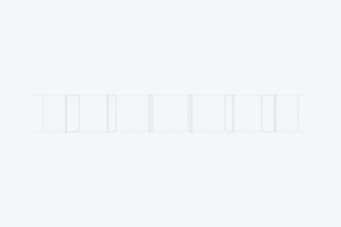</a> | <code>UIV-062</code> | Scheda pubblica Uiverse classificata come LOADER; il codice HTML/CSS non è presente nell&#x27;archivio Galaxy e non è stato acquisito. | <a href="https://uiverse.io/dexter-st/spicy-otter-30" target="_blank" rel="noopener noreferrer">UIVERSE</a> | LOADER | app-factory-dashboard, camperboss, cashmate-ai, cooking-anime, easy-debloat, omni-cleaner, wonderlog | Sorgente archiviata |
|  | <code>UIV-063</code> | Scheda pubblica Uiverse classificata come CARD; il codice HTML/CSS non è presente nell&#x27;archivio Galaxy e non è stato acquisito. | <a href="https://uiverse.io/dexter-st/tough-falcon-78" target="_blank" rel="noopener noreferrer">UIVERSE</a> | CARD | app-factory-dashboard, beerclass-ai, camperboss, cashmate-ai, deskland-android, edu-01-corpo-umano, notes-ecosistema | Sorgente archiviata |
|  | <code>UIV-070</code> | Componente Uiverse nella categoria CHECKBOX; HTML/CSS originale archiviato con blob SHA. L&#x27;effetto specifico richiede ispezione del sorgente e collaudo visivo. | <a href="https://uiverse.io/gagan-gv/unlucky-yak-4" target="_blank" rel="noopener noreferrer">UIVERSE</a> | CHECKBOX | app-factory-dashboard, camperboss, cashmate-ai, notes-ecosistema, omni-cleaner, world-days | Sorgente archiviata |
|  | <code>UIV-071</code> | Componente Uiverse nella categoria SWITCH; HTML/CSS originale archiviato con blob SHA. L&#x27;effetto specifico richiede ispezione del sorgente e collaudo visivo. | <a href="https://uiverse.io/gharsh11032000/sour-vampirebat-66" target="_blank" rel="noopener noreferrer">UIVERSE</a> | SWITCH | battery-guard, camperboss, easy-debloat, notes-ecosistema, phone-guard, pocket-guard, sleepmax-coach | Sorgente archiviata |
|  | <code>UIV-072</code> | Componente Uiverse nella categoria LOADER; HTML/CSS originale archiviato con blob SHA. L&#x27;effetto specifico richiede ispezione del sorgente e collaudo visivo. | <a href="https://uiverse.io/gsperandio/shaggy-kangaroo-12" target="_blank" rel="noopener noreferrer">UIVERSE</a> | LOADER | camperboss, cooking-anime, deskland-android, focussense, omni-cleaner, sleepmax-coach, wonderlog | Sorgente archiviata |
|  | <code>UIV-075</code> | Componente Uiverse nella categoria CARD; HTML/CSS originale archiviato con blob SHA. L&#x27;effetto specifico richiede ispezione del sorgente e collaudo visivo. | <a href="https://uiverse.io/joe-watson-sbf/honest-bullfrog-6" target="_blank" rel="noopener noreferrer">UIVERSE</a> | CARD | annas-diary, camperboss, deskland-android, edu-01-corpo-umano, notes-ecosistema, wonderlog, world-days | Sorgente archiviata |
| <a href="../../docs/assets/componenti/UIV-076.png">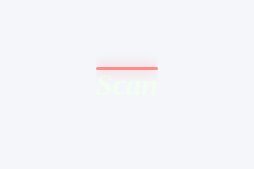</a> | <code>UIV-076</code> | Scheda pubblica Uiverse classificata come LOADER; il codice HTML/CSS non è presente nell&#x27;archivio Galaxy e non è stato acquisito. | <a href="https://uiverse.io/kat_2522/rude-robin-51" target="_blank" rel="noopener noreferrer">UIVERSE</a> | LOADER | app-factory-dashboard, camperboss, cashmate-ai, cooking-anime, easy-debloat, omni-cleaner, wonderlog | Sorgente archiviata |
|  | <code>UIV-078</code> | Scheda pubblica Uiverse classificata come CARD; il codice HTML/CSS non è presente nell&#x27;archivio Galaxy e non è stato acquisito. | <a href="https://uiverse.io/kennyotsu/giant-sloth-18" target="_blank" rel="noopener noreferrer">UIVERSE</a> | CARD | app-factory-dashboard, beerclass-ai, camperboss, cashmate-ai, deskland-android, edu-01-corpo-umano, notes-ecosistema | Sorgente archiviata |
| <a href="../../docs/assets/componenti/UIV-082.png">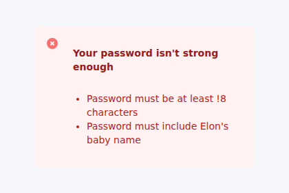</a> | <code>UIV-082</code> | Componente Uiverse nella categoria CARD; HTML/CSS originale archiviato con blob SHA. L&#x27;effetto specifico richiede ispezione del sorgente e collaudo visivo. | <a href="https://uiverse.io/kennyotsu/wise-rattlesnake-92" target="_blank" rel="noopener noreferrer">UIVERSE</a> | CARD | app-factory-dashboard, beerclass-ai, camperboss, cashmate-ai, deskland-android, edu-01-corpo-umano, notes-ecosistema | Sorgente archiviata |
|  | <code>UIV-085</code> | Scheda pubblica Uiverse classificata come SWITCH; il codice HTML/CSS non è presente nell&#x27;archivio Galaxy e non è stato acquisito. | <a href="https://uiverse.io/m1her/odd-fireant-56" target="_blank" rel="noopener noreferrer">UIVERSE</a> | SWITCH | battery-guard, camperboss, easy-debloat, notes-ecosistema, phone-guard, pocket-guard, sleepmax-coach | Sorgente archiviata |
|  | <code>UIV-086</code> | Scheda pubblica Uiverse classificata come SWITCH; il codice HTML/CSS non è presente nell&#x27;archivio Galaxy e non è stato acquisito. | <a href="https://uiverse.io/mamyapro123/cuddly-warthog-66" target="_blank" rel="noopener noreferrer">UIVERSE</a> | SWITCH | battery-guard, camperboss, cashmate-ai, easy-debloat, sleepmax-coach, tabletop-motion-alarm, the-luminous-infinite-circle | Sorgente archiviata |
|  | <code>UIV-087</code> | Componente Uiverse nella categoria BUTTON; HTML/CSS originale archiviato con blob SHA. L&#x27;effetto specifico richiede ispezione del sorgente e collaudo visivo. | <a href="https://uiverse.io/marcelodolza/fat-zebra-11" target="_blank" rel="noopener noreferrer">UIVERSE</a> | BUTTON | annas-diary, app-factory-dashboard, camperboss, easy-debloat, notes-ecosistema, web-utility-factory | Sorgente archiviata |
| <a href="../../docs/assets/componenti/UIV-090.png">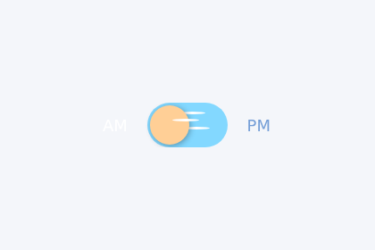</a> | <code>UIV-090</code> | Componente Uiverse nella categoria SWITCH; HTML/CSS originale archiviato con blob SHA. L&#x27;effetto specifico richiede ispezione del sorgente e collaudo visivo. | <a href="https://uiverse.io/mobinkakei/strong-lizard-79" target="_blank" rel="noopener noreferrer">UIVERSE</a> | SWITCH | battery-guard, camperboss, easy-debloat, phone-guard, pocket-guard, sleepmax-coach, the-luminous-infinite-circle | Sorgente archiviata |
| <a href="../../docs/assets/componenti/UIV-091.png">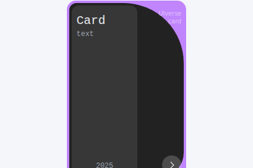</a> | <code>UIV-091</code> | Scheda pubblica Uiverse classificata come CARD; il codice HTML/CSS non è presente nell&#x27;archivio Galaxy e non è stato acquisito. | <a href="https://uiverse.io/monkey_8812/curly-moth-56" target="_blank" rel="noopener noreferrer">UIVERSE</a> | CARD | annas-diary, camperboss, deskland-android, edu-01-corpo-umano, notes-ecosistema, wonderlog, world-days | Sorgente archiviata |
|  | <code>UIV-095</code> | Scheda pubblica Uiverse classificata come CARD; il codice HTML/CSS non è presente nell&#x27;archivio Galaxy e non è stato acquisito. | <a href="https://uiverse.io/seoulchik/funny-seahorse-89" target="_blank" rel="noopener noreferrer">UIVERSE</a> | CARD | annas-diary, camperboss, deskland-android, edu-01-corpo-umano, notes-ecosistema, wonderlog, world-days | Sorgente archiviata |
|  | <code>UIV-100</code> | Componente Uiverse nella categoria SWITCH; HTML/CSS originale archiviato con blob SHA. L&#x27;effetto specifico richiede ispezione del sorgente e collaudo visivo. | <a href="https://uiverse.io/zanina-yassine/afraid-eel-50" target="_blank" rel="noopener noreferrer">UIVERSE</a> | SWITCH | battery-guard, camperboss, cashmate-ai, easy-debloat, sleepmax-coach, tabletop-motion-alarm, the-luminous-infinite-circle | Sorgente archiviata |
| <a href="../../docs/assets/componenti/UIV-102.png">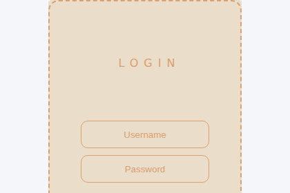</a> | <code>UIV-102</code> | Warm stitched beige/orange login form; adapt to product typography and contrast. Categoria FORM verificata nel post pubblico Uiverse. Tag originali: login, form, stitched, rounded, shadow, beige, orange, password, form, submit. | <a href="https://uiverse.io/Praashoo7/bitter-pig-24" target="_blank" rel="noopener noreferrer">UIVERSE</a> | FORM | annas-diary, app-factory-dashboard, camperboss, cooking-anime, notes-ecosistema, sleepmax-coach, wonderlog | Sorgente archiviata |
| <a href="../../docs/assets/componenti/UIV-109.png">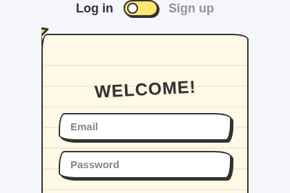</a> | <code>UIV-109</code> | Pink retro/pastel stars form; adapt to approved rose palette and reduced-motion. Categoria FORM verificata nel post pubblico Uiverse. Tag originali: form, button, bold, pink, password, email, retro, toggle, switch, login. | <a href="https://uiverse.io/mamyapro123/curvy-bear-51" target="_blank" rel="noopener noreferrer">UIVERSE</a> | FORM | annas-diary, beerclass-ai, camperboss, cooking-anime, notes-ecosistema, sleepmax-coach, wonderlog, world-days | Sorgente archiviata |
| <a href="../../docs/assets/componenti/UIV-111.png">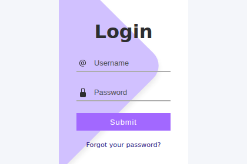</a> | <code>UIV-111</code> | Minimal purple account form; use existing opt-in or non-auth input surfaces only. Categoria FORM verificata nel post pubblico Uiverse. Tag originali: purple, form, log in, button, modern, forgot, password, form, submit, username. | <a href="https://uiverse.io/vinodjangid07/horrible-warthog-14" target="_blank" rel="noopener noreferrer">UIVERSE</a> | FORM | annas-diary, app-factory-dashboard, camperboss, cashmate-ai, notes-ecosistema, wonderlog, world-days | Sorgente archiviata |
| <small>Non disponibile</small> · <a href="https://devlibraries.com/libraries/watermelon/carousel-slider" target="_blank" rel="noopener noreferrer">Fonte</a> | <code>WML-001</code> | Carousel Slider | <a href="https://devlibraries.com/libraries/watermelon/carousel-slider" target="_blank" rel="noopener noreferrer">DEVLIBRARIES_WATERMELON</a> | CAROUSEL_GESTURE | anna-s-diary, beerclass-ai, camperboss, cooking-anime, framelab, notes-ecosistema, omni-cleaner, wonderlog, world-days | Sorgente archiviata |
| <small>Non disponibile</small> · <a href="https://devlibraries.com/libraries/watermelon/fractional-picker" target="_blank" rel="noopener noreferrer">Fonte</a> | <code>WML-002</code> | Fractional Picker | <a href="https://devlibraries.com/libraries/watermelon/fractional-picker" target="_blank" rel="noopener noreferrer">DEVLIBRARIES_WATERMELON</a> | RULER_PICKER | anna-s-diary, battery-guard, beerclass-ai, camperboss, cooking-anime, focussense, sleepmax-coach, world-days | Sorgente archiviata |
| <small>Non disponibile</small> · <a href="https://devlibraries.com/libraries/watermelon/range-selection-slider" target="_blank" rel="noopener noreferrer">Fonte</a> | <code>WML-004</code> | Range Selection Slider | <a href="https://devlibraries.com/libraries/watermelon/range-selection-slider" target="_blank" rel="noopener noreferrer">DEVLIBRARIES_WATERMELON</a> | TWO_HANDLE_RANGE | anna-s-diary, battery-guard, camperboss, cashmate-ai, focussense, framelab, notes-ecosistema, omni-cleaner, wonderlog, world-days | Sorgente archiviata |
| <small>Non disponibile</small> · <a href="https://devlibraries.com/libraries/watermelon/dialog-stack-base" target="_blank" rel="noopener noreferrer">Fonte</a> | <code>WML-007</code> | Dialog Stack (base) | <a href="https://devlibraries.com/libraries/watermelon/dialog-stack-base" target="_blank" rel="noopener noreferrer">DEVLIBRARIES_WATERMELON</a> | MULTISTEP_MODAL | anna-s-diary, app-factory-dashboard, camperboss, cashmate-ai, cooking-anime, notes-ecosistema, wonderlog | Sorgente archiviata |
| <small>Non disponibile</small> · <a href="https://devlibraries.com/libraries/watermelon/notification-list" target="_blank" rel="noopener noreferrer">Fonte</a> | <code>WML-008</code> | Notification List | <a href="https://devlibraries.com/libraries/watermelon/notification-list" target="_blank" rel="noopener noreferrer">DEVLIBRARIES_WATERMELON</a> | TODAY_IN_APP_REMINDER_SUMMARY | anna-s-diary, app-factory-dashboard, camperboss, cashmate-ai, notes-ecosistema, sleepmax-coach, wonderlog, world-days | Solo riferimento |
| <small>Non disponibile</small> · <a href="https://devlibraries.com/libraries/watermelon/flip-clock" target="_blank" rel="noopener noreferrer">Fonte</a> | <code>WML-009</code> | Flip Clock | <a href="https://devlibraries.com/libraries/watermelon/flip-clock" target="_blank" rel="noopener noreferrer">DEVLIBRARIES_WATERMELON</a> | COUNTDOWN_CLOCK_VISUAL | anna-s-diary, camperboss, cooking-anime, focussense, sleepmax-coach, tabletop-motion-alarm, wonderlog, world-days | Solo riferimento |
