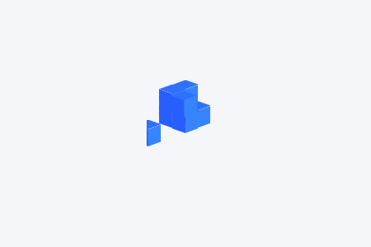
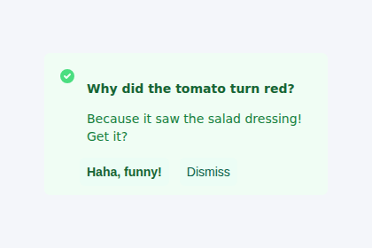

# Anteprime dei componenti — cashmate-ai

**52 componenti associati**, dal solo catalogo Design-App; l'associazione non prova che il componente sia integrato nell'app.

[Tutte le app](./README.md) · [Catalogo completo](../TABELLA_478.md) · [Vista con filtro app](../../docs/componenti.html?app=cashmate-ai)

Le immagini qui mostrate sono catture documentali, **non** una verifica di riuso Flutter, compatibilità nativa o licenze degli asset di terzi. In assenza di una PNG realmente acquisita la cella dichiara «Non disponibile» e punta alla fonte originale.

| Anteprima | UID | ID canonico | Componente | Fonte | Categoria | App associate | Codice |
|---|---|---|---|---|---|---|---|
| <small>Non disponibile</small> · <a href="https://github.com/Subhan-code/Amicro--Micro-transitions-/blob/fa5f8ffbe39537a8db191806066b8773c47c82e9/registry/ui/scroll/scroll-reveal.tsx" target="_blank" rel="noopener noreferrer">Fonte</a> | <code>UID-0004</code> | <code>AMX-004</code> | Scroll Reveal | <a href="https://github.com/Subhan-code/Amicro--Micro-transitions-/blob/fa5f8ffbe39537a8db191806066b8773c47c82e9/registry/ui/scroll/scroll-reveal.tsx" target="_blank" rel="noopener noreferrer">DEVLIBRARIES_AMICRO</a> | SCROLL_TRIGGERED_ENTRANCE | anna-s-diary, app-factory-dashboard, battery-guard, beerclass-ai, camperboss, cashmate-ai, cooking-anime, edu-01-corpo-umano, framelab, notes-ecosistema, omni-cleaner, trailpath, web-utility-factory, wonderlog, world-days | Sorgente archiviata |
| <small>Non disponibile</small> · <a href="https://devlibraries.com/libraries/easeui" target="_blank" rel="noopener noreferrer">Fonte</a> | <code>UID-0034</code> | <code>DSP-001</code> | EaseUI Theme Toggle | <a href="https://devlibraries.com/libraries/easeui" target="_blank" rel="noopener noreferrer">DEVLIBRARIES_EASEUI</a> | THEME_LIGHT_DARK | anna-s-diary, app-factory-dashboard, battery-guard, beerclass-ai, camperboss, cashmate-ai, cooking-anime, deskland-android, easy-debloat, focussense, framelab, notes-ecosistema, omni-cleaner, sleepmax-coach, trailpath, web-utility-factory, wonderlog, world-days | Sorgente archiviata |
| <small>Non disponibile</small> · <a href="https://devlibraries.com/libraries/amicro" target="_blank" rel="noopener noreferrer">Fonte</a> | <code>UID-0036</code> | <code>DSP-003</code> | Accordion Blind Pull | <a href="https://devlibraries.com/libraries/amicro" target="_blank" rel="noopener noreferrer">DEVLIBRARIES_AMICRO</a> | EXPANDABLE_PANEL_TRANSITION | anna-s-diary, app-factory-dashboard, battery-guard, beerclass-ai, camperboss, cashmate-ai, cooking-anime, easy-debloat, notes-ecosistema, omni-cleaner, trailpath, wonderlog, world-days | Sorgente archiviata |
| <small>Non disponibile</small> | <code>UID-0039</code> | <code>DSP-006</code> | Loading &amp; Waiting Visual References (user screenshot) | USER_IMAGE | LOADING_WAIT_STATE_REFERENCE | anna-s-diary, app-factory-dashboard, battery-guard, camperboss, cashmate-ai, cooking-anime, deskland-android, easy-debloat, focussense, framelab, notes-ecosistema, omni-cleaner, send-to-pc, trailpath, web-utility-factory, wonderlog, world-days | Solo riferimento |
| <small>Non disponibile</small> · <a href="https://gentleface.com/icons/cloud" target="_blank" rel="noopener noreferrer">Fonte</a> | <code>UID-0071</code> | <code>ICO-017</code> | Stato cloud/sync | <a href="https://gentleface.com/icons/cloud" target="_blank" rel="noopener noreferrer">GENTLEFACE</a> | ICON | anna-s-diary, cashmate-ai, notes-ecosistema, world-days | Solo riferimento |
| <small>Non disponibile</small> · <a href="https://gentleface.com/icons/gauge" target="_blank" rel="noopener noreferrer">Fonte</a> | <code>UID-0072</code> | <code>ICO-018</code> | Indicatore / metriche | <a href="https://gentleface.com/icons/gauge" target="_blank" rel="noopener noreferrer">GENTLEFACE</a> | ICON | app-factory-dashboard, battery-guard, camperboss, cashmate-ai, focussense | Solo riferimento |
|  | <code>UID-0362</code> | <code>UIV-003</code> | Card gradiente rosa-arancio con testo rivelato su hover | <a href="https://uiverse.io/gharsh11032000/tricky-cheetah-78" target="_blank" rel="noopener noreferrer">UIVERSE</a> | CARD | app-factory-dashboard, beerclass-ai, cashmate-ai, cooking-anime, notes-ecosistema, wonderlog, world-days | Sorgente archiviata |
|  | <code>UID-0364</code> | <code>UIV-005</code> | Card proposta dall&#x27;utente come sfondo decorativo per varie app; effetto esatto non verificato | <a href="https://uiverse.io/amir_6539/red-duck-82" target="_blank" rel="noopener noreferrer">UIVERSE</a> | CARD_BACKGROUND | annas-diary, app-factory-dashboard, battery-guard, cashmate-ai, deskland-android, focussense, notes-ecosistema, omni-cleaner | Sorgente archiviata |
|  | <code>UID-0366</code> | <code>UIV-007</code> | Loader per processi reali, testo UX proposto: Stiamo facendo la magia; animazione specifica non verificata | <a href="https://uiverse.io/arthur_6104/orange-walrus-50" target="_blank" rel="noopener noreferrer">UIVERSE</a> | LOADER | annas-diary, app-factory-dashboard, cashmate-ai, framelab, notes-ecosistema, omni-cleaner, web-utility-factory, world-days | Sorgente archiviata |
|  | <code>UID-0370</code> | <code>UIV-011</code> | Componente Uiverse nella categoria LOADER; HTML/CSS originale archiviato con blob SHA. L&#x27;effetto specifico richiede ispezione del sorgente e collaudo visivo. | <a href="https://uiverse.io/Admin12121/black-sheep-17" target="_blank" rel="noopener noreferrer">UIVERSE</a> | LOADER | app-factory-dashboard, battery-guard, cashmate-ai, easy-debloat, omni-cleaner, send-to-pc, world-days | Sorgente archiviata |
|  | <code>UID-0375</code> | <code>UIV-016</code> | Scheda pubblica Uiverse classificata come CARD; il codice HTML/CSS non è presente nell&#x27;archivio Galaxy e non è stato acquisito. | <a href="https://uiverse.io/Gidarx/clever-panther-6" target="_blank" rel="noopener noreferrer">UIVERSE</a> | CARD | app-factory-dashboard, beerclass-ai, camperboss, cashmate-ai, deskland-android, edu-01-corpo-umano, notes-ecosistema | Sorgente archiviata |
|  | <code>UID-0377</code> | <code>UIV-018</code> | Componente Uiverse nella categoria SWITCH; HTML/CSS originale archiviato con blob SHA. L&#x27;effetto specifico richiede ispezione del sorgente e collaudo visivo. | <a href="https://uiverse.io/JaydipPrajapati1910/average-shrimp-57" target="_blank" rel="noopener noreferrer">UIVERSE</a> | SWITCH | battery-guard, camperboss, cashmate-ai, focussense, omni-cleaner, tabletop-motion-alarm, the-luminous-infinite-circle | Sorgente archiviata |
|  | <code>UID-0381</code> | <code>UIV-022</code> | Componente Uiverse nella categoria INPUT; HTML/CSS originale archiviato con blob SHA. L&#x27;effetto specifico richiede ispezione del sorgente e collaudo visivo. | <a href="https://uiverse.io/Lakshay-art/curvy-earwig-22" target="_blank" rel="noopener noreferrer">UIVERSE</a> | INPUT | app-factory-dashboard, cashmate-ai, notes-ecosistema, omni-cleaner, wonderlog, world-days | Sorgente archiviata |
|  | <code>UID-0382</code> | <code>UIV-023</code> | Componente Uiverse nella categoria RADIO; HTML/CSS originale archiviato con blob SHA. L&#x27;effetto specifico richiede ispezione del sorgente e collaudo visivo. | <a href="https://uiverse.io/LilaRest/soft-baboon-75" target="_blank" rel="noopener noreferrer">UIVERSE</a> | RADIO | annas-diary, battery-guard, cashmate-ai, notes-ecosistema, wonderlog, world-days | Sorgente archiviata |
|  | <code>UID-0384</code> | <code>UIV-025</code> | Componente Uiverse nella categoria LOADER; HTML/CSS originale archiviato con blob SHA. L&#x27;effetto specifico richiede ispezione del sorgente e collaudo visivo. | <a href="https://uiverse.io/Nawsome/ancient-yak-42" target="_blank" rel="noopener noreferrer">UIVERSE</a> | LOADER | app-factory-dashboard, camperboss, cashmate-ai, cooking-anime, easy-debloat, trailpath, wonderlog | Sorgente archiviata |
|  | <code>UID-0388</code> | <code>UIV-029</code> | Componente Uiverse nella categoria LOADER; HTML/CSS originale archiviato con blob SHA. L&#x27;effetto specifico richiede ispezione del sorgente e collaudo visivo. | <a href="https://uiverse.io/Nawsome/wet-mayfly-23" target="_blank" rel="noopener noreferrer">UIVERSE</a> | LOADER | app-factory-dashboard, battery-guard, cashmate-ai, easy-debloat, omni-cleaner, send-to-pc, world-days | Sorgente archiviata |
|  | <code>UID-0389</code> | <code>UIV-030</code> | Componente Uiverse nella categoria LOADER; HTML/CSS originale archiviato con blob SHA. L&#x27;effetto specifico richiede ispezione del sorgente e collaudo visivo. | <a href="https://uiverse.io/Nawsome/young-goat-78" target="_blank" rel="noopener noreferrer">UIVERSE</a> | LOADER | app-factory-dashboard, camperboss, cashmate-ai, cooking-anime, easy-debloat, omni-cleaner, wonderlog | Sorgente archiviata |
|  | <code>UID-0393</code> | <code>UIV-034</code> | Componente Uiverse nella categoria LOADER; HTML/CSS originale archiviato con blob SHA. L&#x27;effetto specifico richiede ispezione del sorgente e collaudo visivo. | <a href="https://uiverse.io/Pradeepsaranbishnoi/fast-cobra-20" target="_blank" rel="noopener noreferrer">UIVERSE</a> | LOADER | app-factory-dashboard, battery-guard, cashmate-ai, easy-debloat, omni-cleaner, send-to-pc, world-days | Sorgente archiviata |
|  | <code>UID-0394</code> | <code>UIV-035</code> | Componente Uiverse nella categoria RADIO; HTML/CSS originale archiviato con blob SHA. L&#x27;effetto specifico richiede ispezione del sorgente e collaudo visivo. | <a href="https://uiverse.io/Pradeepsaranbishnoi/hungry-bat-66" target="_blank" rel="noopener noreferrer">UIVERSE</a> | RADIO | annas-diary, battery-guard, cashmate-ai, notes-ecosistema, trailpath, world-days | Sorgente archiviata |
|  | <code>UID-0396</code> | <code>UIV-037</code> | Componente Uiverse nella categoria CARD; HTML/CSS originale archiviato con blob SHA. L&#x27;effetto specifico richiede ispezione del sorgente e collaudo visivo. | <a href="https://uiverse.io/Prince4fff/slippery-baboon-37" target="_blank" rel="noopener noreferrer">UIVERSE</a> | CARD | app-factory-dashboard, beerclass-ai, cashmate-ai, cooking-anime, framelab, notes-ecosistema, wonderlog | Sorgente archiviata |
|  | <code>UID-0398</code> | <code>UIV-039</code> | Componente Uiverse nella categoria LOADER; HTML/CSS originale archiviato con blob SHA. L&#x27;effetto specifico richiede ispezione del sorgente e collaudo visivo. | <a href="https://uiverse.io/SelfMadeSystem/pretty-treefrog-77" target="_blank" rel="noopener noreferrer">UIVERSE</a> | LOADER | app-factory-dashboard, battery-guard, cashmate-ai, easy-debloat, omni-cleaner, send-to-pc, world-days | Sorgente archiviata |
|  | <code>UID-0399</code> | <code>UIV-040</code> | Componente Uiverse nella categoria LOADER; HTML/CSS originale archiviato con blob SHA. L&#x27;effetto specifico richiede ispezione del sorgente e collaudo visivo. | <a href="https://uiverse.io/Shoh2008/curvy-bulldog-27" target="_blank" rel="noopener noreferrer">UIVERSE</a> | LOADER | app-factory-dashboard, camperboss, cashmate-ai, cooking-anime, easy-debloat, omni-cleaner, wonderlog | Sorgente archiviata |
|  | <code>UID-0403</code> | <code>UIV-044</code> | Componente Uiverse nella categoria LOADER; HTML/CSS originale archiviato con blob SHA. L&#x27;effetto specifico richiede ispezione del sorgente e collaudo visivo. | <a href="https://uiverse.io/Subaashbala/average-horse-18" target="_blank" rel="noopener noreferrer">UIVERSE</a> | LOADER | app-factory-dashboard, battery-guard, cashmate-ai, easy-debloat, omni-cleaner, send-to-pc, world-days | Sorgente archiviata |
|  | <code>UID-0413</code> | <code>UIV-054</code> | Scheda pubblica Uiverse classificata come CARD; il codice HTML/CSS non è presente nell&#x27;archivio Galaxy e non è stato acquisito. | <a href="https://uiverse.io/byllzz/great-wombat-13" target="_blank" rel="noopener noreferrer">UIVERSE</a> | CARD | app-factory-dashboard, beerclass-ai, cashmate-ai, cooking-anime, framelab, notes-ecosistema, wonderlog | Sorgente archiviata |
|  | <code>UID-0416</code> | <code>UIV-057</code> | Componente Uiverse nella categoria LOADER; HTML/CSS originale archiviato con blob SHA. L&#x27;effetto specifico richiede ispezione del sorgente e collaudo visivo. | <a href="https://uiverse.io/cohencoo/dry-rat-94" target="_blank" rel="noopener noreferrer">UIVERSE</a> | LOADER | app-factory-dashboard, camperboss, cashmate-ai, cooking-anime, easy-debloat, trailpath, wonderlog | Sorgente archiviata |
|  | <code>UID-0418</code> | <code>UIV-059</code> | Componente Uiverse nella categoria SWITCH; HTML/CSS originale archiviato con blob SHA. L&#x27;effetto specifico richiede ispezione del sorgente e collaudo visivo. | <a href="https://uiverse.io/cuzpq/gentle-goat-72" target="_blank" rel="noopener noreferrer">UIVERSE</a> | SWITCH | battery-guard, camperboss, cashmate-ai, easy-debloat, sleepmax-coach, tabletop-motion-alarm, the-luminous-infinite-circle | Sorgente archiviata |
|  | <code>UID-0420</code> | <code>UIV-061</code> | Scheda pubblica Uiverse classificata come LOADER; il codice HTML/CSS non è presente nell&#x27;archivio Galaxy e non è stato acquisito. | <a href="https://uiverse.io/dexter-st/bright-lizard-8" target="_blank" rel="noopener noreferrer">UIVERSE</a> | LOADER | app-factory-dashboard, battery-guard, cashmate-ai, easy-debloat, omni-cleaner, send-to-pc, world-days | Sorgente archiviata |
|  | <code>UID-0421</code> | <code>UIV-062</code> | Scheda pubblica Uiverse classificata come LOADER; il codice HTML/CSS non è presente nell&#x27;archivio Galaxy e non è stato acquisito. | <a href="https://uiverse.io/dexter-st/spicy-otter-30" target="_blank" rel="noopener noreferrer">UIVERSE</a> | LOADER | app-factory-dashboard, camperboss, cashmate-ai, cooking-anime, easy-debloat, omni-cleaner, wonderlog | Sorgente archiviata |
|  | <code>UID-0422</code> | <code>UIV-063</code> | Scheda pubblica Uiverse classificata come CARD; il codice HTML/CSS non è presente nell&#x27;archivio Galaxy e non è stato acquisito. | <a href="https://uiverse.io/dexter-st/tough-falcon-78" target="_blank" rel="noopener noreferrer">UIVERSE</a> | CARD | app-factory-dashboard, beerclass-ai, camperboss, cashmate-ai, deskland-android, edu-01-corpo-umano, notes-ecosistema | Sorgente archiviata |
|  | <code>UID-0425</code> | <code>UIV-066</code> | Scheda pubblica Uiverse classificata come LOADER; il codice HTML/CSS non è presente nell&#x27;archivio Galaxy e non è stato acquisito. | <a href="https://uiverse.io/elijahgummer/polite-earwig-72" target="_blank" rel="noopener noreferrer">UIVERSE</a> | LOADER | app-factory-dashboard, battery-guard, cashmate-ai, easy-debloat, omni-cleaner, send-to-pc, world-days | Sorgente archiviata |
|  | <code>UID-0426</code> | <code>UIV-067</code> | Scheda pubblica Uiverse classificata come RADIO; il codice HTML/CSS non è presente nell&#x27;archivio Galaxy e non è stato acquisito. | <a href="https://uiverse.io/elijahgummer/young-horse-7" target="_blank" rel="noopener noreferrer">UIVERSE</a> | RADIO | annas-diary, beerclass-ai, cashmate-ai, notes-ecosistema, sleepmax-coach, web-utility-factory | Sorgente archiviata |
|  | <code>UID-0429</code> | <code>UIV-070</code> | Componente Uiverse nella categoria CHECKBOX; HTML/CSS originale archiviato con blob SHA. L&#x27;effetto specifico richiede ispezione del sorgente e collaudo visivo. | <a href="https://uiverse.io/gagan-gv/unlucky-yak-4" target="_blank" rel="noopener noreferrer">UIVERSE</a> | CHECKBOX | app-factory-dashboard, camperboss, cashmate-ai, notes-ecosistema, omni-cleaner, world-days | Sorgente archiviata |
|  | <code>UID-0432</code> | <code>UIV-073</code> | Scheda pubblica Uiverse classificata come CARD; il codice HTML/CSS non è presente nell&#x27;archivio Galaxy e non è stato acquisito. | <a href="https://uiverse.io/ilkhoeri/thin-bobcat-83" target="_blank" rel="noopener noreferrer">UIVERSE</a> | CARD | app-factory-dashboard, beerclass-ai, cashmate-ai, cooking-anime, framelab, notes-ecosistema, wonderlog | Sorgente archiviata |
|  | <code>UID-0435</code> | <code>UIV-076</code> | Scheda pubblica Uiverse classificata come LOADER; il codice HTML/CSS non è presente nell&#x27;archivio Galaxy e non è stato acquisito. | <a href="https://uiverse.io/kat_2522/rude-robin-51" target="_blank" rel="noopener noreferrer">UIVERSE</a> | LOADER | app-factory-dashboard, camperboss, cashmate-ai, cooking-anime, easy-debloat, omni-cleaner, wonderlog | Sorgente archiviata |
|  | <code>UID-0436</code> | <code>UIV-077</code> | Componente Uiverse nella categoria CARD; HTML/CSS originale archiviato con blob SHA. L&#x27;effetto specifico richiede ispezione del sorgente e collaudo visivo. | <a href="https://uiverse.io/kennyotsu/fast-emu-70" target="_blank" rel="noopener noreferrer">UIVERSE</a> | CARD | app-factory-dashboard, beerclass-ai, cashmate-ai, cooking-anime, framelab, notes-ecosistema, wonderlog | Sorgente archiviata |
|  | <code>UID-0437</code> | <code>UIV-078</code> | Scheda pubblica Uiverse classificata come CARD; il codice HTML/CSS non è presente nell&#x27;archivio Galaxy e non è stato acquisito. | <a href="https://uiverse.io/kennyotsu/giant-sloth-18" target="_blank" rel="noopener noreferrer">UIVERSE</a> | CARD | app-factory-dashboard, beerclass-ai, camperboss, cashmate-ai, deskland-android, edu-01-corpo-umano, notes-ecosistema | Sorgente archiviata |
|  | <code>UID-0440</code> | <code>UIV-081</code> | Scheda pubblica Uiverse classificata come CARD; il codice HTML/CSS non è presente nell&#x27;archivio Galaxy e non è stato acquisito. | <a href="https://uiverse.io/kennyotsu/tender-badger-21" target="_blank" rel="noopener noreferrer">UIVERSE</a> | CARD | app-factory-dashboard, beerclass-ai, cashmate-ai, cooking-anime, framelab, trailpath, wonderlog | Sorgente archiviata |
|  | <code>UID-0441</code> | <code>UIV-082</code> | Componente Uiverse nella categoria CARD; HTML/CSS originale archiviato con blob SHA. L&#x27;effetto specifico richiede ispezione del sorgente e collaudo visivo. | <a href="https://uiverse.io/kennyotsu/wise-rattlesnake-92" target="_blank" rel="noopener noreferrer">UIVERSE</a> | CARD | app-factory-dashboard, beerclass-ai, camperboss, cashmate-ai, deskland-android, edu-01-corpo-umano, notes-ecosistema | Sorgente archiviata |
|  | <code>UID-0445</code> | <code>UIV-086</code> | Scheda pubblica Uiverse classificata come SWITCH; il codice HTML/CSS non è presente nell&#x27;archivio Galaxy e non è stato acquisito. | <a href="https://uiverse.io/mamyapro123/cuddly-warthog-66" target="_blank" rel="noopener noreferrer">UIVERSE</a> | SWITCH | battery-guard, camperboss, cashmate-ai, easy-debloat, sleepmax-coach, tabletop-motion-alarm, the-luminous-infinite-circle | Sorgente archiviata |
|  | <code>UID-0456</code> | <code>UIV-097</code> | Componente Uiverse nella categoria CARD; HTML/CSS originale archiviato con blob SHA. L&#x27;effetto specifico richiede ispezione del sorgente e collaudo visivo. | <a href="https://uiverse.io/vamsidevendrakumar/soft-shrimp-94" target="_blank" rel="noopener noreferrer">UIVERSE</a> | CARD | app-factory-dashboard, beerclass-ai, cashmate-ai, cooking-anime, framelab, notes-ecosistema, wonderlog | Sorgente archiviata |
|  | <code>UID-0457</code> | <code>UIV-098</code> | Scheda pubblica Uiverse classificata come PATTERN; il codice HTML/CSS non è presente nell&#x27;archivio Galaxy e non è stato acquisito. | <a href="https://uiverse.io/whoisyourdeadie/foolish-rabbit-13" target="_blank" rel="noopener noreferrer">UIVERSE</a> | PATTERN | annas-diary, battery-guard, cashmate-ai, deskland-android, notes-ecosistema, world-days | Sorgente archiviata |
|  | <code>UID-0459</code> | <code>UIV-100</code> | Componente Uiverse nella categoria SWITCH; HTML/CSS originale archiviato con blob SHA. L&#x27;effetto specifico richiede ispezione del sorgente e collaudo visivo. | <a href="https://uiverse.io/zanina-yassine/afraid-eel-50" target="_blank" rel="noopener noreferrer">UIVERSE</a> | SWITCH | battery-guard, camperboss, cashmate-ai, easy-debloat, sleepmax-coach, tabletop-motion-alarm, the-luminous-infinite-circle | Sorgente archiviata |
|  | <code>UID-0460</code> | <code>UIV-101</code> | Blue modern login form; use only where an input or optional account flow already exists. Categoria FORM verificata nel post pubblico Uiverse. Tag originali: blue, form, login form, tailwind, rounded, input, button, blue, border, modern. | <a href="https://uiverse.io/Javierrocadev/chatty-ladybug-95" target="_blank" rel="noopener noreferrer">UIVERSE</a> | FORM | annas-diary, app-factory-dashboard, beerclass-ai, cashmate-ai, notes-ecosistema, wonderlog, world-days | Sorgente archiviata |
|  | <code>UID-0462</code> | <code>UIV-103</code> | Blue gradient and depth form; tone down gloss and 3D for readable mobile inputs. Categoria FORM verificata nel post pubblico Uiverse. Tag originali: simple, login, 3d, social, gradient, form, submit, login form, rounded, button. | <a href="https://uiverse.io/SyedShahzaib7/brave-dog-61" target="_blank" rel="noopener noreferrer">UIVERSE</a> | FORM | app-factory-dashboard, beerclass-ai, cashmate-ai, notes-ecosistema, send-to-pc, world-days | Sorgente archiviata |
|  | <code>UID-0463</code> | <code>UIV-104</code> | Minimal purple login form; adapt palette and semantics rather than add authentication. Categoria FORM verificata nel post pubblico Uiverse. Tag originali: login, form, input, button, password, white, form, signin, username, purple. | <a href="https://uiverse.io/alexmaracinaru/tall-owl-30" target="_blank" rel="noopener noreferrer">UIVERSE</a> | FORM | annas-diary, app-factory-dashboard, cashmate-ai, cooking-anime, notes-ecosistema, wonderlog, world-days | Sorgente archiviata |
|  | <code>UID-0464</code> | <code>UIV-105</code> | Welcome/social login form; explicit consent and existing optional provider only. Categoria FORM verificata nel post pubblico Uiverse. Tag originali: login, email, social, form, submit, confirm, password, welcome, rounded, shadow. | <a href="https://uiverse.io/ayyjayy2/sour-dog-94" target="_blank" rel="noopener noreferrer">UIVERSE</a> | FORM | annas-diary, app-factory-dashboard, beerclass-ai, cashmate-ai, cooking-anime, framelab, notes-ecosistema, wonderlog | Sorgente archiviata |
|  | <code>UID-0468</code> | <code>UIV-110</code> | Animated tooltip with real information; tap/focus/keyboard support, not hover-only. Categoria TOOLTIP verificata nel post pubblico Uiverse. Tag originali: tooltip. | <a href="https://uiverse.io/roroland/average-horse-2" target="_blank" rel="noopener noreferrer">UIVERSE</a> | TOOLTIP | app-factory-dashboard, battery-guard, cashmate-ai, edu-01-corpo-umano, focussense, notes-ecosistema, omni-cleaner, wonderlog, world-days | Sorgente archiviata |
|  | <code>UID-0469</code> | <code>UIV-111</code> | Minimal purple account form; use existing opt-in or non-auth input surfaces only. Categoria FORM verificata nel post pubblico Uiverse. Tag originali: purple, form, log in, button, modern, forgot, password, form, submit, username. | <a href="https://uiverse.io/vinodjangid07/horrible-warthog-14" target="_blank" rel="noopener noreferrer">UIVERSE</a> | FORM | annas-diary, app-factory-dashboard, camperboss, cashmate-ai, notes-ecosistema, wonderlog, world-days | Sorgente archiviata |
| <small>Non disponibile</small> · <a href="https://devlibraries.com/libraries/watermelon/range-selection-slider" target="_blank" rel="noopener noreferrer">Fonte</a> | <code>UID-0473</code> | <code>WML-004</code> | Range Selection Slider | <a href="https://devlibraries.com/libraries/watermelon/range-selection-slider" target="_blank" rel="noopener noreferrer">DEVLIBRARIES_WATERMELON</a> | TWO_HANDLE_RANGE | anna-s-diary, battery-guard, camperboss, cashmate-ai, focussense, framelab, notes-ecosistema, omni-cleaner, wonderlog, world-days | Sorgente archiviata |
| <small>Non disponibile</small> · <a href="https://devlibraries.com/libraries/watermelon/swap-form" target="_blank" rel="noopener noreferrer">Fonte</a> | <code>UID-0474</code> | <code>WML-005</code> | Swap Form | <a href="https://devlibraries.com/libraries/watermelon/swap-form" target="_blank" rel="noopener noreferrer">DEVLIBRARIES_WATERMELON</a> | AUTH_FORM_TRANSITION | anna-s-diary, app-factory-dashboard, cashmate-ai, cooking-anime, notes-ecosistema, wonderlog, world-days | Sorgente archiviata |
| <small>Non disponibile</small> · <a href="https://devlibraries.com/libraries/watermelon/dialog-stack-base" target="_blank" rel="noopener noreferrer">Fonte</a> | <code>UID-0476</code> | <code>WML-007</code> | Dialog Stack (base) | <a href="https://devlibraries.com/libraries/watermelon/dialog-stack-base" target="_blank" rel="noopener noreferrer">DEVLIBRARIES_WATERMELON</a> | MULTISTEP_MODAL | anna-s-diary, app-factory-dashboard, camperboss, cashmate-ai, cooking-anime, notes-ecosistema, wonderlog | Sorgente archiviata |
| <small>Non disponibile</small> · <a href="https://devlibraries.com/libraries/watermelon/notification-list" target="_blank" rel="noopener noreferrer">Fonte</a> | <code>UID-0477</code> | <code>WML-008</code> | Notification List | <a href="https://devlibraries.com/libraries/watermelon/notification-list" target="_blank" rel="noopener noreferrer">DEVLIBRARIES_WATERMELON</a> | TODAY_IN_APP_REMINDER_SUMMARY | anna-s-diary, app-factory-dashboard, camperboss, cashmate-ai, notes-ecosistema, sleepmax-coach, wonderlog, world-days | Solo riferimento |
