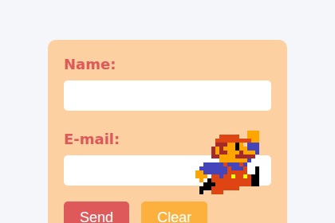

# Anteprime dei componenti — cooking-anime

**69 componenti associati**, dal solo catalogo Design-App; l'associazione non prova che il componente sia integrato nell'app.

[Tutte le app](./README.md) · [Catalogo completo](../TABELLA_478.md) · [Vista con filtro app](../../docs/componenti.html?app=cooking-anime)

Le immagini qui mostrate sono catture documentali, **non** una verifica di riuso Flutter, compatibilità nativa o licenze degli asset di terzi. In assenza di una PNG realmente acquisita la cella dichiara «Non disponibile» e punta alla fonte originale.

| Anteprima | ID | Componente | Fonte | Categoria | App associate | Codice |
|---|---|---|---|---|---|---|
| <small>Non disponibile</small> · <a href="https://github.com/Subhan-code/Amicro--Micro-transitions-/blob/fa5f8ffbe39537a8db191806066b8773c47c82e9/src/components/css-animations/physics/CurtainReveal.tsx" target="_blank" rel="noopener noreferrer">Fonte</a> | <code>AMX-001</code> | CurtainReveal | <a href="https://github.com/Subhan-code/Amicro--Micro-transitions-/blob/fa5f8ffbe39537a8db191806066b8773c47c82e9/src/components/css-animations/physics/CurtainReveal.tsx" target="_blank" rel="noopener noreferrer">DEVLIBRARIES_AMICRO</a> | CONTEXTUAL_CONTENT_REVEAL | anna-s-diary, app-factory-dashboard, cooking-anime, deskland-android, framelab, notes-ecosistema, web-utility-factory, wonderlog, world-days | Sorgente archiviata |
| <small>Non disponibile</small> · <a href="https://devlibraries.com/libraries/amicro/perspective-flip" target="_blank" rel="noopener noreferrer">Fonte</a> | <code>AMX-003</code> | Perspective Flip | <a href="https://devlibraries.com/libraries/amicro/perspective-flip" target="_blank" rel="noopener noreferrer">DEVLIBRARIES_AMICRO</a> | UNVERIFIED_CARD_3D_FLIP | anna-s-diary, app-factory-dashboard, beerclass-ai, cooking-anime, edu-01-corpo-umano, notes-ecosistema, wonderlog, world-days | Solo riferimento |
| <small>Non disponibile</small> · <a href="https://github.com/Subhan-code/Amicro--Micro-transitions-/blob/fa5f8ffbe39537a8db191806066b8773c47c82e9/registry/ui/scroll/scroll-reveal.tsx" target="_blank" rel="noopener noreferrer">Fonte</a> | <code>AMX-004</code> | Scroll Reveal | <a href="https://github.com/Subhan-code/Amicro--Micro-transitions-/blob/fa5f8ffbe39537a8db191806066b8773c47c82e9/registry/ui/scroll/scroll-reveal.tsx" target="_blank" rel="noopener noreferrer">DEVLIBRARIES_AMICRO</a> | SCROLL_TRIGGERED_ENTRANCE | anna-s-diary, app-factory-dashboard, battery-guard, beerclass-ai, camperboss, cashmate-ai, cooking-anime, edu-01-corpo-umano, framelab, notes-ecosistema, omni-cleaner, trailpath, web-utility-factory, wonderlog, world-days | Sorgente archiviata |
| <small>Non disponibile</small> · <a href="https://devlibraries.com/libraries/amicro/spatial-door-portal" target="_blank" rel="noopener noreferrer">Fonte</a> | <code>AMX-005</code> | Spatial Door Portal | <a href="https://devlibraries.com/libraries/amicro/spatial-door-portal" target="_blank" rel="noopener noreferrer">DEVLIBRARIES_AMICRO</a> | UNVERIFIED_SPATIAL_PAGE_TRANSITION | anna-s-diary, app-factory-dashboard, cooking-anime, deskland-android, framelab, notes-ecosistema, wonderlog, world-days | Solo riferimento |
| <small>Non disponibile</small> · <a href="https://github.com/Subhan-code/Amicro--Micro-transitions-/blob/fa5f8ffbe39537a8db191806066b8773c47c82e9/registry/ui/loading/accordion-loader.tsx" target="_blank" rel="noopener noreferrer">Fonte</a> | <code>AMX-006</code> | Accordion Loader | <a href="https://github.com/Subhan-code/Amicro--Micro-transitions-/blob/fa5f8ffbe39537a8db191806066b8773c47c82e9/registry/ui/loading/accordion-loader.tsx" target="_blank" rel="noopener noreferrer">DEVLIBRARIES_AMICRO</a> | INDETERMINATE_LOADING | anna-s-diary, app-factory-dashboard, battery-guard, camperboss, cooking-anime, deskland-android, easy-debloat, focussense, framelab, notes-ecosistema, omni-cleaner, send-to-pc, web-utility-factory, wonderlog, world-days | Sorgente archiviata |
| <small>Non disponibile</small> | <code>DBM-002</code> | Classic Spinner | <a href="https://github.com/riccardopinato/Design-App/blob/main/BIBLIOTECA_COMPONENTI/sorgenti/amicro/dbm-002.tsx" target="_blank" rel="noopener noreferrer">DEVLIBRARIES_BOOKMARKS</a> | LOADER_INDETERMINATE | anna-s-diary, cooking-anime, notes-ecosistema, omni-cleaner, world-days | Sorgente archiviata |
| <small>Non disponibile</small> | <code>DBM-004</code> | App Icon Load | <a href="https://github.com/riccardopinato/Design-App/blob/main/BIBLIOTECA_COMPONENTI/sorgenti/amicro/dbm-004.tsx" target="_blank" rel="noopener noreferrer">DEVLIBRARIES_BOOKMARKS</a> | APP_STARTUP_LOADING | cooking-anime, deskland-android, omni-cleaner, world-days | Sorgente archiviata |
| <small>Non disponibile</small> | <code>DBM-008</code> | Fade Arc | <a href="https://github.com/riccardopinato/Design-App/blob/main/BIBLIOTECA_COMPONENTI/sorgenti/amicro/dbm-008.tsx" target="_blank" rel="noopener noreferrer">DEVLIBRARIES_BOOKMARKS</a> | LOADER_MINIMAL | anna-s-diary, battery-guard, cooking-anime, world-days | Sorgente archiviata |
| <small>Non disponibile</small> | <code>DBM-011</code> | Morph Loader | <a href="https://github.com/riccardopinato/Design-App/blob/main/BIBLIOTECA_COMPONENTI/sorgenti/amicro/dbm-011.tsx" target="_blank" rel="noopener noreferrer">DEVLIBRARIES_BOOKMARKS</a> | LOADER_PLAYFUL | cooking-anime, framelab, notes-ecosistema, wonderlog | Sorgente archiviata |
| <small>Non disponibile</small> | <code>DBM-013</code> | Clock Spinner | <a href="https://github.com/riccardopinato/Design-App/blob/main/BIBLIOTECA_COMPONENTI/sorgenti/amicro/dbm-013.tsx" target="_blank" rel="noopener noreferrer">DEVLIBRARIES_BOOKMARKS</a> | LOADER_TIME_RELATED | cooking-anime, sleepmax-coach, tabletop-motion-alarm | Sorgente archiviata |
| <small>Non disponibile</small> | <code>DBM-016</code> | Skeleton | <a href="https://github.com/riccardopinato/Design-App/blob/main/BIBLIOTECA_COMPONENTI/sorgenti/amicro/dbm-016.tsx" target="_blank" rel="noopener noreferrer">DEVLIBRARIES_BOOKMARKS</a> | CONTENT_PLACEHOLDER | anna-s-diary, app-factory-dashboard, cooking-anime, notes-ecosistema, world-days | Sorgente archiviata |
| <small>Non disponibile</small> | <code>DBM-020</code> | Concentric Squares | <a href="https://github.com/riccardopinato/Design-App/blob/main/BIBLIOTECA_COMPONENTI/sorgenti/amicro/dbm-020.tsx" target="_blank" rel="noopener noreferrer">DEVLIBRARIES_BOOKMARKS</a> | LOADER_GEOMETRIC | app-factory-dashboard, cooking-anime, deskland-android, omni-cleaner | Sorgente archiviata |
| <small>Non disponibile</small> | <code>DBM-025</code> | Bouncing Lines | <a href="https://github.com/riccardopinato/Design-App/blob/main/BIBLIOTECA_COMPONENTI/sorgenti/amicro/dbm-025.tsx" target="_blank" rel="noopener noreferrer">DEVLIBRARIES_BOOKMARKS</a> | LOADER_PLAYFUL | anna-s-diary, cooking-anime, sleepmax-coach, world-days | Sorgente archiviata |
| <small>Non disponibile</small> | <code>DBM-026</code> | Newtons Cradle | <a href="https://github.com/riccardopinato/Design-App/blob/main/BIBLIOTECA_COMPONENTI/sorgenti/amicro/dbm-026.tsx" target="_blank" rel="noopener noreferrer">DEVLIBRARIES_BOOKMARKS</a> | LOADER_PHYSICS | app-factory-dashboard, cooking-anime, focussense, omni-cleaner | Sorgente archiviata |
| <small>Non disponibile</small> | <code>DBM-027</code> | Helix Spinner | DEVLIBRARIES_BOOKMARKS | UNVERIFIED_LOADER_VISUAL | cooking-anime, framelab, omni-cleaner | Solo riferimento |
| <small>Non disponibile</small> | <code>DBM-029</code> | Particle Shape Morph | DEVLIBRARIES_BOOKMARKS | UNVERIFIED_PARTICLE_VISUAL | cooking-anime, deskland-android, framelab, notes-ecosistema | Solo riferimento |
| <small>Non disponibile</small> | <code>DBM-030</code> | Infinite Spiral | DEVLIBRARIES_BOOKMARKS | UNVERIFIED_MEDIA_VISUAL | cooking-anime, deskland-android, framelab, wonderlog | Solo riferimento |
| <small>Non disponibile</small> · <a href="https://devlibraries.com/libraries/easeui" target="_blank" rel="noopener noreferrer">Fonte</a> | <code>DSP-001</code> | EaseUI Theme Toggle | <a href="https://devlibraries.com/libraries/easeui" target="_blank" rel="noopener noreferrer">DEVLIBRARIES_EASEUI</a> | THEME_LIGHT_DARK | anna-s-diary, app-factory-dashboard, battery-guard, beerclass-ai, camperboss, cashmate-ai, cooking-anime, deskland-android, easy-debloat, focussense, framelab, notes-ecosistema, omni-cleaner, sleepmax-coach, trailpath, web-utility-factory, wonderlog, world-days | Sorgente archiviata |
| <small>Non disponibile</small> · <a href="https://devlibraries.com/libraries/amicro/card-stack-peel" target="_blank" rel="noopener noreferrer">Fonte</a> | <code>DSP-002</code> | Card Stack Peel | <a href="https://devlibraries.com/libraries/amicro/card-stack-peel" target="_blank" rel="noopener noreferrer">DEVLIBRARIES_AMICRO</a> | SECTION_CARD_TRANSITION | anna-s-diary, app-factory-dashboard, beerclass-ai, cooking-anime, framelab, notes-ecosistema, omni-cleaner, wonderlog, world-days | Sorgente archiviata |
| <small>Non disponibile</small> · <a href="https://devlibraries.com/libraries/amicro" target="_blank" rel="noopener noreferrer">Fonte</a> | <code>DSP-003</code> | Accordion Blind Pull | <a href="https://devlibraries.com/libraries/amicro" target="_blank" rel="noopener noreferrer">DEVLIBRARIES_AMICRO</a> | EXPANDABLE_PANEL_TRANSITION | anna-s-diary, app-factory-dashboard, battery-guard, beerclass-ai, camperboss, cashmate-ai, cooking-anime, easy-debloat, notes-ecosistema, omni-cleaner, trailpath, wonderlog, world-days | Sorgente archiviata |
| <small>Non disponibile</small> · <a href="https://devlibraries.com/libraries/amicro" target="_blank" rel="noopener noreferrer">Fonte</a> | <code>DSP-005</code> | Shutter Step Slices | <a href="https://devlibraries.com/libraries/amicro" target="_blank" rel="noopener noreferrer">DEVLIBRARIES_AMICRO</a> | STAGGERED_REVEAL | anna-s-diary, app-factory-dashboard, camperboss, cooking-anime, deskland-android, framelab, notes-ecosistema, omni-cleaner, wonderlog, world-days | Sorgente archiviata |
| <small>Non disponibile</small> | <code>DSP-006</code> | Loading &amp; Waiting Visual References (user screenshot) | USER_IMAGE | LOADING_WAIT_STATE_REFERENCE | anna-s-diary, app-factory-dashboard, battery-guard, camperboss, cashmate-ai, cooking-anime, deskland-android, easy-debloat, focussense, framelab, notes-ecosistema, omni-cleaner, send-to-pc, trailpath, web-utility-factory, wonderlog, world-days | Solo riferimento |
| <small>Non disponibile</small> · <a href="https://gentleface.com/icons/video" target="_blank" rel="noopener noreferrer">Fonte</a> | <code>ICO-009</code> | Video / media | <a href="https://gentleface.com/icons/video" target="_blank" rel="noopener noreferrer">GENTLEFACE</a> | ICON | cooking-anime, framelab, omni-cleaner, wonderlog | Solo riferimento |
| <small>Non disponibile</small> · <a href="https://gentleface.com/icons/apps-sparkle" target="_blank" rel="noopener noreferrer">Fonte</a> | <code>ICO-012</code> | App / nuove funzionalità | <a href="https://gentleface.com/icons/apps-sparkle" target="_blank" rel="noopener noreferrer">GENTLEFACE</a> | ICON | app-factory-dashboard, cooking-anime, notes-ecosistema | Solo riferimento |
| <small>Non disponibile</small> · <a href="https://gentleface.com/icons/star" target="_blank" rel="noopener noreferrer">Fonte</a> | <code>ICO-019</code> | Valutazione / preferito | <a href="https://gentleface.com/icons/star" target="_blank" rel="noopener noreferrer">GENTLEFACE</a> | ICON | beerclass-ai, cooking-anime, wonderlog, world-days | Solo riferimento |
| <small>Non disponibile</small> · <a href="https://gentleface.com/icons/play" target="_blank" rel="noopener noreferrer">Fonte</a> | <code>ICO-020</code> | Riproduci | <a href="https://gentleface.com/icons/play" target="_blank" rel="noopener noreferrer">GENTLEFACE</a> | ICON | cooking-anime, deskland-android, framelab, omni-cleaner | Solo riferimento |
| <small>Non disponibile</small> · <a href="https://gentleface.com/icons/pause" target="_blank" rel="noopener noreferrer">Fonte</a> | <code>ICO-021</code> | Pausa | <a href="https://gentleface.com/icons/pause" target="_blank" rel="noopener noreferrer">GENTLEFACE</a> | ICON | cooking-anime, deskland-android, framelab, omni-cleaner | Solo riferimento |
|  | <code>UIV-002</code> | Pulsante pill con riempimento gradiente on-hover | <a href="https://uiverse.io/xueyuantan/rotten-pig-19" target="_blank" rel="noopener noreferrer">UIVERSE</a> | BUTTON | annas-diary, beerclass-ai, camperboss, cooking-anime, web-utility-factory, wonderlog, world-days | Sorgente archiviata |
|  | <code>UIV-003</code> | Card gradiente rosa-arancio con testo rivelato su hover | <a href="https://uiverse.io/gharsh11032000/tricky-cheetah-78" target="_blank" rel="noopener noreferrer">UIVERSE</a> | CARD | app-factory-dashboard, beerclass-ai, cashmate-ai, cooking-anime, notes-ecosistema, wonderlog, world-days | Sorgente archiviata |
|  | <code>UIV-009</code> | Book card in CSS 3D con copertina che si apre su hover: preferenza utente per Ricordi Anna&#x27;s Diary | <a href="https://uiverse.io/eslam-hany/selfish-bobcat-73" target="_blank" rel="noopener noreferrer">UIVERSE</a> | BOOK_CARD | annas-diary, cooking-anime, framelab, notes-ecosistema, wonderlog, world-days | Sorgente archiviata |
|  | <code>UIV-010</code> | Scheda pubblica Uiverse classificata come CARD; il codice HTML/CSS non è presente nell&#x27;archivio Galaxy e non è stato acquisito. | <a href="https://uiverse.io/00Kubi/fluffy-jellyfish-87" target="_blank" rel="noopener noreferrer">UIVERSE</a> | CARD | annas-diary, beerclass-ai, cooking-anime, framelab, notes-ecosistema, wonderlog, world-days | Sorgente archiviata |
|  | <code>UIV-013</code> | Componente Uiverse nella categoria LOADER; HTML/CSS originale archiviato con blob SHA. L&#x27;effetto specifico richiede ispezione del sorgente e collaudo visivo. | <a href="https://uiverse.io/AqFox/young-dragon-29" target="_blank" rel="noopener noreferrer">UIVERSE</a> | LOADER | camperboss, cooking-anime, deskland-android, focussense, omni-cleaner, sleepmax-coach, wonderlog | Sorgente archiviata |
|  | <code>UIV-014</code> | Componente Uiverse nella categoria CARD; HTML/CSS originale archiviato con blob SHA. L&#x27;effetto specifico richiede ispezione del sorgente e collaudo visivo. | <a href="https://uiverse.io/ElSombrero2/tricky-robin-67" target="_blank" rel="noopener noreferrer">UIVERSE</a> | CARD | annas-diary, beerclass-ai, cooking-anime, framelab, notes-ecosistema, wonderlog, world-days | Sorgente archiviata |
|  | <code>UIV-015</code> | Scheda pubblica Uiverse classificata come BUTTON; il codice HTML/CSS non è presente nell&#x27;archivio Galaxy e non è stato acquisito. | <a href="https://uiverse.io/FColombati/spotty-snake-82" target="_blank" rel="noopener noreferrer">UIVERSE</a> | BUTTON | annas-diary, beerclass-ai, camperboss, cooking-anime, easy-debloat, framelab | Sorgente archiviata |
|  | <code>UIV-024</code> | Componente Uiverse nella categoria CARD; HTML/CSS originale archiviato con blob SHA. L&#x27;effetto specifico richiede ispezione del sorgente e collaudo visivo. | <a href="https://uiverse.io/MuhammadHasann/fast-badger-70" target="_blank" rel="noopener noreferrer">UIVERSE</a> | CARD | annas-diary, beerclass-ai, cooking-anime, framelab, notes-ecosistema, wonderlog, world-days | Sorgente archiviata |
|  | <code>UIV-025</code> | Componente Uiverse nella categoria LOADER; HTML/CSS originale archiviato con blob SHA. L&#x27;effetto specifico richiede ispezione del sorgente e collaudo visivo. | <a href="https://uiverse.io/Nawsome/ancient-yak-42" target="_blank" rel="noopener noreferrer">UIVERSE</a> | LOADER | app-factory-dashboard, camperboss, cashmate-ai, cooking-anime, easy-debloat, trailpath, wonderlog | Sorgente archiviata |
|  | <code>UIV-026</code> | Componente Uiverse nella categoria LOADER; HTML/CSS originale archiviato con blob SHA. L&#x27;effetto specifico richiede ispezione del sorgente e collaudo visivo. | <a href="https://uiverse.io/Nawsome/brave-turtle-26" target="_blank" rel="noopener noreferrer">UIVERSE</a> | LOADER | camperboss, cooking-anime, deskland-android, focussense, omni-cleaner, sleepmax-coach, wonderlog | Sorgente archiviata |
|  | <code>UIV-030</code> | Componente Uiverse nella categoria LOADER; HTML/CSS originale archiviato con blob SHA. L&#x27;effetto specifico richiede ispezione del sorgente e collaudo visivo. | <a href="https://uiverse.io/Nawsome/young-goat-78" target="_blank" rel="noopener noreferrer">UIVERSE</a> | LOADER | app-factory-dashboard, camperboss, cashmate-ai, cooking-anime, easy-debloat, omni-cleaner, wonderlog | Sorgente archiviata |
|  | <code>UIV-031</code> | Scheda pubblica Uiverse classificata come LOADER; il codice HTML/CSS non è presente nell&#x27;archivio Galaxy e non è stato acquisito. | <a href="https://uiverse.io/Novaxlo/rotten-lionfish-4" target="_blank" rel="noopener noreferrer">UIVERSE</a> | LOADER | camperboss, cooking-anime, deskland-android, focussense, omni-cleaner, sleepmax-coach, wonderlog | Sorgente archiviata |
|  | <code>UIV-036</code> | Componente Uiverse nella categoria LOADER; HTML/CSS originale archiviato con blob SHA. L&#x27;effetto specifico richiede ispezione del sorgente e collaudo visivo. | <a href="https://uiverse.io/Pradeepsaranbishnoi/tall-fish-38" target="_blank" rel="noopener noreferrer">UIVERSE</a> | LOADER | camperboss, cooking-anime, deskland-android, focussense, omni-cleaner, sleepmax-coach, wonderlog | Sorgente archiviata |
|  | <code>UIV-037</code> | Componente Uiverse nella categoria CARD; HTML/CSS originale archiviato con blob SHA. L&#x27;effetto specifico richiede ispezione del sorgente e collaudo visivo. | <a href="https://uiverse.io/Prince4fff/slippery-baboon-37" target="_blank" rel="noopener noreferrer">UIVERSE</a> | CARD | app-factory-dashboard, beerclass-ai, cashmate-ai, cooking-anime, framelab, notes-ecosistema, wonderlog | Sorgente archiviata |
|  | <code>UIV-038</code> | Scheda pubblica Uiverse classificata come BUTTON; il codice HTML/CSS non è presente nell&#x27;archivio Galaxy e non è stato acquisito. | <a href="https://uiverse.io/Priyanshu02020/popular-puma-87" target="_blank" rel="noopener noreferrer">UIVERSE</a> | BUTTON | annas-diary, beerclass-ai, cooking-anime, framelab, wonderlog, world-days | Sorgente archiviata |
|  | <code>UIV-040</code> | Componente Uiverse nella categoria LOADER; HTML/CSS originale archiviato con blob SHA. L&#x27;effetto specifico richiede ispezione del sorgente e collaudo visivo. | <a href="https://uiverse.io/Shoh2008/curvy-bulldog-27" target="_blank" rel="noopener noreferrer">UIVERSE</a> | LOADER | app-factory-dashboard, camperboss, cashmate-ai, cooking-anime, easy-debloat, omni-cleaner, wonderlog | Sorgente archiviata |
|  | <code>UIV-041</code> | Componente Uiverse nella categoria LOADER; HTML/CSS originale archiviato con blob SHA. L&#x27;effetto specifico richiede ispezione del sorgente e collaudo visivo. | <a href="https://uiverse.io/Shoh2008/ugly-elephant-80" target="_blank" rel="noopener noreferrer">UIVERSE</a> | LOADER | camperboss, cooking-anime, deskland-android, focussense, omni-cleaner, sleepmax-coach, wonderlog | Sorgente archiviata |
|  | <code>UIV-048</code> | Componente Uiverse nella categoria CARD; HTML/CSS originale archiviato con blob SHA. L&#x27;effetto specifico richiede ispezione del sorgente e collaudo visivo. | <a href="https://uiverse.io/akshat-patel28/quick-baboon-29" target="_blank" rel="noopener noreferrer">UIVERSE</a> | CARD | annas-diary, beerclass-ai, cooking-anime, framelab, notes-ecosistema, wonderlog, world-days | Sorgente archiviata |
|  | <code>UIV-054</code> | Scheda pubblica Uiverse classificata come CARD; il codice HTML/CSS non è presente nell&#x27;archivio Galaxy e non è stato acquisito. | <a href="https://uiverse.io/byllzz/great-wombat-13" target="_blank" rel="noopener noreferrer">UIVERSE</a> | CARD | app-factory-dashboard, beerclass-ai, cashmate-ai, cooking-anime, framelab, notes-ecosistema, wonderlog | Sorgente archiviata |
|  | <code>UIV-057</code> | Componente Uiverse nella categoria LOADER; HTML/CSS originale archiviato con blob SHA. L&#x27;effetto specifico richiede ispezione del sorgente e collaudo visivo. | <a href="https://uiverse.io/cohencoo/dry-rat-94" target="_blank" rel="noopener noreferrer">UIVERSE</a> | LOADER | app-factory-dashboard, camperboss, cashmate-ai, cooking-anime, easy-debloat, trailpath, wonderlog | Sorgente archiviata |
|  | <code>UIV-060</code> | Scheda pubblica Uiverse classificata come BUTTON; il codice HTML/CSS non è presente nell&#x27;archivio Galaxy e non è stato acquisito. | <a href="https://uiverse.io/dexter-st/breezy-zebra-94" target="_blank" rel="noopener noreferrer">UIVERSE</a> | BUTTON | annas-diary, cooking-anime, framelab, notes-ecosistema, wonderlog, world-days | Sorgente archiviata |
|  | <code>UIV-062</code> | Scheda pubblica Uiverse classificata come LOADER; il codice HTML/CSS non è presente nell&#x27;archivio Galaxy e non è stato acquisito. | <a href="https://uiverse.io/dexter-st/spicy-otter-30" target="_blank" rel="noopener noreferrer">UIVERSE</a> | LOADER | app-factory-dashboard, camperboss, cashmate-ai, cooking-anime, easy-debloat, omni-cleaner, wonderlog | Sorgente archiviata |
|  | <code>UIV-072</code> | Componente Uiverse nella categoria LOADER; HTML/CSS originale archiviato con blob SHA. L&#x27;effetto specifico richiede ispezione del sorgente e collaudo visivo. | <a href="https://uiverse.io/gsperandio/shaggy-kangaroo-12" target="_blank" rel="noopener noreferrer">UIVERSE</a> | LOADER | camperboss, cooking-anime, deskland-android, focussense, omni-cleaner, sleepmax-coach, wonderlog | Sorgente archiviata |
|  | <code>UIV-073</code> | Scheda pubblica Uiverse classificata come CARD; il codice HTML/CSS non è presente nell&#x27;archivio Galaxy e non è stato acquisito. | <a href="https://uiverse.io/ilkhoeri/thin-bobcat-83" target="_blank" rel="noopener noreferrer">UIVERSE</a> | CARD | app-factory-dashboard, beerclass-ai, cashmate-ai, cooking-anime, framelab, notes-ecosistema, wonderlog | Sorgente archiviata |
|  | <code>UIV-076</code> | Scheda pubblica Uiverse classificata come LOADER; il codice HTML/CSS non è presente nell&#x27;archivio Galaxy e non è stato acquisito. | <a href="https://uiverse.io/kat_2522/rude-robin-51" target="_blank" rel="noopener noreferrer">UIVERSE</a> | LOADER | app-factory-dashboard, camperboss, cashmate-ai, cooking-anime, easy-debloat, omni-cleaner, wonderlog | Sorgente archiviata |
|  | <code>UIV-077</code> | Componente Uiverse nella categoria CARD; HTML/CSS originale archiviato con blob SHA. L&#x27;effetto specifico richiede ispezione del sorgente e collaudo visivo. | <a href="https://uiverse.io/kennyotsu/fast-emu-70" target="_blank" rel="noopener noreferrer">UIVERSE</a> | CARD | app-factory-dashboard, beerclass-ai, cashmate-ai, cooking-anime, framelab, notes-ecosistema, wonderlog | Sorgente archiviata |
|  | <code>UIV-080</code> | Componente Uiverse nella categoria CARD; HTML/CSS originale archiviato con blob SHA. L&#x27;effetto specifico richiede ispezione del sorgente e collaudo visivo. | <a href="https://uiverse.io/kennyotsu/short-ape-5" target="_blank" rel="noopener noreferrer">UIVERSE</a> | CARD | annas-diary, beerclass-ai, cooking-anime, framelab, notes-ecosistema, wonderlog, world-days | Sorgente archiviata |
|  | <code>UIV-081</code> | Scheda pubblica Uiverse classificata come CARD; il codice HTML/CSS non è presente nell&#x27;archivio Galaxy e non è stato acquisito. | <a href="https://uiverse.io/kennyotsu/tender-badger-21" target="_blank" rel="noopener noreferrer">UIVERSE</a> | CARD | app-factory-dashboard, beerclass-ai, cashmate-ai, cooking-anime, framelab, trailpath, wonderlog | Sorgente archiviata |
|  | <code>UIV-092</code> | Scheda pubblica Uiverse classificata come CARD; il codice HTML/CSS non è presente nell&#x27;archivio Galaxy e non è stato acquisito. | <a href="https://uiverse.io/mymiamo/quiet-dragon-5" target="_blank" rel="noopener noreferrer">UIVERSE</a> | CARD | annas-diary, beerclass-ai, cooking-anime, framelab, notes-ecosistema, wonderlog, world-days | Sorgente archiviata |
|  | <code>UIV-097</code> | Componente Uiverse nella categoria CARD; HTML/CSS originale archiviato con blob SHA. L&#x27;effetto specifico richiede ispezione del sorgente e collaudo visivo. | <a href="https://uiverse.io/vamsidevendrakumar/soft-shrimp-94" target="_blank" rel="noopener noreferrer">UIVERSE</a> | CARD | app-factory-dashboard, beerclass-ai, cashmate-ai, cooking-anime, framelab, notes-ecosistema, wonderlog | Sorgente archiviata |
|  | <code>UIV-102</code> | Warm stitched beige/orange login form; adapt to product typography and contrast. Categoria FORM verificata nel post pubblico Uiverse. Tag originali: login, form, stitched, rounded, shadow, beige, orange, password, form, submit. | <a href="https://uiverse.io/Praashoo7/bitter-pig-24" target="_blank" rel="noopener noreferrer">UIVERSE</a> | FORM | annas-diary, app-factory-dashboard, camperboss, cooking-anime, notes-ecosistema, sleepmax-coach, wonderlog | Sorgente archiviata |
|  | <code>UIV-104</code> | Minimal purple login form; adapt palette and semantics rather than add authentication. Categoria FORM verificata nel post pubblico Uiverse. Tag originali: login, form, input, button, password, white, form, signin, username, purple. | <a href="https://uiverse.io/alexmaracinaru/tall-owl-30" target="_blank" rel="noopener noreferrer">UIVERSE</a> | FORM | annas-diary, app-factory-dashboard, cashmate-ai, cooking-anime, notes-ecosistema, wonderlog, world-days | Sorgente archiviata |
|  | <code>UIV-105</code> | Welcome/social login form; explicit consent and existing optional provider only. Categoria FORM verificata nel post pubblico Uiverse. Tag originali: login, email, social, form, submit, confirm, password, welcome, rounded, shadow. | <a href="https://uiverse.io/ayyjayy2/sour-dog-94" target="_blank" rel="noopener noreferrer">UIVERSE</a> | FORM | annas-diary, app-factory-dashboard, beerclass-ai, cashmate-ai, cooking-anime, framelab, notes-ecosistema, wonderlog | Sorgente archiviata |
|  | <code>UIV-108</code> | Pixel-art character form: recognizable Mario/Nintendo reference; reference-only until IP review. Categoria FORM verificata nel post pubblico Uiverse. Tag originali: form, mario, input, animated, button, send, red, orange, yellow, email. | <a href="https://uiverse.io/guilhermeyohan/friendly-walrus-55" target="_blank" rel="noopener noreferrer">UIVERSE</a> | FORM | cooking-anime, deskland-android, edu-01-corpo-umano, framelab | Sorgente archiviata |
|  | <code>UIV-109</code> | Pink retro/pastel stars form; adapt to approved rose palette and reduced-motion. Categoria FORM verificata nel post pubblico Uiverse. Tag originali: form, button, bold, pink, password, email, retro, toggle, switch, login. | <a href="https://uiverse.io/mamyapro123/curvy-bear-51" target="_blank" rel="noopener noreferrer">UIVERSE</a> | FORM | annas-diary, beerclass-ai, camperboss, cooking-anime, notes-ecosistema, sleepmax-coach, wonderlog, world-days | Sorgente archiviata |
| <small>Non disponibile</small> · <a href="https://devlibraries.com/libraries/watermelon/carousel-slider" target="_blank" rel="noopener noreferrer">Fonte</a> | <code>WML-001</code> | Carousel Slider | <a href="https://devlibraries.com/libraries/watermelon/carousel-slider" target="_blank" rel="noopener noreferrer">DEVLIBRARIES_WATERMELON</a> | CAROUSEL_GESTURE | anna-s-diary, beerclass-ai, camperboss, cooking-anime, framelab, notes-ecosistema, omni-cleaner, wonderlog, world-days | Sorgente archiviata |
| <small>Non disponibile</small> · <a href="https://devlibraries.com/libraries/watermelon/fractional-picker" target="_blank" rel="noopener noreferrer">Fonte</a> | <code>WML-002</code> | Fractional Picker | <a href="https://devlibraries.com/libraries/watermelon/fractional-picker" target="_blank" rel="noopener noreferrer">DEVLIBRARIES_WATERMELON</a> | RULER_PICKER | anna-s-diary, battery-guard, beerclass-ai, camperboss, cooking-anime, focussense, sleepmax-coach, world-days | Sorgente archiviata |
| <small>Non disponibile</small> · <a href="https://devlibraries.com/libraries/watermelon/scrub-slider-base" target="_blank" rel="noopener noreferrer">Fonte</a> | <code>WML-003</code> | Scrub Slider (base) | <a href="https://devlibraries.com/libraries/watermelon/scrub-slider-base" target="_blank" rel="noopener noreferrer">DEVLIBRARIES_WATERMELON</a> | SCRUB_PRECISION | anna-s-diary, beerclass-ai, cooking-anime, focussense, framelab, notes-ecosistema, omni-cleaner, trailpath, wonderlog | Sorgente archiviata |
| <small>Non disponibile</small> · <a href="https://devlibraries.com/libraries/watermelon/swap-form" target="_blank" rel="noopener noreferrer">Fonte</a> | <code>WML-005</code> | Swap Form | <a href="https://devlibraries.com/libraries/watermelon/swap-form" target="_blank" rel="noopener noreferrer">DEVLIBRARIES_WATERMELON</a> | AUTH_FORM_TRANSITION | anna-s-diary, app-factory-dashboard, cashmate-ai, cooking-anime, notes-ecosistema, wonderlog, world-days | Sorgente archiviata |
| <small>Non disponibile</small> · <a href="https://devlibraries.com/libraries/watermelon/text-gradient" target="_blank" rel="noopener noreferrer">Fonte</a> | <code>WML-006</code> | Text Gradient | <a href="https://devlibraries.com/libraries/watermelon/text-gradient" target="_blank" rel="noopener noreferrer">DEVLIBRARIES_WATERMELON</a> | TYPOGRAPHY_DECORATION | anna-s-diary, app-factory-dashboard, cooking-anime, framelab, web-utility-factory, wonderlog, world-days | Solo riferimento |
| <small>Non disponibile</small> · <a href="https://devlibraries.com/libraries/watermelon/dialog-stack-base" target="_blank" rel="noopener noreferrer">Fonte</a> | <code>WML-007</code> | Dialog Stack (base) | <a href="https://devlibraries.com/libraries/watermelon/dialog-stack-base" target="_blank" rel="noopener noreferrer">DEVLIBRARIES_WATERMELON</a> | MULTISTEP_MODAL | anna-s-diary, app-factory-dashboard, camperboss, cashmate-ai, cooking-anime, notes-ecosistema, wonderlog | Sorgente archiviata |
| <small>Non disponibile</small> · <a href="https://devlibraries.com/libraries/watermelon/flip-clock" target="_blank" rel="noopener noreferrer">Fonte</a> | <code>WML-009</code> | Flip Clock | <a href="https://devlibraries.com/libraries/watermelon/flip-clock" target="_blank" rel="noopener noreferrer">DEVLIBRARIES_WATERMELON</a> | COUNTDOWN_CLOCK_VISUAL | anna-s-diary, camperboss, cooking-anime, focussense, sleepmax-coach, tabletop-motion-alarm, wonderlog, world-days | Solo riferimento |
