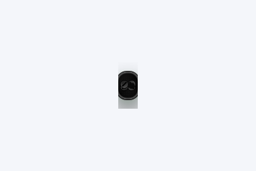
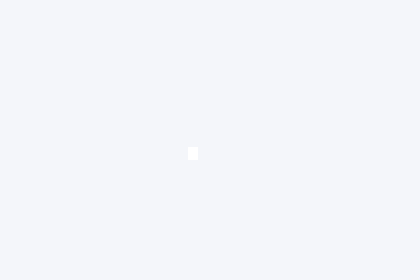
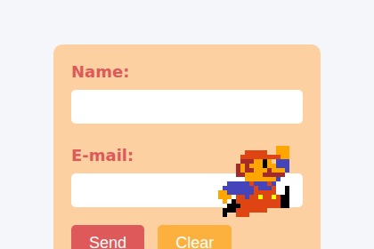

# Anteprime dei componenti — deskland-android

**43 componenti associati**, dal solo catalogo Design-App; l'associazione non prova che il componente sia integrato nell'app.

[Tutte le app](./README.md) · [Catalogo completo](../TABELLA_478.md) · [Vista con filtro app](../../docs/componenti.html?app=deskland-android)

Le immagini qui mostrate sono catture documentali, **non** una verifica di riuso Flutter, compatibilità nativa o licenze degli asset di terzi. In assenza di una PNG realmente acquisita la cella dichiara «Non disponibile» e punta alla fonte originale.

| Anteprima | ID | Componente | Fonte | Categoria | App associate | Codice |
|---|---|---|---|---|---|---|
| <small>Non disponibile</small> · <a href="https://github.com/Subhan-code/Amicro--Micro-transitions-/blob/fa5f8ffbe39537a8db191806066b8773c47c82e9/src/components/css-animations/physics/CurtainReveal.tsx" target="_blank" rel="noopener noreferrer">Fonte</a> | <code>AMX-001</code> | CurtainReveal | <a href="https://github.com/Subhan-code/Amicro--Micro-transitions-/blob/fa5f8ffbe39537a8db191806066b8773c47c82e9/src/components/css-animations/physics/CurtainReveal.tsx" target="_blank" rel="noopener noreferrer">DEVLIBRARIES_AMICRO</a> | CONTEXTUAL_CONTENT_REVEAL | anna-s-diary, app-factory-dashboard, cooking-anime, deskland-android, framelab, notes-ecosistema, web-utility-factory, wonderlog, world-days | Sorgente archiviata |
| <small>Non disponibile</small> · <a href="https://github.com/Subhan-code/Amicro--Micro-transitions-/blob/fa5f8ffbe39537a8db191806066b8773c47c82e9/registry/ui/cursor/cursor-trail.tsx" target="_blank" rel="noopener noreferrer">Fonte</a> | <code>AMX-002</code> | Cursor Trail | <a href="https://github.com/Subhan-code/Amicro--Micro-transitions-/blob/fa5f8ffbe39537a8db191806066b8773c47c82e9/registry/ui/cursor/cursor-trail.tsx" target="_blank" rel="noopener noreferrer">DEVLIBRARIES_AMICRO</a> | POINTER_FEEDBACK | app-factory-dashboard, deskland-android, framelab, notes-ecosistema, web-utility-factory | Sorgente archiviata |
| <small>Non disponibile</small> · <a href="https://devlibraries.com/libraries/amicro/spatial-door-portal" target="_blank" rel="noopener noreferrer">Fonte</a> | <code>AMX-005</code> | Spatial Door Portal | <a href="https://devlibraries.com/libraries/amicro/spatial-door-portal" target="_blank" rel="noopener noreferrer">DEVLIBRARIES_AMICRO</a> | UNVERIFIED_SPATIAL_PAGE_TRANSITION | anna-s-diary, app-factory-dashboard, cooking-anime, deskland-android, framelab, notes-ecosistema, wonderlog, world-days | Solo riferimento |
| <small>Non disponibile</small> · <a href="https://github.com/Subhan-code/Amicro--Micro-transitions-/blob/fa5f8ffbe39537a8db191806066b8773c47c82e9/registry/ui/loading/accordion-loader.tsx" target="_blank" rel="noopener noreferrer">Fonte</a> | <code>AMX-006</code> | Accordion Loader | <a href="https://github.com/Subhan-code/Amicro--Micro-transitions-/blob/fa5f8ffbe39537a8db191806066b8773c47c82e9/registry/ui/loading/accordion-loader.tsx" target="_blank" rel="noopener noreferrer">DEVLIBRARIES_AMICRO</a> | INDETERMINATE_LOADING | anna-s-diary, app-factory-dashboard, battery-guard, camperboss, cooking-anime, deskland-android, easy-debloat, focussense, framelab, notes-ecosistema, omni-cleaner, send-to-pc, web-utility-factory, wonderlog, world-days | Sorgente archiviata |
| <small>Non disponibile</small> | <code>DBM-004</code> | App Icon Load | <a href="https://github.com/riccardopinato/Design-App/blob/main/BIBLIOTECA_COMPONENTI/sorgenti/amicro/dbm-004.tsx" target="_blank" rel="noopener noreferrer">DEVLIBRARIES_BOOKMARKS</a> | APP_STARTUP_LOADING | cooking-anime, deskland-android, omni-cleaner, world-days | Sorgente archiviata |
| <small>Non disponibile</small> | <code>DBM-009</code> | Terminal Loader | <a href="https://github.com/riccardopinato/Design-App/blob/main/BIBLIOTECA_COMPONENTI/sorgenti/amicro/dbm-009.tsx" target="_blank" rel="noopener noreferrer">DEVLIBRARIES_BOOKMARKS</a> | LOADER_TECHNICAL | app-factory-dashboard, deskland-android, easy-debloat, send-to-pc | Sorgente archiviata |
| <small>Non disponibile</small> | <code>DBM-012</code> | Grid Dots | <a href="https://github.com/riccardopinato/Design-App/blob/main/BIBLIOTECA_COMPONENTI/sorgenti/amicro/dbm-012.tsx" target="_blank" rel="noopener noreferrer">DEVLIBRARIES_BOOKMARKS</a> | LOADER_TECHNICAL | app-factory-dashboard, deskland-android, omni-cleaner | Sorgente archiviata |
| <small>Non disponibile</small> | <code>DBM-017</code> | Concentric Ring | <a href="https://github.com/riccardopinato/Design-App/blob/main/BIBLIOTECA_COMPONENTI/sorgenti/amicro/dbm-017.tsx" target="_blank" rel="noopener noreferrer">DEVLIBRARIES_BOOKMARKS</a> | LOADER_RINGS | battery-guard, deskland-android, focussense, the-luminous-infinite-circle | Sorgente archiviata |
| <small>Non disponibile</small> | <code>DBM-020</code> | Concentric Squares | <a href="https://github.com/riccardopinato/Design-App/blob/main/BIBLIOTECA_COMPONENTI/sorgenti/amicro/dbm-020.tsx" target="_blank" rel="noopener noreferrer">DEVLIBRARIES_BOOKMARKS</a> | LOADER_GEOMETRIC | app-factory-dashboard, cooking-anime, deskland-android, omni-cleaner | Sorgente archiviata |
| <small>Non disponibile</small> | <code>DBM-029</code> | Particle Shape Morph | DEVLIBRARIES_BOOKMARKS | UNVERIFIED_PARTICLE_VISUAL | cooking-anime, deskland-android, framelab, notes-ecosistema | Solo riferimento |
| <small>Non disponibile</small> | <code>DBM-030</code> | Infinite Spiral | DEVLIBRARIES_BOOKMARKS | UNVERIFIED_MEDIA_VISUAL | cooking-anime, deskland-android, framelab, wonderlog | Solo riferimento |
| <small>Non disponibile</small> · <a href="https://devlibraries.com/libraries/easeui" target="_blank" rel="noopener noreferrer">Fonte</a> | <code>DSP-001</code> | EaseUI Theme Toggle | <a href="https://devlibraries.com/libraries/easeui" target="_blank" rel="noopener noreferrer">DEVLIBRARIES_EASEUI</a> | THEME_LIGHT_DARK | anna-s-diary, app-factory-dashboard, battery-guard, beerclass-ai, camperboss, cashmate-ai, cooking-anime, deskland-android, easy-debloat, focussense, framelab, notes-ecosistema, omni-cleaner, sleepmax-coach, trailpath, web-utility-factory, wonderlog, world-days | Sorgente archiviata |
| <small>Non disponibile</small> · <a href="https://devlibraries.com/libraries/amicro" target="_blank" rel="noopener noreferrer">Fonte</a> | <code>DSP-005</code> | Shutter Step Slices | <a href="https://devlibraries.com/libraries/amicro" target="_blank" rel="noopener noreferrer">DEVLIBRARIES_AMICRO</a> | STAGGERED_REVEAL | anna-s-diary, app-factory-dashboard, camperboss, cooking-anime, deskland-android, framelab, notes-ecosistema, omni-cleaner, wonderlog, world-days | Sorgente archiviata |
| <small>Non disponibile</small> | <code>DSP-006</code> | Loading &amp; Waiting Visual References (user screenshot) | USER_IMAGE | LOADING_WAIT_STATE_REFERENCE | anna-s-diary, app-factory-dashboard, battery-guard, camperboss, cashmate-ai, cooking-anime, deskland-android, easy-debloat, focussense, framelab, notes-ecosistema, omni-cleaner, send-to-pc, trailpath, web-utility-factory, wonderlog, world-days | Solo riferimento |
| <small>Non disponibile</small> · <a href="https://gentleface.com/icons/battery-charging" target="_blank" rel="noopener noreferrer">Fonte</a> | <code>ICO-003</code> | Batteria in carica | <a href="https://gentleface.com/icons/battery-charging" target="_blank" rel="noopener noreferrer">GENTLEFACE</a> | ICON | 180flipcharge, battery-guard, deskland-android | Solo riferimento |
| <small>Non disponibile</small> · <a href="https://gentleface.com/icons/play" target="_blank" rel="noopener noreferrer">Fonte</a> | <code>ICO-020</code> | Riproduci | <a href="https://gentleface.com/icons/play" target="_blank" rel="noopener noreferrer">GENTLEFACE</a> | ICON | cooking-anime, deskland-android, framelab, omni-cleaner | Solo riferimento |
| <small>Non disponibile</small> · <a href="https://gentleface.com/icons/pause" target="_blank" rel="noopener noreferrer">Fonte</a> | <code>ICO-021</code> | Pausa | <a href="https://gentleface.com/icons/pause" target="_blank" rel="noopener noreferrer">GENTLEFACE</a> | ICON | cooking-anime, deskland-android, framelab, omni-cleaner | Solo riferimento |
| <small>Non disponibile</small> · <a href="https://gentleface.com/icons/home" target="_blank" rel="noopener noreferrer">Fonte</a> | <code>ICO-026</code> | Pagina iniziale | <a href="https://gentleface.com/icons/home" target="_blank" rel="noopener noreferrer">GENTLEFACE</a> | ICON | anna-s-diary, deskland-android, wonderlog, world-days | Solo riferimento |
|  | <code>UIV-005</code> | Card proposta dall&#x27;utente come sfondo decorativo per varie app; effetto esatto non verificato | <a href="https://uiverse.io/amir_6539/red-duck-82" target="_blank" rel="noopener noreferrer">UIVERSE</a> | CARD_BACKGROUND | annas-diary, app-factory-dashboard, battery-guard, cashmate-ai, deskland-android, focussense, notes-ecosistema, omni-cleaner | Sorgente archiviata |
|  | <code>UIV-013</code> | Componente Uiverse nella categoria LOADER; HTML/CSS originale archiviato con blob SHA. L&#x27;effetto specifico richiede ispezione del sorgente e collaudo visivo. | <a href="https://uiverse.io/AqFox/young-dragon-29" target="_blank" rel="noopener noreferrer">UIVERSE</a> | LOADER | camperboss, cooking-anime, deskland-android, focussense, omni-cleaner, sleepmax-coach, wonderlog | Sorgente archiviata |
|  | <code>UIV-016</code> | Scheda pubblica Uiverse classificata come CARD; il codice HTML/CSS non è presente nell&#x27;archivio Galaxy e non è stato acquisito. | <a href="https://uiverse.io/Gidarx/clever-panther-6" target="_blank" rel="noopener noreferrer">UIVERSE</a> | CARD | app-factory-dashboard, beerclass-ai, camperboss, cashmate-ai, deskland-android, edu-01-corpo-umano, notes-ecosistema | Sorgente archiviata |
|  | <code>UIV-017</code> | Scheda pubblica Uiverse classificata come CARD; il codice HTML/CSS non è presente nell&#x27;archivio Galaxy e non è stato acquisito. | <a href="https://uiverse.io/Gidarx/moody-falcon-73" target="_blank" rel="noopener noreferrer">UIVERSE</a> | CARD | annas-diary, camperboss, deskland-android, edu-01-corpo-umano, notes-ecosistema, wonderlog, world-days | Sorgente archiviata |
|  | <code>UIV-019</code> | Componente Uiverse nella categoria LOADER; HTML/CSS originale archiviato con blob SHA. L&#x27;effetto specifico richiede ispezione del sorgente e collaudo visivo. | <a href="https://uiverse.io/JkHuger/new-deer-97" target="_blank" rel="noopener noreferrer">UIVERSE</a> | LOADER | deskland-android, focussense, framelab, notes-ecosistema, omni-cleaner, sleepmax-coach, world-days | Sorgente archiviata |
|  | <code>UIV-021</code> | Componente Uiverse nella categoria CARD; HTML/CSS originale archiviato con blob SHA. L&#x27;effetto specifico richiede ispezione del sorgente e collaudo visivo. | <a href="https://uiverse.io/JohnnyCSilva/black-rabbit-68" target="_blank" rel="noopener noreferrer">UIVERSE</a> | CARD | annas-diary, camperboss, deskland-android, edu-01-corpo-umano, notes-ecosistema, wonderlog, world-days | Sorgente archiviata |
|  | <code>UIV-026</code> | Componente Uiverse nella categoria LOADER; HTML/CSS originale archiviato con blob SHA. L&#x27;effetto specifico richiede ispezione del sorgente e collaudo visivo. | <a href="https://uiverse.io/Nawsome/brave-turtle-26" target="_blank" rel="noopener noreferrer">UIVERSE</a> | LOADER | camperboss, cooking-anime, deskland-android, focussense, omni-cleaner, sleepmax-coach, wonderlog | Sorgente archiviata |
|  | <code>UIV-031</code> | Scheda pubblica Uiverse classificata come LOADER; il codice HTML/CSS non è presente nell&#x27;archivio Galaxy e non è stato acquisito. | <a href="https://uiverse.io/Novaxlo/rotten-lionfish-4" target="_blank" rel="noopener noreferrer">UIVERSE</a> | LOADER | camperboss, cooking-anime, deskland-android, focussense, omni-cleaner, sleepmax-coach, wonderlog | Sorgente archiviata |
|  | <code>UIV-032</code> | Componente Uiverse nella categoria LOADER; HTML/CSS originale archiviato con blob SHA. L&#x27;effetto specifico richiede ispezione del sorgente e collaudo visivo. | <a href="https://uiverse.io/Praashoo7/lucky-hound-44" target="_blank" rel="noopener noreferrer">UIVERSE</a> | LOADER | deskland-android, focussense, framelab, notes-ecosistema, omni-cleaner, sleepmax-coach, world-days | Sorgente archiviata |
|  | <code>UIV-036</code> | Componente Uiverse nella categoria LOADER; HTML/CSS originale archiviato con blob SHA. L&#x27;effetto specifico richiede ispezione del sorgente e collaudo visivo. | <a href="https://uiverse.io/Pradeepsaranbishnoi/tall-fish-38" target="_blank" rel="noopener noreferrer">UIVERSE</a> | LOADER | camperboss, cooking-anime, deskland-android, focussense, omni-cleaner, sleepmax-coach, wonderlog | Sorgente archiviata |
|  | <code>UIV-041</code> | Componente Uiverse nella categoria LOADER; HTML/CSS originale archiviato con blob SHA. L&#x27;effetto specifico richiede ispezione del sorgente e collaudo visivo. | <a href="https://uiverse.io/Shoh2008/ugly-elephant-80" target="_blank" rel="noopener noreferrer">UIVERSE</a> | LOADER | camperboss, cooking-anime, deskland-android, focussense, omni-cleaner, sleepmax-coach, wonderlog | Sorgente archiviata |
|  | <code>UIV-042</code> | Componente Uiverse nella categoria LOADER; HTML/CSS originale archiviato con blob SHA. L&#x27;effetto specifico richiede ispezione del sorgente e collaudo visivo. | <a href="https://uiverse.io/Shoh2008/yellow-dolphin-16" target="_blank" rel="noopener noreferrer">UIVERSE</a> | LOADER | deskland-android, focussense, framelab, notes-ecosistema, omni-cleaner, sleepmax-coach, world-days | Sorgente archiviata |
|  | <code>UIV-050</code> | Scheda pubblica Uiverse classificata come LOADER; il codice HTML/CSS non è presente nell&#x27;archivio Galaxy e non è stato acquisito. | <a href="https://uiverse.io/andrew-manzyk/fast-vampirebat-53" target="_blank" rel="noopener noreferrer">UIVERSE</a> | LOADER | deskland-android, focussense, framelab, notes-ecosistema, omni-cleaner, sleepmax-coach, world-days | Sorgente archiviata |
|  | <code>UIV-056</code> | Scheda pubblica Uiverse classificata come CARD; il codice HTML/CSS non è presente nell&#x27;archivio Galaxy e non è stato acquisito. | <a href="https://uiverse.io/chase2k25/warm-chicken-23" target="_blank" rel="noopener noreferrer">UIVERSE</a> | CARD | annas-diary, camperboss, deskland-android, edu-01-corpo-umano, notes-ecosistema, wonderlog, world-days | Sorgente archiviata |
|  | <code>UIV-063</code> | Scheda pubblica Uiverse classificata come CARD; il codice HTML/CSS non è presente nell&#x27;archivio Galaxy e non è stato acquisito. | <a href="https://uiverse.io/dexter-st/tough-falcon-78" target="_blank" rel="noopener noreferrer">UIVERSE</a> | CARD | app-factory-dashboard, beerclass-ai, camperboss, cashmate-ai, deskland-android, edu-01-corpo-umano, notes-ecosistema | Sorgente archiviata |
|  | <code>UIV-068</code> | Scheda pubblica Uiverse classificata come LOADER; il codice HTML/CSS non è presente nell&#x27;archivio Galaxy e non è stato acquisito. | <a href="https://uiverse.io/esraaabdel-kareem/bad-dragonfly-54" target="_blank" rel="noopener noreferrer">UIVERSE</a> | LOADER | deskland-android, focussense, framelab, notes-ecosistema, omni-cleaner, sleepmax-coach, world-days | Sorgente archiviata |
|  | <code>UIV-072</code> | Componente Uiverse nella categoria LOADER; HTML/CSS originale archiviato con blob SHA. L&#x27;effetto specifico richiede ispezione del sorgente e collaudo visivo. | <a href="https://uiverse.io/gsperandio/shaggy-kangaroo-12" target="_blank" rel="noopener noreferrer">UIVERSE</a> | LOADER | camperboss, cooking-anime, deskland-android, focussense, omni-cleaner, sleepmax-coach, wonderlog | Sorgente archiviata |
|  | <code>UIV-075</code> | Componente Uiverse nella categoria CARD; HTML/CSS originale archiviato con blob SHA. L&#x27;effetto specifico richiede ispezione del sorgente e collaudo visivo. | <a href="https://uiverse.io/joe-watson-sbf/honest-bullfrog-6" target="_blank" rel="noopener noreferrer">UIVERSE</a> | CARD | annas-diary, camperboss, deskland-android, edu-01-corpo-umano, notes-ecosistema, wonderlog, world-days | Sorgente archiviata |
|  | <code>UIV-078</code> | Scheda pubblica Uiverse classificata come CARD; il codice HTML/CSS non è presente nell&#x27;archivio Galaxy e non è stato acquisito. | <a href="https://uiverse.io/kennyotsu/giant-sloth-18" target="_blank" rel="noopener noreferrer">UIVERSE</a> | CARD | app-factory-dashboard, beerclass-ai, camperboss, cashmate-ai, deskland-android, edu-01-corpo-umano, notes-ecosistema | Sorgente archiviata |
|  | <code>UIV-082</code> | Componente Uiverse nella categoria CARD; HTML/CSS originale archiviato con blob SHA. L&#x27;effetto specifico richiede ispezione del sorgente e collaudo visivo. | <a href="https://uiverse.io/kennyotsu/wise-rattlesnake-92" target="_blank" rel="noopener noreferrer">UIVERSE</a> | CARD | app-factory-dashboard, beerclass-ai, camperboss, cashmate-ai, deskland-android, edu-01-corpo-umano, notes-ecosistema | Sorgente archiviata |
|  | <code>UIV-091</code> | Scheda pubblica Uiverse classificata come CARD; il codice HTML/CSS non è presente nell&#x27;archivio Galaxy e non è stato acquisito. | <a href="https://uiverse.io/monkey_8812/curly-moth-56" target="_blank" rel="noopener noreferrer">UIVERSE</a> | CARD | annas-diary, camperboss, deskland-android, edu-01-corpo-umano, notes-ecosistema, wonderlog, world-days | Sorgente archiviata |
|  | <code>UIV-095</code> | Scheda pubblica Uiverse classificata come CARD; il codice HTML/CSS non è presente nell&#x27;archivio Galaxy e non è stato acquisito. | <a href="https://uiverse.io/seoulchik/funny-seahorse-89" target="_blank" rel="noopener noreferrer">UIVERSE</a> | CARD | annas-diary, camperboss, deskland-android, edu-01-corpo-umano, notes-ecosistema, wonderlog, world-days | Sorgente archiviata |
|  | <code>UIV-096</code> | Scheda pubblica Uiverse classificata come PATTERN; il codice HTML/CSS non è presente nell&#x27;archivio Galaxy e non è stato acquisito. | <a href="https://uiverse.io/solowzrd/wet-lionfish-63" target="_blank" rel="noopener noreferrer">UIVERSE</a> | PATTERN | app-factory-dashboard, battery-guard, deskland-android, focussense, omni-cleaner, web-utility-factory | Sorgente archiviata |
|  | <code>UIV-098</code> | Scheda pubblica Uiverse classificata come PATTERN; il codice HTML/CSS non è presente nell&#x27;archivio Galaxy e non è stato acquisito. | <a href="https://uiverse.io/whoisyourdeadie/foolish-rabbit-13" target="_blank" rel="noopener noreferrer">UIVERSE</a> | PATTERN | annas-diary, battery-guard, cashmate-ai, deskland-android, notes-ecosistema, world-days | Sorgente archiviata |
|  | <code>UIV-108</code> | Pixel-art character form: recognizable Mario/Nintendo reference; reference-only until IP review. Categoria FORM verificata nel post pubblico Uiverse. Tag originali: form, mario, input, animated, button, send, red, orange, yellow, email. | <a href="https://uiverse.io/guilhermeyohan/friendly-walrus-55" target="_blank" rel="noopener noreferrer">UIVERSE</a> | FORM | cooking-anime, deskland-android, edu-01-corpo-umano, framelab | Sorgente archiviata |
