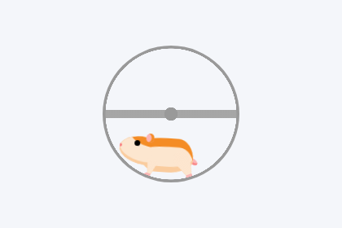
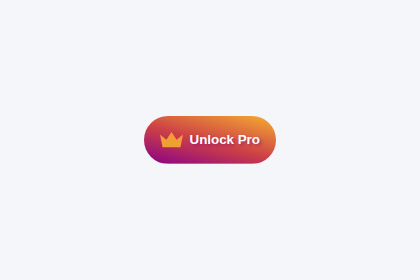
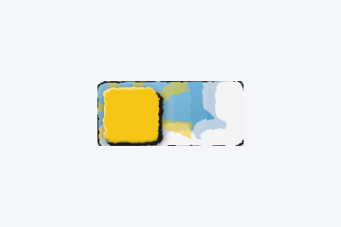

# Anteprime dei componenti — easy-debloat

**38 componenti associati**, dal solo catalogo Design-App; l'associazione non prova che il componente sia integrato nell'app.

[Tutte le app](./README.md) · [Catalogo completo](../TABELLA_478.md) · [Vista con filtro app](../../docs/componenti.html?app=easy-debloat)

Le immagini qui mostrate sono catture documentali, **non** una verifica di riuso Flutter, compatibilità nativa o licenze degli asset di terzi. In assenza di una PNG realmente acquisita la cella dichiara «Non disponibile» e punta alla fonte originale.

| Anteprima | UID | ID canonico | Componente | Fonte | Categoria | App associate | Codice |
|---|---|---|---|---|---|---|---|
| <small>Non disponibile</small> · <a href="https://github.com/Subhan-code/Amicro--Micro-transitions-/blob/fa5f8ffbe39537a8db191806066b8773c47c82e9/registry/ui/loading/accordion-loader.tsx" target="_blank" rel="noopener noreferrer">Fonte</a> | <code>UID-0006</code> | <code>AMX-006</code> | Accordion Loader | <a href="https://github.com/Subhan-code/Amicro--Micro-transitions-/blob/fa5f8ffbe39537a8db191806066b8773c47c82e9/registry/ui/loading/accordion-loader.tsx" target="_blank" rel="noopener noreferrer">DEVLIBRARIES_AMICRO</a> | INDETERMINATE_LOADING | anna-s-diary, app-factory-dashboard, battery-guard, camperboss, cooking-anime, deskland-android, easy-debloat, focussense, framelab, notes-ecosistema, omni-cleaner, send-to-pc, web-utility-factory, wonderlog, world-days | Sorgente archiviata |
| <small>Non disponibile</small> | <code>UID-0014</code> | <code>DBM-009</code> | Terminal Loader | <a href="https://github.com/riccardopinato/Design-App/blob/main/BIBLIOTECA_COMPONENTI/sorgenti/amicro/dbm-009.tsx" target="_blank" rel="noopener noreferrer">DEVLIBRARIES_BOOKMARKS</a> | LOADER_TECHNICAL | app-factory-dashboard, deskland-android, easy-debloat, send-to-pc | Sorgente archiviata |
| <small>Non disponibile</small> · <a href="https://devlibraries.com/libraries/easeui" target="_blank" rel="noopener noreferrer">Fonte</a> | <code>UID-0034</code> | <code>DSP-001</code> | EaseUI Theme Toggle | <a href="https://devlibraries.com/libraries/easeui" target="_blank" rel="noopener noreferrer">DEVLIBRARIES_EASEUI</a> | THEME_LIGHT_DARK | anna-s-diary, app-factory-dashboard, battery-guard, beerclass-ai, camperboss, cashmate-ai, cooking-anime, deskland-android, easy-debloat, focussense, framelab, notes-ecosistema, omni-cleaner, sleepmax-coach, trailpath, web-utility-factory, wonderlog, world-days | Sorgente archiviata |
| <small>Non disponibile</small> · <a href="https://devlibraries.com/libraries/amicro" target="_blank" rel="noopener noreferrer">Fonte</a> | <code>UID-0036</code> | <code>DSP-003</code> | Accordion Blind Pull | <a href="https://devlibraries.com/libraries/amicro" target="_blank" rel="noopener noreferrer">DEVLIBRARIES_AMICRO</a> | EXPANDABLE_PANEL_TRANSITION | anna-s-diary, app-factory-dashboard, battery-guard, beerclass-ai, camperboss, cashmate-ai, cooking-anime, easy-debloat, notes-ecosistema, omni-cleaner, trailpath, wonderlog, world-days | Sorgente archiviata |
| <small>Non disponibile</small> · <a href="https://devlibraries.com/libraries/amicro" target="_blank" rel="noopener noreferrer">Fonte</a> | <code>UID-0037</code> | <code>DSP-004</code> | Interlocking Gear Step | <a href="https://devlibraries.com/libraries/amicro" target="_blank" rel="noopener noreferrer">DEVLIBRARIES_AMICRO</a> | REAL_PROCESS_LOADING | app-factory-dashboard, battery-guard, easy-debloat, focussense, framelab, notes-ecosistema, omni-cleaner, send-to-pc, world-days | Sorgente archiviata |
| <small>Non disponibile</small> | <code>UID-0039</code> | <code>DSP-006</code> | Loading &amp; Waiting Visual References (user screenshot) | USER_IMAGE | LOADING_WAIT_STATE_REFERENCE | anna-s-diary, app-factory-dashboard, battery-guard, camperboss, cashmate-ai, cooking-anime, deskland-android, easy-debloat, focussense, framelab, notes-ecosistema, omni-cleaner, send-to-pc, trailpath, web-utility-factory, wonderlog, world-days | Solo riferimento |
| <small>Non disponibile</small> · <a href="https://gentleface.com/icons/eye" target="_blank" rel="noopener noreferrer">Fonte</a> | <code>UID-0077</code> | <code>ICO-023</code> | Visibilità / anteprima | <a href="https://gentleface.com/icons/eye" target="_blank" rel="noopener noreferrer">GENTLEFACE</a> | ICON | anna-s-diary, easy-debloat, notes-ecosistema, omni-cleaner | Solo riferimento |
| <small>Non disponibile</small> · <a href="https://gentleface.com/icons/shield-check" target="_blank" rel="noopener noreferrer">Fonte</a> | <code>UID-0081</code> | <code>ICO-027</code> | Protezione attiva verificata | <a href="https://gentleface.com/icons/shield-check" target="_blank" rel="noopener noreferrer">GENTLEFACE</a> | ICON | easy-debloat, phone-guard, pocket-guard, tabletop-motion-alarm | Solo riferimento |
|  | <code>UID-0365</code> | <code>UIV-006</code> | Switch interattivo Uiverse, sorgente HTML/CSS non individuato | <a href="https://uiverse.io/JustCode14/red-dingo-61" target="_blank" rel="noopener noreferrer">UIVERSE</a> | SWITCH | 180flipcharge, annas-diary, battery-guard, easy-debloat, focussense, omni-cleaner, phone-guard, pocket-guard | Sorgente archiviata |
|  | <code>UID-0367</code> | <code>UIV-008</code> | Quadrato arancio animato che sale una diagonale a gradini | <a href="https://uiverse.io/Shoh2008/cold-walrus-85" target="_blank" rel="noopener noreferrer">UIVERSE</a> | LOADER | battery-guard, camperboss, easy-debloat, notes-ecosistema, omni-cleaner, send-to-pc, world-days | Sorgente archiviata |
|  | <code>UID-0370</code> | <code>UIV-011</code> | Componente Uiverse nella categoria LOADER; HTML/CSS originale archiviato con blob SHA. L&#x27;effetto specifico richiede ispezione del sorgente e collaudo visivo. | <a href="https://uiverse.io/Admin12121/black-sheep-17" target="_blank" rel="noopener noreferrer">UIVERSE</a> | LOADER | app-factory-dashboard, battery-guard, cashmate-ai, easy-debloat, omni-cleaner, send-to-pc, world-days | Sorgente archiviata |
|  | <code>UID-0371</code> | <code>UIV-012</code> | Componente Uiverse nella categoria SWITCH; HTML/CSS originale archiviato con blob SHA. L&#x27;effetto specifico richiede ispezione del sorgente e collaudo visivo. | <a href="https://uiverse.io/Admin12121/massive-dodo-67" target="_blank" rel="noopener noreferrer">UIVERSE</a> | SWITCH | battery-guard, camperboss, easy-debloat, phone-guard, pocket-guard, sleepmax-coach, the-luminous-infinite-circle | Sorgente archiviata |
|  | <code>UID-0374</code> | <code>UIV-015</code> | Scheda pubblica Uiverse classificata come BUTTON; il codice HTML/CSS non è presente nell&#x27;archivio Galaxy e non è stato acquisito. | <a href="https://uiverse.io/FColombati/spotty-snake-82" target="_blank" rel="noopener noreferrer">UIVERSE</a> | BUTTON | annas-diary, beerclass-ai, camperboss, cooking-anime, easy-debloat, framelab | Sorgente archiviata |
|  | <code>UID-0384</code> | <code>UIV-025</code> | Componente Uiverse nella categoria LOADER; HTML/CSS originale archiviato con blob SHA. L&#x27;effetto specifico richiede ispezione del sorgente e collaudo visivo. | <a href="https://uiverse.io/Nawsome/ancient-yak-42" target="_blank" rel="noopener noreferrer">UIVERSE</a> | LOADER | app-factory-dashboard, camperboss, cashmate-ai, cooking-anime, easy-debloat, trailpath, wonderlog | Sorgente archiviata |
|  | <code>UID-0388</code> | <code>UIV-029</code> | Componente Uiverse nella categoria LOADER; HTML/CSS originale archiviato con blob SHA. L&#x27;effetto specifico richiede ispezione del sorgente e collaudo visivo. | <a href="https://uiverse.io/Nawsome/wet-mayfly-23" target="_blank" rel="noopener noreferrer">UIVERSE</a> | LOADER | app-factory-dashboard, battery-guard, cashmate-ai, easy-debloat, omni-cleaner, send-to-pc, world-days | Sorgente archiviata |
|  | <code>UID-0389</code> | <code>UIV-030</code> | Componente Uiverse nella categoria LOADER; HTML/CSS originale archiviato con blob SHA. L&#x27;effetto specifico richiede ispezione del sorgente e collaudo visivo. | <a href="https://uiverse.io/Nawsome/young-goat-78" target="_blank" rel="noopener noreferrer">UIVERSE</a> | LOADER | app-factory-dashboard, camperboss, cashmate-ai, cooking-anime, easy-debloat, omni-cleaner, wonderlog | Sorgente archiviata |
|  | <code>UID-0393</code> | <code>UIV-034</code> | Componente Uiverse nella categoria LOADER; HTML/CSS originale archiviato con blob SHA. L&#x27;effetto specifico richiede ispezione del sorgente e collaudo visivo. | <a href="https://uiverse.io/Pradeepsaranbishnoi/fast-cobra-20" target="_blank" rel="noopener noreferrer">UIVERSE</a> | LOADER | app-factory-dashboard, battery-guard, cashmate-ai, easy-debloat, omni-cleaner, send-to-pc, world-days | Sorgente archiviata |
|  | <code>UID-0398</code> | <code>UIV-039</code> | Componente Uiverse nella categoria LOADER; HTML/CSS originale archiviato con blob SHA. L&#x27;effetto specifico richiede ispezione del sorgente e collaudo visivo. | <a href="https://uiverse.io/SelfMadeSystem/pretty-treefrog-77" target="_blank" rel="noopener noreferrer">UIVERSE</a> | LOADER | app-factory-dashboard, battery-guard, cashmate-ai, easy-debloat, omni-cleaner, send-to-pc, world-days | Sorgente archiviata |
|  | <code>UID-0399</code> | <code>UIV-040</code> | Componente Uiverse nella categoria LOADER; HTML/CSS originale archiviato con blob SHA. L&#x27;effetto specifico richiede ispezione del sorgente e collaudo visivo. | <a href="https://uiverse.io/Shoh2008/curvy-bulldog-27" target="_blank" rel="noopener noreferrer">UIVERSE</a> | LOADER | app-factory-dashboard, camperboss, cashmate-ai, cooking-anime, easy-debloat, omni-cleaner, wonderlog | Sorgente archiviata |
|  | <code>UID-0403</code> | <code>UIV-044</code> | Componente Uiverse nella categoria LOADER; HTML/CSS originale archiviato con blob SHA. L&#x27;effetto specifico richiede ispezione del sorgente e collaudo visivo. | <a href="https://uiverse.io/Subaashbala/average-horse-18" target="_blank" rel="noopener noreferrer">UIVERSE</a> | LOADER | app-factory-dashboard, battery-guard, cashmate-ai, easy-debloat, omni-cleaner, send-to-pc, world-days | Sorgente archiviata |
|  | <code>UID-0405</code> | <code>UIV-046</code> | Scheda pubblica Uiverse classificata come CHECKBOX; il codice HTML/CSS non è presente nell&#x27;archivio Galaxy e non è stato acquisito. | <a href="https://uiverse.io/Uncannypotato69/rotten-wasp-10" target="_blank" rel="noopener noreferrer">UIVERSE</a> | CHECKBOX | app-factory-dashboard, camperboss, easy-debloat, notes-ecosistema, wonderlog, world-days | Sorgente archiviata |
|  | <code>UID-0406</code> | <code>UIV-047</code> | Componente Uiverse nella categoria BUTTON; HTML/CSS originale archiviato con blob SHA. L&#x27;effetto specifico richiede ispezione del sorgente e collaudo visivo. | <a href="https://uiverse.io/Yaya12085/plastic-quail-42" target="_blank" rel="noopener noreferrer">UIVERSE</a> | BUTTON | annas-diary, app-factory-dashboard, camperboss, easy-debloat, notes-ecosistema, web-utility-factory | Sorgente archiviata |
|  | <code>UID-0408</code> | <code>UIV-049</code> | Componente Uiverse nella categoria SWITCH; HTML/CSS originale archiviato con blob SHA. L&#x27;effetto specifico richiede ispezione del sorgente e collaudo visivo. | <a href="https://uiverse.io/andrew-demchenk0/honest-stingray-90" target="_blank" rel="noopener noreferrer">UIVERSE</a> | SWITCH | 180flipcharge, annas-diary, battery-guard, easy-debloat, notes-ecosistema, phone-guard, pocket-guard | Sorgente archiviata |
|  | <code>UID-0416</code> | <code>UIV-057</code> | Componente Uiverse nella categoria LOADER; HTML/CSS originale archiviato con blob SHA. L&#x27;effetto specifico richiede ispezione del sorgente e collaudo visivo. | <a href="https://uiverse.io/cohencoo/dry-rat-94" target="_blank" rel="noopener noreferrer">UIVERSE</a> | LOADER | app-factory-dashboard, camperboss, cashmate-ai, cooking-anime, easy-debloat, trailpath, wonderlog | Sorgente archiviata |
|  | <code>UID-0417</code> | <code>UIV-058</code> | Componente Uiverse nella categoria SWITCH; HTML/CSS originale archiviato con blob SHA. L&#x27;effetto specifico richiede ispezione del sorgente e collaudo visivo. | <a href="https://uiverse.io/cssbuttons-io/mean-dolphin-24" target="_blank" rel="noopener noreferrer">UIVERSE</a> | SWITCH | battery-guard, camperboss, easy-debloat, notes-ecosistema, phone-guard, pocket-guard, sleepmax-coach | Sorgente archiviata |
|  | <code>UID-0418</code> | <code>UIV-059</code> | Componente Uiverse nella categoria SWITCH; HTML/CSS originale archiviato con blob SHA. L&#x27;effetto specifico richiede ispezione del sorgente e collaudo visivo. | <a href="https://uiverse.io/cuzpq/gentle-goat-72" target="_blank" rel="noopener noreferrer">UIVERSE</a> | SWITCH | battery-guard, camperboss, cashmate-ai, easy-debloat, sleepmax-coach, tabletop-motion-alarm, the-luminous-infinite-circle | Sorgente archiviata |
|  | <code>UID-0420</code> | <code>UIV-061</code> | Scheda pubblica Uiverse classificata come LOADER; il codice HTML/CSS non è presente nell&#x27;archivio Galaxy e non è stato acquisito. | <a href="https://uiverse.io/dexter-st/bright-lizard-8" target="_blank" rel="noopener noreferrer">UIVERSE</a> | LOADER | app-factory-dashboard, battery-guard, cashmate-ai, easy-debloat, omni-cleaner, send-to-pc, world-days | Sorgente archiviata |
|  | <code>UID-0421</code> | <code>UIV-062</code> | Scheda pubblica Uiverse classificata come LOADER; il codice HTML/CSS non è presente nell&#x27;archivio Galaxy e non è stato acquisito. | <a href="https://uiverse.io/dexter-st/spicy-otter-30" target="_blank" rel="noopener noreferrer">UIVERSE</a> | LOADER | app-factory-dashboard, camperboss, cashmate-ai, cooking-anime, easy-debloat, omni-cleaner, wonderlog | Sorgente archiviata |
|  | <code>UID-0425</code> | <code>UIV-066</code> | Scheda pubblica Uiverse classificata come LOADER; il codice HTML/CSS non è presente nell&#x27;archivio Galaxy e non è stato acquisito. | <a href="https://uiverse.io/elijahgummer/polite-earwig-72" target="_blank" rel="noopener noreferrer">UIVERSE</a> | LOADER | app-factory-dashboard, battery-guard, cashmate-ai, easy-debloat, omni-cleaner, send-to-pc, world-days | Sorgente archiviata |
|  | <code>UID-0428</code> | <code>UIV-069</code> | Scheda pubblica Uiverse classificata come BUTTON; il codice HTML/CSS non è presente nell&#x27;archivio Galaxy e non è stato acquisito. | <a href="https://uiverse.io/fthisilak/bitter-termite-36" target="_blank" rel="noopener noreferrer">UIVERSE</a> | BUTTON | annas-diary, app-factory-dashboard, easy-debloat, notes-ecosistema, web-utility-factory, wonderlog | Sorgente archiviata |
|  | <code>UID-0430</code> | <code>UIV-071</code> | Componente Uiverse nella categoria SWITCH; HTML/CSS originale archiviato con blob SHA. L&#x27;effetto specifico richiede ispezione del sorgente e collaudo visivo. | <a href="https://uiverse.io/gharsh11032000/sour-vampirebat-66" target="_blank" rel="noopener noreferrer">UIVERSE</a> | SWITCH | battery-guard, camperboss, easy-debloat, notes-ecosistema, phone-guard, pocket-guard, sleepmax-coach | Sorgente archiviata |
|  | <code>UID-0435</code> | <code>UIV-076</code> | Scheda pubblica Uiverse classificata come LOADER; il codice HTML/CSS non è presente nell&#x27;archivio Galaxy e non è stato acquisito. | <a href="https://uiverse.io/kat_2522/rude-robin-51" target="_blank" rel="noopener noreferrer">UIVERSE</a> | LOADER | app-factory-dashboard, camperboss, cashmate-ai, cooking-anime, easy-debloat, omni-cleaner, wonderlog | Sorgente archiviata |
|  | <code>UID-0444</code> | <code>UIV-085</code> | Scheda pubblica Uiverse classificata come SWITCH; il codice HTML/CSS non è presente nell&#x27;archivio Galaxy e non è stato acquisito. | <a href="https://uiverse.io/m1her/odd-fireant-56" target="_blank" rel="noopener noreferrer">UIVERSE</a> | SWITCH | battery-guard, camperboss, easy-debloat, notes-ecosistema, phone-guard, pocket-guard, sleepmax-coach | Sorgente archiviata |
|  | <code>UID-0445</code> | <code>UIV-086</code> | Scheda pubblica Uiverse classificata come SWITCH; il codice HTML/CSS non è presente nell&#x27;archivio Galaxy e non è stato acquisito. | <a href="https://uiverse.io/mamyapro123/cuddly-warthog-66" target="_blank" rel="noopener noreferrer">UIVERSE</a> | SWITCH | battery-guard, camperboss, cashmate-ai, easy-debloat, sleepmax-coach, tabletop-motion-alarm, the-luminous-infinite-circle | Sorgente archiviata |
|  | <code>UID-0446</code> | <code>UIV-087</code> | Componente Uiverse nella categoria BUTTON; HTML/CSS originale archiviato con blob SHA. L&#x27;effetto specifico richiede ispezione del sorgente e collaudo visivo. | <a href="https://uiverse.io/marcelodolza/fat-zebra-11" target="_blank" rel="noopener noreferrer">UIVERSE</a> | BUTTON | annas-diary, app-factory-dashboard, camperboss, easy-debloat, notes-ecosistema, web-utility-factory | Sorgente archiviata |
|  | <code>UID-0449</code> | <code>UIV-090</code> | Componente Uiverse nella categoria SWITCH; HTML/CSS originale archiviato con blob SHA. L&#x27;effetto specifico richiede ispezione del sorgente e collaudo visivo. | <a href="https://uiverse.io/mobinkakei/strong-lizard-79" target="_blank" rel="noopener noreferrer">UIVERSE</a> | SWITCH | battery-guard, camperboss, easy-debloat, phone-guard, pocket-guard, sleepmax-coach, the-luminous-infinite-circle | Sorgente archiviata |
|  | <code>UID-0459</code> | <code>UIV-100</code> | Componente Uiverse nella categoria SWITCH; HTML/CSS originale archiviato con blob SHA. L&#x27;effetto specifico richiede ispezione del sorgente e collaudo visivo. | <a href="https://uiverse.io/zanina-yassine/afraid-eel-50" target="_blank" rel="noopener noreferrer">UIVERSE</a> | SWITCH | battery-guard, camperboss, cashmate-ai, easy-debloat, sleepmax-coach, tabletop-motion-alarm, the-luminous-infinite-circle | Sorgente archiviata |
|  | <code>UID-0465</code> | <code>UIV-106</code> | Red suspension-ball animation; requires actual running job, retry/timeout, reduced motion. Categoria LOADER verificata nel post pubblico Uiverse. Tag originali: simple, material design, neumorphism, skeuomorphism, glassmorphism, flashy, loader, animated, loader, red. | <a href="https://uiverse.io/doniaskima/cowardly-frog-28" target="_blank" rel="noopener noreferrer">UIVERSE</a> | LOADER | app-factory-dashboard, battery-guard, easy-debloat, framelab, notes-ecosistema, omni-cleaner, send-to-pc, trailpath, world-days | Sorgente archiviata |
