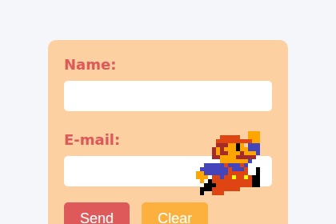

# Anteprime dei componenti — edu-01-corpo-umano

**16 componenti associati**, dal solo catalogo Design-App; l'associazione non prova che il componente sia integrato nell'app.

[Tutte le app](./README.md) · [Catalogo completo](../TABELLA_478.md) · [Vista con filtro app](../../docs/componenti.html?app=edu-01-corpo-umano)

Le immagini qui mostrate sono catture documentali, **non** una verifica di riuso Flutter, compatibilità nativa o licenze degli asset di terzi. In assenza di una PNG realmente acquisita la cella dichiara «Non disponibile» e punta alla fonte originale.

| Anteprima | ID | Componente | Fonte | Categoria | App associate | Codice |
|---|---|---|---|---|---|---|
| <small>Non disponibile</small> · <a href="https://devlibraries.com/libraries/amicro/perspective-flip" target="_blank" rel="noopener noreferrer">Fonte</a> | <code>AMX-003</code> | Perspective Flip | <a href="https://devlibraries.com/libraries/amicro/perspective-flip" target="_blank" rel="noopener noreferrer">DEVLIBRARIES_AMICRO</a> | UNVERIFIED_CARD_3D_FLIP | anna-s-diary, app-factory-dashboard, beerclass-ai, cooking-anime, edu-01-corpo-umano, notes-ecosistema, wonderlog, world-days | Solo riferimento |
| <small>Non disponibile</small> · <a href="https://github.com/Subhan-code/Amicro--Micro-transitions-/blob/fa5f8ffbe39537a8db191806066b8773c47c82e9/registry/ui/scroll/scroll-reveal.tsx" target="_blank" rel="noopener noreferrer">Fonte</a> | <code>AMX-004</code> | Scroll Reveal | <a href="https://github.com/Subhan-code/Amicro--Micro-transitions-/blob/fa5f8ffbe39537a8db191806066b8773c47c82e9/registry/ui/scroll/scroll-reveal.tsx" target="_blank" rel="noopener noreferrer">DEVLIBRARIES_AMICRO</a> | SCROLL_TRIGGERED_ENTRANCE | anna-s-diary, app-factory-dashboard, battery-guard, beerclass-ai, camperboss, cashmate-ai, cooking-anime, edu-01-corpo-umano, framelab, notes-ecosistema, omni-cleaner, trailpath, web-utility-factory, wonderlog, world-days | Sorgente archiviata |
| <small>Non disponibile</small> · <a href="https://gentleface.com/icons/heart-pulse" target="_blank" rel="noopener noreferrer">Fonte</a> | <code>ICO-015</code> | Salute / frequenza o vitalità | <a href="https://gentleface.com/icons/heart-pulse" target="_blank" rel="noopener noreferrer">GENTLEFACE</a> | ICON | edu-01-corpo-umano, focussense, sleepmax-coach | Solo riferimento |
|  | <code>UIV-016</code> | Scheda pubblica Uiverse classificata come CARD; il codice HTML/CSS non è presente nell&#x27;archivio Galaxy e non è stato acquisito. | <a href="https://uiverse.io/Gidarx/clever-panther-6" target="_blank" rel="noopener noreferrer">UIVERSE</a> | CARD | app-factory-dashboard, beerclass-ai, camperboss, cashmate-ai, deskland-android, edu-01-corpo-umano, notes-ecosistema | Sorgente archiviata |
|  | <code>UIV-017</code> | Scheda pubblica Uiverse classificata come CARD; il codice HTML/CSS non è presente nell&#x27;archivio Galaxy e non è stato acquisito. | <a href="https://uiverse.io/Gidarx/moody-falcon-73" target="_blank" rel="noopener noreferrer">UIVERSE</a> | CARD | annas-diary, camperboss, deskland-android, edu-01-corpo-umano, notes-ecosistema, wonderlog, world-days | Sorgente archiviata |
|  | <code>UIV-021</code> | Componente Uiverse nella categoria CARD; HTML/CSS originale archiviato con blob SHA. L&#x27;effetto specifico richiede ispezione del sorgente e collaudo visivo. | <a href="https://uiverse.io/JohnnyCSilva/black-rabbit-68" target="_blank" rel="noopener noreferrer">UIVERSE</a> | CARD | annas-diary, camperboss, deskland-android, edu-01-corpo-umano, notes-ecosistema, wonderlog, world-days | Sorgente archiviata |
|  | <code>UIV-053</code> | Componente Uiverse nella categoria TOOLTIP; HTML/CSS originale archiviato con blob SHA. L&#x27;effetto specifico richiede ispezione del sorgente e collaudo visivo. | <a href="https://uiverse.io/barisdogansutcu/plastic-dolphin-67" target="_blank" rel="noopener noreferrer">UIVERSE</a> | TOOLTIP | app-factory-dashboard, battery-guard, edu-01-corpo-umano, notes-ecosistema, omni-cleaner, wonderlog | Sorgente archiviata |
|  | <code>UIV-056</code> | Scheda pubblica Uiverse classificata come CARD; il codice HTML/CSS non è presente nell&#x27;archivio Galaxy e non è stato acquisito. | <a href="https://uiverse.io/chase2k25/warm-chicken-23" target="_blank" rel="noopener noreferrer">UIVERSE</a> | CARD | annas-diary, camperboss, deskland-android, edu-01-corpo-umano, notes-ecosistema, wonderlog, world-days | Sorgente archiviata |
|  | <code>UIV-063</code> | Scheda pubblica Uiverse classificata come CARD; il codice HTML/CSS non è presente nell&#x27;archivio Galaxy e non è stato acquisito. | <a href="https://uiverse.io/dexter-st/tough-falcon-78" target="_blank" rel="noopener noreferrer">UIVERSE</a> | CARD | app-factory-dashboard, beerclass-ai, camperboss, cashmate-ai, deskland-android, edu-01-corpo-umano, notes-ecosistema | Sorgente archiviata |
|  | <code>UIV-075</code> | Componente Uiverse nella categoria CARD; HTML/CSS originale archiviato con blob SHA. L&#x27;effetto specifico richiede ispezione del sorgente e collaudo visivo. | <a href="https://uiverse.io/joe-watson-sbf/honest-bullfrog-6" target="_blank" rel="noopener noreferrer">UIVERSE</a> | CARD | annas-diary, camperboss, deskland-android, edu-01-corpo-umano, notes-ecosistema, wonderlog, world-days | Sorgente archiviata |
|  | <code>UIV-078</code> | Scheda pubblica Uiverse classificata come CARD; il codice HTML/CSS non è presente nell&#x27;archivio Galaxy e non è stato acquisito. | <a href="https://uiverse.io/kennyotsu/giant-sloth-18" target="_blank" rel="noopener noreferrer">UIVERSE</a> | CARD | app-factory-dashboard, beerclass-ai, camperboss, cashmate-ai, deskland-android, edu-01-corpo-umano, notes-ecosistema | Sorgente archiviata |
|  | <code>UIV-082</code> | Componente Uiverse nella categoria CARD; HTML/CSS originale archiviato con blob SHA. L&#x27;effetto specifico richiede ispezione del sorgente e collaudo visivo. | <a href="https://uiverse.io/kennyotsu/wise-rattlesnake-92" target="_blank" rel="noopener noreferrer">UIVERSE</a> | CARD | app-factory-dashboard, beerclass-ai, camperboss, cashmate-ai, deskland-android, edu-01-corpo-umano, notes-ecosistema | Sorgente archiviata |
|  | <code>UIV-091</code> | Scheda pubblica Uiverse classificata come CARD; il codice HTML/CSS non è presente nell&#x27;archivio Galaxy e non è stato acquisito. | <a href="https://uiverse.io/monkey_8812/curly-moth-56" target="_blank" rel="noopener noreferrer">UIVERSE</a> | CARD | annas-diary, camperboss, deskland-android, edu-01-corpo-umano, notes-ecosistema, wonderlog, world-days | Sorgente archiviata |
|  | <code>UIV-095</code> | Scheda pubblica Uiverse classificata come CARD; il codice HTML/CSS non è presente nell&#x27;archivio Galaxy e non è stato acquisito. | <a href="https://uiverse.io/seoulchik/funny-seahorse-89" target="_blank" rel="noopener noreferrer">UIVERSE</a> | CARD | annas-diary, camperboss, deskland-android, edu-01-corpo-umano, notes-ecosistema, wonderlog, world-days | Sorgente archiviata |
|  | <code>UIV-108</code> | Pixel-art character form: recognizable Mario/Nintendo reference; reference-only until IP review. Categoria FORM verificata nel post pubblico Uiverse. Tag originali: form, mario, input, animated, button, send, red, orange, yellow, email. | <a href="https://uiverse.io/guilhermeyohan/friendly-walrus-55" target="_blank" rel="noopener noreferrer">UIVERSE</a> | FORM | cooking-anime, deskland-android, edu-01-corpo-umano, framelab | Sorgente archiviata |
|  | <code>UIV-110</code> | Animated tooltip with real information; tap/focus/keyboard support, not hover-only. Categoria TOOLTIP verificata nel post pubblico Uiverse. Tag originali: tooltip. | <a href="https://uiverse.io/roroland/average-horse-2" target="_blank" rel="noopener noreferrer">UIVERSE</a> | TOOLTIP | app-factory-dashboard, battery-guard, cashmate-ai, edu-01-corpo-umano, focussense, notes-ecosistema, omni-cleaner, wonderlog, world-days | Sorgente archiviata |
