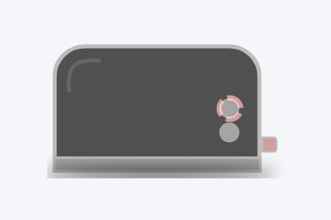

# Anteprime dei componenti — focussense

**32 componenti associati**, dal solo catalogo Design-App; l'associazione non prova che il componente sia integrato nell'app.

[Tutte le app](./README.md) · [Catalogo completo](../TABELLA_478.md) · [Vista con filtro app](../../docs/componenti.html?app=focussense)

Le immagini qui mostrate sono catture documentali, **non** una verifica di riuso Flutter, compatibilità nativa o licenze degli asset di terzi. In assenza di una PNG realmente acquisita la cella dichiara «Non disponibile» e punta alla fonte originale. Le colonne Codice originale e Codice Flutter sono INDIPENDENTI; una variante Dart non implica test su app consumer.

| Anteprima | UID | ID canonico | Componente | Fonte | Categoria | App associate | Codice originale | Codice Flutter |
|---|---|---|---|---|---|---|---|---|
| <small>Non disponibile</small> · <a href="https://github.com/Subhan-code/Amicro--Micro-transitions-/blob/fa5f8ffbe39537a8db191806066b8773c47c82e9/registry/ui/loading/accordion-loader.tsx" target="_blank" rel="noopener noreferrer">Fonte</a> | <code>UID-0006</code> | <code>AMX-006</code> | Accordion Loader | <a href="https://github.com/Subhan-code/Amicro--Micro-transitions-/blob/fa5f8ffbe39537a8db191806066b8773c47c82e9/registry/ui/loading/accordion-loader.tsx" target="_blank" rel="noopener noreferrer">DEVLIBRARIES_AMICRO</a> | INDETERMINATE_LOADING | anna-s-diary, app-factory-dashboard, battery-guard, camperboss, cooking-anime, deskland-android, easy-debloat, focussense, framelab, notes-ecosistema, omni-cleaner, send-to-pc, web-utility-factory, wonderlog, world-days | <a href="../../BIBLIOTECA_COMPONENTI/sorgenti/amicro/amx-006.tsx" target="_blank" rel="noopener noreferrer">Apri TypeScript/React</a> | Da convertire |
| <small>Non disponibile</small> | <code>UID-0019</code> | <code>DBM-014</code> | Circular Bars | <a href="https://github.com/riccardopinato/Design-App/blob/main/BIBLIOTECA_COMPONENTI/sorgenti/amicro/dbm-014.tsx" target="_blank" rel="noopener noreferrer">DEVLIBRARIES_BOOKMARKS</a> | LOADER_DIAGNOSTICS | app-factory-dashboard, battery-guard, focussense, omni-cleaner | <a href="../../BIBLIOTECA_COMPONENTI/sorgenti/amicro/dbm-014.tsx" target="_blank" rel="noopener noreferrer">Apri TypeScript/React (source path not necessarily verified)</a> | Da convertire |
| <small>Non disponibile</small> | <code>UID-0022</code> | <code>DBM-017</code> | Concentric Ring | <a href="https://github.com/riccardopinato/Design-App/blob/main/BIBLIOTECA_COMPONENTI/sorgenti/amicro/dbm-017.tsx" target="_blank" rel="noopener noreferrer">DEVLIBRARIES_BOOKMARKS</a> | LOADER_RINGS | battery-guard, deskland-android, focussense, the-luminous-infinite-circle | <a href="../../BIBLIOTECA_COMPONENTI/sorgenti/amicro/dbm-017.tsx" target="_blank" rel="noopener noreferrer">Apri TypeScript/React (source path not necessarily verified)</a> | Da convertire |
| <small>Non disponibile</small> | <code>UID-0023</code> | <code>DBM-019</code> | Bar Cascade | <a href="https://github.com/riccardopinato/Design-App/blob/main/BIBLIOTECA_COMPONENTI/sorgenti/amicro/dbm-019.tsx" target="_blank" rel="noopener noreferrer">DEVLIBRARIES_BOOKMARKS</a> | LOADER_BAR | app-factory-dashboard, focussense, omni-cleaner, send-to-pc | <a href="../../BIBLIOTECA_COMPONENTI/sorgenti/amicro/dbm-019.tsx" target="_blank" rel="noopener noreferrer">Apri TypeScript/React (source path not necessarily verified)</a> | Da convertire |
| <small>Non disponibile</small> | <code>UID-0029</code> | <code>DBM-026</code> | Newtons Cradle | <a href="https://github.com/riccardopinato/Design-App/blob/main/BIBLIOTECA_COMPONENTI/sorgenti/amicro/dbm-026.tsx" target="_blank" rel="noopener noreferrer">DEVLIBRARIES_BOOKMARKS</a> | LOADER_PHYSICS | app-factory-dashboard, cooking-anime, focussense, omni-cleaner | <a href="../../BIBLIOTECA_COMPONENTI/sorgenti/amicro/dbm-026.tsx" target="_blank" rel="noopener noreferrer">Apri TypeScript/React (source path not necessarily verified)</a> | Da convertire |
| <small>Non disponibile</small> · <a href="https://devlibraries.com/libraries/easeui" target="_blank" rel="noopener noreferrer">Fonte</a> | <code>UID-0034</code> | <code>DSP-001</code> | EaseUI Theme Toggle | <a href="https://devlibraries.com/libraries/easeui" target="_blank" rel="noopener noreferrer">DEVLIBRARIES_EASEUI</a> | THEME_LIGHT_DARK | anna-s-diary, app-factory-dashboard, battery-guard, beerclass-ai, camperboss, cashmate-ai, cooking-anime, deskland-android, easy-debloat, focussense, framelab, notes-ecosistema, omni-cleaner, sleepmax-coach, trailpath, web-utility-factory, wonderlog, world-days | <a href="../../BIBLIOTECA_COMPONENTI/sorgenti/easeui/dsp-001.tsx" target="_blank" rel="noopener noreferrer">Apri TypeScript/React</a> | Da convertire |
| <small>Non disponibile</small> · <a href="https://devlibraries.com/libraries/amicro" target="_blank" rel="noopener noreferrer">Fonte</a> | <code>UID-0037</code> | <code>DSP-004</code> | Interlocking Gear Step | <a href="https://devlibraries.com/libraries/amicro" target="_blank" rel="noopener noreferrer">DEVLIBRARIES_AMICRO</a> | REAL_PROCESS_LOADING | app-factory-dashboard, battery-guard, easy-debloat, focussense, framelab, notes-ecosistema, omni-cleaner, send-to-pc, world-days | <a href="../../BIBLIOTECA_COMPONENTI/sorgenti/amicro/dsp-004.tsx" target="_blank" rel="noopener noreferrer">Apri TypeScript/React</a> | Da convertire |
| <small>Non disponibile</small> | <code>UID-0039</code> | <code>DSP-006</code> | Loading &amp; Waiting Visual References (user screenshot) | USER_IMAGE | LOADING_WAIT_STATE_REFERENCE | anna-s-diary, app-factory-dashboard, battery-guard, camperboss, cashmate-ai, cooking-anime, deskland-android, easy-debloat, focussense, framelab, notes-ecosistema, omni-cleaner, send-to-pc, trailpath, web-utility-factory, wonderlog, world-days | Non disponibile | Sorgente non archiviata |
|  | <code>UID-0069</code> | <code>ICO-015</code> | Salute / frequenza o vitalità | <a href="https://gentleface.com/icons/heart-pulse" target="_blank" rel="noopener noreferrer">GENTLEFACE</a> | ICON | edu-01-corpo-umano, focussense, sleepmax-coach | <a href="../../BIBLIOTECA_COMPONENTI/sorgenti/gentleface/ICO-015.svg" target="_blank" rel="noopener noreferrer">Apri SVG (original, archived)</a> | <a href="../../BIBLIOTECA_COMPONENTI/flutter_adapters/lib/src/gentleface/ico_015.dart" target="_blank" rel="noopener noreferrer">Apri codice Flutter (bozza)</a> |
|  | <code>UID-0072</code> | <code>ICO-018</code> | Indicatore / metriche | <a href="https://gentleface.com/icons/gauge" target="_blank" rel="noopener noreferrer">GENTLEFACE</a> | ICON | app-factory-dashboard, battery-guard, camperboss, cashmate-ai, focussense | <a href="../../BIBLIOTECA_COMPONENTI/sorgenti/gentleface/ICO-018.svg" target="_blank" rel="noopener noreferrer">Apri SVG (original, archived)</a> | <a href="../../BIBLIOTECA_COMPONENTI/flutter_adapters/lib/src/gentleface/ico_018.dart" target="_blank" rel="noopener noreferrer">Apri codice Flutter (bozza)</a> |
|  | <code>UID-0364</code> | <code>UIV-005</code> | Card proposta dall&#x27;utente come sfondo decorativo per varie app; effetto esatto non verificato | <a href="https://uiverse.io/amir_6539/red-duck-82" target="_blank" rel="noopener noreferrer">UIVERSE</a> | CARD_BACKGROUND | annas-diary, app-factory-dashboard, battery-guard, cashmate-ai, deskland-android, focussense, notes-ecosistema, omni-cleaner | <a href="../../UI-UX/UIVERSE/CODICE_SORGENTE/UIV-005_original.html" target="_blank" rel="noopener noreferrer">Apri HTML/CSS</a> | Da convertire |
|  | <code>UID-0365</code> | <code>UIV-006</code> | Switch interattivo Uiverse, sorgente HTML/CSS non individuato | <a href="https://uiverse.io/JustCode14/red-dingo-61" target="_blank" rel="noopener noreferrer">UIVERSE</a> | SWITCH | 180flipcharge, annas-diary, battery-guard, easy-debloat, focussense, omni-cleaner, phone-guard, pocket-guard | <a href="../../UI-UX/UIVERSE/CODICE_SORGENTE/UIV-006_original.html" target="_blank" rel="noopener noreferrer">Apri HTML/CSS</a> | Da convertire |
|  | <code>UID-0372</code> | <code>UIV-013</code> | Componente Uiverse nella categoria LOADER; HTML/CSS originale archiviato con blob SHA. L&#x27;effetto specifico richiede ispezione del sorgente e collaudo visivo. | <a href="https://uiverse.io/AqFox/young-dragon-29" target="_blank" rel="noopener noreferrer">UIVERSE</a> | LOADER | camperboss, cooking-anime, deskland-android, focussense, omni-cleaner, sleepmax-coach, wonderlog | <a href="../../UI-UX/UIVERSE/CODICE_SORGENTE/UIV-013_original.html" target="_blank" rel="noopener noreferrer">Apri HTML/CSS</a> | Da convertire |
|  | <code>UID-0377</code> | <code>UIV-018</code> | Componente Uiverse nella categoria SWITCH; HTML/CSS originale archiviato con blob SHA. L&#x27;effetto specifico richiede ispezione del sorgente e collaudo visivo. | <a href="https://uiverse.io/JaydipPrajapati1910/average-shrimp-57" target="_blank" rel="noopener noreferrer">UIVERSE</a> | SWITCH | battery-guard, camperboss, cashmate-ai, focussense, omni-cleaner, tabletop-motion-alarm, the-luminous-infinite-circle | <a href="../../UI-UX/UIVERSE/CODICE_SORGENTE/UIV-018_original.html" target="_blank" rel="noopener noreferrer">Apri HTML/CSS</a> | Da convertire |
|  | <code>UID-0378</code> | <code>UIV-019</code> | Componente Uiverse nella categoria LOADER; HTML/CSS originale archiviato con blob SHA. L&#x27;effetto specifico richiede ispezione del sorgente e collaudo visivo. | <a href="https://uiverse.io/JkHuger/new-deer-97" target="_blank" rel="noopener noreferrer">UIVERSE</a> | LOADER | deskland-android, focussense, framelab, notes-ecosistema, omni-cleaner, sleepmax-coach, world-days | <a href="../../UI-UX/UIVERSE/CODICE_SORGENTE/UIV-019_original.html" target="_blank" rel="noopener noreferrer">Apri HTML/CSS</a> | Da convertire |
|  | <code>UID-0385</code> | <code>UIV-026</code> | Componente Uiverse nella categoria LOADER; HTML/CSS originale archiviato con blob SHA. L&#x27;effetto specifico richiede ispezione del sorgente e collaudo visivo. | <a href="https://uiverse.io/Nawsome/brave-turtle-26" target="_blank" rel="noopener noreferrer">UIVERSE</a> | LOADER | camperboss, cooking-anime, deskland-android, focussense, omni-cleaner, sleepmax-coach, wonderlog | <a href="../../UI-UX/UIVERSE/CODICE_SORGENTE/UIV-026_original.html" target="_blank" rel="noopener noreferrer">Apri HTML/CSS</a> | Da convertire |
|  | <code>UID-0386</code> | <code>UIV-027</code> | Componente Uiverse nella categoria SWITCH; HTML/CSS originale archiviato con blob SHA. L&#x27;effetto specifico richiede ispezione del sorgente e collaudo visivo. | <a href="https://uiverse.io/Nawsome/empty-snail-69" target="_blank" rel="noopener noreferrer">UIVERSE</a> | SWITCH | 180flipcharge, annas-diary, battery-guard, focussense, notes-ecosistema, omni-cleaner, pocket-guard | <a href="../../UI-UX/UIVERSE/CODICE_SORGENTE/UIV-027_original.html" target="_blank" rel="noopener noreferrer">Apri HTML/CSS</a> | Da convertire |
|  | <code>UID-0390</code> | <code>UIV-031</code> | Scheda pubblica Uiverse classificata come LOADER; il codice HTML/CSS non è presente nell&#x27;archivio Galaxy e non è stato acquisito. | <a href="https://uiverse.io/Novaxlo/rotten-lionfish-4" target="_blank" rel="noopener noreferrer">UIVERSE</a> | LOADER | camperboss, cooking-anime, deskland-android, focussense, omni-cleaner, sleepmax-coach, wonderlog | <a href="../../UI-UX/UIVERSE/CODICE_SORGENTE/UIV-031_original.html" target="_blank" rel="noopener noreferrer">Apri HTML/CSS</a> | Da convertire |
|  | <code>UID-0391</code> | <code>UIV-032</code> | Componente Uiverse nella categoria LOADER; HTML/CSS originale archiviato con blob SHA. L&#x27;effetto specifico richiede ispezione del sorgente e collaudo visivo. | <a href="https://uiverse.io/Praashoo7/lucky-hound-44" target="_blank" rel="noopener noreferrer">UIVERSE</a> | LOADER | deskland-android, focussense, framelab, notes-ecosistema, omni-cleaner, sleepmax-coach, world-days | <a href="../../UI-UX/UIVERSE/CODICE_SORGENTE/UIV-032_original.html" target="_blank" rel="noopener noreferrer">Apri HTML/CSS</a> | Da convertire |
|  | <code>UID-0395</code> | <code>UIV-036</code> | Componente Uiverse nella categoria LOADER; HTML/CSS originale archiviato con blob SHA. L&#x27;effetto specifico richiede ispezione del sorgente e collaudo visivo. | <a href="https://uiverse.io/Pradeepsaranbishnoi/tall-fish-38" target="_blank" rel="noopener noreferrer">UIVERSE</a> | LOADER | camperboss, cooking-anime, deskland-android, focussense, omni-cleaner, sleepmax-coach, wonderlog | <a href="../../UI-UX/UIVERSE/CODICE_SORGENTE/UIV-036_original.html" target="_blank" rel="noopener noreferrer">Apri HTML/CSS</a> | Da convertire |
|  | <code>UID-0400</code> | <code>UIV-041</code> | Componente Uiverse nella categoria LOADER; HTML/CSS originale archiviato con blob SHA. L&#x27;effetto specifico richiede ispezione del sorgente e collaudo visivo. | <a href="https://uiverse.io/Shoh2008/ugly-elephant-80" target="_blank" rel="noopener noreferrer">UIVERSE</a> | LOADER | camperboss, cooking-anime, deskland-android, focussense, omni-cleaner, sleepmax-coach, wonderlog | <a href="../../UI-UX/UIVERSE/CODICE_SORGENTE/UIV-041_original.html" target="_blank" rel="noopener noreferrer">Apri HTML/CSS</a> | Da convertire |
|  | <code>UID-0401</code> | <code>UIV-042</code> | Componente Uiverse nella categoria LOADER; HTML/CSS originale archiviato con blob SHA. L&#x27;effetto specifico richiede ispezione del sorgente e collaudo visivo. | <a href="https://uiverse.io/Shoh2008/yellow-dolphin-16" target="_blank" rel="noopener noreferrer">UIVERSE</a> | LOADER | deskland-android, focussense, framelab, notes-ecosistema, omni-cleaner, sleepmax-coach, world-days | <a href="../../UI-UX/UIVERSE/CODICE_SORGENTE/UIV-042_original.html" target="_blank" rel="noopener noreferrer">Apri HTML/CSS</a> | Da convertire |
|  | <code>UID-0409</code> | <code>UIV-050</code> | Scheda pubblica Uiverse classificata come LOADER; il codice HTML/CSS non è presente nell&#x27;archivio Galaxy e non è stato acquisito. | <a href="https://uiverse.io/andrew-manzyk/fast-vampirebat-53" target="_blank" rel="noopener noreferrer">UIVERSE</a> | LOADER | deskland-android, focussense, framelab, notes-ecosistema, omni-cleaner, sleepmax-coach, world-days | <a href="../../UI-UX/UIVERSE/CODICE_SORGENTE/UIV-050_original.html" target="_blank" rel="noopener noreferrer">Apri HTML/CSS</a> | Da convertire |
|  | <code>UID-0427</code> | <code>UIV-068</code> | Scheda pubblica Uiverse classificata come LOADER; il codice HTML/CSS non è presente nell&#x27;archivio Galaxy e non è stato acquisito. | <a href="https://uiverse.io/esraaabdel-kareem/bad-dragonfly-54" target="_blank" rel="noopener noreferrer">UIVERSE</a> | LOADER | deskland-android, focussense, framelab, notes-ecosistema, omni-cleaner, sleepmax-coach, world-days | <a href="../../UI-UX/UIVERSE/CODICE_SORGENTE/UIV-068_original.html" target="_blank" rel="noopener noreferrer">Apri HTML/CSS</a> | Da convertire |
|  | <code>UID-0431</code> | <code>UIV-072</code> | Componente Uiverse nella categoria LOADER; HTML/CSS originale archiviato con blob SHA. L&#x27;effetto specifico richiede ispezione del sorgente e collaudo visivo. | <a href="https://uiverse.io/gsperandio/shaggy-kangaroo-12" target="_blank" rel="noopener noreferrer">UIVERSE</a> | LOADER | camperboss, cooking-anime, deskland-android, focussense, omni-cleaner, sleepmax-coach, wonderlog | <a href="../../UI-UX/UIVERSE/CODICE_SORGENTE/UIV-072_original.html" target="_blank" rel="noopener noreferrer">Apri HTML/CSS</a> | Da convertire |
|  | <code>UID-0447</code> | <code>UIV-088</code> | Componente Uiverse nella categoria SWITCH; HTML/CSS originale archiviato con blob SHA. L&#x27;effetto specifico richiede ispezione del sorgente e collaudo visivo. | <a href="https://uiverse.io/mobinkakei/great-skunk-8" target="_blank" rel="noopener noreferrer">UIVERSE</a> | SWITCH | 180flipcharge, annas-diary, battery-guard, focussense, notes-ecosistema, omni-cleaner, pocket-guard | <a href="../../UI-UX/UIVERSE/CODICE_SORGENTE/UIV-088_original.html" target="_blank" rel="noopener noreferrer">Apri HTML/CSS</a> | Da convertire |
|  | <code>UID-0455</code> | <code>UIV-096</code> | Scheda pubblica Uiverse classificata come PATTERN; il codice HTML/CSS non è presente nell&#x27;archivio Galaxy e non è stato acquisito. | <a href="https://uiverse.io/solowzrd/wet-lionfish-63" target="_blank" rel="noopener noreferrer">UIVERSE</a> | PATTERN | app-factory-dashboard, battery-guard, deskland-android, focussense, omni-cleaner, web-utility-factory | <a href="../../UI-UX/UIVERSE/CODICE_SORGENTE/UIV-096_original.html" target="_blank" rel="noopener noreferrer">Apri HTML/CSS</a> | Da convertire |
|  | <code>UID-0468</code> | <code>UIV-110</code> | Animated tooltip with real information; tap/focus/keyboard support, not hover-only. Categoria TOOLTIP verificata nel post pubblico Uiverse. Tag originali: tooltip. | <a href="https://uiverse.io/roroland/average-horse-2" target="_blank" rel="noopener noreferrer">UIVERSE</a> | TOOLTIP | app-factory-dashboard, battery-guard, cashmate-ai, edu-01-corpo-umano, focussense, notes-ecosistema, omni-cleaner, wonderlog, world-days | <a href="../../UI-UX/UIVERSE/CODICE_SORGENTE/UIV-110_original.html" target="_blank" rel="noopener noreferrer">Apri HTML/CSS</a> | Da convertire |
| <small>Non disponibile</small> · <a href="https://devlibraries.com/libraries/watermelon/fractional-picker" target="_blank" rel="noopener noreferrer">Fonte</a> | <code>UID-0471</code> | <code>WML-002</code> | Fractional Picker | <a href="https://devlibraries.com/libraries/watermelon/fractional-picker" target="_blank" rel="noopener noreferrer">DEVLIBRARIES_WATERMELON</a> | RULER_PICKER | anna-s-diary, battery-guard, beerclass-ai, camperboss, cooking-anime, focussense, sleepmax-coach, world-days | <a href="../../BIBLIOTECA_COMPONENTI/sorgenti/watermelon/wml-002.tsx" target="_blank" rel="noopener noreferrer">Apri TypeScript/React</a> | Da convertire |
| <small>Non disponibile</small> · <a href="https://devlibraries.com/libraries/watermelon/scrub-slider-base" target="_blank" rel="noopener noreferrer">Fonte</a> | <code>UID-0472</code> | <code>WML-003</code> | Scrub Slider (base) | <a href="https://devlibraries.com/libraries/watermelon/scrub-slider-base" target="_blank" rel="noopener noreferrer">DEVLIBRARIES_WATERMELON</a> | SCRUB_PRECISION | anna-s-diary, beerclass-ai, cooking-anime, focussense, framelab, notes-ecosistema, omni-cleaner, trailpath, wonderlog | <a href="../../BIBLIOTECA_COMPONENTI/sorgenti/watermelon/wml-003.tsx" target="_blank" rel="noopener noreferrer">Apri TypeScript/React</a> | Da convertire |
| <small>Non disponibile</small> · <a href="https://devlibraries.com/libraries/watermelon/range-selection-slider" target="_blank" rel="noopener noreferrer">Fonte</a> | <code>UID-0473</code> | <code>WML-004</code> | Range Selection Slider | <a href="https://devlibraries.com/libraries/watermelon/range-selection-slider" target="_blank" rel="noopener noreferrer">DEVLIBRARIES_WATERMELON</a> | TWO_HANDLE_RANGE | anna-s-diary, battery-guard, camperboss, cashmate-ai, focussense, framelab, notes-ecosistema, omni-cleaner, wonderlog, world-days | <a href="../../BIBLIOTECA_COMPONENTI/sorgenti/watermelon/wml-004.tsx" target="_blank" rel="noopener noreferrer">Apri TypeScript/React</a> | Da convertire |
| <small>Non disponibile</small> · <a href="https://devlibraries.com/libraries/watermelon/flip-clock" target="_blank" rel="noopener noreferrer">Fonte</a> | <code>UID-0478</code> | <code>WML-009</code> | Flip Clock | <a href="https://devlibraries.com/libraries/watermelon/flip-clock" target="_blank" rel="noopener noreferrer">DEVLIBRARIES_WATERMELON</a> | COUNTDOWN_CLOCK_VISUAL | anna-s-diary, camperboss, cooking-anime, focussense, sleepmax-coach, tabletop-motion-alarm, wonderlog, world-days | <a href="https://devlibraries.com/libraries/watermelon/flip-clock" target="_blank" rel="noopener noreferrer">Solo riferimento</a> | Sorgente non archiviata |
