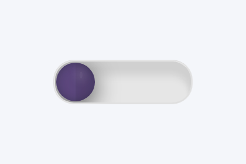
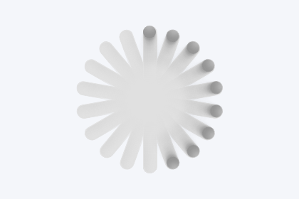
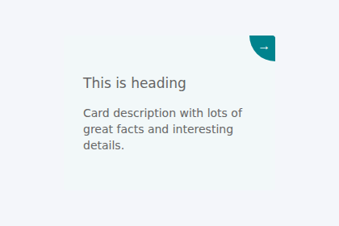
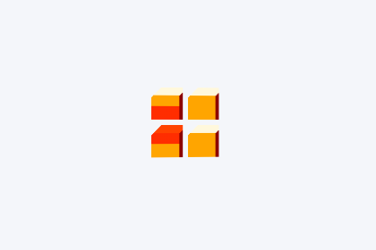
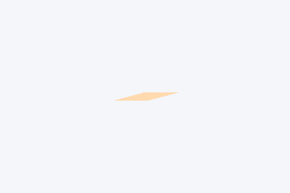
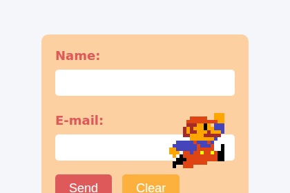

# Anteprime dei componenti — framelab

**63 componenti associati**, dal solo catalogo Design-App; l'associazione non prova che il componente sia integrato nell'app.

[Tutte le app](./README.md) · [Catalogo completo](../TABELLA_478.md) · [Vista con filtro app](../../docs/componenti.html?app=framelab)

Le immagini qui mostrate sono catture documentali, **non** una verifica di riuso Flutter, compatibilità nativa o licenze degli asset di terzi. In assenza di una PNG realmente acquisita la cella dichiara «Non disponibile» e punta alla fonte originale.

| Anteprima | ID | Componente | Fonte | Categoria | App associate | Codice |
|---|---|---|---|---|---|---|
| <small>Non disponibile</small> · <a href="https://github.com/Subhan-code/Amicro--Micro-transitions-/blob/fa5f8ffbe39537a8db191806066b8773c47c82e9/src/components/css-animations/physics/CurtainReveal.tsx" target="_blank" rel="noopener noreferrer">Fonte</a> | <code>AMX-001</code> | CurtainReveal | <a href="https://github.com/Subhan-code/Amicro--Micro-transitions-/blob/fa5f8ffbe39537a8db191806066b8773c47c82e9/src/components/css-animations/physics/CurtainReveal.tsx" target="_blank" rel="noopener noreferrer">DEVLIBRARIES_AMICRO</a> | CONTEXTUAL_CONTENT_REVEAL | anna-s-diary, app-factory-dashboard, cooking-anime, deskland-android, framelab, notes-ecosistema, web-utility-factory, wonderlog, world-days | Sorgente archiviata |
| <small>Non disponibile</small> · <a href="https://github.com/Subhan-code/Amicro--Micro-transitions-/blob/fa5f8ffbe39537a8db191806066b8773c47c82e9/registry/ui/cursor/cursor-trail.tsx" target="_blank" rel="noopener noreferrer">Fonte</a> | <code>AMX-002</code> | Cursor Trail | <a href="https://github.com/Subhan-code/Amicro--Micro-transitions-/blob/fa5f8ffbe39537a8db191806066b8773c47c82e9/registry/ui/cursor/cursor-trail.tsx" target="_blank" rel="noopener noreferrer">DEVLIBRARIES_AMICRO</a> | POINTER_FEEDBACK | app-factory-dashboard, deskland-android, framelab, notes-ecosistema, web-utility-factory | Sorgente archiviata |
| <small>Non disponibile</small> · <a href="https://github.com/Subhan-code/Amicro--Micro-transitions-/blob/fa5f8ffbe39537a8db191806066b8773c47c82e9/registry/ui/scroll/scroll-reveal.tsx" target="_blank" rel="noopener noreferrer">Fonte</a> | <code>AMX-004</code> | Scroll Reveal | <a href="https://github.com/Subhan-code/Amicro--Micro-transitions-/blob/fa5f8ffbe39537a8db191806066b8773c47c82e9/registry/ui/scroll/scroll-reveal.tsx" target="_blank" rel="noopener noreferrer">DEVLIBRARIES_AMICRO</a> | SCROLL_TRIGGERED_ENTRANCE | anna-s-diary, app-factory-dashboard, battery-guard, beerclass-ai, camperboss, cashmate-ai, cooking-anime, edu-01-corpo-umano, framelab, notes-ecosistema, omni-cleaner, trailpath, web-utility-factory, wonderlog, world-days | Sorgente archiviata |
| <small>Non disponibile</small> · <a href="https://devlibraries.com/libraries/amicro/spatial-door-portal" target="_blank" rel="noopener noreferrer">Fonte</a> | <code>AMX-005</code> | Spatial Door Portal | <a href="https://devlibraries.com/libraries/amicro/spatial-door-portal" target="_blank" rel="noopener noreferrer">DEVLIBRARIES_AMICRO</a> | UNVERIFIED_SPATIAL_PAGE_TRANSITION | anna-s-diary, app-factory-dashboard, cooking-anime, deskland-android, framelab, notes-ecosistema, wonderlog, world-days | Solo riferimento |
| <small>Non disponibile</small> · <a href="https://github.com/Subhan-code/Amicro--Micro-transitions-/blob/fa5f8ffbe39537a8db191806066b8773c47c82e9/registry/ui/loading/accordion-loader.tsx" target="_blank" rel="noopener noreferrer">Fonte</a> | <code>AMX-006</code> | Accordion Loader | <a href="https://github.com/Subhan-code/Amicro--Micro-transitions-/blob/fa5f8ffbe39537a8db191806066b8773c47c82e9/registry/ui/loading/accordion-loader.tsx" target="_blank" rel="noopener noreferrer">DEVLIBRARIES_AMICRO</a> | INDETERMINATE_LOADING | anna-s-diary, app-factory-dashboard, battery-guard, camperboss, cooking-anime, deskland-android, easy-debloat, focussense, framelab, notes-ecosistema, omni-cleaner, send-to-pc, web-utility-factory, wonderlog, world-days | Sorgente archiviata |
| <small>Non disponibile</small> | <code>DBM-011</code> | Morph Loader | <a href="https://github.com/riccardopinato/Design-App/blob/main/BIBLIOTECA_COMPONENTI/sorgenti/amicro/dbm-011.tsx" target="_blank" rel="noopener noreferrer">DEVLIBRARIES_BOOKMARKS</a> | LOADER_PLAYFUL | cooking-anime, framelab, notes-ecosistema, wonderlog | Sorgente archiviata |
| <small>Non disponibile</small> | <code>DBM-027</code> | Helix Spinner | DEVLIBRARIES_BOOKMARKS | UNVERIFIED_LOADER_VISUAL | cooking-anime, framelab, omni-cleaner | Solo riferimento |
| <small>Non disponibile</small> | <code>DBM-029</code> | Particle Shape Morph | DEVLIBRARIES_BOOKMARKS | UNVERIFIED_PARTICLE_VISUAL | cooking-anime, deskland-android, framelab, notes-ecosistema | Solo riferimento |
| <small>Non disponibile</small> | <code>DBM-030</code> | Infinite Spiral | DEVLIBRARIES_BOOKMARKS | UNVERIFIED_MEDIA_VISUAL | cooking-anime, deskland-android, framelab, wonderlog | Solo riferimento |
| <small>Non disponibile</small> · <a href="https://devlibraries.com/libraries/easeui" target="_blank" rel="noopener noreferrer">Fonte</a> | <code>DSP-001</code> | EaseUI Theme Toggle | <a href="https://devlibraries.com/libraries/easeui" target="_blank" rel="noopener noreferrer">DEVLIBRARIES_EASEUI</a> | THEME_LIGHT_DARK | anna-s-diary, app-factory-dashboard, battery-guard, beerclass-ai, camperboss, cashmate-ai, cooking-anime, deskland-android, easy-debloat, focussense, framelab, notes-ecosistema, omni-cleaner, sleepmax-coach, trailpath, web-utility-factory, wonderlog, world-days | Sorgente archiviata |
| <small>Non disponibile</small> · <a href="https://devlibraries.com/libraries/amicro/card-stack-peel" target="_blank" rel="noopener noreferrer">Fonte</a> | <code>DSP-002</code> | Card Stack Peel | <a href="https://devlibraries.com/libraries/amicro/card-stack-peel" target="_blank" rel="noopener noreferrer">DEVLIBRARIES_AMICRO</a> | SECTION_CARD_TRANSITION | anna-s-diary, app-factory-dashboard, beerclass-ai, cooking-anime, framelab, notes-ecosistema, omni-cleaner, wonderlog, world-days | Sorgente archiviata |
| <small>Non disponibile</small> · <a href="https://devlibraries.com/libraries/amicro" target="_blank" rel="noopener noreferrer">Fonte</a> | <code>DSP-004</code> | Interlocking Gear Step | <a href="https://devlibraries.com/libraries/amicro" target="_blank" rel="noopener noreferrer">DEVLIBRARIES_AMICRO</a> | REAL_PROCESS_LOADING | app-factory-dashboard, battery-guard, easy-debloat, focussense, framelab, notes-ecosistema, omni-cleaner, send-to-pc, world-days | Sorgente archiviata |
| <small>Non disponibile</small> · <a href="https://devlibraries.com/libraries/amicro" target="_blank" rel="noopener noreferrer">Fonte</a> | <code>DSP-005</code> | Shutter Step Slices | <a href="https://devlibraries.com/libraries/amicro" target="_blank" rel="noopener noreferrer">DEVLIBRARIES_AMICRO</a> | STAGGERED_REVEAL | anna-s-diary, app-factory-dashboard, camperboss, cooking-anime, deskland-android, framelab, notes-ecosistema, omni-cleaner, wonderlog, world-days | Sorgente archiviata |
| <small>Non disponibile</small> | <code>DSP-006</code> | Loading &amp; Waiting Visual References (user screenshot) | USER_IMAGE | LOADING_WAIT_STATE_REFERENCE | anna-s-diary, app-factory-dashboard, battery-guard, camperboss, cashmate-ai, cooking-anime, deskland-android, easy-debloat, focussense, framelab, notes-ecosistema, omni-cleaner, send-to-pc, trailpath, web-utility-factory, wonderlog, world-days | Solo riferimento |
| <small>Non disponibile</small> · <a href="https://fluttercomponentlibrary.com/pages/components/docking-bar.html" target="_blank" rel="noopener noreferrer">Fonte</a> | <code>FCL-001</code> | Docking Bar | <a href="https://fluttercomponentlibrary.com/pages/components/docking-bar.html" target="_blank" rel="noopener noreferrer">FLUTTER_COMPONENT_LIBRARY</a> | navigation | annas-diary, framelab | Solo riferimento |
| <small>Non disponibile</small> · <a href="https://fluttercomponentlibrary.com/pages/components/custom-buttons.html" target="_blank" rel="noopener noreferrer">Fonte</a> | <code>FCL-002</code> | Custom Buttons | <a href="https://fluttercomponentlibrary.com/pages/components/custom-buttons.html" target="_blank" rel="noopener noreferrer">FLUTTER_COMPONENT_LIBRARY</a> | buttons | framelab | Solo riferimento |
| <small>Non disponibile</small> · <a href="https://fluttercomponentlibrary.com/pages/components/bottom-sheet.html" target="_blank" rel="noopener noreferrer">Fonte</a> | <code>FCL-005</code> | Bottom Sheet | <a href="https://fluttercomponentlibrary.com/pages/components/bottom-sheet.html" target="_blank" rel="noopener noreferrer">FLUTTER_COMPONENT_LIBRARY</a> | dialogs | annas-diary, battery-guard, camperboss, framelab, notes-ecosistema | Solo riferimento |
| <small>Non disponibile</small> · <a href="https://gentleface.com/icons/export" target="_blank" rel="noopener noreferrer">Fonte</a> | <code>ICO-006</code> | Esporta | <a href="https://gentleface.com/icons/export" target="_blank" rel="noopener noreferrer">GENTLEFACE</a> | ICON | framelab, notes-ecosistema, wonderlog, world-days | Solo riferimento |
| <small>Non disponibile</small> · <a href="https://gentleface.com/icons/images" target="_blank" rel="noopener noreferrer">Fonte</a> | <code>ICO-008</code> | Galleria immagini | <a href="https://gentleface.com/icons/images" target="_blank" rel="noopener noreferrer">GENTLEFACE</a> | ICON | anna-s-diary, framelab, notes-ecosistema, omni-cleaner, wonderlog | Solo riferimento |
| <small>Non disponibile</small> · <a href="https://gentleface.com/icons/video" target="_blank" rel="noopener noreferrer">Fonte</a> | <code>ICO-009</code> | Video / media | <a href="https://gentleface.com/icons/video" target="_blank" rel="noopener noreferrer">GENTLEFACE</a> | ICON | cooking-anime, framelab, omni-cleaner, wonderlog | Solo riferimento |
| <small>Non disponibile</small> · <a href="https://gentleface.com/icons/play" target="_blank" rel="noopener noreferrer">Fonte</a> | <code>ICO-020</code> | Riproduci | <a href="https://gentleface.com/icons/play" target="_blank" rel="noopener noreferrer">GENTLEFACE</a> | ICON | cooking-anime, deskland-android, framelab, omni-cleaner | Solo riferimento |
| <small>Non disponibile</small> · <a href="https://gentleface.com/icons/pause" target="_blank" rel="noopener noreferrer">Fonte</a> | <code>ICO-021</code> | Pausa | <a href="https://gentleface.com/icons/pause" target="_blank" rel="noopener noreferrer">GENTLEFACE</a> | ICON | cooking-anime, deskland-android, framelab, omni-cleaner | Solo riferimento |
|  | <code>UIV-001</code> | Pallina verde che rimbalza su gradini CSS | <a href="https://uiverse.io/alexruix/tame-fly-42" target="_blank" rel="noopener noreferrer">UIVERSE</a> | LOADER | battery-guard, framelab, notes-ecosistema, omni-cleaner, send-to-pc, world-days | Sorgente archiviata |
|  | <code>UIV-004</code> | Card editoriale con header gradiente, segnalibro e icona aereo SVG | <a href="https://uiverse.io/JohnnyCSilva/jolly-elephant-67" target="_blank" rel="noopener noreferrer">UIVERSE</a> | CARD | annas-diary, camperboss, framelab, notes-ecosistema, web-utility-factory, wonderlog, world-days | Sorgente archiviata |
|  | <code>UIV-007</code> | Loader per processi reali, testo UX proposto: Stiamo facendo la magia; animazione specifica non verificata | <a href="https://uiverse.io/arthur_6104/orange-walrus-50" target="_blank" rel="noopener noreferrer">UIVERSE</a> | LOADER | annas-diary, app-factory-dashboard, cashmate-ai, framelab, notes-ecosistema, omni-cleaner, web-utility-factory, world-days | Sorgente archiviata |
|  | <code>UIV-009</code> | Book card in CSS 3D con copertina che si apre su hover: preferenza utente per Ricordi Anna&#x27;s Diary | <a href="https://uiverse.io/eslam-hany/selfish-bobcat-73" target="_blank" rel="noopener noreferrer">UIVERSE</a> | BOOK_CARD | annas-diary, cooking-anime, framelab, notes-ecosistema, wonderlog, world-days | Sorgente archiviata |
|  | <code>UIV-010</code> | Scheda pubblica Uiverse classificata come CARD; il codice HTML/CSS non è presente nell&#x27;archivio Galaxy e non è stato acquisito. | <a href="https://uiverse.io/00Kubi/fluffy-jellyfish-87" target="_blank" rel="noopener noreferrer">UIVERSE</a> | CARD | annas-diary, beerclass-ai, cooking-anime, framelab, notes-ecosistema, wonderlog, world-days | Sorgente archiviata |
|  | <code>UIV-014</code> | Componente Uiverse nella categoria CARD; HTML/CSS originale archiviato con blob SHA. L&#x27;effetto specifico richiede ispezione del sorgente e collaudo visivo. | <a href="https://uiverse.io/ElSombrero2/tricky-robin-67" target="_blank" rel="noopener noreferrer">UIVERSE</a> | CARD | annas-diary, beerclass-ai, cooking-anime, framelab, notes-ecosistema, wonderlog, world-days | Sorgente archiviata |
|  | <code>UIV-015</code> | Scheda pubblica Uiverse classificata come BUTTON; il codice HTML/CSS non è presente nell&#x27;archivio Galaxy e non è stato acquisito. | <a href="https://uiverse.io/FColombati/spotty-snake-82" target="_blank" rel="noopener noreferrer">UIVERSE</a> | BUTTON | annas-diary, beerclass-ai, camperboss, cooking-anime, easy-debloat, framelab | Sorgente archiviata |
|  | <code>UIV-019</code> | Componente Uiverse nella categoria LOADER; HTML/CSS originale archiviato con blob SHA. L&#x27;effetto specifico richiede ispezione del sorgente e collaudo visivo. | <a href="https://uiverse.io/JkHuger/new-deer-97" target="_blank" rel="noopener noreferrer">UIVERSE</a> | LOADER | deskland-android, focussense, framelab, notes-ecosistema, omni-cleaner, sleepmax-coach, world-days | Sorgente archiviata |
|  | <code>UIV-020</code> | Componente Uiverse nella categoria LOADER; HTML/CSS originale archiviato con blob SHA. L&#x27;effetto specifico richiede ispezione del sorgente e collaudo visivo. | <a href="https://uiverse.io/JkHuger/selfish-bulldog-36" target="_blank" rel="noopener noreferrer">UIVERSE</a> | LOADER | app-factory-dashboard, battery-guard, framelab, notes-ecosistema, omni-cleaner, send-to-pc, world-days | Sorgente archiviata |
|  | <code>UIV-024</code> | Componente Uiverse nella categoria CARD; HTML/CSS originale archiviato con blob SHA. L&#x27;effetto specifico richiede ispezione del sorgente e collaudo visivo. | <a href="https://uiverse.io/MuhammadHasann/fast-badger-70" target="_blank" rel="noopener noreferrer">UIVERSE</a> | CARD | annas-diary, beerclass-ai, cooking-anime, framelab, notes-ecosistema, wonderlog, world-days | Sorgente archiviata |
|  | <code>UIV-028</code> | Componente Uiverse nella categoria LOADER; HTML/CSS originale archiviato con blob SHA. L&#x27;effetto specifico richiede ispezione del sorgente e collaudo visivo. | <a href="https://uiverse.io/Nawsome/kind-mole-87" target="_blank" rel="noopener noreferrer">UIVERSE</a> | LOADER | app-factory-dashboard, battery-guard, framelab, notes-ecosistema, omni-cleaner, send-to-pc, world-days | Sorgente archiviata |
|  | <code>UIV-032</code> | Componente Uiverse nella categoria LOADER; HTML/CSS originale archiviato con blob SHA. L&#x27;effetto specifico richiede ispezione del sorgente e collaudo visivo. | <a href="https://uiverse.io/Praashoo7/lucky-hound-44" target="_blank" rel="noopener noreferrer">UIVERSE</a> | LOADER | deskland-android, focussense, framelab, notes-ecosistema, omni-cleaner, sleepmax-coach, world-days | Sorgente archiviata |
|  | <code>UIV-037</code> | Componente Uiverse nella categoria CARD; HTML/CSS originale archiviato con blob SHA. L&#x27;effetto specifico richiede ispezione del sorgente e collaudo visivo. | <a href="https://uiverse.io/Prince4fff/slippery-baboon-37" target="_blank" rel="noopener noreferrer">UIVERSE</a> | CARD | app-factory-dashboard, beerclass-ai, cashmate-ai, cooking-anime, framelab, notes-ecosistema, wonderlog | Sorgente archiviata |
|  | <code>UIV-038</code> | Scheda pubblica Uiverse classificata come BUTTON; il codice HTML/CSS non è presente nell&#x27;archivio Galaxy e non è stato acquisito. | <a href="https://uiverse.io/Priyanshu02020/popular-puma-87" target="_blank" rel="noopener noreferrer">UIVERSE</a> | BUTTON | annas-diary, beerclass-ai, cooking-anime, framelab, wonderlog, world-days | Sorgente archiviata |
|  | <code>UIV-042</code> | Componente Uiverse nella categoria LOADER; HTML/CSS originale archiviato con blob SHA. L&#x27;effetto specifico richiede ispezione del sorgente e collaudo visivo. | <a href="https://uiverse.io/Shoh2008/yellow-dolphin-16" target="_blank" rel="noopener noreferrer">UIVERSE</a> | LOADER | deskland-android, focussense, framelab, notes-ecosistema, omni-cleaner, sleepmax-coach, world-days | Sorgente archiviata |
|  | <code>UIV-048</code> | Componente Uiverse nella categoria CARD; HTML/CSS originale archiviato con blob SHA. L&#x27;effetto specifico richiede ispezione del sorgente e collaudo visivo. | <a href="https://uiverse.io/akshat-patel28/quick-baboon-29" target="_blank" rel="noopener noreferrer">UIVERSE</a> | CARD | annas-diary, beerclass-ai, cooking-anime, framelab, notes-ecosistema, wonderlog, world-days | Sorgente archiviata |
|  | <code>UIV-050</code> | Scheda pubblica Uiverse classificata come LOADER; il codice HTML/CSS non è presente nell&#x27;archivio Galaxy e non è stato acquisito. | <a href="https://uiverse.io/andrew-manzyk/fast-vampirebat-53" target="_blank" rel="noopener noreferrer">UIVERSE</a> | LOADER | deskland-android, focussense, framelab, notes-ecosistema, omni-cleaner, sleepmax-coach, world-days | Sorgente archiviata |
|  | <code>UIV-051</code> | Scheda pubblica Uiverse classificata come LOADER; il codice HTML/CSS non è presente nell&#x27;archivio Galaxy e non è stato acquisito. | <a href="https://uiverse.io/andrew-manzyk/young-walrus-64" target="_blank" rel="noopener noreferrer">UIVERSE</a> | LOADER | app-factory-dashboard, battery-guard, framelab, notes-ecosistema, omni-cleaner, send-to-pc, world-days | Sorgente archiviata |
|  | <code>UIV-054</code> | Scheda pubblica Uiverse classificata come CARD; il codice HTML/CSS non è presente nell&#x27;archivio Galaxy e non è stato acquisito. | <a href="https://uiverse.io/byllzz/great-wombat-13" target="_blank" rel="noopener noreferrer">UIVERSE</a> | CARD | app-factory-dashboard, beerclass-ai, cashmate-ai, cooking-anime, framelab, notes-ecosistema, wonderlog | Sorgente archiviata |
|  | <code>UIV-055</code> | Scheda pubblica Uiverse classificata come LOADER; il codice HTML/CSS non è presente nell&#x27;archivio Galaxy e non è stato acquisito. | <a href="https://uiverse.io/chase2k25/modern-stingray-54" target="_blank" rel="noopener noreferrer">UIVERSE</a> | LOADER | app-factory-dashboard, battery-guard, framelab, notes-ecosistema, omni-cleaner, send-to-pc, world-days | Sorgente archiviata |
|  | <code>UIV-060</code> | Scheda pubblica Uiverse classificata come BUTTON; il codice HTML/CSS non è presente nell&#x27;archivio Galaxy e non è stato acquisito. | <a href="https://uiverse.io/dexter-st/breezy-zebra-94" target="_blank" rel="noopener noreferrer">UIVERSE</a> | BUTTON | annas-diary, cooking-anime, framelab, notes-ecosistema, wonderlog, world-days | Sorgente archiviata |
|  | <code>UIV-065</code> | Scheda pubblica Uiverse classificata come LOADER; il codice HTML/CSS non è presente nell&#x27;archivio Galaxy e non è stato acquisito. | <a href="https://uiverse.io/dovatgabriel/massive-vampirebat-17" target="_blank" rel="noopener noreferrer">UIVERSE</a> | LOADER | app-factory-dashboard, battery-guard, framelab, notes-ecosistema, omni-cleaner, send-to-pc, world-days | Sorgente archiviata |
|  | <code>UIV-068</code> | Scheda pubblica Uiverse classificata come LOADER; il codice HTML/CSS non è presente nell&#x27;archivio Galaxy e non è stato acquisito. | <a href="https://uiverse.io/esraaabdel-kareem/bad-dragonfly-54" target="_blank" rel="noopener noreferrer">UIVERSE</a> | LOADER | deskland-android, focussense, framelab, notes-ecosistema, omni-cleaner, sleepmax-coach, world-days | Sorgente archiviata |
|  | <code>UIV-073</code> | Scheda pubblica Uiverse classificata come CARD; il codice HTML/CSS non è presente nell&#x27;archivio Galaxy e non è stato acquisito. | <a href="https://uiverse.io/ilkhoeri/thin-bobcat-83" target="_blank" rel="noopener noreferrer">UIVERSE</a> | CARD | app-factory-dashboard, beerclass-ai, cashmate-ai, cooking-anime, framelab, notes-ecosistema, wonderlog | Sorgente archiviata |
|  | <code>UIV-074</code> | Scheda pubblica Uiverse classificata come LOADER; il codice HTML/CSS non è presente nell&#x27;archivio Galaxy e non è stato acquisito. | <a href="https://uiverse.io/jeremy_4982/massive-falcon-52" target="_blank" rel="noopener noreferrer">UIVERSE</a> | LOADER | app-factory-dashboard, battery-guard, framelab, notes-ecosistema, omni-cleaner, send-to-pc, world-days | Sorgente archiviata |
|  | <code>UIV-077</code> | Componente Uiverse nella categoria CARD; HTML/CSS originale archiviato con blob SHA. L&#x27;effetto specifico richiede ispezione del sorgente e collaudo visivo. | <a href="https://uiverse.io/kennyotsu/fast-emu-70" target="_blank" rel="noopener noreferrer">UIVERSE</a> | CARD | app-factory-dashboard, beerclass-ai, cashmate-ai, cooking-anime, framelab, notes-ecosistema, wonderlog | Sorgente archiviata |
|  | <code>UIV-080</code> | Componente Uiverse nella categoria CARD; HTML/CSS originale archiviato con blob SHA. L&#x27;effetto specifico richiede ispezione del sorgente e collaudo visivo. | <a href="https://uiverse.io/kennyotsu/short-ape-5" target="_blank" rel="noopener noreferrer">UIVERSE</a> | CARD | annas-diary, beerclass-ai, cooking-anime, framelab, notes-ecosistema, wonderlog, world-days | Sorgente archiviata |
|  | <code>UIV-081</code> | Scheda pubblica Uiverse classificata come CARD; il codice HTML/CSS non è presente nell&#x27;archivio Galaxy e non è stato acquisito. | <a href="https://uiverse.io/kennyotsu/tender-badger-21" target="_blank" rel="noopener noreferrer">UIVERSE</a> | CARD | app-factory-dashboard, beerclass-ai, cashmate-ai, cooking-anime, framelab, trailpath, wonderlog | Sorgente archiviata |
|  | <code>UIV-084</code> | Componente Uiverse nella categoria LOADER; HTML/CSS originale archiviato con blob SHA. L&#x27;effetto specifico richiede ispezione del sorgente e collaudo visivo. | <a href="https://uiverse.io/lukepadiachy/funny-moose-89" target="_blank" rel="noopener noreferrer">UIVERSE</a> | LOADER | app-factory-dashboard, battery-guard, framelab, notes-ecosistema, omni-cleaner, send-to-pc, world-days | Sorgente archiviata |
|  | <code>UIV-089</code> | Componente Uiverse nella categoria LOADER; HTML/CSS originale archiviato con blob SHA. L&#x27;effetto specifico richiede ispezione del sorgente e collaudo visivo. | <a href="https://uiverse.io/mobinkakei/grumpy-turtle-41" target="_blank" rel="noopener noreferrer">UIVERSE</a> | LOADER | app-factory-dashboard, battery-guard, framelab, notes-ecosistema, omni-cleaner, send-to-pc, world-days | Sorgente archiviata |
|  | <code>UIV-092</code> | Scheda pubblica Uiverse classificata come CARD; il codice HTML/CSS non è presente nell&#x27;archivio Galaxy e non è stato acquisito. | <a href="https://uiverse.io/mymiamo/quiet-dragon-5" target="_blank" rel="noopener noreferrer">UIVERSE</a> | CARD | annas-diary, beerclass-ai, cooking-anime, framelab, notes-ecosistema, wonderlog, world-days | Sorgente archiviata |
|  | <code>UIV-094</code> | Componente Uiverse nella categoria LOADER; HTML/CSS originale archiviato con blob SHA. L&#x27;effetto specifico richiede ispezione del sorgente e collaudo visivo. | <a href="https://uiverse.io/satyamchaudharydev/splendid-husky-54" target="_blank" rel="noopener noreferrer">UIVERSE</a> | LOADER | app-factory-dashboard, battery-guard, framelab, notes-ecosistema, omni-cleaner, send-to-pc, world-days | Sorgente archiviata |
|  | <code>UIV-097</code> | Componente Uiverse nella categoria CARD; HTML/CSS originale archiviato con blob SHA. L&#x27;effetto specifico richiede ispezione del sorgente e collaudo visivo. | <a href="https://uiverse.io/vamsidevendrakumar/soft-shrimp-94" target="_blank" rel="noopener noreferrer">UIVERSE</a> | CARD | app-factory-dashboard, beerclass-ai, cashmate-ai, cooking-anime, framelab, notes-ecosistema, wonderlog | Sorgente archiviata |
|  | <code>UIV-099</code> | Componente Uiverse nella categoria LOADER; HTML/CSS originale archiviato con blob SHA. L&#x27;effetto specifico richiede ispezione del sorgente e collaudo visivo. | <a href="https://uiverse.io/xXJollyHAKERXx/lucky-falcon-75" target="_blank" rel="noopener noreferrer">UIVERSE</a> | LOADER | app-factory-dashboard, battery-guard, framelab, notes-ecosistema, omni-cleaner, send-to-pc, world-days | Sorgente archiviata |
|  | <code>UIV-105</code> | Welcome/social login form; explicit consent and existing optional provider only. Categoria FORM verificata nel post pubblico Uiverse. Tag originali: login, email, social, form, submit, confirm, password, welcome, rounded, shadow. | <a href="https://uiverse.io/ayyjayy2/sour-dog-94" target="_blank" rel="noopener noreferrer">UIVERSE</a> | FORM | annas-diary, app-factory-dashboard, beerclass-ai, cashmate-ai, cooking-anime, framelab, notes-ecosistema, wonderlog | Sorgente archiviata |
|  | <code>UIV-106</code> | Red suspension-ball animation; requires actual running job, retry/timeout, reduced motion. Categoria LOADER verificata nel post pubblico Uiverse. Tag originali: simple, material design, neumorphism, skeuomorphism, glassmorphism, flashy, loader, animated, loader, red. | <a href="https://uiverse.io/doniaskima/cowardly-frog-28" target="_blank" rel="noopener noreferrer">UIVERSE</a> | LOADER | app-factory-dashboard, battery-guard, easy-debloat, framelab, notes-ecosistema, omni-cleaner, send-to-pc, trailpath, world-days | Sorgente archiviata |
|  | <code>UIV-108</code> | Pixel-art character form: recognizable Mario/Nintendo reference; reference-only until IP review. Categoria FORM verificata nel post pubblico Uiverse. Tag originali: form, mario, input, animated, button, send, red, orange, yellow, email. | <a href="https://uiverse.io/guilhermeyohan/friendly-walrus-55" target="_blank" rel="noopener noreferrer">UIVERSE</a> | FORM | cooking-anime, deskland-android, edu-01-corpo-umano, framelab | Sorgente archiviata |
| <small>Non disponibile</small> · <a href="https://devlibraries.com/libraries/watermelon/carousel-slider" target="_blank" rel="noopener noreferrer">Fonte</a> | <code>WML-001</code> | Carousel Slider | <a href="https://devlibraries.com/libraries/watermelon/carousel-slider" target="_blank" rel="noopener noreferrer">DEVLIBRARIES_WATERMELON</a> | CAROUSEL_GESTURE | anna-s-diary, beerclass-ai, camperboss, cooking-anime, framelab, notes-ecosistema, omni-cleaner, wonderlog, world-days | Sorgente archiviata |
| <small>Non disponibile</small> · <a href="https://devlibraries.com/libraries/watermelon/scrub-slider-base" target="_blank" rel="noopener noreferrer">Fonte</a> | <code>WML-003</code> | Scrub Slider (base) | <a href="https://devlibraries.com/libraries/watermelon/scrub-slider-base" target="_blank" rel="noopener noreferrer">DEVLIBRARIES_WATERMELON</a> | SCRUB_PRECISION | anna-s-diary, beerclass-ai, cooking-anime, focussense, framelab, notes-ecosistema, omni-cleaner, trailpath, wonderlog | Sorgente archiviata |
| <small>Non disponibile</small> · <a href="https://devlibraries.com/libraries/watermelon/range-selection-slider" target="_blank" rel="noopener noreferrer">Fonte</a> | <code>WML-004</code> | Range Selection Slider | <a href="https://devlibraries.com/libraries/watermelon/range-selection-slider" target="_blank" rel="noopener noreferrer">DEVLIBRARIES_WATERMELON</a> | TWO_HANDLE_RANGE | anna-s-diary, battery-guard, camperboss, cashmate-ai, focussense, framelab, notes-ecosistema, omni-cleaner, wonderlog, world-days | Sorgente archiviata |
| <small>Non disponibile</small> · <a href="https://devlibraries.com/libraries/watermelon/text-gradient" target="_blank" rel="noopener noreferrer">Fonte</a> | <code>WML-006</code> | Text Gradient | <a href="https://devlibraries.com/libraries/watermelon/text-gradient" target="_blank" rel="noopener noreferrer">DEVLIBRARIES_WATERMELON</a> | TYPOGRAPHY_DECORATION | anna-s-diary, app-factory-dashboard, cooking-anime, framelab, web-utility-factory, wonderlog, world-days | Solo riferimento |
