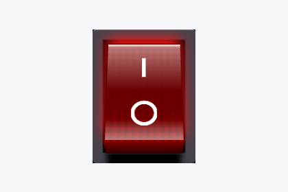
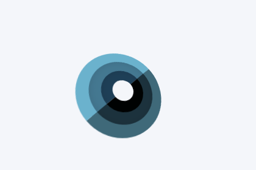
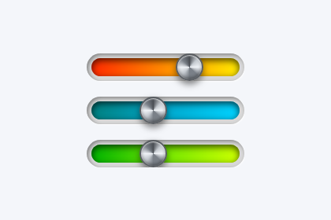
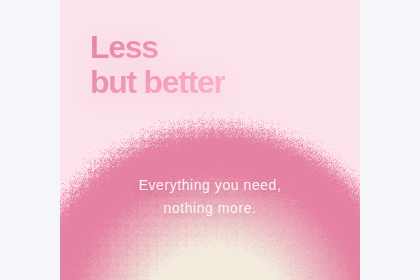
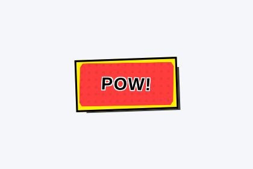
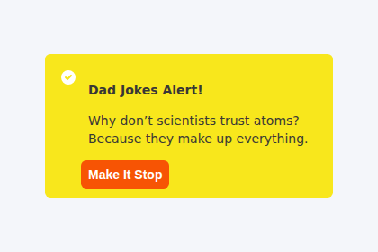
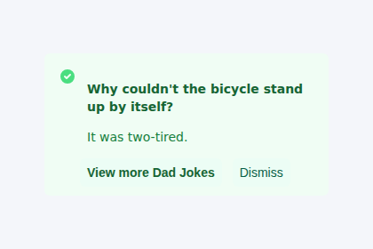
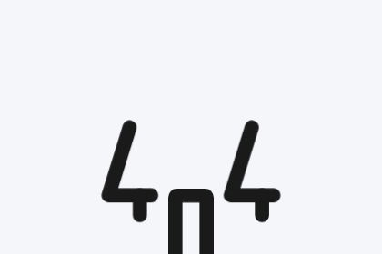

# Anteprime dei componenti — omni-cleaner

**86 componenti associati**, dal solo catalogo Design-App; l'associazione non prova che il componente sia integrato nell'app.

[Tutte le app](./README.md) · [Catalogo completo](../TABELLA_478.md) · [Vista con filtro app](../../docs/componenti.html?app=omni-cleaner)

Le immagini qui mostrate sono catture documentali, **non** una verifica di riuso Flutter, compatibilità nativa o licenze degli asset di terzi. In assenza di una PNG realmente acquisita la cella dichiara «Non disponibile» e punta alla fonte originale. Le colonne Codice originale e Codice Flutter sono INDIPENDENTI; una variante Dart non implica test su app consumer.

| Anteprima | UID | ID canonico | Componente | Fonte | Categoria | App associate | Codice originale | Codice Flutter |
|---|---|---|---|---|---|---|---|---|
| <small>Non disponibile</small> · <a href="https://github.com/Subhan-code/Amicro--Micro-transitions-/blob/fa5f8ffbe39537a8db191806066b8773c47c82e9/registry/ui/scroll/scroll-reveal.tsx" target="_blank" rel="noopener noreferrer">Fonte</a> | <code>UID-0004</code> | <code>AMX-004</code> | Scroll Reveal | <a href="https://github.com/Subhan-code/Amicro--Micro-transitions-/blob/fa5f8ffbe39537a8db191806066b8773c47c82e9/registry/ui/scroll/scroll-reveal.tsx" target="_blank" rel="noopener noreferrer">DEVLIBRARIES_AMICRO</a> | SCROLL_TRIGGERED_ENTRANCE | anna-s-diary, app-factory-dashboard, battery-guard, beerclass-ai, camperboss, cashmate-ai, cooking-anime, edu-01-corpo-umano, framelab, notes-ecosistema, omni-cleaner, trailpath, web-utility-factory, wonderlog, world-days | <a href="../../BIBLIOTECA_COMPONENTI/sorgenti/amicro/amx-004.tsx" target="_blank" rel="noopener noreferrer">Apri TypeScript/React</a> | Da convertire |
| <small>Non disponibile</small> · <a href="https://github.com/Subhan-code/Amicro--Micro-transitions-/blob/fa5f8ffbe39537a8db191806066b8773c47c82e9/registry/ui/loading/accordion-loader.tsx" target="_blank" rel="noopener noreferrer">Fonte</a> | <code>UID-0006</code> | <code>AMX-006</code> | Accordion Loader | <a href="https://github.com/Subhan-code/Amicro--Micro-transitions-/blob/fa5f8ffbe39537a8db191806066b8773c47c82e9/registry/ui/loading/accordion-loader.tsx" target="_blank" rel="noopener noreferrer">DEVLIBRARIES_AMICRO</a> | INDETERMINATE_LOADING | anna-s-diary, app-factory-dashboard, battery-guard, camperboss, cooking-anime, deskland-android, easy-debloat, focussense, framelab, notes-ecosistema, omni-cleaner, send-to-pc, web-utility-factory, wonderlog, world-days | <a href="../../BIBLIOTECA_COMPONENTI/sorgenti/amicro/amx-006.tsx" target="_blank" rel="noopener noreferrer">Apri TypeScript/React</a> | Da convertire |
| <small>Non disponibile</small> | <code>UID-0007</code> | <code>DBM-002</code> | Classic Spinner | <a href="https://github.com/riccardopinato/Design-App/blob/main/BIBLIOTECA_COMPONENTI/sorgenti/amicro/dbm-002.tsx" target="_blank" rel="noopener noreferrer">DEVLIBRARIES_BOOKMARKS</a> | LOADER_INDETERMINATE | anna-s-diary, cooking-anime, notes-ecosistema, omni-cleaner, world-days | <a href="../../BIBLIOTECA_COMPONENTI/sorgenti/amicro/dbm-002.tsx" target="_blank" rel="noopener noreferrer">Apri TypeScript/React (source path not necessarily verified)</a> | Da convertire |
| <small>Non disponibile</small> | <code>UID-0009</code> | <code>DBM-004</code> | App Icon Load | <a href="https://github.com/riccardopinato/Design-App/blob/main/BIBLIOTECA_COMPONENTI/sorgenti/amicro/dbm-004.tsx" target="_blank" rel="noopener noreferrer">DEVLIBRARIES_BOOKMARKS</a> | APP_STARTUP_LOADING | cooking-anime, deskland-android, omni-cleaner, world-days | <a href="../../BIBLIOTECA_COMPONENTI/sorgenti/amicro/dbm-004.tsx" target="_blank" rel="noopener noreferrer">Apri TypeScript/React (source path not necessarily verified)</a> | Da convertire |
| <small>Non disponibile</small> | <code>UID-0011</code> | <code>DBM-006</code> | Stacked Bar Pulse | <a href="https://github.com/riccardopinato/Design-App/blob/main/BIBLIOTECA_COMPONENTI/sorgenti/amicro/dbm-006.tsx" target="_blank" rel="noopener noreferrer">DEVLIBRARIES_BOOKMARKS</a> | LOADER_SCAN | app-factory-dashboard, battery-guard, omni-cleaner, send-to-pc | <a href="../../BIBLIOTECA_COMPONENTI/sorgenti/amicro/dbm-006.tsx" target="_blank" rel="noopener noreferrer">Apri TypeScript/React (source path not necessarily verified)</a> | Da convertire |
| <small>Non disponibile</small> | <code>UID-0017</code> | <code>DBM-012</code> | Grid Dots | <a href="https://github.com/riccardopinato/Design-App/blob/main/BIBLIOTECA_COMPONENTI/sorgenti/amicro/dbm-012.tsx" target="_blank" rel="noopener noreferrer">DEVLIBRARIES_BOOKMARKS</a> | LOADER_TECHNICAL | app-factory-dashboard, deskland-android, omni-cleaner | <a href="../../BIBLIOTECA_COMPONENTI/sorgenti/amicro/dbm-012.tsx" target="_blank" rel="noopener noreferrer">Apri TypeScript/React (source path not necessarily verified)</a> | Da convertire |
| <small>Non disponibile</small> | <code>UID-0019</code> | <code>DBM-014</code> | Circular Bars | <a href="https://github.com/riccardopinato/Design-App/blob/main/BIBLIOTECA_COMPONENTI/sorgenti/amicro/dbm-014.tsx" target="_blank" rel="noopener noreferrer">DEVLIBRARIES_BOOKMARKS</a> | LOADER_DIAGNOSTICS | app-factory-dashboard, battery-guard, focussense, omni-cleaner | <a href="../../BIBLIOTECA_COMPONENTI/sorgenti/amicro/dbm-014.tsx" target="_blank" rel="noopener noreferrer">Apri TypeScript/React (source path not necessarily verified)</a> | Da convertire |
| <small>Non disponibile</small> | <code>UID-0023</code> | <code>DBM-019</code> | Bar Cascade | <a href="https://github.com/riccardopinato/Design-App/blob/main/BIBLIOTECA_COMPONENTI/sorgenti/amicro/dbm-019.tsx" target="_blank" rel="noopener noreferrer">DEVLIBRARIES_BOOKMARKS</a> | LOADER_BAR | app-factory-dashboard, focussense, omni-cleaner, send-to-pc | <a href="../../BIBLIOTECA_COMPONENTI/sorgenti/amicro/dbm-019.tsx" target="_blank" rel="noopener noreferrer">Apri TypeScript/React (source path not necessarily verified)</a> | Da convertire |
| <small>Non disponibile</small> | <code>UID-0024</code> | <code>DBM-020</code> | Concentric Squares | <a href="https://github.com/riccardopinato/Design-App/blob/main/BIBLIOTECA_COMPONENTI/sorgenti/amicro/dbm-020.tsx" target="_blank" rel="noopener noreferrer">DEVLIBRARIES_BOOKMARKS</a> | LOADER_GEOMETRIC | app-factory-dashboard, cooking-anime, deskland-android, omni-cleaner | <a href="../../BIBLIOTECA_COMPONENTI/sorgenti/amicro/dbm-020.tsx" target="_blank" rel="noopener noreferrer">Apri TypeScript/React (source path not necessarily verified)</a> | Da convertire |
| <small>Non disponibile</small> | <code>UID-0025</code> | <code>DBM-022</code> | Bar Sweep | <a href="https://github.com/riccardopinato/Design-App/blob/main/BIBLIOTECA_COMPONENTI/sorgenti/amicro/dbm-022.tsx" target="_blank" rel="noopener noreferrer">DEVLIBRARIES_BOOKMARKS</a> | LOADER_BAR | battery-guard, omni-cleaner, send-to-pc, world-days | <a href="../../BIBLIOTECA_COMPONENTI/sorgenti/amicro/dbm-022.tsx" target="_blank" rel="noopener noreferrer">Apri TypeScript/React (source path not necessarily verified)</a> | Da convertire |
| <small>Non disponibile</small> | <code>UID-0026</code> | <code>DBM-023</code> | Conveyor Loop | <a href="https://github.com/riccardopinato/Design-App/blob/main/BIBLIOTECA_COMPONENTI/sorgenti/amicro/dbm-023.tsx" target="_blank" rel="noopener noreferrer">DEVLIBRARIES_BOOKMARKS</a> | LOADER_TRANSFER | app-factory-dashboard, notes-ecosistema, omni-cleaner, send-to-pc | <a href="../../BIBLIOTECA_COMPONENTI/sorgenti/amicro/dbm-023.tsx" target="_blank" rel="noopener noreferrer">Apri TypeScript/React (source path not necessarily verified)</a> | Da convertire |
| <small>Non disponibile</small> | <code>UID-0029</code> | <code>DBM-026</code> | Newtons Cradle | <a href="https://github.com/riccardopinato/Design-App/blob/main/BIBLIOTECA_COMPONENTI/sorgenti/amicro/dbm-026.tsx" target="_blank" rel="noopener noreferrer">DEVLIBRARIES_BOOKMARKS</a> | LOADER_PHYSICS | app-factory-dashboard, cooking-anime, focussense, omni-cleaner | <a href="../../BIBLIOTECA_COMPONENTI/sorgenti/amicro/dbm-026.tsx" target="_blank" rel="noopener noreferrer">Apri TypeScript/React (source path not necessarily verified)</a> | Da convertire |
| <small>Non disponibile</small> | <code>UID-0030</code> | <code>DBM-027</code> | Helix Spinner | DEVLIBRARIES_BOOKMARKS | UNVERIFIED_LOADER_VISUAL | cooking-anime, framelab, omni-cleaner | Non disponibile | Sorgente non archiviata |
| <small>Non disponibile</small> | <code>UID-0031</code> | <code>DBM-028</code> | Loader | DEVLIBRARIES_BOOKMARKS | UNVERIFIED_LOADER_COLLECTION | app-factory-dashboard, notes-ecosistema, omni-cleaner | Non disponibile | Sorgente non archiviata |
| <small>Non disponibile</small> · <a href="https://devlibraries.com/libraries/easeui" target="_blank" rel="noopener noreferrer">Fonte</a> | <code>UID-0034</code> | <code>DSP-001</code> | EaseUI Theme Toggle | <a href="https://devlibraries.com/libraries/easeui" target="_blank" rel="noopener noreferrer">DEVLIBRARIES_EASEUI</a> | THEME_LIGHT_DARK | anna-s-diary, app-factory-dashboard, battery-guard, beerclass-ai, camperboss, cashmate-ai, cooking-anime, deskland-android, easy-debloat, focussense, framelab, notes-ecosistema, omni-cleaner, sleepmax-coach, trailpath, web-utility-factory, wonderlog, world-days | <a href="../../BIBLIOTECA_COMPONENTI/sorgenti/easeui/dsp-001.tsx" target="_blank" rel="noopener noreferrer">Apri TypeScript/React</a> | Da convertire |
| <small>Non disponibile</small> · <a href="https://devlibraries.com/libraries/amicro/card-stack-peel" target="_blank" rel="noopener noreferrer">Fonte</a> | <code>UID-0035</code> | <code>DSP-002</code> | Card Stack Peel | <a href="https://devlibraries.com/libraries/amicro/card-stack-peel" target="_blank" rel="noopener noreferrer">DEVLIBRARIES_AMICRO</a> | SECTION_CARD_TRANSITION | anna-s-diary, app-factory-dashboard, beerclass-ai, cooking-anime, framelab, notes-ecosistema, omni-cleaner, wonderlog, world-days | <a href="../../BIBLIOTECA_COMPONENTI/sorgenti/amicro/dsp-002.tsx" target="_blank" rel="noopener noreferrer">Apri TypeScript/React</a> | Da convertire |
| <small>Non disponibile</small> · <a href="https://devlibraries.com/libraries/amicro" target="_blank" rel="noopener noreferrer">Fonte</a> | <code>UID-0036</code> | <code>DSP-003</code> | Accordion Blind Pull | <a href="https://devlibraries.com/libraries/amicro" target="_blank" rel="noopener noreferrer">DEVLIBRARIES_AMICRO</a> | EXPANDABLE_PANEL_TRANSITION | anna-s-diary, app-factory-dashboard, battery-guard, beerclass-ai, camperboss, cashmate-ai, cooking-anime, easy-debloat, notes-ecosistema, omni-cleaner, trailpath, wonderlog, world-days | <a href="../../BIBLIOTECA_COMPONENTI/sorgenti/amicro/dsp-003.tsx" target="_blank" rel="noopener noreferrer">Apri TypeScript/React</a> | Da convertire |
| <small>Non disponibile</small> · <a href="https://devlibraries.com/libraries/amicro" target="_blank" rel="noopener noreferrer">Fonte</a> | <code>UID-0037</code> | <code>DSP-004</code> | Interlocking Gear Step | <a href="https://devlibraries.com/libraries/amicro" target="_blank" rel="noopener noreferrer">DEVLIBRARIES_AMICRO</a> | REAL_PROCESS_LOADING | app-factory-dashboard, battery-guard, easy-debloat, focussense, framelab, notes-ecosistema, omni-cleaner, send-to-pc, world-days | <a href="../../BIBLIOTECA_COMPONENTI/sorgenti/amicro/dsp-004.tsx" target="_blank" rel="noopener noreferrer">Apri TypeScript/React</a> | Da convertire |
| <small>Non disponibile</small> · <a href="https://devlibraries.com/libraries/amicro" target="_blank" rel="noopener noreferrer">Fonte</a> | <code>UID-0038</code> | <code>DSP-005</code> | Shutter Step Slices | <a href="https://devlibraries.com/libraries/amicro" target="_blank" rel="noopener noreferrer">DEVLIBRARIES_AMICRO</a> | STAGGERED_REVEAL | anna-s-diary, app-factory-dashboard, camperboss, cooking-anime, deskland-android, framelab, notes-ecosistema, omni-cleaner, wonderlog, world-days | <a href="../../BIBLIOTECA_COMPONENTI/sorgenti/amicro/dsp-005.tsx" target="_blank" rel="noopener noreferrer">Apri TypeScript/React</a> | Da convertire |
| <small>Non disponibile</small> | <code>UID-0039</code> | <code>DSP-006</code> | Loading &amp; Waiting Visual References (user screenshot) | USER_IMAGE | LOADING_WAIT_STATE_REFERENCE | anna-s-diary, app-factory-dashboard, battery-guard, camperboss, cashmate-ai, cooking-anime, deskland-android, easy-debloat, focussense, framelab, notes-ecosistema, omni-cleaner, send-to-pc, trailpath, web-utility-factory, wonderlog, world-days | Non disponibile | Sorgente non archiviata |
|  | <code>UID-0059</code> | <code>ICO-005</code> | Download dati / file | <a href="https://gentleface.com/icons/download" target="_blank" rel="noopener noreferrer">GENTLEFACE</a> | ICON | camperboss, notes-ecosistema, omni-cleaner, wonderlog, world-days | <a href="../../BIBLIOTECA_COMPONENTI/sorgenti/gentleface/ICO-005.svg" target="_blank" rel="noopener noreferrer">Apri SVG (original, archived)</a> | <a href="../../BIBLIOTECA_COMPONENTI/flutter_adapters/lib/src/gentleface/ico_005.dart" target="_blank" rel="noopener noreferrer">Apri codice Flutter (bozza)</a> |
|  | <code>UID-0062</code> | <code>ICO-008</code> | Galleria immagini | <a href="https://gentleface.com/icons/images" target="_blank" rel="noopener noreferrer">GENTLEFACE</a> | ICON | anna-s-diary, framelab, notes-ecosistema, omni-cleaner, wonderlog | <a href="../../BIBLIOTECA_COMPONENTI/sorgenti/gentleface/ICO-008.svg" target="_blank" rel="noopener noreferrer">Apri SVG (original, archived)</a> | <a href="../../BIBLIOTECA_COMPONENTI/flutter_adapters/lib/src/gentleface/ico_008.dart" target="_blank" rel="noopener noreferrer">Apri codice Flutter (bozza)</a> |
|  | <code>UID-0063</code> | <code>ICO-009</code> | Video / media | <a href="https://gentleface.com/icons/video" target="_blank" rel="noopener noreferrer">GENTLEFACE</a> | ICON | cooking-anime, framelab, omni-cleaner, wonderlog | <a href="../../BIBLIOTECA_COMPONENTI/sorgenti/gentleface/ICO-009.svg" target="_blank" rel="noopener noreferrer">Apri SVG (original, archived)</a> | <a href="../../BIBLIOTECA_COMPONENTI/flutter_adapters/lib/src/gentleface/ico_009.dart" target="_blank" rel="noopener noreferrer">Apri codice Flutter (bozza)</a> |
|  | <code>UID-0065</code> | <code>ICO-011</code> | Ricerca | <a href="https://gentleface.com/icons/search" target="_blank" rel="noopener noreferrer">GENTLEFACE</a> | ICON | app-factory-dashboard, notes-ecosistema, omni-cleaner, wonderlog, world-days | <a href="../../BIBLIOTECA_COMPONENTI/sorgenti/gentleface/ICO-011.svg" target="_blank" rel="noopener noreferrer">Apri SVG (original, archived)</a> | <a href="../../BIBLIOTECA_COMPONENTI/flutter_adapters/lib/src/gentleface/ico_011.dart" target="_blank" rel="noopener noreferrer">Apri codice Flutter (bozza)</a> |
|  | <code>UID-0067</code> | <code>ICO-013</code> | Attività in corso | <a href="https://gentleface.com/icons/loader" target="_blank" rel="noopener noreferrer">GENTLEFACE</a> | ICON | battery-guard, notes-ecosistema, omni-cleaner, send-to-pc, world-days | <a href="../../BIBLIOTECA_COMPONENTI/sorgenti/gentleface/ICO-013.svg" target="_blank" rel="noopener noreferrer">Apri SVG (original, archived)</a> | <a href="../../BIBLIOTECA_COMPONENTI/flutter_adapters/lib/src/gentleface/ico_013.dart" target="_blank" rel="noopener noreferrer">Apri codice Flutter (bozza)</a> |
|  | <code>UID-0068</code> | <code>ICO-014</code> | Completato | <a href="https://gentleface.com/icons/check" target="_blank" rel="noopener noreferrer">GENTLEFACE</a> | ICON | anna-s-diary, app-factory-dashboard, notes-ecosistema, omni-cleaner, world-days | <a href="../../BIBLIOTECA_COMPONENTI/sorgenti/gentleface/ICO-014.svg" target="_blank" rel="noopener noreferrer">Apri SVG (original, archived)</a> | <a href="../../BIBLIOTECA_COMPONENTI/flutter_adapters/lib/src/gentleface/ico_014.dart" target="_blank" rel="noopener noreferrer">Apri codice Flutter (bozza)</a> |
|  | <code>UID-0074</code> | <code>ICO-020</code> | Riproduci | <a href="https://gentleface.com/icons/play" target="_blank" rel="noopener noreferrer">GENTLEFACE</a> | ICON | cooking-anime, deskland-android, framelab, omni-cleaner | <a href="../../BIBLIOTECA_COMPONENTI/sorgenti/gentleface/ICO-020.svg" target="_blank" rel="noopener noreferrer">Apri SVG (original, archived)</a> | <a href="../../BIBLIOTECA_COMPONENTI/flutter_adapters/lib/src/gentleface/ico_020.dart" target="_blank" rel="noopener noreferrer">Apri codice Flutter (bozza)</a> |
| <small>Non disponibile</small> · <a href="https://gentleface.com/icons/pause" target="_blank" rel="noopener noreferrer">Fonte</a> | <code>UID-0075</code> | <code>ICO-021</code> | Pausa | <a href="https://gentleface.com/icons/pause" target="_blank" rel="noopener noreferrer">GENTLEFACE</a> | ICON | cooking-anime, deskland-android, framelab, omni-cleaner | <a href="../../BIBLIOTECA_COMPONENTI/sorgenti/gentleface/ICO-021.svg" target="_blank" rel="noopener noreferrer">Apri SVG (original, archived)</a> | <a href="../../BIBLIOTECA_COMPONENTI/flutter_adapters/lib/src/gentleface/ico_021.dart" target="_blank" rel="noopener noreferrer">Apri codice Flutter (bozza)</a> |
|  | <code>UID-0076</code> | <code>ICO-022</code> | Ripeti / loop | <a href="https://gentleface.com/icons/repeat" target="_blank" rel="noopener noreferrer">GENTLEFACE</a> | ICON | notes-ecosistema, omni-cleaner, sleepmax-coach, wonderlog | <a href="../../BIBLIOTECA_COMPONENTI/sorgenti/gentleface/ICO-022.svg" target="_blank" rel="noopener noreferrer">Apri SVG (original, archived)</a> | <a href="../../BIBLIOTECA_COMPONENTI/flutter_adapters/lib/src/gentleface/ico_022.dart" target="_blank" rel="noopener noreferrer">Apri codice Flutter (bozza)</a> |
|  | <code>UID-0077</code> | <code>ICO-023</code> | Visibilità / anteprima | <a href="https://gentleface.com/icons/eye" target="_blank" rel="noopener noreferrer">GENTLEFACE</a> | ICON | anna-s-diary, easy-debloat, notes-ecosistema, omni-cleaner | <a href="../../BIBLIOTECA_COMPONENTI/sorgenti/gentleface/ICO-023.svg" target="_blank" rel="noopener noreferrer">Apri SVG (original, archived)</a> | <a href="../../BIBLIOTECA_COMPONENTI/flutter_adapters/lib/src/gentleface/ico_023.dart" target="_blank" rel="noopener noreferrer">Apri codice Flutter (bozza)</a> |
|  | <code>UID-0360</code> | <code>UIV-001</code> | Pallina verde che rimbalza su gradini CSS | <a href="https://uiverse.io/alexruix/tame-fly-42" target="_blank" rel="noopener noreferrer">UIVERSE</a> | LOADER | battery-guard, framelab, notes-ecosistema, omni-cleaner, send-to-pc, world-days | <a href="../../UI-UX/UIVERSE/CODICE_SORGENTE/UIV-001_original.html" target="_blank" rel="noopener noreferrer">Apri HTML/CSS</a> | Da convertire |
|  | <code>UID-0364</code> | <code>UIV-005</code> | Card proposta dall&#x27;utente come sfondo decorativo per varie app; effetto esatto non verificato | <a href="https://uiverse.io/amir_6539/red-duck-82" target="_blank" rel="noopener noreferrer">UIVERSE</a> | CARD_BACKGROUND | annas-diary, app-factory-dashboard, battery-guard, cashmate-ai, deskland-android, focussense, notes-ecosistema, omni-cleaner | <a href="../../UI-UX/UIVERSE/CODICE_SORGENTE/UIV-005_original.html" target="_blank" rel="noopener noreferrer">Apri HTML/CSS</a> | Da convertire |
|  | <code>UID-0365</code> | <code>UIV-006</code> | Switch interattivo Uiverse, sorgente HTML/CSS non individuato | <a href="https://uiverse.io/JustCode14/red-dingo-61" target="_blank" rel="noopener noreferrer">UIVERSE</a> | SWITCH | 180flipcharge, annas-diary, battery-guard, easy-debloat, focussense, omni-cleaner, phone-guard, pocket-guard | <a href="../../UI-UX/UIVERSE/CODICE_SORGENTE/UIV-006_original.html" target="_blank" rel="noopener noreferrer">Apri HTML/CSS</a> | Da convertire |
|  | <code>UID-0366</code> | <code>UIV-007</code> | Loader per processi reali, testo UX proposto: Stiamo facendo la magia; animazione specifica non verificata | <a href="https://uiverse.io/arthur_6104/orange-walrus-50" target="_blank" rel="noopener noreferrer">UIVERSE</a> | LOADER | annas-diary, app-factory-dashboard, cashmate-ai, framelab, notes-ecosistema, omni-cleaner, web-utility-factory, world-days | <a href="../../UI-UX/UIVERSE/CODICE_SORGENTE/UIV-007_original.html" target="_blank" rel="noopener noreferrer">Apri HTML/CSS</a> | Da convertire |
|  | <code>UID-0367</code> | <code>UIV-008</code> | Quadrato arancio animato che sale una diagonale a gradini | <a href="https://uiverse.io/Shoh2008/cold-walrus-85" target="_blank" rel="noopener noreferrer">UIVERSE</a> | LOADER | battery-guard, camperboss, easy-debloat, notes-ecosistema, omni-cleaner, send-to-pc, world-days | <a href="../../UI-UX/UIVERSE/CODICE_SORGENTE/UIV-008_original.html" target="_blank" rel="noopener noreferrer">Apri HTML/CSS</a> | Da convertire |
|  | <code>UID-0370</code> | <code>UIV-011</code> | Componente Uiverse nella categoria LOADER; HTML/CSS originale archiviato con blob SHA. L&#x27;effetto specifico richiede ispezione del sorgente e collaudo visivo. | <a href="https://uiverse.io/Admin12121/black-sheep-17" target="_blank" rel="noopener noreferrer">UIVERSE</a> | LOADER | app-factory-dashboard, battery-guard, cashmate-ai, easy-debloat, omni-cleaner, send-to-pc, world-days | <a href="../../UI-UX/UIVERSE/CODICE_SORGENTE/UIV-011_original.html" target="_blank" rel="noopener noreferrer">Apri HTML/CSS</a> | Da convertire |
|  | <code>UID-0372</code> | <code>UIV-013</code> | Componente Uiverse nella categoria LOADER; HTML/CSS originale archiviato con blob SHA. L&#x27;effetto specifico richiede ispezione del sorgente e collaudo visivo. | <a href="https://uiverse.io/AqFox/young-dragon-29" target="_blank" rel="noopener noreferrer">UIVERSE</a> | LOADER | camperboss, cooking-anime, deskland-android, focussense, omni-cleaner, sleepmax-coach, wonderlog | <a href="../../UI-UX/UIVERSE/CODICE_SORGENTE/UIV-013_original.html" target="_blank" rel="noopener noreferrer">Apri HTML/CSS</a> | Da convertire |
|  | <code>UID-0377</code> | <code>UIV-018</code> | Componente Uiverse nella categoria SWITCH; HTML/CSS originale archiviato con blob SHA. L&#x27;effetto specifico richiede ispezione del sorgente e collaudo visivo. | <a href="https://uiverse.io/JaydipPrajapati1910/average-shrimp-57" target="_blank" rel="noopener noreferrer">UIVERSE</a> | SWITCH | battery-guard, camperboss, cashmate-ai, focussense, omni-cleaner, tabletop-motion-alarm, the-luminous-infinite-circle | <a href="../../UI-UX/UIVERSE/CODICE_SORGENTE/UIV-018_original.html" target="_blank" rel="noopener noreferrer">Apri HTML/CSS</a> | Da convertire |
|  | <code>UID-0378</code> | <code>UIV-019</code> | Componente Uiverse nella categoria LOADER; HTML/CSS originale archiviato con blob SHA. L&#x27;effetto specifico richiede ispezione del sorgente e collaudo visivo. | <a href="https://uiverse.io/JkHuger/new-deer-97" target="_blank" rel="noopener noreferrer">UIVERSE</a> | LOADER | deskland-android, focussense, framelab, notes-ecosistema, omni-cleaner, sleepmax-coach, world-days | <a href="../../UI-UX/UIVERSE/CODICE_SORGENTE/UIV-019_original.html" target="_blank" rel="noopener noreferrer">Apri HTML/CSS</a> | Da convertire |
|  | <code>UID-0379</code> | <code>UIV-020</code> | Componente Uiverse nella categoria LOADER; HTML/CSS originale archiviato con blob SHA. L&#x27;effetto specifico richiede ispezione del sorgente e collaudo visivo. | <a href="https://uiverse.io/JkHuger/selfish-bulldog-36" target="_blank" rel="noopener noreferrer">UIVERSE</a> | LOADER | app-factory-dashboard, battery-guard, framelab, notes-ecosistema, omni-cleaner, send-to-pc, world-days | <a href="../../UI-UX/UIVERSE/CODICE_SORGENTE/UIV-020_original.html" target="_blank" rel="noopener noreferrer">Apri HTML/CSS</a> | Da convertire |
|  | <code>UID-0381</code> | <code>UIV-022</code> | Componente Uiverse nella categoria INPUT; HTML/CSS originale archiviato con blob SHA. L&#x27;effetto specifico richiede ispezione del sorgente e collaudo visivo. | <a href="https://uiverse.io/Lakshay-art/curvy-earwig-22" target="_blank" rel="noopener noreferrer">UIVERSE</a> | INPUT | app-factory-dashboard, cashmate-ai, notes-ecosistema, omni-cleaner, wonderlog, world-days | <a href="../../UI-UX/UIVERSE/CODICE_SORGENTE/UIV-022_original.html" target="_blank" rel="noopener noreferrer">Apri HTML/CSS</a> | Da convertire |
|  | <code>UID-0385</code> | <code>UIV-026</code> | Componente Uiverse nella categoria LOADER; HTML/CSS originale archiviato con blob SHA. L&#x27;effetto specifico richiede ispezione del sorgente e collaudo visivo. | <a href="https://uiverse.io/Nawsome/brave-turtle-26" target="_blank" rel="noopener noreferrer">UIVERSE</a> | LOADER | camperboss, cooking-anime, deskland-android, focussense, omni-cleaner, sleepmax-coach, wonderlog | <a href="../../UI-UX/UIVERSE/CODICE_SORGENTE/UIV-026_original.html" target="_blank" rel="noopener noreferrer">Apri HTML/CSS</a> | Da convertire |
|  | <code>UID-0386</code> | <code>UIV-027</code> | Componente Uiverse nella categoria SWITCH; HTML/CSS originale archiviato con blob SHA. L&#x27;effetto specifico richiede ispezione del sorgente e collaudo visivo. | <a href="https://uiverse.io/Nawsome/empty-snail-69" target="_blank" rel="noopener noreferrer">UIVERSE</a> | SWITCH | 180flipcharge, annas-diary, battery-guard, focussense, notes-ecosistema, omni-cleaner, pocket-guard | <a href="../../UI-UX/UIVERSE/CODICE_SORGENTE/UIV-027_original.html" target="_blank" rel="noopener noreferrer">Apri HTML/CSS</a> | Da convertire |
|  | <code>UID-0387</code> | <code>UIV-028</code> | Componente Uiverse nella categoria LOADER; HTML/CSS originale archiviato con blob SHA. L&#x27;effetto specifico richiede ispezione del sorgente e collaudo visivo. | <a href="https://uiverse.io/Nawsome/kind-mole-87" target="_blank" rel="noopener noreferrer">UIVERSE</a> | LOADER | app-factory-dashboard, battery-guard, framelab, notes-ecosistema, omni-cleaner, send-to-pc, world-days | <a href="../../UI-UX/UIVERSE/CODICE_SORGENTE/UIV-028_original.html" target="_blank" rel="noopener noreferrer">Apri HTML/CSS</a> | Da convertire |
|  | <code>UID-0388</code> | <code>UIV-029</code> | Componente Uiverse nella categoria LOADER; HTML/CSS originale archiviato con blob SHA. L&#x27;effetto specifico richiede ispezione del sorgente e collaudo visivo. | <a href="https://uiverse.io/Nawsome/wet-mayfly-23" target="_blank" rel="noopener noreferrer">UIVERSE</a> | LOADER | app-factory-dashboard, battery-guard, cashmate-ai, easy-debloat, omni-cleaner, send-to-pc, world-days | <a href="../../UI-UX/UIVERSE/CODICE_SORGENTE/UIV-029_original.html" target="_blank" rel="noopener noreferrer">Apri HTML/CSS</a> | Da convertire |
|  | <code>UID-0389</code> | <code>UIV-030</code> | Componente Uiverse nella categoria LOADER; HTML/CSS originale archiviato con blob SHA. L&#x27;effetto specifico richiede ispezione del sorgente e collaudo visivo. | <a href="https://uiverse.io/Nawsome/young-goat-78" target="_blank" rel="noopener noreferrer">UIVERSE</a> | LOADER | app-factory-dashboard, camperboss, cashmate-ai, cooking-anime, easy-debloat, omni-cleaner, wonderlog | <a href="../../UI-UX/UIVERSE/CODICE_SORGENTE/UIV-030_original.html" target="_blank" rel="noopener noreferrer">Apri HTML/CSS</a> | Da convertire |
|  | <code>UID-0390</code> | <code>UIV-031</code> | Scheda pubblica Uiverse classificata come LOADER; il codice HTML/CSS non è presente nell&#x27;archivio Galaxy e non è stato acquisito. | <a href="https://uiverse.io/Novaxlo/rotten-lionfish-4" target="_blank" rel="noopener noreferrer">UIVERSE</a> | LOADER | camperboss, cooking-anime, deskland-android, focussense, omni-cleaner, sleepmax-coach, wonderlog | <a href="../../UI-UX/UIVERSE/CODICE_SORGENTE/UIV-031_original.html" target="_blank" rel="noopener noreferrer">Apri HTML/CSS</a> | Da convertire |
|  | <code>UID-0391</code> | <code>UIV-032</code> | Componente Uiverse nella categoria LOADER; HTML/CSS originale archiviato con blob SHA. L&#x27;effetto specifico richiede ispezione del sorgente e collaudo visivo. | <a href="https://uiverse.io/Praashoo7/lucky-hound-44" target="_blank" rel="noopener noreferrer">UIVERSE</a> | LOADER | deskland-android, focussense, framelab, notes-ecosistema, omni-cleaner, sleepmax-coach, world-days | <a href="../../UI-UX/UIVERSE/CODICE_SORGENTE/UIV-032_original.html" target="_blank" rel="noopener noreferrer">Apri HTML/CSS</a> | Da convertire |
|  | <code>UID-0393</code> | <code>UIV-034</code> | Componente Uiverse nella categoria LOADER; HTML/CSS originale archiviato con blob SHA. L&#x27;effetto specifico richiede ispezione del sorgente e collaudo visivo. | <a href="https://uiverse.io/Pradeepsaranbishnoi/fast-cobra-20" target="_blank" rel="noopener noreferrer">UIVERSE</a> | LOADER | app-factory-dashboard, battery-guard, cashmate-ai, easy-debloat, omni-cleaner, send-to-pc, world-days | <a href="../../UI-UX/UIVERSE/CODICE_SORGENTE/UIV-034_original.html" target="_blank" rel="noopener noreferrer">Apri HTML/CSS</a> | Da convertire |
|  | <code>UID-0395</code> | <code>UIV-036</code> | Componente Uiverse nella categoria LOADER; HTML/CSS originale archiviato con blob SHA. L&#x27;effetto specifico richiede ispezione del sorgente e collaudo visivo. | <a href="https://uiverse.io/Pradeepsaranbishnoi/tall-fish-38" target="_blank" rel="noopener noreferrer">UIVERSE</a> | LOADER | camperboss, cooking-anime, deskland-android, focussense, omni-cleaner, sleepmax-coach, wonderlog | <a href="../../UI-UX/UIVERSE/CODICE_SORGENTE/UIV-036_original.html" target="_blank" rel="noopener noreferrer">Apri HTML/CSS</a> | Da convertire |
|  | <code>UID-0398</code> | <code>UIV-039</code> | Componente Uiverse nella categoria LOADER; HTML/CSS originale archiviato con blob SHA. L&#x27;effetto specifico richiede ispezione del sorgente e collaudo visivo. | <a href="https://uiverse.io/SelfMadeSystem/pretty-treefrog-77" target="_blank" rel="noopener noreferrer">UIVERSE</a> | LOADER | app-factory-dashboard, battery-guard, cashmate-ai, easy-debloat, omni-cleaner, send-to-pc, world-days | <a href="../../UI-UX/UIVERSE/CODICE_SORGENTE/UIV-039_original.html" target="_blank" rel="noopener noreferrer">Apri HTML/CSS</a> | Da convertire |
|  | <code>UID-0399</code> | <code>UIV-040</code> | Componente Uiverse nella categoria LOADER; HTML/CSS originale archiviato con blob SHA. L&#x27;effetto specifico richiede ispezione del sorgente e collaudo visivo. | <a href="https://uiverse.io/Shoh2008/curvy-bulldog-27" target="_blank" rel="noopener noreferrer">UIVERSE</a> | LOADER | app-factory-dashboard, camperboss, cashmate-ai, cooking-anime, easy-debloat, omni-cleaner, wonderlog | <a href="../../UI-UX/UIVERSE/CODICE_SORGENTE/UIV-040_original.html" target="_blank" rel="noopener noreferrer">Apri HTML/CSS</a> | Da convertire |
|  | <code>UID-0400</code> | <code>UIV-041</code> | Componente Uiverse nella categoria LOADER; HTML/CSS originale archiviato con blob SHA. L&#x27;effetto specifico richiede ispezione del sorgente e collaudo visivo. | <a href="https://uiverse.io/Shoh2008/ugly-elephant-80" target="_blank" rel="noopener noreferrer">UIVERSE</a> | LOADER | camperboss, cooking-anime, deskland-android, focussense, omni-cleaner, sleepmax-coach, wonderlog | <a href="../../UI-UX/UIVERSE/CODICE_SORGENTE/UIV-041_original.html" target="_blank" rel="noopener noreferrer">Apri HTML/CSS</a> | Da convertire |
|  | <code>UID-0401</code> | <code>UIV-042</code> | Componente Uiverse nella categoria LOADER; HTML/CSS originale archiviato con blob SHA. L&#x27;effetto specifico richiede ispezione del sorgente e collaudo visivo. | <a href="https://uiverse.io/Shoh2008/yellow-dolphin-16" target="_blank" rel="noopener noreferrer">UIVERSE</a> | LOADER | deskland-android, focussense, framelab, notes-ecosistema, omni-cleaner, sleepmax-coach, world-days | <a href="../../UI-UX/UIVERSE/CODICE_SORGENTE/UIV-042_original.html" target="_blank" rel="noopener noreferrer">Apri HTML/CSS</a> | Da convertire |
|  | <code>UID-0402</code> | <code>UIV-043</code> | Categoria INPUT confermata dall&#x27;endpoint pubblico Uiverse. Abbinamenti UI/UX proposti, non collaudati sui consumer. | <a href="https://uiverse.io/Stavros2410/wet-duck-69" target="_blank" rel="noopener noreferrer">UIVERSE</a> | INPUT | notes-ecosistema, omni-cleaner, world-days | <a href="../../UI-UX/UIVERSE/CODICE_SORGENTE/UIV-043_original.html" target="_blank" rel="noopener noreferrer">Apri HTML/CSS</a> | Da convertire |
|  | <code>UID-0403</code> | <code>UIV-044</code> | Componente Uiverse nella categoria LOADER; HTML/CSS originale archiviato con blob SHA. L&#x27;effetto specifico richiede ispezione del sorgente e collaudo visivo. | <a href="https://uiverse.io/Subaashbala/average-horse-18" target="_blank" rel="noopener noreferrer">UIVERSE</a> | LOADER | app-factory-dashboard, battery-guard, cashmate-ai, easy-debloat, omni-cleaner, send-to-pc, world-days | <a href="../../UI-UX/UIVERSE/CODICE_SORGENTE/UIV-044_original.html" target="_blank" rel="noopener noreferrer">Apri HTML/CSS</a> | Da convertire |
|  | <code>UID-0404</code> | <code>UIV-045</code> | Categoria CHECKBOX confermata dall&#x27;endpoint pubblico Uiverse. Abbinamenti UI/UX proposti, non collaudati sui consumer. | <a href="https://uiverse.io/Uncannypotato69/honest-starfish-32" target="_blank" rel="noopener noreferrer">UIVERSE</a> | CHECKBOX | app-factory-dashboard, notes-ecosistema, omni-cleaner | <a href="../../UI-UX/UIVERSE/CODICE_SORGENTE/UIV-045_original.html" target="_blank" rel="noopener noreferrer">Apri HTML/CSS</a> | Da convertire |
|  | <code>UID-0409</code> | <code>UIV-050</code> | Scheda pubblica Uiverse classificata come LOADER; il codice HTML/CSS non è presente nell&#x27;archivio Galaxy e non è stato acquisito. | <a href="https://uiverse.io/andrew-manzyk/fast-vampirebat-53" target="_blank" rel="noopener noreferrer">UIVERSE</a> | LOADER | deskland-android, focussense, framelab, notes-ecosistema, omni-cleaner, sleepmax-coach, world-days | <a href="../../UI-UX/UIVERSE/CODICE_SORGENTE/UIV-050_original.html" target="_blank" rel="noopener noreferrer">Apri HTML/CSS</a> | Da convertire |
|  | <code>UID-0410</code> | <code>UIV-051</code> | Scheda pubblica Uiverse classificata come LOADER; il codice HTML/CSS non è presente nell&#x27;archivio Galaxy e non è stato acquisito. | <a href="https://uiverse.io/andrew-manzyk/young-walrus-64" target="_blank" rel="noopener noreferrer">UIVERSE</a> | LOADER | app-factory-dashboard, battery-guard, framelab, notes-ecosistema, omni-cleaner, send-to-pc, world-days | <a href="../../UI-UX/UIVERSE/CODICE_SORGENTE/UIV-051_original.html" target="_blank" rel="noopener noreferrer">Apri HTML/CSS</a> | Da convertire |
|  | <code>UID-0411</code> | <code>UIV-052</code> | Categoria CARD confermata dall&#x27;endpoint pubblico Uiverse. Abbinamenti UI/UX proposti, non collaudati sui consumer. | <a href="https://uiverse.io/ashif_6672/rare-bat-68" target="_blank" rel="noopener noreferrer">UIVERSE</a> | CARD | notes-ecosistema, omni-cleaner, world-days | <a href="../../UI-UX/UIVERSE/CODICE_SORGENTE/UIV-052_original.html" target="_blank" rel="noopener noreferrer">Apri HTML/CSS</a> | Da convertire |
|  | <code>UID-0412</code> | <code>UIV-053</code> | Componente Uiverse nella categoria TOOLTIP; HTML/CSS originale archiviato con blob SHA. L&#x27;effetto specifico richiede ispezione del sorgente e collaudo visivo. | <a href="https://uiverse.io/barisdogansutcu/plastic-dolphin-67" target="_blank" rel="noopener noreferrer">UIVERSE</a> | TOOLTIP | app-factory-dashboard, battery-guard, edu-01-corpo-umano, notes-ecosistema, omni-cleaner, wonderlog | <a href="../../UI-UX/UIVERSE/CODICE_SORGENTE/UIV-053_original.html" target="_blank" rel="noopener noreferrer">Apri HTML/CSS</a> | Da convertire |
|  | <code>UID-0414</code> | <code>UIV-055</code> | Scheda pubblica Uiverse classificata come LOADER; il codice HTML/CSS non è presente nell&#x27;archivio Galaxy e non è stato acquisito. | <a href="https://uiverse.io/chase2k25/modern-stingray-54" target="_blank" rel="noopener noreferrer">UIVERSE</a> | LOADER | app-factory-dashboard, battery-guard, framelab, notes-ecosistema, omni-cleaner, send-to-pc, world-days | <a href="../../UI-UX/UIVERSE/CODICE_SORGENTE/UIV-055_original.html" target="_blank" rel="noopener noreferrer">Apri HTML/CSS</a> | Da convertire |
|  | <code>UID-0420</code> | <code>UIV-061</code> | Scheda pubblica Uiverse classificata come LOADER; il codice HTML/CSS non è presente nell&#x27;archivio Galaxy e non è stato acquisito. | <a href="https://uiverse.io/dexter-st/bright-lizard-8" target="_blank" rel="noopener noreferrer">UIVERSE</a> | LOADER | app-factory-dashboard, battery-guard, cashmate-ai, easy-debloat, omni-cleaner, send-to-pc, world-days | <a href="../../UI-UX/UIVERSE/CODICE_SORGENTE/UIV-061_original.html" target="_blank" rel="noopener noreferrer">Apri HTML/CSS</a> | Da convertire |
|  | <code>UID-0421</code> | <code>UIV-062</code> | Scheda pubblica Uiverse classificata come LOADER; il codice HTML/CSS non è presente nell&#x27;archivio Galaxy e non è stato acquisito. | <a href="https://uiverse.io/dexter-st/spicy-otter-30" target="_blank" rel="noopener noreferrer">UIVERSE</a> | LOADER | app-factory-dashboard, camperboss, cashmate-ai, cooking-anime, easy-debloat, omni-cleaner, wonderlog | <a href="../../UI-UX/UIVERSE/CODICE_SORGENTE/UIV-062_original.html" target="_blank" rel="noopener noreferrer">Apri HTML/CSS</a> | Da convertire |
|  | <code>UID-0423</code> | <code>UIV-064</code> | Categoria BUTTON confermata dall&#x27;endpoint pubblico Uiverse. Abbinamenti UI/UX proposti, non collaudati sui consumer. | <a href="https://uiverse.io/dopekid_9309/tiny-dog-80" target="_blank" rel="noopener noreferrer">UIVERSE</a> | BUTTON | notes-ecosistema, omni-cleaner, world-days | <a href="../../UI-UX/UIVERSE/CODICE_SORGENTE/UIV-064_original.html" target="_blank" rel="noopener noreferrer">Apri HTML/CSS</a> | Da convertire |
|  | <code>UID-0424</code> | <code>UIV-065</code> | Scheda pubblica Uiverse classificata come LOADER; il codice HTML/CSS non è presente nell&#x27;archivio Galaxy e non è stato acquisito. | <a href="https://uiverse.io/dovatgabriel/massive-vampirebat-17" target="_blank" rel="noopener noreferrer">UIVERSE</a> | LOADER | app-factory-dashboard, battery-guard, framelab, notes-ecosistema, omni-cleaner, send-to-pc, world-days | <a href="../../UI-UX/UIVERSE/CODICE_SORGENTE/UIV-065_original.html" target="_blank" rel="noopener noreferrer">Apri HTML/CSS</a> | Da convertire |
|  | <code>UID-0425</code> | <code>UIV-066</code> | Scheda pubblica Uiverse classificata come LOADER; il codice HTML/CSS non è presente nell&#x27;archivio Galaxy e non è stato acquisito. | <a href="https://uiverse.io/elijahgummer/polite-earwig-72" target="_blank" rel="noopener noreferrer">UIVERSE</a> | LOADER | app-factory-dashboard, battery-guard, cashmate-ai, easy-debloat, omni-cleaner, send-to-pc, world-days | <a href="../../UI-UX/UIVERSE/CODICE_SORGENTE/UIV-066_original.html" target="_blank" rel="noopener noreferrer">Apri HTML/CSS</a> | Da convertire |
|  | <code>UID-0427</code> | <code>UIV-068</code> | Scheda pubblica Uiverse classificata come LOADER; il codice HTML/CSS non è presente nell&#x27;archivio Galaxy e non è stato acquisito. | <a href="https://uiverse.io/esraaabdel-kareem/bad-dragonfly-54" target="_blank" rel="noopener noreferrer">UIVERSE</a> | LOADER | deskland-android, focussense, framelab, notes-ecosistema, omni-cleaner, sleepmax-coach, world-days | <a href="../../UI-UX/UIVERSE/CODICE_SORGENTE/UIV-068_original.html" target="_blank" rel="noopener noreferrer">Apri HTML/CSS</a> | Da convertire |
|  | <code>UID-0429</code> | <code>UIV-070</code> | Componente Uiverse nella categoria CHECKBOX; HTML/CSS originale archiviato con blob SHA. L&#x27;effetto specifico richiede ispezione del sorgente e collaudo visivo. | <a href="https://uiverse.io/gagan-gv/unlucky-yak-4" target="_blank" rel="noopener noreferrer">UIVERSE</a> | CHECKBOX | app-factory-dashboard, camperboss, cashmate-ai, notes-ecosistema, omni-cleaner, world-days | <a href="../../UI-UX/UIVERSE/CODICE_SORGENTE/UIV-070_original.html" target="_blank" rel="noopener noreferrer">Apri HTML/CSS</a> | Da convertire |
|  | <code>UID-0431</code> | <code>UIV-072</code> | Componente Uiverse nella categoria LOADER; HTML/CSS originale archiviato con blob SHA. L&#x27;effetto specifico richiede ispezione del sorgente e collaudo visivo. | <a href="https://uiverse.io/gsperandio/shaggy-kangaroo-12" target="_blank" rel="noopener noreferrer">UIVERSE</a> | LOADER | camperboss, cooking-anime, deskland-android, focussense, omni-cleaner, sleepmax-coach, wonderlog | <a href="../../UI-UX/UIVERSE/CODICE_SORGENTE/UIV-072_original.html" target="_blank" rel="noopener noreferrer">Apri HTML/CSS</a> | Da convertire |
|  | <code>UID-0433</code> | <code>UIV-074</code> | Scheda pubblica Uiverse classificata come LOADER; il codice HTML/CSS non è presente nell&#x27;archivio Galaxy e non è stato acquisito. | <a href="https://uiverse.io/jeremy_4982/massive-falcon-52" target="_blank" rel="noopener noreferrer">UIVERSE</a> | LOADER | app-factory-dashboard, battery-guard, framelab, notes-ecosistema, omni-cleaner, send-to-pc, world-days | <a href="../../UI-UX/UIVERSE/CODICE_SORGENTE/UIV-074_original.html" target="_blank" rel="noopener noreferrer">Apri HTML/CSS</a> | Da convertire |
|  | <code>UID-0435</code> | <code>UIV-076</code> | Scheda pubblica Uiverse classificata come LOADER; il codice HTML/CSS non è presente nell&#x27;archivio Galaxy e non è stato acquisito. | <a href="https://uiverse.io/kat_2522/rude-robin-51" target="_blank" rel="noopener noreferrer">UIVERSE</a> | LOADER | app-factory-dashboard, camperboss, cashmate-ai, cooking-anime, easy-debloat, omni-cleaner, wonderlog | <a href="../../UI-UX/UIVERSE/CODICE_SORGENTE/UIV-076_original.html" target="_blank" rel="noopener noreferrer">Apri HTML/CSS</a> | Da convertire |
|  | <code>UID-0438</code> | <code>UIV-079</code> | Categoria CARD confermata dall&#x27;endpoint pubblico Uiverse. Abbinamenti UI/UX proposti, non collaudati sui consumer. | <a href="https://uiverse.io/kennyotsu/selfish-bear-69" target="_blank" rel="noopener noreferrer">UIVERSE</a> | CARD | notes-ecosistema, omni-cleaner, world-days | <a href="../../UI-UX/UIVERSE/CODICE_SORGENTE/UIV-079_original.html" target="_blank" rel="noopener noreferrer">Apri HTML/CSS</a> | Da convertire |
|  | <code>UID-0442</code> | <code>UIV-083</code> | Categoria CARD confermata dall&#x27;endpoint pubblico Uiverse. Abbinamenti UI/UX proposti, non collaudati sui consumer. | <a href="https://uiverse.io/kennyotsu/wonderful-firefox-31" target="_blank" rel="noopener noreferrer">UIVERSE</a> | CARD | notes-ecosistema, omni-cleaner, world-days | <a href="../../UI-UX/UIVERSE/CODICE_SORGENTE/UIV-083_original.html" target="_blank" rel="noopener noreferrer">Apri HTML/CSS</a> | Da convertire |
|  | <code>UID-0443</code> | <code>UIV-084</code> | Componente Uiverse nella categoria LOADER; HTML/CSS originale archiviato con blob SHA. L&#x27;effetto specifico richiede ispezione del sorgente e collaudo visivo. | <a href="https://uiverse.io/lukepadiachy/funny-moose-89" target="_blank" rel="noopener noreferrer">UIVERSE</a> | LOADER | app-factory-dashboard, battery-guard, framelab, notes-ecosistema, omni-cleaner, send-to-pc, world-days | <a href="../../UI-UX/UIVERSE/CODICE_SORGENTE/UIV-084_original.html" target="_blank" rel="noopener noreferrer">Apri HTML/CSS</a> | Da convertire |
|  | <code>UID-0447</code> | <code>UIV-088</code> | Componente Uiverse nella categoria SWITCH; HTML/CSS originale archiviato con blob SHA. L&#x27;effetto specifico richiede ispezione del sorgente e collaudo visivo. | <a href="https://uiverse.io/mobinkakei/great-skunk-8" target="_blank" rel="noopener noreferrer">UIVERSE</a> | SWITCH | 180flipcharge, annas-diary, battery-guard, focussense, notes-ecosistema, omni-cleaner, pocket-guard | <a href="../../UI-UX/UIVERSE/CODICE_SORGENTE/UIV-088_original.html" target="_blank" rel="noopener noreferrer">Apri HTML/CSS</a> | Da convertire |
|  | <code>UID-0448</code> | <code>UIV-089</code> | Componente Uiverse nella categoria LOADER; HTML/CSS originale archiviato con blob SHA. L&#x27;effetto specifico richiede ispezione del sorgente e collaudo visivo. | <a href="https://uiverse.io/mobinkakei/grumpy-turtle-41" target="_blank" rel="noopener noreferrer">UIVERSE</a> | LOADER | app-factory-dashboard, battery-guard, framelab, notes-ecosistema, omni-cleaner, send-to-pc, world-days | <a href="../../UI-UX/UIVERSE/CODICE_SORGENTE/UIV-089_original.html" target="_blank" rel="noopener noreferrer">Apri HTML/CSS</a> | Da convertire |
|  | <code>UID-0452</code> | <code>UIV-093</code> | Categoria CARD confermata dall&#x27;endpoint pubblico Uiverse. Abbinamenti UI/UX proposti, non collaudati sui consumer. | <a href="https://uiverse.io/preet_7613/new-cougar-63" target="_blank" rel="noopener noreferrer">UIVERSE</a> | CARD | app-factory-dashboard, notes-ecosistema, omni-cleaner | <a href="../../UI-UX/UIVERSE/CODICE_SORGENTE/UIV-093_original.html" target="_blank" rel="noopener noreferrer">Apri HTML/CSS</a> | Da convertire |
|  | <code>UID-0453</code> | <code>UIV-094</code> | Componente Uiverse nella categoria LOADER; HTML/CSS originale archiviato con blob SHA. L&#x27;effetto specifico richiede ispezione del sorgente e collaudo visivo. | <a href="https://uiverse.io/satyamchaudharydev/splendid-husky-54" target="_blank" rel="noopener noreferrer">UIVERSE</a> | LOADER | app-factory-dashboard, battery-guard, framelab, notes-ecosistema, omni-cleaner, send-to-pc, world-days | <a href="../../UI-UX/UIVERSE/CODICE_SORGENTE/UIV-094_original.html" target="_blank" rel="noopener noreferrer">Apri HTML/CSS</a> | Da convertire |
|  | <code>UID-0455</code> | <code>UIV-096</code> | Scheda pubblica Uiverse classificata come PATTERN; il codice HTML/CSS non è presente nell&#x27;archivio Galaxy e non è stato acquisito. | <a href="https://uiverse.io/solowzrd/wet-lionfish-63" target="_blank" rel="noopener noreferrer">UIVERSE</a> | PATTERN | app-factory-dashboard, battery-guard, deskland-android, focussense, omni-cleaner, web-utility-factory | <a href="../../UI-UX/UIVERSE/CODICE_SORGENTE/UIV-096_original.html" target="_blank" rel="noopener noreferrer">Apri HTML/CSS</a> | Da convertire |
|  | <code>UID-0458</code> | <code>UIV-099</code> | Componente Uiverse nella categoria LOADER; HTML/CSS originale archiviato con blob SHA. L&#x27;effetto specifico richiede ispezione del sorgente e collaudo visivo. | <a href="https://uiverse.io/xXJollyHAKERXx/lucky-falcon-75" target="_blank" rel="noopener noreferrer">UIVERSE</a> | LOADER | app-factory-dashboard, battery-guard, framelab, notes-ecosistema, omni-cleaner, send-to-pc, world-days | <a href="../../UI-UX/UIVERSE/CODICE_SORGENTE/UIV-099_original.html" target="_blank" rel="noopener noreferrer">Apri HTML/CSS</a> | Da convertire |
|  | <code>UID-0465</code> | <code>UIV-106</code> | Red suspension-ball animation; requires actual running job, retry/timeout, reduced motion. Categoria LOADER verificata nel post pubblico Uiverse. Tag originali: simple, material design, neumorphism, skeuomorphism, glassmorphism, flashy, loader, animated, loader, red. | <a href="https://uiverse.io/doniaskima/cowardly-frog-28" target="_blank" rel="noopener noreferrer">UIVERSE</a> | LOADER | app-factory-dashboard, battery-guard, easy-debloat, framelab, notes-ecosistema, omni-cleaner, send-to-pc, trailpath, world-days | <a href="../../UI-UX/UIVERSE/CODICE_SORGENTE/UIV-106_original.html" target="_blank" rel="noopener noreferrer">Apri HTML/CSS</a> | Da convertire |
|  | <code>UID-0468</code> | <code>UIV-110</code> | Animated tooltip with real information; tap/focus/keyboard support, not hover-only. Categoria TOOLTIP verificata nel post pubblico Uiverse. Tag originali: tooltip. | <a href="https://uiverse.io/roroland/average-horse-2" target="_blank" rel="noopener noreferrer">UIVERSE</a> | TOOLTIP | app-factory-dashboard, battery-guard, cashmate-ai, edu-01-corpo-umano, focussense, notes-ecosistema, omni-cleaner, wonderlog, world-days | <a href="../../UI-UX/UIVERSE/CODICE_SORGENTE/UIV-110_original.html" target="_blank" rel="noopener noreferrer">Apri HTML/CSS</a> | Da convertire |
| <small>Non disponibile</small> · <a href="https://devlibraries.com/libraries/watermelon/carousel-slider" target="_blank" rel="noopener noreferrer">Fonte</a> | <code>UID-0470</code> | <code>WML-001</code> | Carousel Slider | <a href="https://devlibraries.com/libraries/watermelon/carousel-slider" target="_blank" rel="noopener noreferrer">DEVLIBRARIES_WATERMELON</a> | CAROUSEL_GESTURE | anna-s-diary, beerclass-ai, camperboss, cooking-anime, framelab, notes-ecosistema, omni-cleaner, wonderlog, world-days | <a href="../../BIBLIOTECA_COMPONENTI/sorgenti/watermelon/wml-001.tsx" target="_blank" rel="noopener noreferrer">Apri TypeScript/React</a> | Da convertire |
| <small>Non disponibile</small> · <a href="https://devlibraries.com/libraries/watermelon/scrub-slider-base" target="_blank" rel="noopener noreferrer">Fonte</a> | <code>UID-0472</code> | <code>WML-003</code> | Scrub Slider (base) | <a href="https://devlibraries.com/libraries/watermelon/scrub-slider-base" target="_blank" rel="noopener noreferrer">DEVLIBRARIES_WATERMELON</a> | SCRUB_PRECISION | anna-s-diary, beerclass-ai, cooking-anime, focussense, framelab, notes-ecosistema, omni-cleaner, trailpath, wonderlog | <a href="../../BIBLIOTECA_COMPONENTI/sorgenti/watermelon/wml-003.tsx" target="_blank" rel="noopener noreferrer">Apri TypeScript/React</a> | Da convertire |
| <small>Non disponibile</small> · <a href="https://devlibraries.com/libraries/watermelon/range-selection-slider" target="_blank" rel="noopener noreferrer">Fonte</a> | <code>UID-0473</code> | <code>WML-004</code> | Range Selection Slider | <a href="https://devlibraries.com/libraries/watermelon/range-selection-slider" target="_blank" rel="noopener noreferrer">DEVLIBRARIES_WATERMELON</a> | TWO_HANDLE_RANGE | anna-s-diary, battery-guard, camperboss, cashmate-ai, focussense, framelab, notes-ecosistema, omni-cleaner, wonderlog, world-days | <a href="../../BIBLIOTECA_COMPONENTI/sorgenti/watermelon/wml-004.tsx" target="_blank" rel="noopener noreferrer">Apri TypeScript/React</a> | Da convertire |
