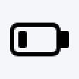

# Anteprime dei componenti — pocket-guard

**13 componenti associati**, dal solo catalogo Design-App; l'associazione non prova che il componente sia integrato nell'app.

[Tutte le app](./README.md) · [Catalogo completo](../TABELLA_478.md) · [Vista con filtro app](../../docs/componenti.html?app=pocket-guard)

Le immagini qui mostrate sono catture documentali, **non** una verifica di riuso Flutter, compatibilità nativa o licenze degli asset di terzi. In assenza di una PNG realmente acquisita la cella dichiara «Non disponibile» e punta alla fonte originale. Le colonne Codice originale e Codice Flutter sono INDIPENDENTI; una variante Dart non implica test su app consumer.

| Anteprima | UID | ID canonico | Componente | Fonte | Categoria | App associate | Codice originale | Codice Flutter |
|---|---|---|---|---|---|---|---|---|
|  | <code>UID-0010</code> | <code>DBM-005</code> | Face Id Scan | <a href="https://github.com/riccardopinato/Design-App/blob/main/BIBLIOTECA_COMPONENTI/sorgenti/amicro/dbm-005.tsx" target="_blank" rel="noopener noreferrer">DEVLIBRARIES_BOOKMARKS</a> | BIOMETRIC_STATUS_VISUAL_ONLY | anna-s-diary, pocket-guard, tabletop-motion-alarm | <a href="../../BIBLIOTECA_COMPONENTI/sorgenti/amicro/dbm-005.tsx" target="_blank" rel="noopener noreferrer">Apri TypeScript/React (source path not necessarily verified)</a> | Da convertire |
|  | <code>UID-0058</code> | <code>ICO-004</code> | Batteria scarica | <a href="https://gentleface.com/icons/battery-low" target="_blank" rel="noopener noreferrer">GENTLEFACE</a> | ICON | battery-guard, pocket-guard | <a href="../../BIBLIOTECA_COMPONENTI/sorgenti/gentleface/ICO-004.svg" target="_blank" rel="noopener noreferrer">Apri SVG (original, archived)</a> | <a href="../../BIBLIOTECA_COMPONENTI/flutter_adapters/lib/src/gentleface/ico_004.dart" target="_blank" rel="noopener noreferrer">Apri codice Flutter (bozza)</a> |
|  | <code>UID-0081</code> | <code>ICO-027</code> | Protezione attiva verificata | <a href="https://gentleface.com/icons/shield-check" target="_blank" rel="noopener noreferrer">GENTLEFACE</a> | ICON | easy-debloat, phone-guard, pocket-guard, tabletop-motion-alarm | <a href="../../BIBLIOTECA_COMPONENTI/sorgenti/gentleface/ICO-027.svg" target="_blank" rel="noopener noreferrer">Apri SVG (original, archived)</a> | <a href="../../BIBLIOTECA_COMPONENTI/flutter_adapters/lib/src/gentleface/ico_027.dart" target="_blank" rel="noopener noreferrer">Apri codice Flutter (bozza)</a> |
|  | <code>UID-0082</code> | <code>ICO-028</code> | Blocco / riservatezza | <a href="https://gentleface.com/icons/lock" target="_blank" rel="noopener noreferrer">GENTLEFACE</a> | ICON | anna-s-diary, notes-ecosistema, pocket-guard, tabletop-motion-alarm | <a href="../../BIBLIOTECA_COMPONENTI/sorgenti/gentleface/ICO-028.svg" target="_blank" rel="noopener noreferrer">Apri SVG (original, archived)</a> | <a href="../../BIBLIOTECA_COMPONENTI/flutter_adapters/lib/src/gentleface/ico_028.dart" target="_blank" rel="noopener noreferrer">Apri codice Flutter (bozza)</a> |
|  | <code>UID-0365</code> | <code>UIV-006</code> | Switch interattivo Uiverse, sorgente HTML/CSS non individuato | <a href="https://uiverse.io/JustCode14/red-dingo-61" target="_blank" rel="noopener noreferrer">UIVERSE</a> | SWITCH | 180flipcharge, annas-diary, battery-guard, easy-debloat, focussense, omni-cleaner, phone-guard, pocket-guard | <a href="../../UI-UX/UIVERSE/CODICE_SORGENTE/UIV-006_original.html" target="_blank" rel="noopener noreferrer">Apri HTML/CSS</a> | Da convertire |
|  | <code>UID-0371</code> | <code>UIV-012</code> | Componente Uiverse nella categoria SWITCH; HTML/CSS originale archiviato con blob SHA. L&#x27;effetto specifico richiede ispezione del sorgente e collaudo visivo. | <a href="https://uiverse.io/Admin12121/massive-dodo-67" target="_blank" rel="noopener noreferrer">UIVERSE</a> | SWITCH | battery-guard, camperboss, easy-debloat, phone-guard, pocket-guard, sleepmax-coach, the-luminous-infinite-circle | <a href="../../UI-UX/UIVERSE/CODICE_SORGENTE/UIV-012_original.html" target="_blank" rel="noopener noreferrer">Apri HTML/CSS</a> | Da convertire |
|  | <code>UID-0386</code> | <code>UIV-027</code> | Componente Uiverse nella categoria SWITCH; HTML/CSS originale archiviato con blob SHA. L&#x27;effetto specifico richiede ispezione del sorgente e collaudo visivo. | <a href="https://uiverse.io/Nawsome/empty-snail-69" target="_blank" rel="noopener noreferrer">UIVERSE</a> | SWITCH | 180flipcharge, annas-diary, battery-guard, focussense, notes-ecosistema, omni-cleaner, pocket-guard | <a href="../../UI-UX/UIVERSE/CODICE_SORGENTE/UIV-027_original.html" target="_blank" rel="noopener noreferrer">Apri HTML/CSS</a> | Da convertire |
|  | <code>UID-0408</code> | <code>UIV-049</code> | Componente Uiverse nella categoria SWITCH; HTML/CSS originale archiviato con blob SHA. L&#x27;effetto specifico richiede ispezione del sorgente e collaudo visivo. | <a href="https://uiverse.io/andrew-demchenk0/honest-stingray-90" target="_blank" rel="noopener noreferrer">UIVERSE</a> | SWITCH | 180flipcharge, annas-diary, battery-guard, easy-debloat, notes-ecosistema, phone-guard, pocket-guard | <a href="../../UI-UX/UIVERSE/CODICE_SORGENTE/UIV-049_original.html" target="_blank" rel="noopener noreferrer">Apri HTML/CSS</a> | Da convertire |
|  | <code>UID-0417</code> | <code>UIV-058</code> | Componente Uiverse nella categoria SWITCH; HTML/CSS originale archiviato con blob SHA. L&#x27;effetto specifico richiede ispezione del sorgente e collaudo visivo. | <a href="https://uiverse.io/cssbuttons-io/mean-dolphin-24" target="_blank" rel="noopener noreferrer">UIVERSE</a> | SWITCH | battery-guard, camperboss, easy-debloat, notes-ecosistema, phone-guard, pocket-guard, sleepmax-coach | <a href="../../UI-UX/UIVERSE/CODICE_SORGENTE/UIV-058_original.html" target="_blank" rel="noopener noreferrer">Apri HTML/CSS</a> | Da convertire |
|  | <code>UID-0430</code> | <code>UIV-071</code> | Componente Uiverse nella categoria SWITCH; HTML/CSS originale archiviato con blob SHA. L&#x27;effetto specifico richiede ispezione del sorgente e collaudo visivo. | <a href="https://uiverse.io/gharsh11032000/sour-vampirebat-66" target="_blank" rel="noopener noreferrer">UIVERSE</a> | SWITCH | battery-guard, camperboss, easy-debloat, notes-ecosistema, phone-guard, pocket-guard, sleepmax-coach | <a href="../../UI-UX/UIVERSE/CODICE_SORGENTE/UIV-071_original.html" target="_blank" rel="noopener noreferrer">Apri HTML/CSS</a> | Da convertire |
|  | <code>UID-0444</code> | <code>UIV-085</code> | Scheda pubblica Uiverse classificata come SWITCH; il codice HTML/CSS non è presente nell&#x27;archivio Galaxy e non è stato acquisito. | <a href="https://uiverse.io/m1her/odd-fireant-56" target="_blank" rel="noopener noreferrer">UIVERSE</a> | SWITCH | battery-guard, camperboss, easy-debloat, notes-ecosistema, phone-guard, pocket-guard, sleepmax-coach | <a href="../../UI-UX/UIVERSE/CODICE_SORGENTE/UIV-085_original.html" target="_blank" rel="noopener noreferrer">Apri HTML/CSS</a> | Da convertire |
|  | <code>UID-0447</code> | <code>UIV-088</code> | Componente Uiverse nella categoria SWITCH; HTML/CSS originale archiviato con blob SHA. L&#x27;effetto specifico richiede ispezione del sorgente e collaudo visivo. | <a href="https://uiverse.io/mobinkakei/great-skunk-8" target="_blank" rel="noopener noreferrer">UIVERSE</a> | SWITCH | 180flipcharge, annas-diary, battery-guard, focussense, notes-ecosistema, omni-cleaner, pocket-guard | <a href="../../UI-UX/UIVERSE/CODICE_SORGENTE/UIV-088_original.html" target="_blank" rel="noopener noreferrer">Apri HTML/CSS</a> | Da convertire |
|  | <code>UID-0449</code> | <code>UIV-090</code> | Componente Uiverse nella categoria SWITCH; HTML/CSS originale archiviato con blob SHA. L&#x27;effetto specifico richiede ispezione del sorgente e collaudo visivo. | <a href="https://uiverse.io/mobinkakei/strong-lizard-79" target="_blank" rel="noopener noreferrer">UIVERSE</a> | SWITCH | battery-guard, camperboss, easy-debloat, phone-guard, pocket-guard, sleepmax-coach, the-luminous-infinite-circle | <a href="../../UI-UX/UIVERSE/CODICE_SORGENTE/UIV-090_original.html" target="_blank" rel="noopener noreferrer">Apri HTML/CSS</a> | Da convertire |
