# Componenti Design-App — tutte le 480 anteprime

**480 componenti canonici · 4 alias · 112 immagini archiviate.**

[Tabelle filtrate per app](./PER_APP/README.md) · [Visualizzatore con lightbox](../docs/componenti.html) (richiede GitHub Pages o un server locale).

Le immagini qui mostrate sono catture documentali, **non** una verifica di riuso Flutter, compatibilità nativa o licenze degli asset di terzi. In assenza di una PNG realmente acquisita la cella dichiara «Non disponibile» e punta alla fonte originale.

| Anteprima | ID | Componente | Fonte | Categoria | App associate | Codice |
|---|---|---|---|---|---|---|
| <small>Non disponibile</small> · <a href="https://github.com/Subhan-code/Amicro--Micro-transitions-/blob/fa5f8ffbe39537a8db191806066b8773c47c82e9/src/components/css-animations/physics/CurtainReveal.tsx" target="_blank" rel="noopener noreferrer">Fonte</a> | <code>AMX-001</code> | CurtainReveal | <a href="https://github.com/Subhan-code/Amicro--Micro-transitions-/blob/fa5f8ffbe39537a8db191806066b8773c47c82e9/src/components/css-animations/physics/CurtainReveal.tsx" target="_blank" rel="noopener noreferrer">DEVLIBRARIES_AMICRO</a> | CONTEXTUAL_CONTENT_REVEAL | anna-s-diary, app-factory-dashboard, cooking-anime, deskland-android, framelab, notes-ecosistema, web-utility-factory, wonderlog, world-days | Sorgente archiviata |
| <small>Non disponibile</small> · <a href="https://github.com/Subhan-code/Amicro--Micro-transitions-/blob/fa5f8ffbe39537a8db191806066b8773c47c82e9/registry/ui/cursor/cursor-trail.tsx" target="_blank" rel="noopener noreferrer">Fonte</a> | <code>AMX-002</code> | Cursor Trail | <a href="https://github.com/Subhan-code/Amicro--Micro-transitions-/blob/fa5f8ffbe39537a8db191806066b8773c47c82e9/registry/ui/cursor/cursor-trail.tsx" target="_blank" rel="noopener noreferrer">DEVLIBRARIES_AMICRO</a> | POINTER_FEEDBACK | app-factory-dashboard, deskland-android, framelab, notes-ecosistema, web-utility-factory | Sorgente archiviata |
| <small>Non disponibile</small> · <a href="https://devlibraries.com/libraries/amicro/perspective-flip" target="_blank" rel="noopener noreferrer">Fonte</a> | <code>AMX-003</code> | Perspective Flip | <a href="https://devlibraries.com/libraries/amicro/perspective-flip" target="_blank" rel="noopener noreferrer">DEVLIBRARIES_AMICRO</a> | UNVERIFIED_CARD_3D_FLIP | anna-s-diary, app-factory-dashboard, beerclass-ai, cooking-anime, edu-01-corpo-umano, notes-ecosistema, wonderlog, world-days | Solo riferimento |
| <small>Non disponibile</small> · <a href="https://github.com/Subhan-code/Amicro--Micro-transitions-/blob/fa5f8ffbe39537a8db191806066b8773c47c82e9/registry/ui/scroll/scroll-reveal.tsx" target="_blank" rel="noopener noreferrer">Fonte</a> | <code>AMX-004</code> | Scroll Reveal | <a href="https://github.com/Subhan-code/Amicro--Micro-transitions-/blob/fa5f8ffbe39537a8db191806066b8773c47c82e9/registry/ui/scroll/scroll-reveal.tsx" target="_blank" rel="noopener noreferrer">DEVLIBRARIES_AMICRO</a> | SCROLL_TRIGGERED_ENTRANCE | anna-s-diary, app-factory-dashboard, battery-guard, beerclass-ai, camperboss, cashmate-ai, cooking-anime, edu-01-corpo-umano, framelab, notes-ecosistema, omni-cleaner, trailpath, web-utility-factory, wonderlog, world-days | Sorgente archiviata |
| <small>Non disponibile</small> · <a href="https://devlibraries.com/libraries/amicro/spatial-door-portal" target="_blank" rel="noopener noreferrer">Fonte</a> | <code>AMX-005</code> | Spatial Door Portal | <a href="https://devlibraries.com/libraries/amicro/spatial-door-portal" target="_blank" rel="noopener noreferrer">DEVLIBRARIES_AMICRO</a> | UNVERIFIED_SPATIAL_PAGE_TRANSITION | anna-s-diary, app-factory-dashboard, cooking-anime, deskland-android, framelab, notes-ecosistema, wonderlog, world-days | Solo riferimento |
| <small>Non disponibile</small> · <a href="https://github.com/Subhan-code/Amicro--Micro-transitions-/blob/fa5f8ffbe39537a8db191806066b8773c47c82e9/registry/ui/loading/accordion-loader.tsx" target="_blank" rel="noopener noreferrer">Fonte</a> | <code>AMX-006</code> | Accordion Loader | <a href="https://github.com/Subhan-code/Amicro--Micro-transitions-/blob/fa5f8ffbe39537a8db191806066b8773c47c82e9/registry/ui/loading/accordion-loader.tsx" target="_blank" rel="noopener noreferrer">DEVLIBRARIES_AMICRO</a> | INDETERMINATE_LOADING | anna-s-diary, app-factory-dashboard, battery-guard, camperboss, cooking-anime, deskland-android, easy-debloat, focussense, framelab, notes-ecosistema, omni-cleaner, send-to-pc, web-utility-factory, wonderlog, world-days | Sorgente archiviata |
| <small>Non disponibile</small> | <code>DBM-002</code> | Classic Spinner | <a href="https://github.com/riccardopinato/Design-App/blob/main/BIBLIOTECA_COMPONENTI/sorgenti/amicro/dbm-002.tsx" target="_blank" rel="noopener noreferrer">DEVLIBRARIES_BOOKMARKS</a> | LOADER_INDETERMINATE | anna-s-diary, cooking-anime, notes-ecosistema, omni-cleaner, world-days | Sorgente archiviata |
| <small>Non disponibile</small> | <code>DBM-003</code> | Pulsating Dots | <a href="https://github.com/riccardopinato/Design-App/blob/main/BIBLIOTECA_COMPONENTI/sorgenti/amicro/dbm-003.tsx" target="_blank" rel="noopener noreferrer">DEVLIBRARIES_BOOKMARKS</a> | LOADER_SUBTLE | anna-s-diary, notes-ecosistema, wonderlog, world-days | Sorgente archiviata |
| <small>Non disponibile</small> | <code>DBM-004</code> | App Icon Load | <a href="https://github.com/riccardopinato/Design-App/blob/main/BIBLIOTECA_COMPONENTI/sorgenti/amicro/dbm-004.tsx" target="_blank" rel="noopener noreferrer">DEVLIBRARIES_BOOKMARKS</a> | APP_STARTUP_LOADING | cooking-anime, deskland-android, omni-cleaner, world-days | Sorgente archiviata |
| <small>Non disponibile</small> | <code>DBM-005</code> | Face Id Scan | <a href="https://github.com/riccardopinato/Design-App/blob/main/BIBLIOTECA_COMPONENTI/sorgenti/amicro/dbm-005.tsx" target="_blank" rel="noopener noreferrer">DEVLIBRARIES_BOOKMARKS</a> | BIOMETRIC_STATUS_VISUAL_ONLY | anna-s-diary, pocket-guard, tabletop-motion-alarm | Sorgente archiviata |
| <small>Non disponibile</small> | <code>DBM-006</code> | Stacked Bar Pulse | <a href="https://github.com/riccardopinato/Design-App/blob/main/BIBLIOTECA_COMPONENTI/sorgenti/amicro/dbm-006.tsx" target="_blank" rel="noopener noreferrer">DEVLIBRARIES_BOOKMARKS</a> | LOADER_SCAN | app-factory-dashboard, battery-guard, omni-cleaner, send-to-pc | Sorgente archiviata |
| <small>Non disponibile</small> | <code>DBM-007</code> | Apple Breathe | <a href="https://github.com/riccardopinato/Design-App/blob/main/BIBLIOTECA_COMPONENTI/sorgenti/amicro/dbm-007.tsx" target="_blank" rel="noopener noreferrer">DEVLIBRARIES_BOOKMARKS</a> | LOADER_CALM | anna-s-diary, notes-ecosistema, sleepmax-coach, wonderlog | Sorgente archiviata |
| <small>Non disponibile</small> | <code>DBM-008</code> | Fade Arc | <a href="https://github.com/riccardopinato/Design-App/blob/main/BIBLIOTECA_COMPONENTI/sorgenti/amicro/dbm-008.tsx" target="_blank" rel="noopener noreferrer">DEVLIBRARIES_BOOKMARKS</a> | LOADER_MINIMAL | anna-s-diary, battery-guard, cooking-anime, world-days | Sorgente archiviata |
| <small>Non disponibile</small> | <code>DBM-009</code> | Terminal Loader | <a href="https://github.com/riccardopinato/Design-App/blob/main/BIBLIOTECA_COMPONENTI/sorgenti/amicro/dbm-009.tsx" target="_blank" rel="noopener noreferrer">DEVLIBRARIES_BOOKMARKS</a> | LOADER_TECHNICAL | app-factory-dashboard, deskland-android, easy-debloat, send-to-pc | Sorgente archiviata |
| <small>Non disponibile</small> | <code>DBM-010</code> | Apple Pulse Dots | <a href="https://github.com/riccardopinato/Design-App/blob/main/BIBLIOTECA_COMPONENTI/sorgenti/amicro/dbm-010.tsx" target="_blank" rel="noopener noreferrer">DEVLIBRARIES_BOOKMARKS</a> | LOADER_SUBTLE | anna-s-diary, notes-ecosistema, sleepmax-coach, world-days | Sorgente archiviata |
| <small>Non disponibile</small> | <code>DBM-011</code> | Morph Loader | <a href="https://github.com/riccardopinato/Design-App/blob/main/BIBLIOTECA_COMPONENTI/sorgenti/amicro/dbm-011.tsx" target="_blank" rel="noopener noreferrer">DEVLIBRARIES_BOOKMARKS</a> | LOADER_PLAYFUL | cooking-anime, framelab, notes-ecosistema, wonderlog | Sorgente archiviata |
| <small>Non disponibile</small> | <code>DBM-012</code> | Grid Dots | <a href="https://github.com/riccardopinato/Design-App/blob/main/BIBLIOTECA_COMPONENTI/sorgenti/amicro/dbm-012.tsx" target="_blank" rel="noopener noreferrer">DEVLIBRARIES_BOOKMARKS</a> | LOADER_TECHNICAL | app-factory-dashboard, deskland-android, omni-cleaner | Sorgente archiviata |
| <small>Non disponibile</small> | <code>DBM-013</code> | Clock Spinner | <a href="https://github.com/riccardopinato/Design-App/blob/main/BIBLIOTECA_COMPONENTI/sorgenti/amicro/dbm-013.tsx" target="_blank" rel="noopener noreferrer">DEVLIBRARIES_BOOKMARKS</a> | LOADER_TIME_RELATED | cooking-anime, sleepmax-coach, tabletop-motion-alarm | Sorgente archiviata |
| <small>Non disponibile</small> | <code>DBM-014</code> | Circular Bars | <a href="https://github.com/riccardopinato/Design-App/blob/main/BIBLIOTECA_COMPONENTI/sorgenti/amicro/dbm-014.tsx" target="_blank" rel="noopener noreferrer">DEVLIBRARIES_BOOKMARKS</a> | LOADER_DIAGNOSTICS | app-factory-dashboard, battery-guard, focussense, omni-cleaner | Sorgente archiviata |
| <small>Non disponibile</small> | <code>DBM-015</code> | Intersecting Rings | <a href="https://github.com/riccardopinato/Design-App/blob/main/BIBLIOTECA_COMPONENTI/sorgenti/amicro/dbm-015.tsx" target="_blank" rel="noopener noreferrer">DEVLIBRARIES_BOOKMARKS</a> | LOADER_SYNC | anna-s-diary, notes-ecosistema, send-to-pc, world-days | Sorgente archiviata |
| <small>Non disponibile</small> | <code>DBM-016</code> | Skeleton | <a href="https://github.com/riccardopinato/Design-App/blob/main/BIBLIOTECA_COMPONENTI/sorgenti/amicro/dbm-016.tsx" target="_blank" rel="noopener noreferrer">DEVLIBRARIES_BOOKMARKS</a> | CONTENT_PLACEHOLDER | anna-s-diary, app-factory-dashboard, cooking-anime, notes-ecosistema, world-days | Sorgente archiviata |
| <small>Non disponibile</small> | <code>DBM-017</code> | Concentric Ring | <a href="https://github.com/riccardopinato/Design-App/blob/main/BIBLIOTECA_COMPONENTI/sorgenti/amicro/dbm-017.tsx" target="_blank" rel="noopener noreferrer">DEVLIBRARIES_BOOKMARKS</a> | LOADER_RINGS | battery-guard, deskland-android, focussense, the-luminous-infinite-circle | Sorgente archiviata |
| <small>Non disponibile</small> | <code>DBM-019</code> | Bar Cascade | <a href="https://github.com/riccardopinato/Design-App/blob/main/BIBLIOTECA_COMPONENTI/sorgenti/amicro/dbm-019.tsx" target="_blank" rel="noopener noreferrer">DEVLIBRARIES_BOOKMARKS</a> | LOADER_BAR | app-factory-dashboard, focussense, omni-cleaner, send-to-pc | Sorgente archiviata |
| <small>Non disponibile</small> | <code>DBM-020</code> | Concentric Squares | <a href="https://github.com/riccardopinato/Design-App/blob/main/BIBLIOTECA_COMPONENTI/sorgenti/amicro/dbm-020.tsx" target="_blank" rel="noopener noreferrer">DEVLIBRARIES_BOOKMARKS</a> | LOADER_GEOMETRIC | app-factory-dashboard, cooking-anime, deskland-android, omni-cleaner | Sorgente archiviata |
| <small>Non disponibile</small> | <code>DBM-022</code> | Bar Sweep | <a href="https://github.com/riccardopinato/Design-App/blob/main/BIBLIOTECA_COMPONENTI/sorgenti/amicro/dbm-022.tsx" target="_blank" rel="noopener noreferrer">DEVLIBRARIES_BOOKMARKS</a> | LOADER_BAR | battery-guard, omni-cleaner, send-to-pc, world-days | Sorgente archiviata |
| <small>Non disponibile</small> | <code>DBM-023</code> | Conveyor Loop | <a href="https://github.com/riccardopinato/Design-App/blob/main/BIBLIOTECA_COMPONENTI/sorgenti/amicro/dbm-023.tsx" target="_blank" rel="noopener noreferrer">DEVLIBRARIES_BOOKMARKS</a> | LOADER_TRANSFER | app-factory-dashboard, notes-ecosistema, omni-cleaner, send-to-pc | Sorgente archiviata |
| <small>Non disponibile</small> | <code>DBM-024</code> | View On Map | <a href="https://github.com/riccardopinato/Design-App/blob/main/BIBLIOTECA_COMPONENTI/sorgenti/watermelon/dbm-024.tsx" target="_blank" rel="noopener noreferrer">DEVLIBRARIES_BOOKMARKS</a> | MAP_PREVIEW_OVERLAY | anna-s-diary, camperboss, trailpath, wonderlog, world-days | Sorgente archiviata |
| <small>Non disponibile</small> | <code>DBM-025</code> | Bouncing Lines | <a href="https://github.com/riccardopinato/Design-App/blob/main/BIBLIOTECA_COMPONENTI/sorgenti/amicro/dbm-025.tsx" target="_blank" rel="noopener noreferrer">DEVLIBRARIES_BOOKMARKS</a> | LOADER_PLAYFUL | anna-s-diary, cooking-anime, sleepmax-coach, world-days | Sorgente archiviata |
| <small>Non disponibile</small> | <code>DBM-026</code> | Newtons Cradle | <a href="https://github.com/riccardopinato/Design-App/blob/main/BIBLIOTECA_COMPONENTI/sorgenti/amicro/dbm-026.tsx" target="_blank" rel="noopener noreferrer">DEVLIBRARIES_BOOKMARKS</a> | LOADER_PHYSICS | app-factory-dashboard, cooking-anime, focussense, omni-cleaner | Sorgente archiviata |
| <small>Non disponibile</small> | <code>DBM-027</code> | Helix Spinner | DEVLIBRARIES_BOOKMARKS | UNVERIFIED_LOADER_VISUAL | cooking-anime, framelab, omni-cleaner | Solo riferimento |
| <small>Non disponibile</small> | <code>DBM-028</code> | Loader | DEVLIBRARIES_BOOKMARKS | UNVERIFIED_LOADER_COLLECTION | app-factory-dashboard, notes-ecosistema, omni-cleaner | Solo riferimento |
| <small>Non disponibile</small> | <code>DBM-029</code> | Particle Shape Morph | DEVLIBRARIES_BOOKMARKS | UNVERIFIED_PARTICLE_VISUAL | cooking-anime, deskland-android, framelab, notes-ecosistema | Solo riferimento |
| <small>Non disponibile</small> | <code>DBM-030</code> | Infinite Spiral | DEVLIBRARIES_BOOKMARKS | UNVERIFIED_MEDIA_VISUAL | cooking-anime, deskland-android, framelab, wonderlog | Solo riferimento |
| <small>Non disponibile</small> · <a href="https://devlibraries.com/libraries/easeui" target="_blank" rel="noopener noreferrer">Fonte</a> | <code>DSP-001</code> | EaseUI Theme Toggle | <a href="https://devlibraries.com/libraries/easeui" target="_blank" rel="noopener noreferrer">DEVLIBRARIES_EASEUI</a> | THEME_LIGHT_DARK | anna-s-diary, app-factory-dashboard, battery-guard, beerclass-ai, camperboss, cashmate-ai, cooking-anime, deskland-android, easy-debloat, focussense, framelab, notes-ecosistema, omni-cleaner, sleepmax-coach, trailpath, web-utility-factory, wonderlog, world-days | Sorgente archiviata |
| <small>Non disponibile</small> · <a href="https://devlibraries.com/libraries/amicro/card-stack-peel" target="_blank" rel="noopener noreferrer">Fonte</a> | <code>DSP-002</code> | Card Stack Peel | <a href="https://devlibraries.com/libraries/amicro/card-stack-peel" target="_blank" rel="noopener noreferrer">DEVLIBRARIES_AMICRO</a> | SECTION_CARD_TRANSITION | anna-s-diary, app-factory-dashboard, beerclass-ai, cooking-anime, framelab, notes-ecosistema, omni-cleaner, wonderlog, world-days | Sorgente archiviata |
| <small>Non disponibile</small> · <a href="https://devlibraries.com/libraries/amicro" target="_blank" rel="noopener noreferrer">Fonte</a> | <code>DSP-003</code> | Accordion Blind Pull | <a href="https://devlibraries.com/libraries/amicro" target="_blank" rel="noopener noreferrer">DEVLIBRARIES_AMICRO</a> | EXPANDABLE_PANEL_TRANSITION | anna-s-diary, app-factory-dashboard, battery-guard, beerclass-ai, camperboss, cashmate-ai, cooking-anime, easy-debloat, notes-ecosistema, omni-cleaner, trailpath, wonderlog, world-days | Sorgente archiviata |
| <small>Non disponibile</small> · <a href="https://devlibraries.com/libraries/amicro" target="_blank" rel="noopener noreferrer">Fonte</a> | <code>DSP-004</code> | Interlocking Gear Step | <a href="https://devlibraries.com/libraries/amicro" target="_blank" rel="noopener noreferrer">DEVLIBRARIES_AMICRO</a> | REAL_PROCESS_LOADING | app-factory-dashboard, battery-guard, easy-debloat, focussense, framelab, notes-ecosistema, omni-cleaner, send-to-pc, world-days | Sorgente archiviata |
| <small>Non disponibile</small> · <a href="https://devlibraries.com/libraries/amicro" target="_blank" rel="noopener noreferrer">Fonte</a> | <code>DSP-005</code> | Shutter Step Slices | <a href="https://devlibraries.com/libraries/amicro" target="_blank" rel="noopener noreferrer">DEVLIBRARIES_AMICRO</a> | STAGGERED_REVEAL | anna-s-diary, app-factory-dashboard, camperboss, cooking-anime, deskland-android, framelab, notes-ecosistema, omni-cleaner, wonderlog, world-days | Sorgente archiviata |
| <small>Non disponibile</small> | <code>DSP-006</code> | Loading &amp; Waiting Visual References (user screenshot) | USER_IMAGE | LOADING_WAIT_STATE_REFERENCE | anna-s-diary, app-factory-dashboard, battery-guard, camperboss, cashmate-ai, cooking-anime, deskland-android, easy-debloat, focussense, framelab, notes-ecosistema, omni-cleaner, send-to-pc, trailpath, web-utility-factory, wonderlog, world-days | Solo riferimento |
| <small>Non disponibile</small> · <a href="https://fluttercomponentlibrary.com/pages/components/docking-bar.html" target="_blank" rel="noopener noreferrer">Fonte</a> | <code>FCL-001</code> | Docking Bar | <a href="https://fluttercomponentlibrary.com/pages/components/docking-bar.html" target="_blank" rel="noopener noreferrer">FLUTTER_COMPONENT_LIBRARY</a> | navigation | annas-diary, framelab | Solo riferimento |
| <small>Non disponibile</small> · <a href="https://fluttercomponentlibrary.com/pages/components/custom-buttons.html" target="_blank" rel="noopener noreferrer">Fonte</a> | <code>FCL-002</code> | Custom Buttons | <a href="https://fluttercomponentlibrary.com/pages/components/custom-buttons.html" target="_blank" rel="noopener noreferrer">FLUTTER_COMPONENT_LIBRARY</a> | buttons | framelab | Solo riferimento |
| <small>Non disponibile</small> · <a href="https://fluttercomponentlibrary.com/pages/components/filter-button.html" target="_blank" rel="noopener noreferrer">Fonte</a> | <code>FCL-003</code> | Filter Button | <a href="https://fluttercomponentlibrary.com/pages/components/filter-button.html" target="_blank" rel="noopener noreferrer">FLUTTER_COMPONENT_LIBRARY</a> | buttons | notes-ecosistema, world-days | Solo riferimento |
| <small>Non disponibile</small> · <a href="https://fluttercomponentlibrary.com/pages/components/banner-info.html" target="_blank" rel="noopener noreferrer">Fonte</a> | <code>FCL-004</code> | Banner Info | <a href="https://fluttercomponentlibrary.com/pages/components/banner-info.html" target="_blank" rel="noopener noreferrer">FLUTTER_COMPONENT_LIBRARY</a> | cards | battery-guard, world-days | Solo riferimento |
| <small>Non disponibile</small> · <a href="https://fluttercomponentlibrary.com/pages/components/bottom-sheet.html" target="_blank" rel="noopener noreferrer">Fonte</a> | <code>FCL-005</code> | Bottom Sheet | <a href="https://fluttercomponentlibrary.com/pages/components/bottom-sheet.html" target="_blank" rel="noopener noreferrer">FLUTTER_COMPONENT_LIBRARY</a> | dialogs | annas-diary, battery-guard, camperboss, framelab, notes-ecosistema | Solo riferimento |
| <small>Non disponibile</small> · <a href="https://fluttercomponentlibrary.com/pages/components/book-shelf.html" target="_blank" rel="noopener noreferrer">Fonte</a> | <code>FCL-006</code> | Book Shelf | <a href="https://fluttercomponentlibrary.com/pages/components/book-shelf.html" target="_blank" rel="noopener noreferrer">FLUTTER_COMPONENT_LIBRARY</a> | animation | annas-diary | Solo riferimento |
| <small>Non disponibile</small> · <a href="https://fluttercomponentlibrary.com/pages/components/slide-to-act.html" target="_blank" rel="noopener noreferrer">Fonte</a> | <code>FCL-007</code> | Slide To Act | <a href="https://fluttercomponentlibrary.com/pages/components/slide-to-act.html" target="_blank" rel="noopener noreferrer">FLUTTER_COMPONENT_LIBRARY</a> | buttons | Non assegnato | Solo riferimento |
| <small>Non disponibile</small> · <a href="https://fluttercomponentlibrary.com/pages/components/faq-widget.html" target="_blank" rel="noopener noreferrer">Fonte</a> | <code>FCL-008</code> | FAQ Widget | <a href="https://fluttercomponentlibrary.com/pages/components/faq-widget.html" target="_blank" rel="noopener noreferrer">FLUTTER_COMPONENT_LIBRARY</a> | other | camperboss, world-days | Solo riferimento |
| <small>Non disponibile</small> · <a href="https://fluttercomponentlibrary.com/pages/components/stepper.html" target="_blank" rel="noopener noreferrer">Fonte</a> | <code>FCL-009</code> | Stepper | <a href="https://fluttercomponentlibrary.com/pages/components/stepper.html" target="_blank" rel="noopener noreferrer">FLUTTER_COMPONENT_LIBRARY</a> | other | camperboss | Solo riferimento |
| <small>Non disponibile</small> · <a href="https://fluttercomponentlibrary.com/pages/components/slider.html" target="_blank" rel="noopener noreferrer">Fonte</a> | <code>FCL-010</code> | Slider | <a href="https://fluttercomponentlibrary.com/pages/components/slider.html" target="_blank" rel="noopener noreferrer">FLUTTER_COMPONENT_LIBRARY</a> | sliders | battery-guard | Solo riferimento |
| <small>Non disponibile</small> · <a href="https://fluttercomponentlibrary.com/pages/components/plan-card.html" target="_blank" rel="noopener noreferrer">Fonte</a> | <code>FCL-011</code> | Plan Card | <a href="https://fluttercomponentlibrary.com/pages/components/plan-card.html" target="_blank" rel="noopener noreferrer">FLUTTER_COMPONENT_LIBRARY</a> | cards | Non assegnato | Solo riferimento |
| <small>Non disponibile</small> · <a href="https://fluttercomponentlibrary.com/pages/components/scratcher.html" target="_blank" rel="noopener noreferrer">Fonte</a> | <code>FCL-012</code> | Scratcher | <a href="https://fluttercomponentlibrary.com/pages/components/scratcher.html" target="_blank" rel="noopener noreferrer">FLUTTER_COMPONENT_LIBRARY</a> | animation | Non assegnato | Solo riferimento |
| <small>Non disponibile</small> · <a href="https://fluttercomponentlibrary.com/pages/components/page-flipper.html" target="_blank" rel="noopener noreferrer">Fonte</a> | <code>FCL-013</code> | Page Flipper | <a href="https://fluttercomponentlibrary.com/pages/components/page-flipper.html" target="_blank" rel="noopener noreferrer">FLUTTER_COMPONENT_LIBRARY</a> | animation | Non assegnato | Solo riferimento |
| <small>Non disponibile</small> · <a href="https://fluttercomponentlibrary.com/pages/components/drawer.html" target="_blank" rel="noopener noreferrer">Fonte</a> | <code>FCL-014</code> | Drawer | <a href="https://fluttercomponentlibrary.com/pages/components/drawer.html" target="_blank" rel="noopener noreferrer">FLUTTER_COMPONENT_LIBRARY</a> | navigation | notes-ecosistema | Solo riferimento |
| <small>Non disponibile</small> · <a href="https://fluttercomponentlibrary.com/pages/components/draggable-fab.html" target="_blank" rel="noopener noreferrer">Fonte</a> | <code>FCL-015</code> | Draggable FAB | <a href="https://fluttercomponentlibrary.com/pages/components/draggable-fab.html" target="_blank" rel="noopener noreferrer">FLUTTER_COMPONENT_LIBRARY</a> | buttons | Non assegnato | Solo riferimento |
| <a href="../docs/assets/componenti/FUI-001.png">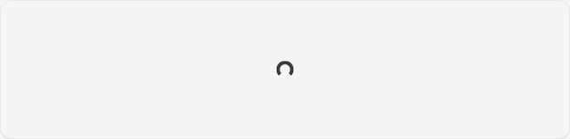</a> | <code>FUI-001</code> | Forui FButton — varianti primary, secondary, destructive, ghost, outline | <a href="https://github.com/duobaseio/forui/blob/5dbf97c926a53fcfe3436db1be6262ac40961db5/forui/lib/src/widgets/button/button.dart" target="_blank" rel="noopener noreferrer">FLUTTER_FORUI</a> | BUTTON | Non assegnato | Sorgente archiviata |
| <a href="../docs/assets/componenti/FUI-002.png">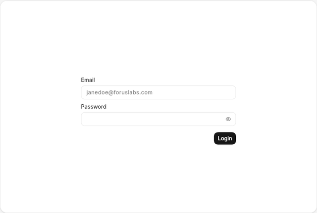</a> | <code>FUI-002</code> | Forui Login Form — email/username + password + submit (demo) | <a href="https://github.com/duobaseio/forui/blob/5dbf97c926a53fcfe3436db1be6262ac40961db5/docs_snippets/lib/examples/form/text_form_field.dart" target="_blank" rel="noopener noreferrer">FLUTTER_FORUI</a> | AUTH_FORM_SAMPLE | Non assegnato | Sorgente archiviata |
| <small>Non disponibile</small> · <a href="https://gentleface.com/icons/bell-ring" target="_blank" rel="noopener noreferrer">Fonte</a> | <code>ICO-001</code> | Icona notifica / promemoria | <a href="https://gentleface.com/icons/bell-ring" target="_blank" rel="noopener noreferrer">GENTLEFACE</a> | ICON | anna-s-diary, battery-guard, sleepmax-coach, the-luminous-infinite-circle, world-days | Solo riferimento |
| <small>Non disponibile</small> · <a href="https://gentleface.com/icons/calendar" target="_blank" rel="noopener noreferrer">Fonte</a> | <code>ICO-002</code> | Vista calendario | <a href="https://gentleface.com/icons/calendar" target="_blank" rel="noopener noreferrer">GENTLEFACE</a> | ICON | anna-s-diary, camperboss, sleepmax-coach, wonderlog, world-days | Solo riferimento |
| <small>Non disponibile</small> · <a href="https://gentleface.com/icons/battery-charging" target="_blank" rel="noopener noreferrer">Fonte</a> | <code>ICO-003</code> | Batteria in carica | <a href="https://gentleface.com/icons/battery-charging" target="_blank" rel="noopener noreferrer">GENTLEFACE</a> | ICON | 180flipcharge, battery-guard, deskland-android | Solo riferimento |
| <small>Non disponibile</small> · <a href="https://gentleface.com/icons/battery-low" target="_blank" rel="noopener noreferrer">Fonte</a> | <code>ICO-004</code> | Batteria scarica | <a href="https://gentleface.com/icons/battery-low" target="_blank" rel="noopener noreferrer">GENTLEFACE</a> | ICON | battery-guard, pocket-guard | Solo riferimento |
| <small>Non disponibile</small> · <a href="https://gentleface.com/icons/download" target="_blank" rel="noopener noreferrer">Fonte</a> | <code>ICO-005</code> | Download dati / file | <a href="https://gentleface.com/icons/download" target="_blank" rel="noopener noreferrer">GENTLEFACE</a> | ICON | camperboss, notes-ecosistema, omni-cleaner, wonderlog, world-days | Solo riferimento |
| <small>Non disponibile</small> · <a href="https://gentleface.com/icons/export" target="_blank" rel="noopener noreferrer">Fonte</a> | <code>ICO-006</code> | Esporta | <a href="https://gentleface.com/icons/export" target="_blank" rel="noopener noreferrer">GENTLEFACE</a> | ICON | framelab, notes-ecosistema, wonderlog, world-days | Solo riferimento |
| <small>Non disponibile</small> · <a href="https://gentleface.com/icons/import" target="_blank" rel="noopener noreferrer">Fonte</a> | <code>ICO-007</code> | Importa | <a href="https://gentleface.com/icons/import" target="_blank" rel="noopener noreferrer">GENTLEFACE</a> | ICON | anna-s-diary, camperboss, notes-ecosistema, wonderlog | Solo riferimento |
| <small>Non disponibile</small> · <a href="https://gentleface.com/icons/images" target="_blank" rel="noopener noreferrer">Fonte</a> | <code>ICO-008</code> | Galleria immagini | <a href="https://gentleface.com/icons/images" target="_blank" rel="noopener noreferrer">GENTLEFACE</a> | ICON | anna-s-diary, framelab, notes-ecosistema, omni-cleaner, wonderlog | Solo riferimento |
| <small>Non disponibile</small> · <a href="https://gentleface.com/icons/video" target="_blank" rel="noopener noreferrer">Fonte</a> | <code>ICO-009</code> | Video / media | <a href="https://gentleface.com/icons/video" target="_blank" rel="noopener noreferrer">GENTLEFACE</a> | ICON | cooking-anime, framelab, omni-cleaner, wonderlog | Solo riferimento |
| <small>Non disponibile</small> · <a href="https://gentleface.com/icons/bookmark" target="_blank" rel="noopener noreferrer">Fonte</a> | <code>ICO-010</code> | Salva nei preferiti | <a href="https://gentleface.com/icons/bookmark" target="_blank" rel="noopener noreferrer">GENTLEFACE</a> | ICON | anna-s-diary, notes-ecosistema, wonderlog, world-days | Solo riferimento |
| <small>Non disponibile</small> · <a href="https://gentleface.com/icons/search" target="_blank" rel="noopener noreferrer">Fonte</a> | <code>ICO-011</code> | Ricerca | <a href="https://gentleface.com/icons/search" target="_blank" rel="noopener noreferrer">GENTLEFACE</a> | ICON | app-factory-dashboard, notes-ecosistema, omni-cleaner, wonderlog, world-days | Solo riferimento |
| <small>Non disponibile</small> · <a href="https://gentleface.com/icons/apps-sparkle" target="_blank" rel="noopener noreferrer">Fonte</a> | <code>ICO-012</code> | App / nuove funzionalità | <a href="https://gentleface.com/icons/apps-sparkle" target="_blank" rel="noopener noreferrer">GENTLEFACE</a> | ICON | app-factory-dashboard, cooking-anime, notes-ecosistema | Solo riferimento |
| <small>Non disponibile</small> · <a href="https://gentleface.com/icons/loader" target="_blank" rel="noopener noreferrer">Fonte</a> | <code>ICO-013</code> | Attività in corso | <a href="https://gentleface.com/icons/loader" target="_blank" rel="noopener noreferrer">GENTLEFACE</a> | ICON | battery-guard, notes-ecosistema, omni-cleaner, send-to-pc, world-days | Solo riferimento |
| <small>Non disponibile</small> · <a href="https://gentleface.com/icons/check" target="_blank" rel="noopener noreferrer">Fonte</a> | <code>ICO-014</code> | Completato | <a href="https://gentleface.com/icons/check" target="_blank" rel="noopener noreferrer">GENTLEFACE</a> | ICON | anna-s-diary, app-factory-dashboard, notes-ecosistema, omni-cleaner, world-days | Solo riferimento |
| <small>Non disponibile</small> · <a href="https://gentleface.com/icons/heart-pulse" target="_blank" rel="noopener noreferrer">Fonte</a> | <code>ICO-015</code> | Salute / frequenza o vitalità | <a href="https://gentleface.com/icons/heart-pulse" target="_blank" rel="noopener noreferrer">GENTLEFACE</a> | ICON | edu-01-corpo-umano, focussense, sleepmax-coach | Solo riferimento |
| <small>Non disponibile</small> · <a href="https://gentleface.com/icons/map-pin" target="_blank" rel="noopener noreferrer">Fonte</a> | <code>ICO-016</code> | Punto mappa | <a href="https://gentleface.com/icons/map-pin" target="_blank" rel="noopener noreferrer">GENTLEFACE</a> | ICON | camperboss, trailpath, wonderlog, world-days | Solo riferimento |
| <small>Non disponibile</small> · <a href="https://gentleface.com/icons/cloud" target="_blank" rel="noopener noreferrer">Fonte</a> | <code>ICO-017</code> | Stato cloud/sync | <a href="https://gentleface.com/icons/cloud" target="_blank" rel="noopener noreferrer">GENTLEFACE</a> | ICON | anna-s-diary, cashmate-ai, notes-ecosistema, world-days | Solo riferimento |
| <small>Non disponibile</small> · <a href="https://gentleface.com/icons/gauge" target="_blank" rel="noopener noreferrer">Fonte</a> | <code>ICO-018</code> | Indicatore / metriche | <a href="https://gentleface.com/icons/gauge" target="_blank" rel="noopener noreferrer">GENTLEFACE</a> | ICON | app-factory-dashboard, battery-guard, camperboss, cashmate-ai, focussense | Solo riferimento |
| <small>Non disponibile</small> · <a href="https://gentleface.com/icons/star" target="_blank" rel="noopener noreferrer">Fonte</a> | <code>ICO-019</code> | Valutazione / preferito | <a href="https://gentleface.com/icons/star" target="_blank" rel="noopener noreferrer">GENTLEFACE</a> | ICON | beerclass-ai, cooking-anime, wonderlog, world-days | Solo riferimento |
| <small>Non disponibile</small> · <a href="https://gentleface.com/icons/play" target="_blank" rel="noopener noreferrer">Fonte</a> | <code>ICO-020</code> | Riproduci | <a href="https://gentleface.com/icons/play" target="_blank" rel="noopener noreferrer">GENTLEFACE</a> | ICON | cooking-anime, deskland-android, framelab, omni-cleaner | Solo riferimento |
| <small>Non disponibile</small> · <a href="https://gentleface.com/icons/pause" target="_blank" rel="noopener noreferrer">Fonte</a> | <code>ICO-021</code> | Pausa | <a href="https://gentleface.com/icons/pause" target="_blank" rel="noopener noreferrer">GENTLEFACE</a> | ICON | cooking-anime, deskland-android, framelab, omni-cleaner | Solo riferimento |
| <small>Non disponibile</small> · <a href="https://gentleface.com/icons/repeat" target="_blank" rel="noopener noreferrer">Fonte</a> | <code>ICO-022</code> | Ripeti / loop | <a href="https://gentleface.com/icons/repeat" target="_blank" rel="noopener noreferrer">GENTLEFACE</a> | ICON | notes-ecosistema, omni-cleaner, sleepmax-coach, wonderlog | Solo riferimento |
| <small>Non disponibile</small> · <a href="https://gentleface.com/icons/eye" target="_blank" rel="noopener noreferrer">Fonte</a> | <code>ICO-023</code> | Visibilità / anteprima | <a href="https://gentleface.com/icons/eye" target="_blank" rel="noopener noreferrer">GENTLEFACE</a> | ICON | anna-s-diary, easy-debloat, notes-ecosistema, omni-cleaner | Solo riferimento |
| <small>Non disponibile</small> · <a href="https://gentleface.com/icons/archive" target="_blank" rel="noopener noreferrer">Fonte</a> | <code>ICO-024</code> | Archiviazione | <a href="https://gentleface.com/icons/archive" target="_blank" rel="noopener noreferrer">GENTLEFACE</a> | ICON | anna-s-diary, notes-ecosistema, world-days | Solo riferimento |
| <small>Non disponibile</small> · <a href="https://gentleface.com/icons/messages" target="_blank" rel="noopener noreferrer">Fonte</a> | <code>ICO-025</code> | Messaggi / conversazioni | <a href="https://gentleface.com/icons/messages" target="_blank" rel="noopener noreferrer">GENTLEFACE</a> | ICON | anna-s-diary, notes-ecosistema, send-to-pc, wonderlog | Solo riferimento |
| <small>Non disponibile</small> · <a href="https://gentleface.com/icons/home" target="_blank" rel="noopener noreferrer">Fonte</a> | <code>ICO-026</code> | Pagina iniziale | <a href="https://gentleface.com/icons/home" target="_blank" rel="noopener noreferrer">GENTLEFACE</a> | ICON | anna-s-diary, deskland-android, wonderlog, world-days | Solo riferimento |
| <small>Non disponibile</small> · <a href="https://gentleface.com/icons/shield-check" target="_blank" rel="noopener noreferrer">Fonte</a> | <code>ICO-027</code> | Protezione attiva verificata | <a href="https://gentleface.com/icons/shield-check" target="_blank" rel="noopener noreferrer">GENTLEFACE</a> | ICON | easy-debloat, phone-guard, pocket-guard, tabletop-motion-alarm | Solo riferimento |
| <small>Non disponibile</small> · <a href="https://gentleface.com/icons/lock" target="_blank" rel="noopener noreferrer">Fonte</a> | <code>ICO-028</code> | Blocco / riservatezza | <a href="https://gentleface.com/icons/lock" target="_blank" rel="noopener noreferrer">GENTLEFACE</a> | ICON | anna-s-diary, notes-ecosistema, pocket-guard, tabletop-motion-alarm | Solo riferimento |
| <small>Non disponibile</small> · <a href="https://github.com/ruixenui/ruixen.com/blob/f6b20860623fa39122ac2b5f0e5bd29a9eb10941/registry/ruixenui/accordion-editorial.tsx" target="_blank" rel="noopener noreferrer">Fonte</a> | <code>RXN-accordion-editorial</code> | accordion editorial | <a href="https://github.com/ruixenui/ruixen.com/blob/f6b20860623fa39122ac2b5f0e5bd29a9eb10941/registry/ruixenui/accordion-editorial.tsx" target="_blank" rel="noopener noreferrer">RUIXEN</a> | surface-control | Non assegnato | Sorgente archiviata |
| <small>Non disponibile</small> · <a href="https://github.com/ruixenui/ruixen.com/blob/f6b20860623fa39122ac2b5f0e5bd29a9eb10941/registry/ruixenui/accordion-indexed.tsx" target="_blank" rel="noopener noreferrer">Fonte</a> | <code>RXN-accordion-indexed</code> | accordion indexed | <a href="https://github.com/ruixenui/ruixen.com/blob/f6b20860623fa39122ac2b5f0e5bd29a9eb10941/registry/ruixenui/accordion-indexed.tsx" target="_blank" rel="noopener noreferrer">RUIXEN</a> | surface-control | Non assegnato | Sorgente archiviata |
| <small>Non disponibile</small> · <a href="https://github.com/ruixenui/ruixen.com/blob/f6b20860623fa39122ac2b5f0e5bd29a9eb10941/registry/ruixenui/account-menu.tsx" target="_blank" rel="noopener noreferrer">Fonte</a> | <code>RXN-account-menu</code> | account menu | <a href="https://github.com/ruixenui/ruixen.com/blob/f6b20860623fa39122ac2b5f0e5bd29a9eb10941/registry/ruixenui/account-menu.tsx" target="_blank" rel="noopener noreferrer">RUIXEN</a> | navigation | Non assegnato | Sorgente archiviata |
| <small>Non disponibile</small> · <a href="https://github.com/ruixenui/ruixen.com/blob/f6b20860623fa39122ac2b5f0e5bd29a9eb10941/registry/ruixenui/action-toolbar.tsx" target="_blank" rel="noopener noreferrer">Fonte</a> | <code>RXN-action-toolbar</code> | action toolbar | <a href="https://github.com/ruixenui/ruixen.com/blob/f6b20860623fa39122ac2b5f0e5bd29a9eb10941/registry/ruixenui/action-toolbar.tsx" target="_blank" rel="noopener noreferrer">RUIXEN</a> | misc | Non assegnato | Sorgente archiviata |
| <small>Non disponibile</small> · <a href="https://github.com/ruixenui/ruixen.com/blob/f6b20860623fa39122ac2b5f0e5bd29a9eb10941/registry/ruixenui/add-task-sheet.tsx" target="_blank" rel="noopener noreferrer">Fonte</a> | <code>RXN-add-task-sheet</code> | add task sheet | <a href="https://github.com/ruixenui/ruixen.com/blob/f6b20860623fa39122ac2b5f0e5bd29a9eb10941/registry/ruixenui/add-task-sheet.tsx" target="_blank" rel="noopener noreferrer">RUIXEN</a> | data-workflow | Non assegnato | Sorgente archiviata |
| <small>Non disponibile</small> · <a href="https://github.com/ruixenui/ruixen.com/blob/f6b20860623fa39122ac2b5f0e5bd29a9eb10941/registry/ruixenui/add-to-cart-button.tsx" target="_blank" rel="noopener noreferrer">Fonte</a> | <code>RXN-add-to-cart-button</code> | add to cart button | <a href="https://github.com/ruixenui/ruixen.com/blob/f6b20860623fa39122ac2b5f0e5bd29a9eb10941/registry/ruixenui/add-to-cart-button.tsx" target="_blank" rel="noopener noreferrer">RUIXEN</a> | surface-control | Non assegnato | Sorgente archiviata |
| <small>Non disponibile</small> · <a href="https://github.com/ruixenui/ruixen.com/blob/f6b20860623fa39122ac2b5f0e5bd29a9eb10941/registry/ruixenui/ai-chat-input.tsx" target="_blank" rel="noopener noreferrer">Fonte</a> | <code>RXN-ai-chat-input</code> | ai chat input | <a href="https://github.com/ruixenui/ruixen.com/blob/f6b20860623fa39122ac2b5f0e5bd29a9eb10941/registry/ruixenui/ai-chat-input.tsx" target="_blank" rel="noopener noreferrer">RUIXEN</a> | form-input | Non assegnato | Sorgente archiviata |
| <small>Non disponibile</small> · <a href="https://github.com/ruixenui/ruixen.com/blob/f6b20860623fa39122ac2b5f0e5bd29a9eb10941/registry/ruixenui/animated-beam.tsx" target="_blank" rel="noopener noreferrer">Fonte</a> | <code>RXN-animated-beam</code> | animated beam | <a href="https://github.com/ruixenui/ruixen.com/blob/f6b20860623fa39122ac2b5f0e5bd29a9eb10941/registry/ruixenui/animated-beam.tsx" target="_blank" rel="noopener noreferrer">RUIXEN</a> | motion-effects | Non assegnato | Sorgente archiviata |
| <small>Non disponibile</small> · <a href="https://github.com/ruixenui/ruixen.com/blob/f6b20860623fa39122ac2b5f0e5bd29a9eb10941/registry/ruixenui/animated-circular-progress-bar.tsx" target="_blank" rel="noopener noreferrer">Fonte</a> | <code>RXN-animated-circular-progress-bar</code> | animated circular progress bar | <a href="https://github.com/ruixenui/ruixen.com/blob/f6b20860623fa39122ac2b5f0e5bd29a9eb10941/registry/ruixenui/animated-circular-progress-bar.tsx" target="_blank" rel="noopener noreferrer">RUIXEN</a> | motion-effects | Non assegnato | Sorgente archiviata |
| <small>Non disponibile</small> · <a href="https://github.com/ruixenui/ruixen.com/blob/f6b20860623fa39122ac2b5f0e5bd29a9eb10941/registry/ruixenui/animated-gradient-text.tsx" target="_blank" rel="noopener noreferrer">Fonte</a> | <code>RXN-animated-gradient-text</code> | animated gradient text | <a href="https://github.com/ruixenui/ruixen.com/blob/f6b20860623fa39122ac2b5f0e5bd29a9eb10941/registry/ruixenui/animated-gradient-text.tsx" target="_blank" rel="noopener noreferrer">RUIXEN</a> | motion-effects | Non assegnato | Sorgente archiviata |
| <small>Non disponibile</small> · <a href="https://github.com/ruixenui/ruixen.com/blob/f6b20860623fa39122ac2b5f0e5bd29a9eb10941/registry/ruixenui/animated-grid-pattern.tsx" target="_blank" rel="noopener noreferrer">Fonte</a> | <code>RXN-animated-grid-pattern</code> | animated grid pattern | <a href="https://github.com/ruixenui/ruixen.com/blob/f6b20860623fa39122ac2b5f0e5bd29a9eb10941/registry/ruixenui/animated-grid-pattern.tsx" target="_blank" rel="noopener noreferrer">RUIXEN</a> | motion-effects | Non assegnato | Sorgente archiviata |
| <small>Non disponibile</small> · <a href="https://github.com/ruixenui/ruixen.com/blob/f6b20860623fa39122ac2b5f0e5bd29a9eb10941/registry/ruixenui/animated-highlight-text.tsx" target="_blank" rel="noopener noreferrer">Fonte</a> | <code>RXN-animated-highlight-text</code> | animated highlight text | <a href="https://github.com/ruixenui/ruixen.com/blob/f6b20860623fa39122ac2b5f0e5bd29a9eb10941/registry/ruixenui/animated-highlight-text.tsx" target="_blank" rel="noopener noreferrer">RUIXEN</a> | motion-effects | Non assegnato | Sorgente archiviata |
| <small>Non disponibile</small> · <a href="https://github.com/ruixenui/ruixen.com/blob/f6b20860623fa39122ac2b5f0e5bd29a9eb10941/registry/ruixenui/animated-link.tsx" target="_blank" rel="noopener noreferrer">Fonte</a> | <code>RXN-animated-link</code> | animated link | <a href="https://github.com/ruixenui/ruixen.com/blob/f6b20860623fa39122ac2b5f0e5bd29a9eb10941/registry/ruixenui/animated-link.tsx" target="_blank" rel="noopener noreferrer">RUIXEN</a> | motion-effects | Non assegnato | Sorgente archiviata |
| <small>Non disponibile</small> · <a href="https://github.com/ruixenui/ruixen.com/blob/f6b20860623fa39122ac2b5f0e5bd29a9eb10941/registry/ruixenui/animated-list.tsx" target="_blank" rel="noopener noreferrer">Fonte</a> | <code>RXN-animated-list</code> | animated list | <a href="https://github.com/ruixenui/ruixen.com/blob/f6b20860623fa39122ac2b5f0e5bd29a9eb10941/registry/ruixenui/animated-list.tsx" target="_blank" rel="noopener noreferrer">RUIXEN</a> | motion-effects | Non assegnato | Sorgente archiviata |
| <small>Non disponibile</small> · <a href="https://github.com/ruixenui/ruixen.com/blob/f6b20860623fa39122ac2b5f0e5bd29a9eb10941/registry/ruixenui/animated-number-flip.tsx" target="_blank" rel="noopener noreferrer">Fonte</a> | <code>RXN-animated-number-flip</code> | animated number flip | <a href="https://github.com/ruixenui/ruixen.com/blob/f6b20860623fa39122ac2b5f0e5bd29a9eb10941/registry/ruixenui/animated-number-flip.tsx" target="_blank" rel="noopener noreferrer">RUIXEN</a> | motion-effects | Non assegnato | Sorgente archiviata |
| <small>Non disponibile</small> · <a href="https://github.com/ruixenui/ruixen.com/blob/f6b20860623fa39122ac2b5f0e5bd29a9eb10941/registry/ruixenui/animated-shiny-text.tsx" target="_blank" rel="noopener noreferrer">Fonte</a> | <code>RXN-animated-shiny-text</code> | animated shiny text | <a href="https://github.com/ruixenui/ruixen.com/blob/f6b20860623fa39122ac2b5f0e5bd29a9eb10941/registry/ruixenui/animated-shiny-text.tsx" target="_blank" rel="noopener noreferrer">RUIXEN</a> | motion-effects | Non assegnato | Sorgente archiviata |
| <small>Non disponibile</small> · <a href="https://github.com/ruixenui/ruixen.com/blob/f6b20860623fa39122ac2b5f0e5bd29a9eb10941/registry/ruixenui/animated-subscribe-button.tsx" target="_blank" rel="noopener noreferrer">Fonte</a> | <code>RXN-animated-subscribe-button</code> | animated subscribe button | <a href="https://github.com/ruixenui/ruixen.com/blob/f6b20860623fa39122ac2b5f0e5bd29a9eb10941/registry/ruixenui/animated-subscribe-button.tsx" target="_blank" rel="noopener noreferrer">RUIXEN</a> | motion-effects | Non assegnato | Sorgente archiviata |
| <small>Non disponibile</small> · <a href="https://github.com/ruixenui/ruixen.com/blob/f6b20860623fa39122ac2b5f0e5bd29a9eb10941/registry/ruixenui/animated-theme-toggler.tsx" target="_blank" rel="noopener noreferrer">Fonte</a> | <code>RXN-animated-theme-toggler</code> | animated theme toggler | <a href="https://github.com/ruixenui/ruixen.com/blob/f6b20860623fa39122ac2b5f0e5bd29a9eb10941/registry/ruixenui/animated-theme-toggler.tsx" target="_blank" rel="noopener noreferrer">RUIXEN</a> | motion-effects | Non assegnato | Sorgente archiviata |
| <small>Non disponibile</small> · <a href="https://github.com/ruixenui/ruixen.com/blob/f6b20860623fa39122ac2b5f0e5bd29a9eb10941/registry/ruixenui/app-menu-bar.tsx" target="_blank" rel="noopener noreferrer">Fonte</a> | <code>RXN-app-menu-bar</code> | app menu bar | <a href="https://github.com/ruixenui/ruixen.com/blob/f6b20860623fa39122ac2b5f0e5bd29a9eb10941/registry/ruixenui/app-menu-bar.tsx" target="_blank" rel="noopener noreferrer">RUIXEN</a> | navigation | Non assegnato | Sorgente archiviata |
| <small>Non disponibile</small> · <a href="https://github.com/ruixenui/ruixen.com/blob/f6b20860623fa39122ac2b5f0e5bd29a9eb10941/registry/ruixenui/arc-reveal-hero.tsx" target="_blank" rel="noopener noreferrer">Fonte</a> | <code>RXN-arc-reveal-hero</code> | arc reveal hero | <a href="https://github.com/ruixenui/ruixen.com/blob/f6b20860623fa39122ac2b5f0e5bd29a9eb10941/registry/ruixenui/arc-reveal-hero.tsx" target="_blank" rel="noopener noreferrer">RUIXEN</a> | marketing | Non assegnato | Sorgente archiviata |
| <small>Non disponibile</small> · <a href="https://github.com/ruixenui/ruixen.com/blob/f6b20860623fa39122ac2b5f0e5bd29a9eb10941/registry/ruixenui/arc-timeline.tsx" target="_blank" rel="noopener noreferrer">Fonte</a> | <code>RXN-arc-timeline</code> | arc timeline | <a href="https://github.com/ruixenui/ruixen.com/blob/f6b20860623fa39122ac2b5f0e5bd29a9eb10941/registry/ruixenui/arc-timeline.tsx" target="_blank" rel="noopener noreferrer">RUIXEN</a> | data-workflow | Non assegnato | Sorgente archiviata |
| <small>Non disponibile</small> · <a href="https://github.com/ruixenui/ruixen.com/blob/f6b20860623fa39122ac2b5f0e5bd29a9eb10941/registry/ruixenui/aurora-text.tsx" target="_blank" rel="noopener noreferrer">Fonte</a> | <code>RXN-aurora-text</code> | aurora text | <a href="https://github.com/ruixenui/ruixen.com/blob/f6b20860623fa39122ac2b5f0e5bd29a9eb10941/registry/ruixenui/aurora-text.tsx" target="_blank" rel="noopener noreferrer">RUIXEN</a> | misc | Non assegnato | Sorgente archiviata |
| <small>Non disponibile</small> · <a href="https://github.com/ruixenui/ruixen.com/blob/f6b20860623fa39122ac2b5f0e5bd29a9eb10941/registry/ruixenui/auto-scrolling-client-carousel.tsx" target="_blank" rel="noopener noreferrer">Fonte</a> | <code>RXN-auto-scrolling-client-carousel</code> | auto scrolling client carousel | <a href="https://github.com/ruixenui/ruixen.com/blob/f6b20860623fa39122ac2b5f0e5bd29a9eb10941/registry/ruixenui/auto-scrolling-client-carousel.tsx" target="_blank" rel="noopener noreferrer">RUIXEN</a> | motion-effects | Non assegnato | Sorgente archiviata |
| <small>Non disponibile</small> · <a href="https://github.com/ruixenui/ruixen.com/blob/f6b20860623fa39122ac2b5f0e5bd29a9eb10941/registry/ruixenui/automated-tasks-panel.tsx" target="_blank" rel="noopener noreferrer">Fonte</a> | <code>RXN-automated-tasks-panel</code> | automated tasks panel | <a href="https://github.com/ruixenui/ruixen.com/blob/f6b20860623fa39122ac2b5f0e5bd29a9eb10941/registry/ruixenui/automated-tasks-panel.tsx" target="_blank" rel="noopener noreferrer">RUIXEN</a> | data-workflow | Non assegnato | Sorgente archiviata |
| <small>Non disponibile</small> · <a href="https://github.com/ruixenui/ruixen.com/blob/f6b20860623fa39122ac2b5f0e5bd29a9eb10941/registry/ruixenui/avatar-circles.tsx" target="_blank" rel="noopener noreferrer">Fonte</a> | <code>RXN-avatar-circles</code> | avatar circles | <a href="https://github.com/ruixenui/ruixen.com/blob/f6b20860623fa39122ac2b5f0e5bd29a9eb10941/registry/ruixenui/avatar-circles.tsx" target="_blank" rel="noopener noreferrer">RUIXEN</a> | media-gallery | Non assegnato | Sorgente archiviata |
| <small>Non disponibile</small> · <a href="https://github.com/ruixenui/ruixen.com/blob/f6b20860623fa39122ac2b5f0e5bd29a9eb10941/registry/ruixenui/avatar-hover-card.tsx" target="_blank" rel="noopener noreferrer">Fonte</a> | <code>RXN-avatar-hover-card</code> | avatar hover card | <a href="https://github.com/ruixenui/ruixen.com/blob/f6b20860623fa39122ac2b5f0e5bd29a9eb10941/registry/ruixenui/avatar-hover-card.tsx" target="_blank" rel="noopener noreferrer">RUIXEN</a> | media-gallery | Non assegnato | Sorgente archiviata |
| <small>Non disponibile</small> · <a href="https://github.com/ruixenui/ruixen.com/blob/f6b20860623fa39122ac2b5f0e5bd29a9eb10941/registry/ruixenui/avatar-quick-actions.tsx" target="_blank" rel="noopener noreferrer">Fonte</a> | <code>RXN-avatar-quick-actions</code> | avatar quick actions | <a href="https://github.com/ruixenui/ruixen.com/blob/f6b20860623fa39122ac2b5f0e5bd29a9eb10941/registry/ruixenui/avatar-quick-actions.tsx" target="_blank" rel="noopener noreferrer">RUIXEN</a> | media-gallery | Non assegnato | Sorgente archiviata |
| <small>Non disponibile</small> · <a href="https://github.com/ruixenui/ruixen.com/blob/f6b20860623fa39122ac2b5f0e5bd29a9eb10941/registry/ruixenui/avatar-spring-stack.tsx" target="_blank" rel="noopener noreferrer">Fonte</a> | <code>RXN-avatar-spring-stack</code> | avatar spring stack | <a href="https://github.com/ruixenui/ruixen.com/blob/f6b20860623fa39122ac2b5f0e5bd29a9eb10941/registry/ruixenui/avatar-spring-stack.tsx" target="_blank" rel="noopener noreferrer">RUIXEN</a> | media-gallery | Non assegnato | Sorgente archiviata |
| <small>Non disponibile</small> · <a href="https://github.com/ruixenui/ruixen.com/blob/f6b20860623fa39122ac2b5f0e5bd29a9eb10941/registry/ruixenui/badge-button-combo.tsx" target="_blank" rel="noopener noreferrer">Fonte</a> | <code>RXN-badge-button-combo</code> | badge button combo | <a href="https://github.com/ruixenui/ruixen.com/blob/f6b20860623fa39122ac2b5f0e5bd29a9eb10941/registry/ruixenui/badge-button-combo.tsx" target="_blank" rel="noopener noreferrer">RUIXEN</a> | surface-control | Non assegnato | Sorgente archiviata |
| <small>Non disponibile</small> · <a href="https://github.com/ruixenui/ruixen.com/blob/f6b20860623fa39122ac2b5f0e5bd29a9eb10941/registry/ruixenui/badge-morph.tsx" target="_blank" rel="noopener noreferrer">Fonte</a> | <code>RXN-badge-morph</code> | badge morph | <a href="https://github.com/ruixenui/ruixen.com/blob/f6b20860623fa39122ac2b5f0e5bd29a9eb10941/registry/ruixenui/badge-morph.tsx" target="_blank" rel="noopener noreferrer">RUIXEN</a> | surface-control | Non assegnato | Sorgente archiviata |
| <small>Non disponibile</small> · <a href="https://github.com/ruixenui/ruixen.com/blob/f6b20860623fa39122ac2b5f0e5bd29a9eb10941/registry/ruixenui/banner-announcement.tsx" target="_blank" rel="noopener noreferrer">Fonte</a> | <code>RXN-banner-announcement</code> | banner announcement | <a href="https://github.com/ruixenui/ruixen.com/blob/f6b20860623fa39122ac2b5f0e5bd29a9eb10941/registry/ruixenui/banner-announcement.tsx" target="_blank" rel="noopener noreferrer">RUIXEN</a> | marketing | Non assegnato | Sorgente archiviata |
| <small>Non disponibile</small> · <a href="https://github.com/ruixenui/ruixen.com/blob/f6b20860623fa39122ac2b5f0e5bd29a9eb10941/registry/ruixenui/banner-cookie.tsx" target="_blank" rel="noopener noreferrer">Fonte</a> | <code>RXN-banner-cookie</code> | banner cookie | <a href="https://github.com/ruixenui/ruixen.com/blob/f6b20860623fa39122ac2b5f0e5bd29a9eb10941/registry/ruixenui/banner-cookie.tsx" target="_blank" rel="noopener noreferrer">RUIXEN</a> | marketing | Non assegnato | Sorgente archiviata |
| <small>Non disponibile</small> · <a href="https://github.com/ruixenui/ruixen.com/blob/f6b20860623fa39122ac2b5f0e5bd29a9eb10941/registry/ruixenui/banner-countdown.tsx" target="_blank" rel="noopener noreferrer">Fonte</a> | <code>RXN-banner-countdown</code> | banner countdown | <a href="https://github.com/ruixenui/ruixen.com/blob/f6b20860623fa39122ac2b5f0e5bd29a9eb10941/registry/ruixenui/banner-countdown.tsx" target="_blank" rel="noopener noreferrer">RUIXEN</a> | marketing | Non assegnato | Sorgente archiviata |
| <small>Non disponibile</small> · <a href="https://github.com/ruixenui/ruixen.com/blob/f6b20860623fa39122ac2b5f0e5bd29a9eb10941/registry/ruixenui/banner-newsletter.tsx" target="_blank" rel="noopener noreferrer">Fonte</a> | <code>RXN-banner-newsletter</code> | banner newsletter | <a href="https://github.com/ruixenui/ruixen.com/blob/f6b20860623fa39122ac2b5f0e5bd29a9eb10941/registry/ruixenui/banner-newsletter.tsx" target="_blank" rel="noopener noreferrer">RUIXEN</a> | marketing | Non assegnato | Sorgente archiviata |
| <small>Non disponibile</small> · <a href="https://github.com/ruixenui/ruixen.com/blob/f6b20860623fa39122ac2b5f0e5bd29a9eb10941/registry/ruixenui/behavioral-history-select.tsx" target="_blank" rel="noopener noreferrer">Fonte</a> | <code>RXN-behavioral-history-select</code> | behavioral history select | <a href="https://github.com/ruixenui/ruixen.com/blob/f6b20860623fa39122ac2b5f0e5bd29a9eb10941/registry/ruixenui/behavioral-history-select.tsx" target="_blank" rel="noopener noreferrer">RUIXEN</a> | form-input | Non assegnato | Sorgente archiviata |
| <small>Non disponibile</small> · <a href="https://github.com/ruixenui/ruixen.com/blob/f6b20860623fa39122ac2b5f0e5bd29a9eb10941/registry/ruixenui/better-time-picker.tsx" target="_blank" rel="noopener noreferrer">Fonte</a> | <code>RXN-better-time-picker</code> | better time picker | <a href="https://github.com/ruixenui/ruixen.com/blob/f6b20860623fa39122ac2b5f0e5bd29a9eb10941/registry/ruixenui/better-time-picker.tsx" target="_blank" rel="noopener noreferrer">RUIXEN</a> | calendar-date | Non assegnato | Sorgente archiviata |
| <small>Non disponibile</small> · <a href="https://github.com/ruixenui/ruixen.com/blob/f6b20860623fa39122ac2b5f0e5bd29a9eb10941/registry/ruixenui/blur-fade.tsx" target="_blank" rel="noopener noreferrer">Fonte</a> | <code>RXN-blur-fade</code> | blur fade | <a href="https://github.com/ruixenui/ruixen.com/blob/f6b20860623fa39122ac2b5f0e5bd29a9eb10941/registry/ruixenui/blur-fade.tsx" target="_blank" rel="noopener noreferrer">RUIXEN</a> | misc | Non assegnato | Sorgente archiviata |
| <small>Non disponibile</small> · <a href="https://github.com/ruixenui/ruixen.com/blob/f6b20860623fa39122ac2b5f0e5bd29a9eb10941/registry/ruixenui/bordered-clients-grid.tsx" target="_blank" rel="noopener noreferrer">Fonte</a> | <code>RXN-bordered-clients-grid</code> | bordered clients grid | <a href="https://github.com/ruixenui/ruixen.com/blob/f6b20860623fa39122ac2b5f0e5bd29a9eb10941/registry/ruixenui/bordered-clients-grid.tsx" target="_blank" rel="noopener noreferrer">RUIXEN</a> | marketing | Non assegnato | Sorgente archiviata |
| <small>Non disponibile</small> · <a href="https://github.com/ruixenui/ruixen.com/blob/f6b20860623fa39122ac2b5f0e5bd29a9eb10941/registry/ruixenui/bottom-drawers.tsx" target="_blank" rel="noopener noreferrer">Fonte</a> | <code>RXN-bottom-drawers</code> | bottom drawers | <a href="https://github.com/ruixenui/ruixen.com/blob/f6b20860623fa39122ac2b5f0e5bd29a9eb10941/registry/ruixenui/bottom-drawers.tsx" target="_blank" rel="noopener noreferrer">RUIXEN</a> | surface-control | Non assegnato | Sorgente archiviata |
| <small>Non disponibile</small> · <a href="https://github.com/ruixenui/ruixen.com/blob/f6b20860623fa39122ac2b5f0e5bd29a9eb10941/registry/ruixenui/box-reveal.tsx" target="_blank" rel="noopener noreferrer">Fonte</a> | <code>RXN-box-reveal</code> | box reveal | <a href="https://github.com/ruixenui/ruixen.com/blob/f6b20860623fa39122ac2b5f0e5bd29a9eb10941/registry/ruixenui/box-reveal.tsx" target="_blank" rel="noopener noreferrer">RUIXEN</a> | misc | Non assegnato | Sorgente archiviata |
| <small>Non disponibile</small> · <a href="https://github.com/ruixenui/ruixen.com/blob/f6b20860623fa39122ac2b5f0e5bd29a9eb10941/registry/ruixenui/breadcrumb-dropdown.tsx" target="_blank" rel="noopener noreferrer">Fonte</a> | <code>RXN-breadcrumb-dropdown</code> | breadcrumb dropdown | <a href="https://github.com/ruixenui/ruixen.com/blob/f6b20860623fa39122ac2b5f0e5bd29a9eb10941/registry/ruixenui/breadcrumb-dropdown.tsx" target="_blank" rel="noopener noreferrer">RUIXEN</a> | navigation | Non assegnato | Sorgente archiviata |
| <small>Non disponibile</small> · <a href="https://github.com/ruixenui/ruixen.com/blob/f6b20860623fa39122ac2b5f0e5bd29a9eb10941/registry/ruixenui/breadcrumb-icon.tsx" target="_blank" rel="noopener noreferrer">Fonte</a> | <code>RXN-breadcrumb-icon</code> | breadcrumb icon | <a href="https://github.com/ruixenui/ruixen.com/blob/f6b20860623fa39122ac2b5f0e5bd29a9eb10941/registry/ruixenui/breadcrumb-icon.tsx" target="_blank" rel="noopener noreferrer">RUIXEN</a> | navigation | Non assegnato | Sorgente archiviata |
| <small>Non disponibile</small> · <a href="https://github.com/ruixenui/ruixen.com/blob/f6b20860623fa39122ac2b5f0e5bd29a9eb10941/registry/ruixenui/breadcrumb-separator.tsx" target="_blank" rel="noopener noreferrer">Fonte</a> | <code>RXN-breadcrumb-separator</code> | breadcrumb separator | <a href="https://github.com/ruixenui/ruixen.com/blob/f6b20860623fa39122ac2b5f0e5bd29a9eb10941/registry/ruixenui/breadcrumb-separator.tsx" target="_blank" rel="noopener noreferrer">RUIXEN</a> | navigation | Non assegnato | Sorgente archiviata |
| <small>Non disponibile</small> · <a href="https://github.com/ruixenui/ruixen.com/blob/f6b20860623fa39122ac2b5f0e5bd29a9eb10941/registry/ruixenui/button-badge.tsx" target="_blank" rel="noopener noreferrer">Fonte</a> | <code>RXN-button-badge</code> | button badge | <a href="https://github.com/ruixenui/ruixen.com/blob/f6b20860623fa39122ac2b5f0e5bd29a9eb10941/registry/ruixenui/button-badge.tsx" target="_blank" rel="noopener noreferrer">RUIXEN</a> | surface-control | Non assegnato | Sorgente archiviata |
| <small>Non disponibile</small> · <a href="https://github.com/ruixenui/ruixen.com/blob/f6b20860623fa39122ac2b5f0e5bd29a9eb10941/registry/ruixenui/button-copy.tsx" target="_blank" rel="noopener noreferrer">Fonte</a> | <code>RXN-button-copy</code> | button copy | <a href="https://github.com/ruixenui/ruixen.com/blob/f6b20860623fa39122ac2b5f0e5bd29a9eb10941/registry/ruixenui/button-copy.tsx" target="_blank" rel="noopener noreferrer">RUIXEN</a> | surface-control | Non assegnato | Sorgente archiviata |
| <small>Non disponibile</small> · <a href="https://github.com/ruixenui/ruixen.com/blob/f6b20860623fa39122ac2b5f0e5bd29a9eb10941/registry/ruixenui/button-dropdown.tsx" target="_blank" rel="noopener noreferrer">Fonte</a> | <code>RXN-button-dropdown</code> | button dropdown | <a href="https://github.com/ruixenui/ruixen.com/blob/f6b20860623fa39122ac2b5f0e5bd29a9eb10941/registry/ruixenui/button-dropdown.tsx" target="_blank" rel="noopener noreferrer">RUIXEN</a> | surface-control | Non assegnato | Sorgente archiviata |
| <small>Non disponibile</small> · <a href="https://github.com/ruixenui/ruixen.com/blob/f6b20860623fa39122ac2b5f0e5bd29a9eb10941/registry/ruixenui/button-split.tsx" target="_blank" rel="noopener noreferrer">Fonte</a> | <code>RXN-button-split</code> | button split | <a href="https://github.com/ruixenui/ruixen.com/blob/f6b20860623fa39122ac2b5f0e5bd29a9eb10941/registry/ruixenui/button-split.tsx" target="_blank" rel="noopener noreferrer">RUIXEN</a> | surface-control | Non assegnato | Sorgente archiviata |
| <small>Non disponibile</small> · <a href="https://github.com/ruixenui/ruixen.com/blob/f6b20860623fa39122ac2b5f0e5bd29a9eb10941/registry/ruixenui/calendar-crest.tsx" target="_blank" rel="noopener noreferrer">Fonte</a> | <code>RXN-calendar-crest</code> | calendar crest | <a href="https://github.com/ruixenui/ruixen.com/blob/f6b20860623fa39122ac2b5f0e5bd29a9eb10941/registry/ruixenui/calendar-crest.tsx" target="_blank" rel="noopener noreferrer">RUIXEN</a> | calendar-date | Non assegnato | Sorgente archiviata |
| <small>Non disponibile</small> · <a href="https://github.com/ruixenui/ruixen.com/blob/f6b20860623fa39122ac2b5f0e5bd29a9eb10941/registry/ruixenui/calendar-lume.tsx" target="_blank" rel="noopener noreferrer">Fonte</a> | <code>RXN-calendar-lume</code> | calendar lume | <a href="https://github.com/ruixenui/ruixen.com/blob/f6b20860623fa39122ac2b5f0e5bd29a9eb10941/registry/ruixenui/calendar-lume.tsx" target="_blank" rel="noopener noreferrer">RUIXEN</a> | calendar-date | Non assegnato | Sorgente archiviata |
| <small>Non disponibile</small> · <a href="https://github.com/ruixenui/ruixen.com/blob/f6b20860623fa39122ac2b5f0e5bd29a9eb10941/registry/ruixenui/calendar-planner.tsx" target="_blank" rel="noopener noreferrer">Fonte</a> | <code>RXN-calendar-planner</code> | calendar planner | <a href="https://github.com/ruixenui/ruixen.com/blob/f6b20860623fa39122ac2b5f0e5bd29a9eb10941/registry/ruixenui/calendar-planner.tsx" target="_blank" rel="noopener noreferrer">RUIXEN</a> | calendar-date | Non assegnato | Sorgente archiviata |
| <small>Non disponibile</small> · <a href="https://github.com/ruixenui/ruixen.com/blob/f6b20860623fa39122ac2b5f0e5bd29a9eb10941/registry/ruixenui/calendar-scheduler.tsx" target="_blank" rel="noopener noreferrer">Fonte</a> | <code>RXN-calendar-scheduler</code> | calendar scheduler | <a href="https://github.com/ruixenui/ruixen.com/blob/f6b20860623fa39122ac2b5f0e5bd29a9eb10941/registry/ruixenui/calendar-scheduler.tsx" target="_blank" rel="noopener noreferrer">RUIXEN</a> | calendar-date | Non assegnato | Sorgente archiviata |
| <small>Non disponibile</small> · <a href="https://github.com/ruixenui/ruixen.com/blob/f6b20860623fa39122ac2b5f0e5bd29a9eb10941/registry/ruixenui/calendar-twin.tsx" target="_blank" rel="noopener noreferrer">Fonte</a> | <code>RXN-calendar-twin</code> | calendar twin | <a href="https://github.com/ruixenui/ruixen.com/blob/f6b20860623fa39122ac2b5f0e5bd29a9eb10941/registry/ruixenui/calendar-twin.tsx" target="_blank" rel="noopener noreferrer">RUIXEN</a> | calendar-date | Non assegnato | Sorgente archiviata |
| <small>Non disponibile</small> · <a href="https://github.com/ruixenui/ruixen.com/blob/f6b20860623fa39122ac2b5f0e5bd29a9eb10941/registry/ruixenui/calendar-wave.tsx" target="_blank" rel="noopener noreferrer">Fonte</a> | <code>RXN-calendar-wave</code> | calendar wave | <a href="https://github.com/ruixenui/ruixen.com/blob/f6b20860623fa39122ac2b5f0e5bd29a9eb10941/registry/ruixenui/calendar-wave.tsx" target="_blank" rel="noopener noreferrer">RUIXEN</a> | calendar-date | Non assegnato | Sorgente archiviata |
| <small>Non disponibile</small> · <a href="https://github.com/ruixenui/ruixen.com/blob/f6b20860623fa39122ac2b5f0e5bd29a9eb10941/registry/ruixenui/card-carousel-hero.tsx" target="_blank" rel="noopener noreferrer">Fonte</a> | <code>RXN-card-carousel-hero</code> | card carousel hero | <a href="https://github.com/ruixenui/ruixen.com/blob/f6b20860623fa39122ac2b5f0e5bd29a9eb10941/registry/ruixenui/card-carousel-hero.tsx" target="_blank" rel="noopener noreferrer">RUIXEN</a> | media-gallery | Non assegnato | Sorgente archiviata |
| <small>Non disponibile</small> · <a href="https://github.com/ruixenui/ruixen.com/blob/f6b20860623fa39122ac2b5f0e5bd29a9eb10941/registry/ruixenui/card-stack.tsx" target="_blank" rel="noopener noreferrer">Fonte</a> | <code>RXN-card-stack</code> | card stack | <a href="https://github.com/ruixenui/ruixen.com/blob/f6b20860623fa39122ac2b5f0e5bd29a9eb10941/registry/ruixenui/card-stack.tsx" target="_blank" rel="noopener noreferrer">RUIXEN</a> | media-gallery | Non assegnato | Sorgente archiviata |
| <small>Non disponibile</small> · <a href="https://github.com/ruixenui/ruixen.com/blob/f6b20860623fa39122ac2b5f0e5bd29a9eb10941/registry/ruixenui/carousel-3d-select.tsx" target="_blank" rel="noopener noreferrer">Fonte</a> | <code>RXN-carousel-3d-select</code> | carousel 3d select | <a href="https://github.com/ruixenui/ruixen.com/blob/f6b20860623fa39122ac2b5f0e5bd29a9eb10941/registry/ruixenui/carousel-3d-select.tsx" target="_blank" rel="noopener noreferrer">RUIXEN</a> | form-input | Non assegnato | Sorgente archiviata |
| <small>Non disponibile</small> · <a href="https://github.com/ruixenui/ruixen.com/blob/f6b20860623fa39122ac2b5f0e5bd29a9eb10941/registry/ruixenui/case-study-tabs.tsx" target="_blank" rel="noopener noreferrer">Fonte</a> | <code>RXN-case-study-tabs</code> | case study tabs | <a href="https://github.com/ruixenui/ruixen.com/blob/f6b20860623fa39122ac2b5f0e5bd29a9eb10941/registry/ruixenui/case-study-tabs.tsx" target="_blank" rel="noopener noreferrer">RUIXEN</a> | navigation | Non assegnato | Sorgente archiviata |
| <small>Non disponibile</small> · <a href="https://github.com/ruixenui/ruixen.com/blob/f6b20860623fa39122ac2b5f0e5bd29a9eb10941/registry/ruixenui/centered-feedback-drawer.tsx" target="_blank" rel="noopener noreferrer">Fonte</a> | <code>RXN-centered-feedback-drawer</code> | centered feedback drawer | <a href="https://github.com/ruixenui/ruixen.com/blob/f6b20860623fa39122ac2b5f0e5bd29a9eb10941/registry/ruixenui/centered-feedback-drawer.tsx" target="_blank" rel="noopener noreferrer">RUIXEN</a> | surface-control | Non assegnato | Sorgente archiviata |
| <small>Non disponibile</small> · <a href="https://github.com/ruixenui/ruixen.com/blob/f6b20860623fa39122ac2b5f0e5bd29a9eb10941/registry/ruixenui/chapter-scrubber.tsx" target="_blank" rel="noopener noreferrer">Fonte</a> | <code>RXN-chapter-scrubber</code> | chapter scrubber | <a href="https://github.com/ruixenui/ruixen.com/blob/f6b20860623fa39122ac2b5f0e5bd29a9eb10941/registry/ruixenui/chapter-scrubber.tsx" target="_blank" rel="noopener noreferrer">RUIXEN</a> | misc | Non assegnato | Sorgente archiviata |
| <small>Non disponibile</small> · <a href="https://github.com/ruixenui/ruixen.com/blob/f6b20860623fa39122ac2b5f0e5bd29a9eb10941/registry/ruixenui/checkbox-colored.tsx" target="_blank" rel="noopener noreferrer">Fonte</a> | <code>RXN-checkbox-colored</code> | checkbox colored | <a href="https://github.com/ruixenui/ruixen.com/blob/f6b20860623fa39122ac2b5f0e5bd29a9eb10941/registry/ruixenui/checkbox-colored.tsx" target="_blank" rel="noopener noreferrer">RUIXEN</a> | form-input | Non assegnato | Sorgente archiviata |
| <small>Non disponibile</small> · <a href="https://github.com/ruixenui/ruixen.com/blob/f6b20860623fa39122ac2b5f0e5bd29a9eb10941/registry/ruixenui/checkbox-group.tsx" target="_blank" rel="noopener noreferrer">Fonte</a> | <code>RXN-checkbox-group</code> | checkbox group | <a href="https://github.com/ruixenui/ruixen.com/blob/f6b20860623fa39122ac2b5f0e5bd29a9eb10941/registry/ruixenui/checkbox-group.tsx" target="_blank" rel="noopener noreferrer">RUIXEN</a> | form-input | Non assegnato | Sorgente archiviata |
| <small>Non disponibile</small> · <a href="https://github.com/ruixenui/ruixen.com/blob/f6b20860623fa39122ac2b5f0e5bd29a9eb10941/registry/ruixenui/checkbox-indeterminate.tsx" target="_blank" rel="noopener noreferrer">Fonte</a> | <code>RXN-checkbox-indeterminate</code> | checkbox indeterminate | <a href="https://github.com/ruixenui/ruixen.com/blob/f6b20860623fa39122ac2b5f0e5bd29a9eb10941/registry/ruixenui/checkbox-indeterminate.tsx" target="_blank" rel="noopener noreferrer">RUIXEN</a> | form-input | Non assegnato | Sorgente archiviata |
| <small>Non disponibile</small> · <a href="https://github.com/ruixenui/ruixen.com/blob/f6b20860623fa39122ac2b5f0e5bd29a9eb10941/registry/ruixenui/checkbox-simple.tsx" target="_blank" rel="noopener noreferrer">Fonte</a> | <code>RXN-checkbox-simple</code> | checkbox simple | <a href="https://github.com/ruixenui/ruixen.com/blob/f6b20860623fa39122ac2b5f0e5bd29a9eb10941/registry/ruixenui/checkbox-simple.tsx" target="_blank" rel="noopener noreferrer">RUIXEN</a> | form-input | Non assegnato | Sorgente archiviata |
| <small>Non disponibile</small> · <a href="https://github.com/ruixenui/ruixen.com/blob/f6b20860623fa39122ac2b5f0e5bd29a9eb10941/registry/ruixenui/checkbox-terms.tsx" target="_blank" rel="noopener noreferrer">Fonte</a> | <code>RXN-checkbox-terms</code> | checkbox terms | <a href="https://github.com/ruixenui/ruixen.com/blob/f6b20860623fa39122ac2b5f0e5bd29a9eb10941/registry/ruixenui/checkbox-terms.tsx" target="_blank" rel="noopener noreferrer">RUIXEN</a> | form-input | Non assegnato | Sorgente archiviata |
| <small>Non disponibile</small> · <a href="https://github.com/ruixenui/ruixen.com/blob/f6b20860623fa39122ac2b5f0e5bd29a9eb10941/registry/ruixenui/checkbox-todo.tsx" target="_blank" rel="noopener noreferrer">Fonte</a> | <code>RXN-checkbox-todo</code> | checkbox todo | <a href="https://github.com/ruixenui/ruixen.com/blob/f6b20860623fa39122ac2b5f0e5bd29a9eb10941/registry/ruixenui/checkbox-todo.tsx" target="_blank" rel="noopener noreferrer">RUIXEN</a> | form-input | Non assegnato | Sorgente archiviata |
| <small>Non disponibile</small> · <a href="https://github.com/ruixenui/ruixen.com/blob/f6b20860623fa39122ac2b5f0e5bd29a9eb10941/registry/ruixenui/checkbox-tree.tsx" target="_blank" rel="noopener noreferrer">Fonte</a> | <code>RXN-checkbox-tree</code> | checkbox tree | <a href="https://github.com/ruixenui/ruixen.com/blob/f6b20860623fa39122ac2b5f0e5bd29a9eb10941/registry/ruixenui/checkbox-tree.tsx" target="_blank" rel="noopener noreferrer">RUIXEN</a> | form-input | Non assegnato | Sorgente archiviata |
| <small>Non disponibile</small> · <a href="https://github.com/ruixenui/ruixen.com/blob/f6b20860623fa39122ac2b5f0e5bd29a9eb10941/registry/ruixenui/chrono-select.tsx" target="_blank" rel="noopener noreferrer">Fonte</a> | <code>RXN-chrono-select</code> | chrono select | <a href="https://github.com/ruixenui/ruixen.com/blob/f6b20860623fa39122ac2b5f0e5bd29a9eb10941/registry/ruixenui/chrono-select.tsx" target="_blank" rel="noopener noreferrer">RUIXEN</a> | calendar-date | Non assegnato | Sorgente archiviata |
| <small>Non disponibile</small> · <a href="https://github.com/ruixenui/ruixen.com/blob/f6b20860623fa39122ac2b5f0e5bd29a9eb10941/registry/ruixenui/circular-stepper-input.tsx" target="_blank" rel="noopener noreferrer">Fonte</a> | <code>RXN-circular-stepper-input</code> | circular stepper input | <a href="https://github.com/ruixenui/ruixen.com/blob/f6b20860623fa39122ac2b5f0e5bd29a9eb10941/registry/ruixenui/circular-stepper-input.tsx" target="_blank" rel="noopener noreferrer">RUIXEN</a> | form-input | Non assegnato | Sorgente archiviata |
| <small>Non disponibile</small> · <a href="https://github.com/ruixenui/ruixen.com/blob/f6b20860623fa39122ac2b5f0e5bd29a9eb10941/registry/ruixenui/claude-chat-input.tsx" target="_blank" rel="noopener noreferrer">Fonte</a> | <code>RXN-claude-chat-input</code> | claude chat input | <a href="https://github.com/ruixenui/ruixen.com/blob/f6b20860623fa39122ac2b5f0e5bd29a9eb10941/registry/ruixenui/claude-chat-input.tsx" target="_blank" rel="noopener noreferrer">RUIXEN</a> | form-input | Non assegnato | Sorgente archiviata |
| <small>Non disponibile</small> · <a href="https://github.com/ruixenui/ruixen.com/blob/f6b20860623fa39122ac2b5f0e5bd29a9eb10941/registry/ruixenui/clean-tag-input.tsx" target="_blank" rel="noopener noreferrer">Fonte</a> | <code>RXN-clean-tag-input</code> | clean tag input | <a href="https://github.com/ruixenui/ruixen.com/blob/f6b20860623fa39122ac2b5f0e5bd29a9eb10941/registry/ruixenui/clean-tag-input.tsx" target="_blank" rel="noopener noreferrer">RUIXEN</a> | form-input | Non assegnato | Sorgente archiviata |
| <small>Non disponibile</small> · <a href="https://github.com/ruixenui/ruixen.com/blob/f6b20860623fa39122ac2b5f0e5bd29a9eb10941/registry/ruixenui/client-carousel-showcase.tsx" target="_blank" rel="noopener noreferrer">Fonte</a> | <code>RXN-client-carousel-showcase</code> | client carousel showcase | <a href="https://github.com/ruixenui/ruixen.com/blob/f6b20860623fa39122ac2b5f0e5bd29a9eb10941/registry/ruixenui/client-carousel-showcase.tsx" target="_blank" rel="noopener noreferrer">RUIXEN</a> | media-gallery | Non assegnato | Sorgente archiviata |
| <small>Non disponibile</small> · <a href="https://github.com/ruixenui/ruixen.com/blob/f6b20860623fa39122ac2b5f0e5bd29a9eb10941/registry/ruixenui/cloud-background.tsx" target="_blank" rel="noopener noreferrer">Fonte</a> | <code>RXN-cloud-background</code> | cloud background | <a href="https://github.com/ruixenui/ruixen.com/blob/f6b20860623fa39122ac2b5f0e5bd29a9eb10941/registry/ruixenui/cloud-background.tsx" target="_blank" rel="noopener noreferrer">RUIXEN</a> | misc | Non assegnato | Sorgente archiviata |
| <small>Non disponibile</small> · <a href="https://github.com/ruixenui/ruixen.com/blob/f6b20860623fa39122ac2b5f0e5bd29a9eb10941/registry/ruixenui/code-comparison.tsx" target="_blank" rel="noopener noreferrer">Fonte</a> | <code>RXN-code-comparison</code> | code comparison | <a href="https://github.com/ruixenui/ruixen.com/blob/f6b20860623fa39122ac2b5f0e5bd29a9eb10941/registry/ruixenui/code-comparison.tsx" target="_blank" rel="noopener noreferrer">RUIXEN</a> | misc | Non assegnato | Sorgente archiviata |
| <small>Non disponibile</small> · <a href="https://github.com/ruixenui/ruixen.com/blob/f6b20860623fa39122ac2b5f0e5bd29a9eb10941/registry/ruixenui/color-emotion-select.tsx" target="_blank" rel="noopener noreferrer">Fonte</a> | <code>RXN-color-emotion-select</code> | color emotion select | <a href="https://github.com/ruixenui/ruixen.com/blob/f6b20860623fa39122ac2b5f0e5bd29a9eb10941/registry/ruixenui/color-emotion-select.tsx" target="_blank" rel="noopener noreferrer">RUIXEN</a> | form-input | Non assegnato | Sorgente archiviata |
| <small>Non disponibile</small> · <a href="https://github.com/ruixenui/ruixen.com/blob/f6b20860623fa39122ac2b5f0e5bd29a9eb10941/registry/ruixenui/color-picker-input.tsx" target="_blank" rel="noopener noreferrer">Fonte</a> | <code>RXN-color-picker-input</code> | color picker input | <a href="https://github.com/ruixenui/ruixen.com/blob/f6b20860623fa39122ac2b5f0e5bd29a9eb10941/registry/ruixenui/color-picker-input.tsx" target="_blank" rel="noopener noreferrer">RUIXEN</a> | form-input | Non assegnato | Sorgente archiviata |
| <small>Non disponibile</small> · <a href="https://github.com/ruixenui/ruixen.com/blob/f6b20860623fa39122ac2b5f0e5bd29a9eb10941/registry/ruixenui/comic-text.tsx" target="_blank" rel="noopener noreferrer">Fonte</a> | <code>RXN-comic-text</code> | comic text | <a href="https://github.com/ruixenui/ruixen.com/blob/f6b20860623fa39122ac2b5f0e5bd29a9eb10941/registry/ruixenui/comic-text.tsx" target="_blank" rel="noopener noreferrer">RUIXEN</a> | misc | Non assegnato | Sorgente archiviata |
| <small>Non disponibile</small> · <a href="https://github.com/ruixenui/ruixen.com/blob/f6b20860623fa39122ac2b5f0e5bd29a9eb10941/registry/ruixenui/command-deck.tsx" target="_blank" rel="noopener noreferrer">Fonte</a> | <code>RXN-command-deck</code> | command deck | <a href="https://github.com/ruixenui/ruixen.com/blob/f6b20860623fa39122ac2b5f0e5bd29a9eb10941/registry/ruixenui/command-deck.tsx" target="_blank" rel="noopener noreferrer">RUIXEN</a> | misc | Non assegnato | Sorgente archiviata |
| <small>Non disponibile</small> · <a href="https://github.com/ruixenui/ruixen.com/blob/f6b20860623fa39122ac2b5f0e5bd29a9eb10941/registry/ruixenui/comment-thread.tsx" target="_blank" rel="noopener noreferrer">Fonte</a> | <code>RXN-comment-thread</code> | comment thread | <a href="https://github.com/ruixenui/ruixen.com/blob/f6b20860623fa39122ac2b5f0e5bd29a9eb10941/registry/ruixenui/comment-thread.tsx" target="_blank" rel="noopener noreferrer">RUIXEN</a> | misc | Non assegnato | Sorgente archiviata |
| <small>Non disponibile</small> · <a href="https://github.com/ruixenui/ruixen.com/blob/f6b20860623fa39122ac2b5f0e5bd29a9eb10941/registry/ruixenui/confetti-button.tsx" target="_blank" rel="noopener noreferrer">Fonte</a> | <code>RXN-confetti-button</code> | confetti button | <a href="https://github.com/ruixenui/ruixen.com/blob/f6b20860623fa39122ac2b5f0e5bd29a9eb10941/registry/ruixenui/confetti-button.tsx" target="_blank" rel="noopener noreferrer">RUIXEN</a> | motion-effects | Non assegnato | Sorgente archiviata |
| <small>Non disponibile</small> · <a href="https://github.com/ruixenui/ruixen.com/blob/f6b20860623fa39122ac2b5f0e5bd29a9eb10941/registry/ruixenui/container-text-scroll.tsx" target="_blank" rel="noopener noreferrer">Fonte</a> | <code>RXN-container-text-scroll</code> | container text scroll | <a href="https://github.com/ruixenui/ruixen.com/blob/f6b20860623fa39122ac2b5f0e5bd29a9eb10941/registry/ruixenui/container-text-scroll.tsx" target="_blank" rel="noopener noreferrer">RUIXEN</a> | motion-effects | Non assegnato | Sorgente archiviata |
| <small>Non disponibile</small> · <a href="https://github.com/ruixenui/ruixen.com/blob/f6b20860623fa39122ac2b5f0e5bd29a9eb10941/registry/ruixenui/cool-mode.tsx" target="_blank" rel="noopener noreferrer">Fonte</a> | <code>RXN-cool-mode</code> | cool mode | <a href="https://github.com/ruixenui/ruixen.com/blob/f6b20860623fa39122ac2b5f0e5bd29a9eb10941/registry/ruixenui/cool-mode.tsx" target="_blank" rel="noopener noreferrer">RUIXEN</a> | misc | Non assegnato | Sorgente archiviata |
| <small>Non disponibile</small> · <a href="https://github.com/ruixenui/ruixen.com/blob/f6b20860623fa39122ac2b5f0e5bd29a9eb10941/registry/ruixenui/corporate-footer.tsx" target="_blank" rel="noopener noreferrer">Fonte</a> | <code>RXN-corporate-footer</code> | corporate footer | <a href="https://github.com/ruixenui/ruixen.com/blob/f6b20860623fa39122ac2b5f0e5bd29a9eb10941/registry/ruixenui/corporate-footer.tsx" target="_blank" rel="noopener noreferrer">RUIXEN</a> | marketing | Non assegnato | Sorgente archiviata |
| <small>Non disponibile</small> · <a href="https://github.com/ruixenui/ruixen.com/blob/f6b20860623fa39122ac2b5f0e5bd29a9eb10941/registry/ruixenui/correct-number-input.tsx" target="_blank" rel="noopener noreferrer">Fonte</a> | <code>RXN-correct-number-input</code> | correct number input | <a href="https://github.com/ruixenui/ruixen.com/blob/f6b20860623fa39122ac2b5f0e5bd29a9eb10941/registry/ruixenui/correct-number-input.tsx" target="_blank" rel="noopener noreferrer">RUIXEN</a> | form-input | Non assegnato | Sorgente archiviata |
| <small>Non disponibile</small> · <a href="https://github.com/ruixenui/ruixen.com/blob/f6b20860623fa39122ac2b5f0e5bd29a9eb10941/registry/ruixenui/coverflow-carousel.tsx" target="_blank" rel="noopener noreferrer">Fonte</a> | <code>RXN-coverflow-carousel</code> | coverflow carousel | <a href="https://github.com/ruixenui/ruixen.com/blob/f6b20860623fa39122ac2b5f0e5bd29a9eb10941/registry/ruixenui/coverflow-carousel.tsx" target="_blank" rel="noopener noreferrer">RUIXEN</a> | media-gallery | Non assegnato | Sorgente archiviata |
| <small>Non disponibile</small> · <a href="https://github.com/ruixenui/ruixen.com/blob/f6b20860623fa39122ac2b5f0e5bd29a9eb10941/registry/ruixenui/credit-card-dialog.tsx" target="_blank" rel="noopener noreferrer">Fonte</a> | <code>RXN-credit-card-dialog</code> | credit card dialog | <a href="https://github.com/ruixenui/ruixen.com/blob/f6b20860623fa39122ac2b5f0e5bd29a9eb10941/registry/ruixenui/credit-card-dialog.tsx" target="_blank" rel="noopener noreferrer">RUIXEN</a> | surface-control | Non assegnato | Sorgente archiviata |
| <small>Non disponibile</small> · <a href="https://github.com/ruixenui/ruixen.com/blob/f6b20860623fa39122ac2b5f0e5bd29a9eb10941/registry/ruixenui/customer-story-stack.tsx" target="_blank" rel="noopener noreferrer">Fonte</a> | <code>RXN-customer-story-stack</code> | customer story stack | <a href="https://github.com/ruixenui/ruixen.com/blob/f6b20860623fa39122ac2b5f0e5bd29a9eb10941/registry/ruixenui/customer-story-stack.tsx" target="_blank" rel="noopener noreferrer">RUIXEN</a> | misc | Non assegnato | Sorgente archiviata |
| <small>Non disponibile</small> · <a href="https://github.com/ruixenui/ruixen.com/blob/f6b20860623fa39122ac2b5f0e5bd29a9eb10941/registry/ruixenui/deploy-region-globe.tsx" target="_blank" rel="noopener noreferrer">Fonte</a> | <code>RXN-deploy-region-globe</code> | deploy region globe | <a href="https://github.com/ruixenui/ruixen.com/blob/f6b20860623fa39122ac2b5f0e5bd29a9eb10941/registry/ruixenui/deploy-region-globe.tsx" target="_blank" rel="noopener noreferrer">RUIXEN</a> | misc | Non assegnato | Sorgente archiviata |
| <small>Non disponibile</small> · <a href="https://github.com/ruixenui/ruixen.com/blob/f6b20860623fa39122ac2b5f0e5bd29a9eb10941/registry/ruixenui/dot-pattern.tsx" target="_blank" rel="noopener noreferrer">Fonte</a> | <code>RXN-dot-pattern</code> | dot pattern | <a href="https://github.com/ruixenui/ruixen.com/blob/f6b20860623fa39122ac2b5f0e5bd29a9eb10941/registry/ruixenui/dot-pattern.tsx" target="_blank" rel="noopener noreferrer">RUIXEN</a> | misc | Non assegnato | Sorgente archiviata |
| <small>Non disponibile</small> · <a href="https://github.com/ruixenui/ruixen.com/blob/f6b20860623fa39122ac2b5f0e5bd29a9eb10941/registry/ruixenui/drag-and-drop-tabs.tsx" target="_blank" rel="noopener noreferrer">Fonte</a> | <code>RXN-drag-and-drop-tabs</code> | drag and drop tabs | <a href="https://github.com/ruixenui/ruixen.com/blob/f6b20860623fa39122ac2b5f0e5bd29a9eb10941/registry/ruixenui/drag-and-drop-tabs.tsx" target="_blank" rel="noopener noreferrer">RUIXEN</a> | navigation | Non assegnato | Sorgente archiviata |
| <small>Non disponibile</small> · <a href="https://github.com/ruixenui/ruixen.com/blob/f6b20860623fa39122ac2b5f0e5bd29a9eb10941/registry/ruixenui/drawer-inner-content.tsx" target="_blank" rel="noopener noreferrer">Fonte</a> | <code>RXN-drawer-inner-content</code> | drawer inner content | <a href="https://github.com/ruixenui/ruixen.com/blob/f6b20860623fa39122ac2b5f0e5bd29a9eb10941/registry/ruixenui/drawer-inner-content.tsx" target="_blank" rel="noopener noreferrer">RUIXEN</a> | surface-control | Non assegnato | Sorgente archiviata |
| <small>Non disponibile</small> · <a href="https://github.com/ruixenui/ruixen.com/blob/f6b20860623fa39122ac2b5f0e5bd29a9eb10941/registry/ruixenui/drilldown-menu.tsx" target="_blank" rel="noopener noreferrer">Fonte</a> | <code>RXN-drilldown-menu</code> | drilldown menu | <a href="https://github.com/ruixenui/ruixen.com/blob/f6b20860623fa39122ac2b5f0e5bd29a9eb10941/registry/ruixenui/drilldown-menu.tsx" target="_blank" rel="noopener noreferrer">RUIXEN</a> | navigation | Non assegnato | Sorgente archiviata |
| <small>Non disponibile</small> · <a href="https://github.com/ruixenui/ruixen.com/blob/f6b20860623fa39122ac2b5f0e5bd29a9eb10941/registry/ruixenui/drum-picker.tsx" target="_blank" rel="noopener noreferrer">Fonte</a> | <code>RXN-drum-picker</code> | drum picker | <a href="https://github.com/ruixenui/ruixen.com/blob/f6b20860623fa39122ac2b5f0e5bd29a9eb10941/registry/ruixenui/drum-picker.tsx" target="_blank" rel="noopener noreferrer">RUIXEN</a> | calendar-date | Non assegnato | Sorgente archiviata |
| <small>Non disponibile</small> · <a href="https://github.com/ruixenui/ruixen.com/blob/f6b20860623fa39122ac2b5f0e5bd29a9eb10941/registry/ruixenui/dual-tone-rain-background.tsx" target="_blank" rel="noopener noreferrer">Fonte</a> | <code>RXN-dual-tone-rain-background</code> | dual tone rain background | <a href="https://github.com/ruixenui/ruixen.com/blob/f6b20860623fa39122ac2b5f0e5bd29a9eb10941/registry/ruixenui/dual-tone-rain-background.tsx" target="_blank" rel="noopener noreferrer">RUIXEN</a> | misc | Non assegnato | Sorgente archiviata |
| <small>Non disponibile</small> · <a href="https://github.com/ruixenui/ruixen.com/blob/f6b20860623fa39122ac2b5f0e5bd29a9eb10941/registry/ruixenui/event-scheduler.tsx" target="_blank" rel="noopener noreferrer">Fonte</a> | <code>RXN-event-scheduler</code> | event scheduler | <a href="https://github.com/ruixenui/ruixen.com/blob/f6b20860623fa39122ac2b5f0e5bd29a9eb10941/registry/ruixenui/event-scheduler.tsx" target="_blank" rel="noopener noreferrer">RUIXEN</a> | calendar-date | Non assegnato | Sorgente archiviata |
| <small>Non disponibile</small> · <a href="https://github.com/ruixenui/ruixen.com/blob/f6b20860623fa39122ac2b5f0e5bd29a9eb10941/registry/ruixenui/expandable-menu-navbar.tsx" target="_blank" rel="noopener noreferrer">Fonte</a> | <code>RXN-expandable-menu-navbar</code> | expandable menu navbar | <a href="https://github.com/ruixenui/ruixen.com/blob/f6b20860623fa39122ac2b5f0e5bd29a9eb10941/registry/ruixenui/expandable-menu-navbar.tsx" target="_blank" rel="noopener noreferrer">RUIXEN</a> | navigation | Non assegnato | Sorgente archiviata |
| <small>Non disponibile</small> · <a href="https://github.com/ruixenui/ruixen.com/blob/f6b20860623fa39122ac2b5f0e5bd29a9eb10941/registry/ruixenui/faq-auto-accordion.tsx" target="_blank" rel="noopener noreferrer">Fonte</a> | <code>RXN-faq-auto-accordion</code> | faq auto accordion | <a href="https://github.com/ruixenui/ruixen.com/blob/f6b20860623fa39122ac2b5f0e5bd29a9eb10941/registry/ruixenui/faq-auto-accordion.tsx" target="_blank" rel="noopener noreferrer">RUIXEN</a> | marketing | Non assegnato | Sorgente archiviata |
| <small>Non disponibile</small> · <a href="https://github.com/ruixenui/ruixen.com/blob/f6b20860623fa39122ac2b5f0e5bd29a9eb10941/registry/ruixenui/faq-chat-accordion.tsx" target="_blank" rel="noopener noreferrer">Fonte</a> | <code>RXN-faq-chat-accordion</code> | faq chat accordion | <a href="https://github.com/ruixenui/ruixen.com/blob/f6b20860623fa39122ac2b5f0e5bd29a9eb10941/registry/ruixenui/faq-chat-accordion.tsx" target="_blank" rel="noopener noreferrer">RUIXEN</a> | marketing | Non assegnato | Sorgente archiviata |
| <small>Non disponibile</small> · <a href="https://github.com/ruixenui/ruixen.com/blob/f6b20860623fa39122ac2b5f0e5bd29a9eb10941/registry/ruixenui/faq-scroll-accordion.tsx" target="_blank" rel="noopener noreferrer">Fonte</a> | <code>RXN-faq-scroll-accordion</code> | faq scroll accordion | <a href="https://github.com/ruixenui/ruixen.com/blob/f6b20860623fa39122ac2b5f0e5bd29a9eb10941/registry/ruixenui/faq-scroll-accordion.tsx" target="_blank" rel="noopener noreferrer">RUIXEN</a> | motion-effects | Non assegnato | Sorgente archiviata |
| <small>Non disponibile</small> · <a href="https://github.com/ruixenui/ruixen.com/blob/f6b20860623fa39122ac2b5f0e5bd29a9eb10941/registry/ruixenui/feature-highlights.tsx" target="_blank" rel="noopener noreferrer">Fonte</a> | <code>RXN-feature-highlights</code> | feature highlights | <a href="https://github.com/ruixenui/ruixen.com/blob/f6b20860623fa39122ac2b5f0e5bd29a9eb10941/registry/ruixenui/feature-highlights.tsx" target="_blank" rel="noopener noreferrer">RUIXEN</a> | marketing | Non assegnato | Sorgente archiviata |
| <small>Non disponibile</small> · <a href="https://github.com/ruixenui/ruixen.com/blob/f6b20860623fa39122ac2b5f0e5bd29a9eb10941/registry/ruixenui/featured-portrait-testimonial.tsx" target="_blank" rel="noopener noreferrer">Fonte</a> | <code>RXN-featured-portrait-testimonial</code> | featured portrait testimonial | <a href="https://github.com/ruixenui/ruixen.com/blob/f6b20860623fa39122ac2b5f0e5bd29a9eb10941/registry/ruixenui/featured-portrait-testimonial.tsx" target="_blank" rel="noopener noreferrer">RUIXEN</a> | media-gallery | Non assegnato | Sorgente archiviata |
| <small>Non disponibile</small> · <a href="https://github.com/ruixenui/ruixen.com/blob/f6b20860623fa39122ac2b5f0e5bd29a9eb10941/registry/ruixenui/file-tree.tsx" target="_blank" rel="noopener noreferrer">Fonte</a> | <code>RXN-file-tree</code> | file tree | <a href="https://github.com/ruixenui/ruixen.com/blob/f6b20860623fa39122ac2b5f0e5bd29a9eb10941/registry/ruixenui/file-tree.tsx" target="_blank" rel="noopener noreferrer">RUIXEN</a> | data-workflow | Non assegnato | Sorgente archiviata |
| <small>Non disponibile</small> · <a href="https://github.com/ruixenui/ruixen.com/blob/f6b20860623fa39122ac2b5f0e5bd29a9eb10941/registry/ruixenui/fine-tune-slider.tsx" target="_blank" rel="noopener noreferrer">Fonte</a> | <code>RXN-fine-tune-slider</code> | fine tune slider | <a href="https://github.com/ruixenui/ruixen.com/blob/f6b20860623fa39122ac2b5f0e5bd29a9eb10941/registry/ruixenui/fine-tune-slider.tsx" target="_blank" rel="noopener noreferrer">RUIXEN</a> | form-input | Non assegnato | Sorgente archiviata |
| <small>Non disponibile</small> · <a href="https://github.com/ruixenui/ruixen.com/blob/f6b20860623fa39122ac2b5f0e5bd29a9eb10941/registry/ruixenui/flash-sale-banner.tsx" target="_blank" rel="noopener noreferrer">Fonte</a> | <code>RXN-flash-sale-banner</code> | flash sale banner | <a href="https://github.com/ruixenui/ruixen.com/blob/f6b20860623fa39122ac2b5f0e5bd29a9eb10941/registry/ruixenui/flash-sale-banner.tsx" target="_blank" rel="noopener noreferrer">RUIXEN</a> | marketing | Non assegnato | Sorgente archiviata |
| <small>Non disponibile</small> · <a href="https://github.com/ruixenui/ruixen.com/blob/f6b20860623fa39122ac2b5f0e5bd29a9eb10941/registry/ruixenui/flickering-grid.tsx" target="_blank" rel="noopener noreferrer">Fonte</a> | <code>RXN-flickering-grid</code> | flickering grid | <a href="https://github.com/ruixenui/ruixen.com/blob/f6b20860623fa39122ac2b5f0e5bd29a9eb10941/registry/ruixenui/flickering-grid.tsx" target="_blank" rel="noopener noreferrer">RUIXEN</a> | misc | Non assegnato | Sorgente archiviata |
| <small>Non disponibile</small> · <a href="https://github.com/ruixenui/ruixen.com/blob/f6b20860623fa39122ac2b5f0e5bd29a9eb10941/registry/ruixenui/flip-text.tsx" target="_blank" rel="noopener noreferrer">Fonte</a> | <code>RXN-flip-text</code> | flip text | <a href="https://github.com/ruixenui/ruixen.com/blob/f6b20860623fa39122ac2b5f0e5bd29a9eb10941/registry/ruixenui/flip-text.tsx" target="_blank" rel="noopener noreferrer">RUIXEN</a> | misc | Non assegnato | Sorgente archiviata |
| <small>Non disponibile</small> · <a href="https://github.com/ruixenui/ruixen.com/blob/f6b20860623fa39122ac2b5f0e5bd29a9eb10941/registry/ruixenui/floating-cards-hero.tsx" target="_blank" rel="noopener noreferrer">Fonte</a> | <code>RXN-floating-cards-hero</code> | floating cards hero | <a href="https://github.com/ruixenui/ruixen.com/blob/f6b20860623fa39122ac2b5f0e5bd29a9eb10941/registry/ruixenui/floating-cards-hero.tsx" target="_blank" rel="noopener noreferrer">RUIXEN</a> | marketing | Non assegnato | Sorgente archiviata |
| <small>Non disponibile</small> · <a href="https://github.com/ruixenui/ruixen.com/blob/f6b20860623fa39122ac2b5f0e5bd29a9eb10941/registry/ruixenui/floating-navbar.tsx" target="_blank" rel="noopener noreferrer">Fonte</a> | <code>RXN-floating-navbar</code> | floating navbar | <a href="https://github.com/ruixenui/ruixen.com/blob/f6b20860623fa39122ac2b5f0e5bd29a9eb10941/registry/ruixenui/floating-navbar.tsx" target="_blank" rel="noopener noreferrer">RUIXEN</a> | navigation | Non assegnato | Sorgente archiviata |
| <small>Non disponibile</small> · <a href="https://github.com/ruixenui/ruixen.com/blob/f6b20860623fa39122ac2b5f0e5bd29a9eb10941/registry/ruixenui/floating-toolbar.tsx" target="_blank" rel="noopener noreferrer">Fonte</a> | <code>RXN-floating-toolbar</code> | floating toolbar | <a href="https://github.com/ruixenui/ruixen.com/blob/f6b20860623fa39122ac2b5f0e5bd29a9eb10941/registry/ruixenui/floating-toolbar.tsx" target="_blank" rel="noopener noreferrer">RUIXEN</a> | misc | Non assegnato | Sorgente archiviata |
| <small>Non disponibile</small> · <a href="https://github.com/ruixenui/ruixen.com/blob/f6b20860623fa39122ac2b5f0e5bd29a9eb10941/registry/ruixenui/footer-enterprise.tsx" target="_blank" rel="noopener noreferrer">Fonte</a> | <code>RXN-footer-enterprise</code> | footer enterprise | <a href="https://github.com/ruixenui/ruixen.com/blob/f6b20860623fa39122ac2b5f0e5bd29a9eb10941/registry/ruixenui/footer-enterprise.tsx" target="_blank" rel="noopener noreferrer">RUIXEN</a> | marketing | Non assegnato | Sorgente archiviata |
| <small>Non disponibile</small> · <a href="https://github.com/ruixenui/ruixen.com/blob/f6b20860623fa39122ac2b5f0e5bd29a9eb10941/registry/ruixenui/footer-pro.tsx" target="_blank" rel="noopener noreferrer">Fonte</a> | <code>RXN-footer-pro</code> | footer pro | <a href="https://github.com/ruixenui/ruixen.com/blob/f6b20860623fa39122ac2b5f0e5bd29a9eb10941/registry/ruixenui/footer-pro.tsx" target="_blank" rel="noopener noreferrer">RUIXEN</a> | marketing | Non assegnato | Sorgente archiviata |
| <small>Non disponibile</small> · <a href="https://github.com/ruixenui/ruixen.com/blob/f6b20860623fa39122ac2b5f0e5bd29a9eb10941/registry/ruixenui/glass-ai-card.tsx" target="_blank" rel="noopener noreferrer">Fonte</a> | <code>RXN-glass-ai-card</code> | glass ai card | <a href="https://github.com/ruixenui/ruixen.com/blob/f6b20860623fa39122ac2b5f0e5bd29a9eb10941/registry/ruixenui/glass-ai-card.tsx" target="_blank" rel="noopener noreferrer">RUIXEN</a> | surface-control | Non assegnato | Sorgente archiviata |
| <small>Non disponibile</small> · <a href="https://github.com/ruixenui/ruixen.com/blob/f6b20860623fa39122ac2b5f0e5bd29a9eb10941/registry/ruixenui/glass-form.tsx" target="_blank" rel="noopener noreferrer">Fonte</a> | <code>RXN-glass-form</code> | glass form | <a href="https://github.com/ruixenui/ruixen.com/blob/f6b20860623fa39122ac2b5f0e5bd29a9eb10941/registry/ruixenui/glass-form.tsx" target="_blank" rel="noopener noreferrer">RUIXEN</a> | form-input | Non assegnato | Sorgente archiviata |
| <small>Non disponibile</small> · <a href="https://github.com/ruixenui/ruixen.com/blob/f6b20860623fa39122ac2b5f0e5bd29a9eb10941/registry/ruixenui/glass-image-compare.tsx" target="_blank" rel="noopener noreferrer">Fonte</a> | <code>RXN-glass-image-compare</code> | glass image compare | <a href="https://github.com/ruixenui/ruixen.com/blob/f6b20860623fa39122ac2b5f0e5bd29a9eb10941/registry/ruixenui/glass-image-compare.tsx" target="_blank" rel="noopener noreferrer">RUIXEN</a> | media-gallery | Non assegnato | Sorgente archiviata |
| <small>Non disponibile</small> · <a href="https://github.com/ruixenui/ruixen.com/blob/f6b20860623fa39122ac2b5f0e5bd29a9eb10941/registry/ruixenui/glass-image-editor.tsx" target="_blank" rel="noopener noreferrer">Fonte</a> | <code>RXN-glass-image-editor</code> | glass image editor | <a href="https://github.com/ruixenui/ruixen.com/blob/f6b20860623fa39122ac2b5f0e5bd29a9eb10941/registry/ruixenui/glass-image-editor.tsx" target="_blank" rel="noopener noreferrer">RUIXEN</a> | media-gallery | Non assegnato | Sorgente archiviata |
| <small>Non disponibile</small> · <a href="https://github.com/ruixenui/ruixen.com/blob/f6b20860623fa39122ac2b5f0e5bd29a9eb10941/registry/ruixenui/glass-shipment-flow.tsx" target="_blank" rel="noopener noreferrer">Fonte</a> | <code>RXN-glass-shipment-flow</code> | glass shipment flow | <a href="https://github.com/ruixenui/ruixen.com/blob/f6b20860623fa39122ac2b5f0e5bd29a9eb10941/registry/ruixenui/glass-shipment-flow.tsx" target="_blank" rel="noopener noreferrer">RUIXEN</a> | misc | Non assegnato | Sorgente archiviata |
| <small>Non disponibile</small> · <a href="https://github.com/ruixenui/ruixen.com/blob/f6b20860623fa39122ac2b5f0e5bd29a9eb10941/registry/ruixenui/glow-link-button.tsx" target="_blank" rel="noopener noreferrer">Fonte</a> | <code>RXN-glow-link-button</code> | glow link button | <a href="https://github.com/ruixenui/ruixen.com/blob/f6b20860623fa39122ac2b5f0e5bd29a9eb10941/registry/ruixenui/glow-link-button.tsx" target="_blank" rel="noopener noreferrer">RUIXEN</a> | motion-effects | Non assegnato | Sorgente archiviata |
| <small>Non disponibile</small> · <a href="https://github.com/ruixenui/ruixen.com/blob/f6b20860623fa39122ac2b5f0e5bd29a9eb10941/registry/ruixenui/glow-tree.tsx" target="_blank" rel="noopener noreferrer">Fonte</a> | <code>RXN-glow-tree</code> | glow tree | <a href="https://github.com/ruixenui/ruixen.com/blob/f6b20860623fa39122ac2b5f0e5bd29a9eb10941/registry/ruixenui/glow-tree.tsx" target="_blank" rel="noopener noreferrer">RUIXEN</a> | data-workflow | Non assegnato | Sorgente archiviata |
| <small>Non disponibile</small> · <a href="https://github.com/ruixenui/ruixen.com/blob/f6b20860623fa39122ac2b5f0e5bd29a9eb10941/registry/ruixenui/glowing-send-input.tsx" target="_blank" rel="noopener noreferrer">Fonte</a> | <code>RXN-glowing-send-input</code> | glowing send input | <a href="https://github.com/ruixenui/ruixen.com/blob/f6b20860623fa39122ac2b5f0e5bd29a9eb10941/registry/ruixenui/glowing-send-input.tsx" target="_blank" rel="noopener noreferrer">RUIXEN</a> | form-input | Non assegnato | Sorgente archiviata |
| <small>Non disponibile</small> · <a href="https://github.com/ruixenui/ruixen.com/blob/f6b20860623fa39122ac2b5f0e5bd29a9eb10941/registry/ruixenui/gooey-dock.tsx" target="_blank" rel="noopener noreferrer">Fonte</a> | <code>RXN-gooey-dock</code> | gooey dock | <a href="https://github.com/ruixenui/ruixen.com/blob/f6b20860623fa39122ac2b5f0e5bd29a9eb10941/registry/ruixenui/gooey-dock.tsx" target="_blank" rel="noopener noreferrer">RUIXEN</a> | navigation | Non assegnato | Sorgente archiviata |
| <small>Non disponibile</small> · <a href="https://github.com/ruixenui/ruixen.com/blob/f6b20860623fa39122ac2b5f0e5bd29a9eb10941/registry/ruixenui/gooey-pagination.tsx" target="_blank" rel="noopener noreferrer">Fonte</a> | <code>RXN-gooey-pagination</code> | gooey pagination | <a href="https://github.com/ruixenui/ruixen.com/blob/f6b20860623fa39122ac2b5f0e5bd29a9eb10941/registry/ruixenui/gooey-pagination.tsx" target="_blank" rel="noopener noreferrer">RUIXEN</a> | navigation | Non assegnato | Sorgente archiviata |
| <small>Non disponibile</small> · <a href="https://github.com/ruixenui/ruixen.com/blob/f6b20860623fa39122ac2b5f0e5bd29a9eb10941/registry/ruixenui/gradient-chat-input.tsx" target="_blank" rel="noopener noreferrer">Fonte</a> | <code>RXN-gradient-chat-input</code> | gradient chat input | <a href="https://github.com/ruixenui/ruixen.com/blob/f6b20860623fa39122ac2b5f0e5bd29a9eb10941/registry/ruixenui/gradient-chat-input.tsx" target="_blank" rel="noopener noreferrer">RUIXEN</a> | form-input | Non assegnato | Sorgente archiviata |
| <small>Non disponibile</small> · <a href="https://github.com/ruixenui/ruixen.com/blob/f6b20860623fa39122ac2b5f0e5bd29a9eb10941/registry/ruixenui/gradient-hero-showcase.tsx" target="_blank" rel="noopener noreferrer">Fonte</a> | <code>RXN-gradient-hero-showcase</code> | gradient hero showcase | <a href="https://github.com/ruixenui/ruixen.com/blob/f6b20860623fa39122ac2b5f0e5bd29a9eb10941/registry/ruixenui/gradient-hero-showcase.tsx" target="_blank" rel="noopener noreferrer">RUIXEN</a> | marketing | Non assegnato | Sorgente archiviata |
| <small>Non disponibile</small> · <a href="https://github.com/ruixenui/ruixen.com/blob/f6b20860623fa39122ac2b5f0e5bd29a9eb10941/registry/ruixenui/gradient-reveal-text.tsx" target="_blank" rel="noopener noreferrer">Fonte</a> | <code>RXN-gradient-reveal-text</code> | gradient reveal text | <a href="https://github.com/ruixenui/ruixen.com/blob/f6b20860623fa39122ac2b5f0e5bd29a9eb10941/registry/ruixenui/gradient-reveal-text.tsx" target="_blank" rel="noopener noreferrer">RUIXEN</a> | misc | Non assegnato | Sorgente archiviata |
| <small>Non disponibile</small> · <a href="https://github.com/ruixenui/ruixen.com/blob/f6b20860623fa39122ac2b5f0e5bd29a9eb10941/registry/ruixenui/grain-gradient-bg.tsx" target="_blank" rel="noopener noreferrer">Fonte</a> | <code>RXN-grain-gradient-bg</code> | grain gradient bg | <a href="https://github.com/ruixenui/ruixen.com/blob/f6b20860623fa39122ac2b5f0e5bd29a9eb10941/registry/ruixenui/grain-gradient-bg.tsx" target="_blank" rel="noopener noreferrer">RUIXEN</a> | misc | Non assegnato | Sorgente archiviata |
| <small>Non disponibile</small> · <a href="https://github.com/ruixenui/ruixen.com/blob/f6b20860623fa39122ac2b5f0e5bd29a9eb10941/registry/ruixenui/gravatar-email-input.tsx" target="_blank" rel="noopener noreferrer">Fonte</a> | <code>RXN-gravatar-email-input</code> | gravatar email input | <a href="https://github.com/ruixenui/ruixen.com/blob/f6b20860623fa39122ac2b5f0e5bd29a9eb10941/registry/ruixenui/gravatar-email-input.tsx" target="_blank" rel="noopener noreferrer">RUIXEN</a> | form-input | Non assegnato | Sorgente archiviata |
| <small>Non disponibile</small> · <a href="https://github.com/ruixenui/ruixen.com/blob/f6b20860623fa39122ac2b5f0e5bd29a9eb10941/registry/ruixenui/grid-frame-hero.tsx" target="_blank" rel="noopener noreferrer">Fonte</a> | <code>RXN-grid-frame-hero</code> | grid frame hero | <a href="https://github.com/ruixenui/ruixen.com/blob/f6b20860623fa39122ac2b5f0e5bd29a9eb10941/registry/ruixenui/grid-frame-hero.tsx" target="_blank" rel="noopener noreferrer">RUIXEN</a> | marketing | Non assegnato | Sorgente archiviata |
| <small>Non disponibile</small> · <a href="https://github.com/ruixenui/ruixen.com/blob/f6b20860623fa39122ac2b5f0e5bd29a9eb10941/registry/ruixenui/grid-pattern.tsx" target="_blank" rel="noopener noreferrer">Fonte</a> | <code>RXN-grid-pattern</code> | grid pattern | <a href="https://github.com/ruixenui/ruixen.com/blob/f6b20860623fa39122ac2b5f0e5bd29a9eb10941/registry/ruixenui/grid-pattern.tsx" target="_blank" rel="noopener noreferrer">RUIXEN</a> | misc | Non assegnato | Sorgente archiviata |
| <small>Non disponibile</small> · <a href="https://github.com/ruixenui/ruixen.com/blob/f6b20860623fa39122ac2b5f0e5bd29a9eb10941/registry/ruixenui/grouped-faq-section.tsx" target="_blank" rel="noopener noreferrer">Fonte</a> | <code>RXN-grouped-faq-section</code> | grouped faq section | <a href="https://github.com/ruixenui/ruixen.com/blob/f6b20860623fa39122ac2b5f0e5bd29a9eb10941/registry/ruixenui/grouped-faq-section.tsx" target="_blank" rel="noopener noreferrer">RUIXEN</a> | marketing | Non assegnato | Sorgente archiviata |
| <small>Non disponibile</small> · <a href="https://github.com/ruixenui/ruixen.com/blob/f6b20860623fa39122ac2b5f0e5bd29a9eb10941/registry/ruixenui/halo-reel.tsx" target="_blank" rel="noopener noreferrer">Fonte</a> | <code>RXN-halo-reel</code> | halo reel | <a href="https://github.com/ruixenui/ruixen.com/blob/f6b20860623fa39122ac2b5f0e5bd29a9eb10941/registry/ruixenui/halo-reel.tsx" target="_blank" rel="noopener noreferrer">RUIXEN</a> | misc | Non assegnato | Sorgente archiviata |
| <small>Non disponibile</small> · <a href="https://github.com/ruixenui/ruixen.com/blob/f6b20860623fa39122ac2b5f0e5bd29a9eb10941/registry/ruixenui/hero-title-animation.tsx" target="_blank" rel="noopener noreferrer">Fonte</a> | <code>RXN-hero-title-animation</code> | hero title animation | <a href="https://github.com/ruixenui/ruixen.com/blob/f6b20860623fa39122ac2b5f0e5bd29a9eb10941/registry/ruixenui/hero-title-animation.tsx" target="_blank" rel="noopener noreferrer">RUIXEN</a> | marketing | Non assegnato | Sorgente archiviata |
| <small>Non disponibile</small> · <a href="https://github.com/ruixenui/ruixen.com/blob/f6b20860623fa39122ac2b5f0e5bd29a9eb10941/registry/ruixenui/hover-gradient-navbar.tsx" target="_blank" rel="noopener noreferrer">Fonte</a> | <code>RXN-hover-gradient-navbar</code> | hover gradient navbar | <a href="https://github.com/ruixenui/ruixen.com/blob/f6b20860623fa39122ac2b5f0e5bd29a9eb10941/registry/ruixenui/hover-gradient-navbar.tsx" target="_blank" rel="noopener noreferrer">RUIXEN</a> | navigation | Non assegnato | Sorgente archiviata |
| <small>Non disponibile</small> · <a href="https://github.com/ruixenui/ruixen.com/blob/f6b20860623fa39122ac2b5f0e5bd29a9eb10941/registry/ruixenui/hover-preview-button.tsx" target="_blank" rel="noopener noreferrer">Fonte</a> | <code>RXN-hover-preview-button</code> | hover preview button | <a href="https://github.com/ruixenui/ruixen.com/blob/f6b20860623fa39122ac2b5f0e5bd29a9eb10941/registry/ruixenui/hover-preview-button.tsx" target="_blank" rel="noopener noreferrer">RUIXEN</a> | surface-control | Non assegnato | Sorgente archiviata |
| <small>Non disponibile</small> · <a href="https://github.com/ruixenui/ruixen.com/blob/f6b20860623fa39122ac2b5f0e5bd29a9eb10941/registry/ruixenui/hyper-text.tsx" target="_blank" rel="noopener noreferrer">Fonte</a> | <code>RXN-hyper-text</code> | hyper text | <a href="https://github.com/ruixenui/ruixen.com/blob/f6b20860623fa39122ac2b5f0e5bd29a9eb10941/registry/ruixenui/hyper-text.tsx" target="_blank" rel="noopener noreferrer">RUIXEN</a> | misc | Non assegnato | Sorgente archiviata |
| <small>Non disponibile</small> · <a href="https://github.com/ruixenui/ruixen.com/blob/f6b20860623fa39122ac2b5f0e5bd29a9eb10941/registry/ruixenui/icon-cloud.tsx" target="_blank" rel="noopener noreferrer">Fonte</a> | <code>RXN-icon-cloud</code> | icon cloud | <a href="https://github.com/ruixenui/ruixen.com/blob/f6b20860623fa39122ac2b5f0e5bd29a9eb10941/registry/ruixenui/icon-cloud.tsx" target="_blank" rel="noopener noreferrer">RUIXEN</a> | misc | Non assegnato | Sorgente archiviata |
| <small>Non disponibile</small> · <a href="https://github.com/ruixenui/ruixen.com/blob/f6b20860623fa39122ac2b5f0e5bd29a9eb10941/registry/ruixenui/icon-label-subtext-button.tsx" target="_blank" rel="noopener noreferrer">Fonte</a> | <code>RXN-icon-label-subtext-button</code> | icon label subtext button | <a href="https://github.com/ruixenui/ruixen.com/blob/f6b20860623fa39122ac2b5f0e5bd29a9eb10941/registry/ruixenui/icon-label-subtext-button.tsx" target="_blank" rel="noopener noreferrer">RUIXEN</a> | surface-control | Non assegnato | Sorgente archiviata |
| <small>Non disponibile</small> · <a href="https://github.com/ruixenui/ruixen.com/blob/f6b20860623fa39122ac2b5f0e5bd29a9eb10941/registry/ruixenui/icon-pagination.tsx" target="_blank" rel="noopener noreferrer">Fonte</a> | <code>RXN-icon-pagination</code> | icon pagination | <a href="https://github.com/ruixenui/ruixen.com/blob/f6b20860623fa39122ac2b5f0e5bd29a9eb10941/registry/ruixenui/icon-pagination.tsx" target="_blank" rel="noopener noreferrer">RUIXEN</a> | navigation | Non assegnato | Sorgente archiviata |
| <small>Non disponibile</small> · <a href="https://github.com/ruixenui/ruixen.com/blob/f6b20860623fa39122ac2b5f0e5bd29a9eb10941/registry/ruixenui/image-card-fan.tsx" target="_blank" rel="noopener noreferrer">Fonte</a> | <code>RXN-image-card-fan</code> | image card fan | <a href="https://github.com/ruixenui/ruixen.com/blob/f6b20860623fa39122ac2b5f0e5bd29a9eb10941/registry/ruixenui/image-card-fan.tsx" target="_blank" rel="noopener noreferrer">RUIXEN</a> | media-gallery | Non assegnato | Sorgente archiviata |
| <small>Non disponibile</small> · <a href="https://github.com/ruixenui/ruixen.com/blob/f6b20860623fa39122ac2b5f0e5bd29a9eb10941/registry/ruixenui/image-stream-hero.tsx" target="_blank" rel="noopener noreferrer">Fonte</a> | <code>RXN-image-stream-hero</code> | image stream hero | <a href="https://github.com/ruixenui/ruixen.com/blob/f6b20860623fa39122ac2b5f0e5bd29a9eb10941/registry/ruixenui/image-stream-hero.tsx" target="_blank" rel="noopener noreferrer">RUIXEN</a> | media-gallery | Non assegnato | Sorgente archiviata |
| <small>Non disponibile</small> · <a href="https://github.com/ruixenui/ruixen.com/blob/f6b20860623fa39122ac2b5f0e5bd29a9eb10941/registry/ruixenui/inline-copy-input.tsx" target="_blank" rel="noopener noreferrer">Fonte</a> | <code>RXN-inline-copy-input</code> | inline copy input | <a href="https://github.com/ruixenui/ruixen.com/blob/f6b20860623fa39122ac2b5f0e5bd29a9eb10941/registry/ruixenui/inline-copy-input.tsx" target="_blank" rel="noopener noreferrer">RUIXEN</a> | form-input | Non assegnato | Sorgente archiviata |
| <small>Non disponibile</small> · <a href="https://github.com/ruixenui/ruixen.com/blob/f6b20860623fa39122ac2b5f0e5bd29a9eb10941/registry/ruixenui/input-with-select.tsx" target="_blank" rel="noopener noreferrer">Fonte</a> | <code>RXN-input-with-select</code> | input with select | <a href="https://github.com/ruixenui/ruixen.com/blob/f6b20860623fa39122ac2b5f0e5bd29a9eb10941/registry/ruixenui/input-with-select.tsx" target="_blank" rel="noopener noreferrer">RUIXEN</a> | form-input | Non assegnato | Sorgente archiviata |
| <small>Non disponibile</small> · <a href="https://github.com/ruixenui/ruixen.com/blob/f6b20860623fa39122ac2b5f0e5bd29a9eb10941/registry/ruixenui/integration-and-stats-section.tsx" target="_blank" rel="noopener noreferrer">Fonte</a> | <code>RXN-integration-and-stats-section</code> | integration and stats section | <a href="https://github.com/ruixenui/ruixen.com/blob/f6b20860623fa39122ac2b5f0e5bd29a9eb10941/registry/ruixenui/integration-and-stats-section.tsx" target="_blank" rel="noopener noreferrer">RUIXEN</a> | data-workflow | Non assegnato | Sorgente archiviata |
| <small>Non disponibile</small> · <a href="https://github.com/ruixenui/ruixen.com/blob/f6b20860623fa39122ac2b5f0e5bd29a9eb10941/registry/ruixenui/interactive-grid-pattern.tsx" target="_blank" rel="noopener noreferrer">Fonte</a> | <code>RXN-interactive-grid-pattern</code> | interactive grid pattern | <a href="https://github.com/ruixenui/ruixen.com/blob/f6b20860623fa39122ac2b5f0e5bd29a9eb10941/registry/ruixenui/interactive-grid-pattern.tsx" target="_blank" rel="noopener noreferrer">RUIXEN</a> | misc | Non assegnato | Sorgente archiviata |
| <small>Non disponibile</small> · <a href="https://github.com/ruixenui/ruixen.com/blob/f6b20860623fa39122ac2b5f0e5bd29a9eb10941/registry/ruixenui/interactive-hover-button.tsx" target="_blank" rel="noopener noreferrer">Fonte</a> | <code>RXN-interactive-hover-button</code> | interactive hover button | <a href="https://github.com/ruixenui/ruixen.com/blob/f6b20860623fa39122ac2b5f0e5bd29a9eb10941/registry/ruixenui/interactive-hover-button.tsx" target="_blank" rel="noopener noreferrer">RUIXEN</a> | surface-control | Non assegnato | Sorgente archiviata |
| <small>Non disponibile</small> · <a href="https://github.com/ruixenui/ruixen.com/blob/f6b20860623fa39122ac2b5f0e5bd29a9eb10941/registry/ruixenui/invert-tabs.tsx" target="_blank" rel="noopener noreferrer">Fonte</a> | <code>RXN-invert-tabs</code> | invert tabs | <a href="https://github.com/ruixenui/ruixen.com/blob/f6b20860623fa39122ac2b5f0e5bd29a9eb10941/registry/ruixenui/invert-tabs.tsx" target="_blank" rel="noopener noreferrer">RUIXEN</a> | navigation | Non assegnato | Sorgente archiviata |
| <small>Non disponibile</small> · <a href="https://github.com/ruixenui/ruixen.com/blob/f6b20860623fa39122ac2b5f0e5bd29a9eb10941/registry/ruixenui/iphone-15-pro.tsx" target="_blank" rel="noopener noreferrer">Fonte</a> | <code>RXN-iphone-15-pro</code> | iphone 15 pro | <a href="https://github.com/ruixenui/ruixen.com/blob/f6b20860623fa39122ac2b5f0e5bd29a9eb10941/registry/ruixenui/iphone-15-pro.tsx" target="_blank" rel="noopener noreferrer">RUIXEN</a> | misc | Non assegnato | Sorgente archiviata |
| <small>Non disponibile</small> · <a href="https://github.com/ruixenui/ruixen.com/blob/f6b20860623fa39122ac2b5f0e5bd29a9eb10941/registry/ruixenui/line-shadow-text.tsx" target="_blank" rel="noopener noreferrer">Fonte</a> | <code>RXN-line-shadow-text</code> | line shadow text | <a href="https://github.com/ruixenui/ruixen.com/blob/f6b20860623fa39122ac2b5f0e5bd29a9eb10941/registry/ruixenui/line-shadow-text.tsx" target="_blank" rel="noopener noreferrer">RUIXEN</a> | misc | Non assegnato | Sorgente archiviata |
| <small>Non disponibile</small> · <a href="https://github.com/ruixenui/ruixen.com/blob/f6b20860623fa39122ac2b5f0e5bd29a9eb10941/registry/ruixenui/linear-mask.tsx" target="_blank" rel="noopener noreferrer">Fonte</a> | <code>RXN-linear-mask</code> | linear mask | <a href="https://github.com/ruixenui/ruixen.com/blob/f6b20860623fa39122ac2b5f0e5bd29a9eb10941/registry/ruixenui/linear-mask.tsx" target="_blank" rel="noopener noreferrer">RUIXEN</a> | misc | Non assegnato | Sorgente archiviata |
| <small>Non disponibile</small> · <a href="https://github.com/ruixenui/ruixen.com/blob/f6b20860623fa39122ac2b5f0e5bd29a9eb10941/registry/ruixenui/live-waveform.tsx" target="_blank" rel="noopener noreferrer">Fonte</a> | <code>RXN-live-waveform</code> | live waveform | <a href="https://github.com/ruixenui/ruixen.com/blob/f6b20860623fa39122ac2b5f0e5bd29a9eb10941/registry/ruixenui/live-waveform.tsx" target="_blank" rel="noopener noreferrer">RUIXEN</a> | form-input | Non assegnato | Sorgente archiviata |
| <small>Non disponibile</small> · <a href="https://github.com/ruixenui/ruixen.com/blob/f6b20860623fa39122ac2b5f0e5bd29a9eb10941/registry/ruixenui/load-ripple.tsx" target="_blank" rel="noopener noreferrer">Fonte</a> | <code>RXN-load-ripple</code> | load ripple | <a href="https://github.com/ruixenui/ruixen.com/blob/f6b20860623fa39122ac2b5f0e5bd29a9eb10941/registry/ruixenui/load-ripple.tsx" target="_blank" rel="noopener noreferrer">RUIXEN</a> | motion-effects | Non assegnato | Sorgente archiviata |
| <small>Non disponibile</small> · <a href="https://github.com/ruixenui/ruixen.com/blob/f6b20860623fa39122ac2b5f0e5bd29a9eb10941/registry/ruixenui/loading-circle.tsx" target="_blank" rel="noopener noreferrer">Fonte</a> | <code>RXN-loading-circle</code> | loading circle | <a href="https://github.com/ruixenui/ruixen.com/blob/f6b20860623fa39122ac2b5f0e5bd29a9eb10941/registry/ruixenui/loading-circle.tsx" target="_blank" rel="noopener noreferrer">RUIXEN</a> | motion-effects | Non assegnato | Sorgente archiviata |
| <small>Non disponibile</small> · <a href="https://github.com/ruixenui/ruixen.com/blob/f6b20860623fa39122ac2b5f0e5bd29a9eb10941/registry/ruixenui/luma-bar.tsx" target="_blank" rel="noopener noreferrer">Fonte</a> | <code>RXN-luma-bar</code> | luma bar | <a href="https://github.com/ruixenui/ruixen.com/blob/f6b20860623fa39122ac2b5f0e5bd29a9eb10941/registry/ruixenui/luma-bar.tsx" target="_blank" rel="noopener noreferrer">RUIXEN</a> | misc | Non assegnato | Sorgente archiviata |
| <small>Non disponibile</small> · <a href="https://github.com/ruixenui/ruixen.com/blob/f6b20860623fa39122ac2b5f0e5bd29a9eb10941/registry/ruixenui/magic-tree.tsx" target="_blank" rel="noopener noreferrer">Fonte</a> | <code>RXN-magic-tree</code> | magic tree | <a href="https://github.com/ruixenui/ruixen.com/blob/f6b20860623fa39122ac2b5f0e5bd29a9eb10941/registry/ruixenui/magic-tree.tsx" target="_blank" rel="noopener noreferrer">RUIXEN</a> | data-workflow | Non assegnato | Sorgente archiviata |
| <small>Non disponibile</small> · <a href="https://github.com/ruixenui/ruixen.com/blob/f6b20860623fa39122ac2b5f0e5bd29a9eb10941/registry/ruixenui/magnetic-tabs.tsx" target="_blank" rel="noopener noreferrer">Fonte</a> | <code>RXN-magnetic-tabs</code> | magnetic tabs | <a href="https://github.com/ruixenui/ruixen.com/blob/f6b20860623fa39122ac2b5f0e5bd29a9eb10941/registry/ruixenui/magnetic-tabs.tsx" target="_blank" rel="noopener noreferrer">RUIXEN</a> | navigation | Non assegnato | Sorgente archiviata |
| <small>Non disponibile</small> · <a href="https://github.com/ruixenui/ruixen.com/blob/f6b20860623fa39122ac2b5f0e5bd29a9eb10941/registry/ruixenui/milestone-stepper.tsx" target="_blank" rel="noopener noreferrer">Fonte</a> | <code>RXN-milestone-stepper</code> | milestone stepper | <a href="https://github.com/ruixenui/ruixen.com/blob/f6b20860623fa39122ac2b5f0e5bd29a9eb10941/registry/ruixenui/milestone-stepper.tsx" target="_blank" rel="noopener noreferrer">RUIXEN</a> | form-input | Non assegnato | Sorgente archiviata |
| <small>Non disponibile</small> · <a href="https://github.com/ruixenui/ruixen.com/blob/f6b20860623fa39122ac2b5f0e5bd29a9eb10941/registry/ruixenui/mode-toggle.tsx" target="_blank" rel="noopener noreferrer">Fonte</a> | <code>RXN-mode-toggle</code> | mode toggle | <a href="https://github.com/ruixenui/ruixen.com/blob/f6b20860623fa39122ac2b5f0e5bd29a9eb10941/registry/ruixenui/mode-toggle.tsx" target="_blank" rel="noopener noreferrer">RUIXEN</a> | misc | Non assegnato | Sorgente archiviata |
| <small>Non disponibile</small> · <a href="https://github.com/ruixenui/ruixen.com/blob/f6b20860623fa39122ac2b5f0e5bd29a9eb10941/registry/ruixenui/morphing-expandable-menu.tsx" target="_blank" rel="noopener noreferrer">Fonte</a> | <code>RXN-morphing-expandable-menu</code> | morphing expandable menu | <a href="https://github.com/ruixenui/ruixen.com/blob/f6b20860623fa39122ac2b5f0e5bd29a9eb10941/registry/ruixenui/morphing-expandable-menu.tsx" target="_blank" rel="noopener noreferrer">RUIXEN</a> | navigation | Non assegnato | Sorgente archiviata |
| <small>Non disponibile</small> · <a href="https://github.com/ruixenui/ruixen.com/blob/f6b20860623fa39122ac2b5f0e5bd29a9eb10941/registry/ruixenui/morphing-page-dots.tsx" target="_blank" rel="noopener noreferrer">Fonte</a> | <code>RXN-morphing-page-dots</code> | morphing page dots | <a href="https://github.com/ruixenui/ruixen.com/blob/f6b20860623fa39122ac2b5f0e5bd29a9eb10941/registry/ruixenui/morphing-page-dots.tsx" target="_blank" rel="noopener noreferrer">RUIXEN</a> | misc | Non assegnato | Sorgente archiviata |
| <small>Non disponibile</small> · <a href="https://github.com/ruixenui/ruixen.com/blob/f6b20860623fa39122ac2b5f0e5bd29a9eb10941/registry/ruixenui/morphing-text.tsx" target="_blank" rel="noopener noreferrer">Fonte</a> | <code>RXN-morphing-text</code> | morphing text | <a href="https://github.com/ruixenui/ruixen.com/blob/f6b20860623fa39122ac2b5f0e5bd29a9eb10941/registry/ruixenui/morphing-text.tsx" target="_blank" rel="noopener noreferrer">RUIXEN</a> | misc | Non assegnato | Sorgente archiviata |
| <small>Non disponibile</small> · <a href="https://github.com/ruixenui/ruixen.com/blob/f6b20860623fa39122ac2b5f0e5bd29a9eb10941/registry/ruixenui/motion-file-tree.tsx" target="_blank" rel="noopener noreferrer">Fonte</a> | <code>RXN-motion-file-tree</code> | motion file tree | <a href="https://github.com/ruixenui/ruixen.com/blob/f6b20860623fa39122ac2b5f0e5bd29a9eb10941/registry/ruixenui/motion-file-tree.tsx" target="_blank" rel="noopener noreferrer">RUIXEN</a> | data-workflow | Non assegnato | Sorgente archiviata |
| <small>Non disponibile</small> · <a href="https://github.com/ruixenui/ruixen.com/blob/f6b20860623fa39122ac2b5f0e5bd29a9eb10941/registry/ruixenui/mouse-spark.tsx" target="_blank" rel="noopener noreferrer">Fonte</a> | <code>RXN-mouse-spark</code> | mouse spark | <a href="https://github.com/ruixenui/ruixen.com/blob/f6b20860623fa39122ac2b5f0e5bd29a9eb10941/registry/ruixenui/mouse-spark.tsx" target="_blank" rel="noopener noreferrer">RUIXEN</a> | motion-effects | Non assegnato | Sorgente archiviata |
| <small>Non disponibile</small> · <a href="https://github.com/ruixenui/ruixen.com/blob/f6b20860623fa39122ac2b5f0e5bd29a9eb10941/registry/ruixenui/multi-media-testimonial.tsx" target="_blank" rel="noopener noreferrer">Fonte</a> | <code>RXN-multi-media-testimonial</code> | multi media testimonial | <a href="https://github.com/ruixenui/ruixen.com/blob/f6b20860623fa39122ac2b5f0e5bd29a9eb10941/registry/ruixenui/multi-media-testimonial.tsx" target="_blank" rel="noopener noreferrer">RUIXEN</a> | marketing | Non assegnato | Sorgente archiviata |
| <small>Non disponibile</small> · <a href="https://github.com/ruixenui/ruixen.com/blob/f6b20860623fa39122ac2b5f0e5bd29a9eb10941/registry/ruixenui/music-player-card.tsx" target="_blank" rel="noopener noreferrer">Fonte</a> | <code>RXN-music-player-card</code> | music player card | <a href="https://github.com/ruixenui/ruixen.com/blob/f6b20860623fa39122ac2b5f0e5bd29a9eb10941/registry/ruixenui/music-player-card.tsx" target="_blank" rel="noopener noreferrer">RUIXEN</a> | surface-control | Non assegnato | Sorgente archiviata |
| <small>Non disponibile</small> · <a href="https://github.com/ruixenui/ruixen.com/blob/f6b20860623fa39122ac2b5f0e5bd29a9eb10941/registry/ruixenui/navbar-breadcrumb.tsx" target="_blank" rel="noopener noreferrer">Fonte</a> | <code>RXN-navbar-breadcrumb</code> | navbar breadcrumb | <a href="https://github.com/ruixenui/ruixen.com/blob/f6b20860623fa39122ac2b5f0e5bd29a9eb10941/registry/ruixenui/navbar-breadcrumb.tsx" target="_blank" rel="noopener noreferrer">RUIXEN</a> | navigation | Non assegnato | Sorgente archiviata |
| <small>Non disponibile</small> · <a href="https://github.com/ruixenui/ruixen.com/blob/f6b20860623fa39122ac2b5f0e5bd29a9eb10941/registry/ruixenui/navbar-centered.tsx" target="_blank" rel="noopener noreferrer">Fonte</a> | <code>RXN-navbar-centered</code> | navbar centered | <a href="https://github.com/ruixenui/ruixen.com/blob/f6b20860623fa39122ac2b5f0e5bd29a9eb10941/registry/ruixenui/navbar-centered.tsx" target="_blank" rel="noopener noreferrer">RUIXEN</a> | navigation | Non assegnato | Sorgente archiviata |
| <small>Non disponibile</small> · <a href="https://github.com/ruixenui/ruixen.com/blob/f6b20860623fa39122ac2b5f0e5bd29a9eb10941/registry/ruixenui/navbar-floating.tsx" target="_blank" rel="noopener noreferrer">Fonte</a> | <code>RXN-navbar-floating</code> | navbar floating | <a href="https://github.com/ruixenui/ruixen.com/blob/f6b20860623fa39122ac2b5f0e5bd29a9eb10941/registry/ruixenui/navbar-floating.tsx" target="_blank" rel="noopener noreferrer">RUIXEN</a> | navigation | Non assegnato | Sorgente archiviata |
| <small>Non disponibile</small> · <a href="https://github.com/ruixenui/ruixen.com/blob/f6b20860623fa39122ac2b5f0e5bd29a9eb10941/registry/ruixenui/navbar-icon-links.tsx" target="_blank" rel="noopener noreferrer">Fonte</a> | <code>RXN-navbar-icon-links</code> | navbar icon links | <a href="https://github.com/ruixenui/ruixen.com/blob/f6b20860623fa39122ac2b5f0e5bd29a9eb10941/registry/ruixenui/navbar-icon-links.tsx" target="_blank" rel="noopener noreferrer">RUIXEN</a> | navigation | Non assegnato | Sorgente archiviata |
| <small>Non disponibile</small> · <a href="https://github.com/ruixenui/ruixen.com/blob/f6b20860623fa39122ac2b5f0e5bd29a9eb10941/registry/ruixenui/navbar-minimal.tsx" target="_blank" rel="noopener noreferrer">Fonte</a> | <code>RXN-navbar-minimal</code> | navbar minimal | <a href="https://github.com/ruixenui/ruixen.com/blob/f6b20860623fa39122ac2b5f0e5bd29a9eb10941/registry/ruixenui/navbar-minimal.tsx" target="_blank" rel="noopener noreferrer">RUIXEN</a> | navigation | Non assegnato | Sorgente archiviata |
| <small>Non disponibile</small> · <a href="https://github.com/ruixenui/ruixen.com/blob/f6b20860623fa39122ac2b5f0e5bd29a9eb10941/registry/ruixenui/navbar-simple.tsx" target="_blank" rel="noopener noreferrer">Fonte</a> | <code>RXN-navbar-simple</code> | navbar simple | <a href="https://github.com/ruixenui/ruixen.com/blob/f6b20860623fa39122ac2b5f0e5bd29a9eb10941/registry/ruixenui/navbar-simple.tsx" target="_blank" rel="noopener noreferrer">RUIXEN</a> | navigation | Non assegnato | Sorgente archiviata |
| <small>Non disponibile</small> · <a href="https://github.com/ruixenui/ruixen.com/blob/f6b20860623fa39122ac2b5f0e5bd29a9eb10941/registry/ruixenui/navbar-split.tsx" target="_blank" rel="noopener noreferrer">Fonte</a> | <code>RXN-navbar-split</code> | navbar split | <a href="https://github.com/ruixenui/ruixen.com/blob/f6b20860623fa39122ac2b5f0e5bd29a9eb10941/registry/ruixenui/navbar-split.tsx" target="_blank" rel="noopener noreferrer">RUIXEN</a> | navigation | Non assegnato | Sorgente archiviata |
| <small>Non disponibile</small> · <a href="https://github.com/ruixenui/ruixen.com/blob/f6b20860623fa39122ac2b5f0e5bd29a9eb10941/registry/ruixenui/navbar-status.tsx" target="_blank" rel="noopener noreferrer">Fonte</a> | <code>RXN-navbar-status</code> | navbar status | <a href="https://github.com/ruixenui/ruixen.com/blob/f6b20860623fa39122ac2b5f0e5bd29a9eb10941/registry/ruixenui/navbar-status.tsx" target="_blank" rel="noopener noreferrer">RUIXEN</a> | navigation | Non assegnato | Sorgente archiviata |
| <small>Non disponibile</small> · <a href="https://github.com/ruixenui/ruixen.com/blob/f6b20860623fa39122ac2b5f0e5bd29a9eb10941/registry/ruixenui/navbar-tabs.tsx" target="_blank" rel="noopener noreferrer">Fonte</a> | <code>RXN-navbar-tabs</code> | navbar tabs | <a href="https://github.com/ruixenui/ruixen.com/blob/f6b20860623fa39122ac2b5f0e5bd29a9eb10941/registry/ruixenui/navbar-tabs.tsx" target="_blank" rel="noopener noreferrer">RUIXEN</a> | navigation | Non assegnato | Sorgente archiviata |
| <small>Non disponibile</small> · <a href="https://github.com/ruixenui/ruixen.com/blob/f6b20860623fa39122ac2b5f0e5bd29a9eb10941/registry/ruixenui/navbar-user-menu.tsx" target="_blank" rel="noopener noreferrer">Fonte</a> | <code>RXN-navbar-user-menu</code> | navbar user menu | <a href="https://github.com/ruixenui/ruixen.com/blob/f6b20860623fa39122ac2b5f0e5bd29a9eb10941/registry/ruixenui/navbar-user-menu.tsx" target="_blank" rel="noopener noreferrer">RUIXEN</a> | navigation | Non assegnato | Sorgente archiviata |
| <small>Non disponibile</small> · <a href="https://github.com/ruixenui/ruixen.com/blob/f6b20860623fa39122ac2b5f0e5bd29a9eb10941/registry/ruixenui/navbar-with-search.tsx" target="_blank" rel="noopener noreferrer">Fonte</a> | <code>RXN-navbar-with-search</code> | navbar with search | <a href="https://github.com/ruixenui/ruixen.com/blob/f6b20860623fa39122ac2b5f0e5bd29a9eb10941/registry/ruixenui/navbar-with-search.tsx" target="_blank" rel="noopener noreferrer">RUIXEN</a> | navigation | Non assegnato | Sorgente archiviata |
| <small>Non disponibile</small> · <a href="https://github.com/ruixenui/ruixen.com/blob/f6b20860623fa39122ac2b5f0e5bd29a9eb10941/registry/ruixenui/neon-circle-grid.tsx" target="_blank" rel="noopener noreferrer">Fonte</a> | <code>RXN-neon-circle-grid</code> | neon circle grid | <a href="https://github.com/ruixenui/ruixen.com/blob/f6b20860623fa39122ac2b5f0e5bd29a9eb10941/registry/ruixenui/neon-circle-grid.tsx" target="_blank" rel="noopener noreferrer">RUIXEN</a> | misc | Non assegnato | Sorgente archiviata |
| <small>Non disponibile</small> · <a href="https://github.com/ruixenui/ruixen.com/blob/f6b20860623fa39122ac2b5f0e5bd29a9eb10941/registry/ruixenui/neon-gradient-card.tsx" target="_blank" rel="noopener noreferrer">Fonte</a> | <code>RXN-neon-gradient-card</code> | neon gradient card | <a href="https://github.com/ruixenui/ruixen.com/blob/f6b20860623fa39122ac2b5f0e5bd29a9eb10941/registry/ruixenui/neon-gradient-card.tsx" target="_blank" rel="noopener noreferrer">RUIXEN</a> | surface-control | Non assegnato | Sorgente archiviata |
| <small>Non disponibile</small> · <a href="https://github.com/ruixenui/ruixen.com/blob/f6b20860623fa39122ac2b5f0e5bd29a9eb10941/registry/ruixenui/nested-dashboard-menu.tsx" target="_blank" rel="noopener noreferrer">Fonte</a> | <code>RXN-nested-dashboard-menu</code> | nested dashboard menu | <a href="https://github.com/ruixenui/ruixen.com/blob/f6b20860623fa39122ac2b5f0e5bd29a9eb10941/registry/ruixenui/nested-dashboard-menu.tsx" target="_blank" rel="noopener noreferrer">RUIXEN</a> | navigation | Non assegnato | Sorgente archiviata |
| <small>Non disponibile</small> · <a href="https://github.com/ruixenui/ruixen.com/blob/f6b20860623fa39122ac2b5f0e5bd29a9eb10941/registry/ruixenui/notification.tsx" target="_blank" rel="noopener noreferrer">Fonte</a> | <code>RXN-notification</code> | notification | <a href="https://github.com/ruixenui/ruixen.com/blob/f6b20860623fa39122ac2b5f0e5bd29a9eb10941/registry/ruixenui/notification.tsx" target="_blank" rel="noopener noreferrer">RUIXEN</a> | data-workflow | Non assegnato | Sorgente archiviata |
| <small>Non disponibile</small> · <a href="https://github.com/ruixenui/ruixen.com/blob/f6b20860623fa39122ac2b5f0e5bd29a9eb10941/registry/ruixenui/notification-inbox-popover.tsx" target="_blank" rel="noopener noreferrer">Fonte</a> | <code>RXN-notification-inbox-popover</code> | notification inbox popover | <a href="https://github.com/ruixenui/ruixen.com/blob/f6b20860623fa39122ac2b5f0e5bd29a9eb10941/registry/ruixenui/notification-inbox-popover.tsx" target="_blank" rel="noopener noreferrer">RUIXEN</a> | data-workflow | Non assegnato | Sorgente archiviata |
| <small>Non disponibile</small> · <a href="https://github.com/ruixenui/ruixen.com/blob/f6b20860623fa39122ac2b5f0e5bd29a9eb10941/registry/ruixenui/notifications-carousel.tsx" target="_blank" rel="noopener noreferrer">Fonte</a> | <code>RXN-notifications-carousel</code> | notifications carousel | <a href="https://github.com/ruixenui/ruixen.com/blob/f6b20860623fa39122ac2b5f0e5bd29a9eb10941/registry/ruixenui/notifications-carousel.tsx" target="_blank" rel="noopener noreferrer">RUIXEN</a> | data-workflow | Non assegnato | Sorgente archiviata |
| <small>Non disponibile</small> · <a href="https://github.com/ruixenui/ruixen.com/blob/f6b20860623fa39122ac2b5f0e5bd29a9eb10941/registry/ruixenui/notifications-filter.tsx" target="_blank" rel="noopener noreferrer">Fonte</a> | <code>RXN-notifications-filter</code> | notifications filter | <a href="https://github.com/ruixenui/ruixen.com/blob/f6b20860623fa39122ac2b5f0e5bd29a9eb10941/registry/ruixenui/notifications-filter.tsx" target="_blank" rel="noopener noreferrer">RUIXEN</a> | data-workflow | Non assegnato | Sorgente archiviata |
| <small>Non disponibile</small> · <a href="https://github.com/ruixenui/ruixen.com/blob/f6b20860623fa39122ac2b5f0e5bd29a9eb10941/registry/ruixenui/number-ticker.tsx" target="_blank" rel="noopener noreferrer">Fonte</a> | <code>RXN-number-ticker</code> | number ticker | <a href="https://github.com/ruixenui/ruixen.com/blob/f6b20860623fa39122ac2b5f0e5bd29a9eb10941/registry/ruixenui/number-ticker.tsx" target="_blank" rel="noopener noreferrer">RUIXEN</a> | misc | Non assegnato | Sorgente archiviata |
| <small>Non disponibile</small> · <a href="https://github.com/ruixenui/ruixen.com/blob/f6b20860623fa39122ac2b5f0e5bd29a9eb10941/registry/ruixenui/orbiting-circles.tsx" target="_blank" rel="noopener noreferrer">Fonte</a> | <code>RXN-orbiting-circles</code> | orbiting circles | <a href="https://github.com/ruixenui/ruixen.com/blob/f6b20860623fa39122ac2b5f0e5bd29a9eb10941/registry/ruixenui/orbiting-circles.tsx" target="_blank" rel="noopener noreferrer">RUIXEN</a> | misc | Non assegnato | Sorgente archiviata |
| <small>Non disponibile</small> · <a href="https://github.com/ruixenui/ruixen.com/blob/f6b20860623fa39122ac2b5f0e5bd29a9eb10941/registry/ruixenui/package-installer-tabs.tsx" target="_blank" rel="noopener noreferrer">Fonte</a> | <code>RXN-package-installer-tabs</code> | package installer tabs | <a href="https://github.com/ruixenui/ruixen.com/blob/f6b20860623fa39122ac2b5f0e5bd29a9eb10941/registry/ruixenui/package-installer-tabs.tsx" target="_blank" rel="noopener noreferrer">RUIXEN</a> | navigation | Non assegnato | Sorgente archiviata |
| <small>Non disponibile</small> · <a href="https://github.com/ruixenui/ruixen.com/blob/f6b20860623fa39122ac2b5f0e5bd29a9eb10941/registry/ruixenui/particle-text-dots.tsx" target="_blank" rel="noopener noreferrer">Fonte</a> | <code>RXN-particle-text-dots</code> | particle text dots | <a href="https://github.com/ruixenui/ruixen.com/blob/f6b20860623fa39122ac2b5f0e5bd29a9eb10941/registry/ruixenui/particle-text-dots.tsx" target="_blank" rel="noopener noreferrer">RUIXEN</a> | motion-effects | Non assegnato | Sorgente archiviata |
| <small>Non disponibile</small> · <a href="https://github.com/ruixenui/ruixen.com/blob/f6b20860623fa39122ac2b5f0e5bd29a9eb10941/registry/ruixenui/password-field.tsx" target="_blank" rel="noopener noreferrer">Fonte</a> | <code>RXN-password-field</code> | password field | <a href="https://github.com/ruixenui/ruixen.com/blob/f6b20860623fa39122ac2b5f0e5bd29a9eb10941/registry/ruixenui/password-field.tsx" target="_blank" rel="noopener noreferrer">RUIXEN</a> | misc | Non assegnato | Sorgente archiviata |
| <small>Non disponibile</small> · <a href="https://github.com/ruixenui/ruixen.com/blob/f6b20860623fa39122ac2b5f0e5bd29a9eb10941/registry/ruixenui/perspective-text.tsx" target="_blank" rel="noopener noreferrer">Fonte</a> | <code>RXN-perspective-text</code> | perspective text | <a href="https://github.com/ruixenui/ruixen.com/blob/f6b20860623fa39122ac2b5f0e5bd29a9eb10941/registry/ruixenui/perspective-text.tsx" target="_blank" rel="noopener noreferrer">RUIXEN</a> | misc | Non assegnato | Sorgente archiviata |
| <small>Non disponibile</small> · <a href="https://github.com/ruixenui/ruixen.com/blob/f6b20860623fa39122ac2b5f0e5bd29a9eb10941/registry/ruixenui/phone-mockup-card.tsx" target="_blank" rel="noopener noreferrer">Fonte</a> | <code>RXN-phone-mockup-card</code> | phone mockup card | <a href="https://github.com/ruixenui/ruixen.com/blob/f6b20860623fa39122ac2b5f0e5bd29a9eb10941/registry/ruixenui/phone-mockup-card.tsx" target="_blank" rel="noopener noreferrer">RUIXEN</a> | surface-control | Non assegnato | Sorgente archiviata |
| <small>Non disponibile</small> · <a href="https://github.com/ruixenui/ruixen.com/blob/f6b20860623fa39122ac2b5f0e5bd29a9eb10941/registry/ruixenui/phone-scroll-hero.tsx" target="_blank" rel="noopener noreferrer">Fonte</a> | <code>RXN-phone-scroll-hero</code> | phone scroll hero | <a href="https://github.com/ruixenui/ruixen.com/blob/f6b20860623fa39122ac2b5f0e5bd29a9eb10941/registry/ruixenui/phone-scroll-hero.tsx" target="_blank" rel="noopener noreferrer">RUIXEN</a> | motion-effects | Non assegnato | Sorgente archiviata |
| <small>Non disponibile</small> · <a href="https://github.com/ruixenui/ruixen.com/blob/f6b20860623fa39122ac2b5f0e5bd29a9eb10941/registry/ruixenui/pixel-image.tsx" target="_blank" rel="noopener noreferrer">Fonte</a> | <code>RXN-pixel-image</code> | pixel image | <a href="https://github.com/ruixenui/ruixen.com/blob/f6b20860623fa39122ac2b5f0e5bd29a9eb10941/registry/ruixenui/pixel-image.tsx" target="_blank" rel="noopener noreferrer">RUIXEN</a> | media-gallery | Non assegnato | Sorgente archiviata |
| <small>Non disponibile</small> · <a href="https://github.com/ruixenui/ruixen.com/blob/f6b20860623fa39122ac2b5f0e5bd29a9eb10941/registry/ruixenui/preview-switch-hero.tsx" target="_blank" rel="noopener noreferrer">Fonte</a> | <code>RXN-preview-switch-hero</code> | preview switch hero | <a href="https://github.com/ruixenui/ruixen.com/blob/f6b20860623fa39122ac2b5f0e5bd29a9eb10941/registry/ruixenui/preview-switch-hero.tsx" target="_blank" rel="noopener noreferrer">RUIXEN</a> | marketing | Non assegnato | Sorgente archiviata |
| <small>Non disponibile</small> · <a href="https://github.com/ruixenui/ruixen.com/blob/f6b20860623fa39122ac2b5f0e5bd29a9eb10941/registry/ruixenui/pricing-cards-tooltip.tsx" target="_blank" rel="noopener noreferrer">Fonte</a> | <code>RXN-pricing-cards-tooltip</code> | pricing cards tooltip | <a href="https://github.com/ruixenui/ruixen.com/blob/f6b20860623fa39122ac2b5f0e5bd29a9eb10941/registry/ruixenui/pricing-cards-tooltip.tsx" target="_blank" rel="noopener noreferrer">RUIXEN</a> | marketing | Non assegnato | Sorgente archiviata |
| <small>Non disponibile</small> · <a href="https://github.com/ruixenui/ruixen.com/blob/f6b20860623fa39122ac2b5f0e5bd29a9eb10941/registry/ruixenui/pricing-comparison.tsx" target="_blank" rel="noopener noreferrer">Fonte</a> | <code>RXN-pricing-comparison</code> | pricing comparison | <a href="https://github.com/ruixenui/ruixen.com/blob/f6b20860623fa39122ac2b5f0e5bd29a9eb10941/registry/ruixenui/pricing-comparison.tsx" target="_blank" rel="noopener noreferrer">RUIXEN</a> | marketing | Non assegnato | Sorgente archiviata |
| <small>Non disponibile</small> · <a href="https://github.com/ruixenui/ruixen.com/blob/f6b20860623fa39122ac2b5f0e5bd29a9eb10941/registry/ruixenui/pricing-feature-matrix.tsx" target="_blank" rel="noopener noreferrer">Fonte</a> | <code>RXN-pricing-feature-matrix</code> | pricing feature matrix | <a href="https://github.com/ruixenui/ruixen.com/blob/f6b20860623fa39122ac2b5f0e5bd29a9eb10941/registry/ruixenui/pricing-feature-matrix.tsx" target="_blank" rel="noopener noreferrer">RUIXEN</a> | marketing | Non assegnato | Sorgente archiviata |
| <small>Non disponibile</small> · <a href="https://github.com/ruixenui/ruixen.com/blob/f6b20860623fa39122ac2b5f0e5bd29a9eb10941/registry/ruixenui/pricing-flow.tsx" target="_blank" rel="noopener noreferrer">Fonte</a> | <code>RXN-pricing-flow</code> | pricing flow | <a href="https://github.com/ruixenui/ruixen.com/blob/f6b20860623fa39122ac2b5f0e5bd29a9eb10941/registry/ruixenui/pricing-flow.tsx" target="_blank" rel="noopener noreferrer">RUIXEN</a> | marketing | Non assegnato | Sorgente archiviata |
| <small>Non disponibile</small> · <a href="https://github.com/ruixenui/ruixen.com/blob/f6b20860623fa39122ac2b5f0e5bd29a9eb10941/registry/ruixenui/pricing-landing-hero.tsx" target="_blank" rel="noopener noreferrer">Fonte</a> | <code>RXN-pricing-landing-hero</code> | pricing landing hero | <a href="https://github.com/ruixenui/ruixen.com/blob/f6b20860623fa39122ac2b5f0e5bd29a9eb10941/registry/ruixenui/pricing-landing-hero.tsx" target="_blank" rel="noopener noreferrer">RUIXEN</a> | marketing | Non assegnato | Sorgente archiviata |
| <small>Non disponibile</small> · <a href="https://github.com/ruixenui/ruixen.com/blob/f6b20860623fa39122ac2b5f0e5bd29a9eb10941/registry/ruixenui/pricing-plans.tsx" target="_blank" rel="noopener noreferrer">Fonte</a> | <code>RXN-pricing-plans</code> | pricing plans | <a href="https://github.com/ruixenui/ruixen.com/blob/f6b20860623fa39122ac2b5f0e5bd29a9eb10941/registry/ruixenui/pricing-plans.tsx" target="_blank" rel="noopener noreferrer">RUIXEN</a> | marketing | Non assegnato | Sorgente archiviata |
| <small>Non disponibile</small> · <a href="https://github.com/ruixenui/ruixen.com/blob/f6b20860623fa39122ac2b5f0e5bd29a9eb10941/registry/ruixenui/pricing-section-vertical.tsx" target="_blank" rel="noopener noreferrer">Fonte</a> | <code>RXN-pricing-section-vertical</code> | pricing section vertical | <a href="https://github.com/ruixenui/ruixen.com/blob/f6b20860623fa39122ac2b5f0e5bd29a9eb10941/registry/ruixenui/pricing-section-vertical.tsx" target="_blank" rel="noopener noreferrer">RUIXEN</a> | marketing | Non assegnato | Sorgente archiviata |
| <small>Non disponibile</small> · <a href="https://github.com/ruixenui/ruixen.com/blob/f6b20860623fa39122ac2b5f0e5bd29a9eb10941/registry/ruixenui/pricing-tiers.tsx" target="_blank" rel="noopener noreferrer">Fonte</a> | <code>RXN-pricing-tiers</code> | pricing tiers | <a href="https://github.com/ruixenui/ruixen.com/blob/f6b20860623fa39122ac2b5f0e5bd29a9eb10941/registry/ruixenui/pricing-tiers.tsx" target="_blank" rel="noopener noreferrer">RUIXEN</a> | marketing | Non assegnato | Sorgente archiviata |
| <small>Non disponibile</small> · <a href="https://github.com/ruixenui/ruixen.com/blob/f6b20860623fa39122ac2b5f0e5bd29a9eb10941/registry/ruixenui/pricing-with-user-scaling.tsx" target="_blank" rel="noopener noreferrer">Fonte</a> | <code>RXN-pricing-with-user-scaling</code> | pricing with user scaling | <a href="https://github.com/ruixenui/ruixen.com/blob/f6b20860623fa39122ac2b5f0e5bd29a9eb10941/registry/ruixenui/pricing-with-user-scaling.tsx" target="_blank" rel="noopener noreferrer">RUIXEN</a> | marketing | Non assegnato | Sorgente archiviata |
| <small>Non disponibile</small> · <a href="https://github.com/ruixenui/ruixen.com/blob/f6b20860623fa39122ac2b5f0e5bd29a9eb10941/registry/ruixenui/product-card-hero.tsx" target="_blank" rel="noopener noreferrer">Fonte</a> | <code>RXN-product-card-hero</code> | product card hero | <a href="https://github.com/ruixenui/ruixen.com/blob/f6b20860623fa39122ac2b5f0e5bd29a9eb10941/registry/ruixenui/product-card-hero.tsx" target="_blank" rel="noopener noreferrer">RUIXEN</a> | marketing | Non assegnato | Sorgente archiviata |
| <small>Non disponibile</small> · <a href="https://github.com/ruixenui/ruixen.com/blob/f6b20860623fa39122ac2b5f0e5bd29a9eb10941/registry/ruixenui/product-feature-hero.tsx" target="_blank" rel="noopener noreferrer">Fonte</a> | <code>RXN-product-feature-hero</code> | product feature hero | <a href="https://github.com/ruixenui/ruixen.com/blob/f6b20860623fa39122ac2b5f0e5bd29a9eb10941/registry/ruixenui/product-feature-hero.tsx" target="_blank" rel="noopener noreferrer">RUIXEN</a> | marketing | Non assegnato | Sorgente archiviata |
| <small>Non disponibile</small> · <a href="https://github.com/ruixenui/ruixen.com/blob/f6b20860623fa39122ac2b5f0e5bd29a9eb10941/registry/ruixenui/profile-card.tsx" target="_blank" rel="noopener noreferrer">Fonte</a> | <code>RXN-profile-card</code> | profile card | <a href="https://github.com/ruixenui/ruixen.com/blob/f6b20860623fa39122ac2b5f0e5bd29a9eb10941/registry/ruixenui/profile-card.tsx" target="_blank" rel="noopener noreferrer">RUIXEN</a> | data-workflow | Non assegnato | Sorgente archiviata |
| <small>Non disponibile</small> · <a href="https://github.com/ruixenui/ruixen.com/blob/f6b20860623fa39122ac2b5f0e5bd29a9eb10941/registry/ruixenui/progress-button.tsx" target="_blank" rel="noopener noreferrer">Fonte</a> | <code>RXN-progress-button</code> | progress button | <a href="https://github.com/ruixenui/ruixen.com/blob/f6b20860623fa39122ac2b5f0e5bd29a9eb10941/registry/ruixenui/progress-button.tsx" target="_blank" rel="noopener noreferrer">RUIXEN</a> | surface-control | Non assegnato | Sorgente archiviata |
| <small>Non disponibile</small> · <a href="https://github.com/ruixenui/ruixen.com/blob/f6b20860623fa39122ac2b5f0e5bd29a9eb10941/registry/ruixenui/progressive-blur.tsx" target="_blank" rel="noopener noreferrer">Fonte</a> | <code>RXN-progressive-blur</code> | progressive blur | <a href="https://github.com/ruixenui/ruixen.com/blob/f6b20860623fa39122ac2b5f0e5bd29a9eb10941/registry/ruixenui/progressive-blur.tsx" target="_blank" rel="noopener noreferrer">RUIXEN</a> | surface-control | Non assegnato | Sorgente archiviata |
| <small>Non disponibile</small> · <a href="https://github.com/ruixenui/ruixen.com/blob/f6b20860623fa39122ac2b5f0e5bd29a9eb10941/registry/ruixenui/progressive-flux-loader.tsx" target="_blank" rel="noopener noreferrer">Fonte</a> | <code>RXN-progressive-flux-loader</code> | progressive flux loader | <a href="https://github.com/ruixenui/ruixen.com/blob/f6b20860623fa39122ac2b5f0e5bd29a9eb10941/registry/ruixenui/progressive-flux-loader.tsx" target="_blank" rel="noopener noreferrer">RUIXEN</a> | motion-effects | Non assegnato | Sorgente archiviata |
| <small>Non disponibile</small> · <a href="https://github.com/ruixenui/ruixen.com/blob/f6b20860623fa39122ac2b5f0e5bd29a9eb10941/registry/ruixenui/promote-header.tsx" target="_blank" rel="noopener noreferrer">Fonte</a> | <code>RXN-promote-header</code> | promote header | <a href="https://github.com/ruixenui/ruixen.com/blob/f6b20860623fa39122ac2b5f0e5bd29a9eb10941/registry/ruixenui/promote-header.tsx" target="_blank" rel="noopener noreferrer">RUIXEN</a> | misc | Non assegnato | Sorgente archiviata |
| <small>Non disponibile</small> · <a href="https://github.com/ruixenui/ruixen.com/blob/f6b20860623fa39122ac2b5f0e5bd29a9eb10941/registry/ruixenui/pulsating-button.tsx" target="_blank" rel="noopener noreferrer">Fonte</a> | <code>RXN-pulsating-button</code> | pulsating button | <a href="https://github.com/ruixenui/ruixen.com/blob/f6b20860623fa39122ac2b5f0e5bd29a9eb10941/registry/ruixenui/pulsating-button.tsx" target="_blank" rel="noopener noreferrer">RUIXEN</a> | surface-control | Non assegnato | Sorgente archiviata |
| <small>Non disponibile</small> · <a href="https://github.com/ruixenui/ruixen.com/blob/f6b20860623fa39122ac2b5f0e5bd29a9eb10941/registry/ruixenui/rainbow-button.tsx" target="_blank" rel="noopener noreferrer">Fonte</a> | <code>RXN-rainbow-button</code> | rainbow button | <a href="https://github.com/ruixenui/ruixen.com/blob/f6b20860623fa39122ac2b5f0e5bd29a9eb10941/registry/ruixenui/rainbow-button.tsx" target="_blank" rel="noopener noreferrer">RUIXEN</a> | surface-control | Non assegnato | Sorgente archiviata |
| <small>Non disponibile</small> · <a href="https://github.com/ruixenui/ruixen.com/blob/f6b20860623fa39122ac2b5f0e5bd29a9eb10941/registry/ruixenui/range-calendar.tsx" target="_blank" rel="noopener noreferrer">Fonte</a> | <code>RXN-range-calendar</code> | range calendar | <a href="https://github.com/ruixenui/ruixen.com/blob/f6b20860623fa39122ac2b5f0e5bd29a9eb10941/registry/ruixenui/range-calendar.tsx" target="_blank" rel="noopener noreferrer">RUIXEN</a> | calendar-date | Non assegnato | Sorgente archiviata |
| <small>Non disponibile</small> · <a href="https://github.com/ruixenui/ruixen.com/blob/f6b20860623fa39122ac2b5f0e5bd29a9eb10941/registry/ruixenui/receding-text-plane.tsx" target="_blank" rel="noopener noreferrer">Fonte</a> | <code>RXN-receding-text-plane</code> | receding text plane | <a href="https://github.com/ruixenui/ruixen.com/blob/f6b20860623fa39122ac2b5f0e5bd29a9eb10941/registry/ruixenui/receding-text-plane.tsx" target="_blank" rel="noopener noreferrer">RUIXEN</a> | misc | Non assegnato | Sorgente archiviata |
| <small>Non disponibile</small> · <a href="https://github.com/ruixenui/ruixen.com/blob/f6b20860623fa39122ac2b5f0e5bd29a9eb10941/registry/ruixenui/retro-grid.tsx" target="_blank" rel="noopener noreferrer">Fonte</a> | <code>RXN-retro-grid</code> | retro grid | <a href="https://github.com/ruixenui/ruixen.com/blob/f6b20860623fa39122ac2b5f0e5bd29a9eb10941/registry/ruixenui/retro-grid.tsx" target="_blank" rel="noopener noreferrer">RUIXEN</a> | misc | Non assegnato | Sorgente archiviata |
| <small>Non disponibile</small> · <a href="https://github.com/ruixenui/ruixen.com/blob/f6b20860623fa39122ac2b5f0e5bd29a9eb10941/registry/ruixenui/ripple-circles.tsx" target="_blank" rel="noopener noreferrer">Fonte</a> | <code>RXN-ripple-circles</code> | ripple circles | <a href="https://github.com/ruixenui/ruixen.com/blob/f6b20860623fa39122ac2b5f0e5bd29a9eb10941/registry/ruixenui/ripple-circles.tsx" target="_blank" rel="noopener noreferrer">RUIXEN</a> | motion-effects | Non assegnato | Sorgente archiviata |
| <small>Non disponibile</small> · <a href="https://github.com/ruixenui/ruixen.com/blob/f6b20860623fa39122ac2b5f0e5bd29a9eb10941/registry/ruixenui/ripple-distortion.tsx" target="_blank" rel="noopener noreferrer">Fonte</a> | <code>RXN-ripple-distortion</code> | ripple distortion | <a href="https://github.com/ruixenui/ruixen.com/blob/f6b20860623fa39122ac2b5f0e5bd29a9eb10941/registry/ruixenui/ripple-distortion.tsx" target="_blank" rel="noopener noreferrer">RUIXEN</a> | motion-effects | Non assegnato | Sorgente archiviata |
| <small>Non disponibile</small> · <a href="https://github.com/ruixenui/ruixen.com/blob/f6b20860623fa39122ac2b5f0e5bd29a9eb10941/registry/ruixenui/rising-glow.tsx" target="_blank" rel="noopener noreferrer">Fonte</a> | <code>RXN-rising-glow</code> | rising glow | <a href="https://github.com/ruixenui/ruixen.com/blob/f6b20860623fa39122ac2b5f0e5bd29a9eb10941/registry/ruixenui/rising-glow.tsx" target="_blank" rel="noopener noreferrer">RUIXEN</a> | motion-effects | Non assegnato | Sorgente archiviata |
| <small>Non disponibile</small> · <a href="https://github.com/ruixenui/ruixen.com/blob/f6b20860623fa39122ac2b5f0e5bd29a9eb10941/registry/ruixenui/rotating-gradient-right.tsx" target="_blank" rel="noopener noreferrer">Fonte</a> | <code>RXN-rotating-gradient-right</code> | rotating gradient right | <a href="https://github.com/ruixenui/ruixen.com/blob/f6b20860623fa39122ac2b5f0e5bd29a9eb10941/registry/ruixenui/rotating-gradient-right.tsx" target="_blank" rel="noopener noreferrer">RUIXEN</a> | misc | Non assegnato | Sorgente archiviata |
| <small>Non disponibile</small> · <a href="https://github.com/ruixenui/ruixen.com/blob/f6b20860623fa39122ac2b5f0e5bd29a9eb10941/registry/ruixenui/ruixen-featured-message-card.tsx" target="_blank" rel="noopener noreferrer">Fonte</a> | <code>RXN-ruixen-featured-message-card</code> | ruixen featured message card | <a href="https://github.com/ruixenui/ruixen.com/blob/f6b20860623fa39122ac2b5f0e5bd29a9eb10941/registry/ruixenui/ruixen-featured-message-card.tsx" target="_blank" rel="noopener noreferrer">RUIXEN</a> | marketing | Non assegnato | Sorgente archiviata |
| <small>Non disponibile</small> · <a href="https://github.com/ruixenui/ruixen.com/blob/f6b20860623fa39122ac2b5f0e5bd29a9eb10941/registry/ruixenui/ruixen-gradient-footer.tsx" target="_blank" rel="noopener noreferrer">Fonte</a> | <code>RXN-ruixen-gradient-footer</code> | ruixen gradient footer | <a href="https://github.com/ruixenui/ruixen.com/blob/f6b20860623fa39122ac2b5f0e5bd29a9eb10941/registry/ruixenui/ruixen-gradient-footer.tsx" target="_blank" rel="noopener noreferrer">RUIXEN</a> | marketing | Non assegnato | Sorgente archiviata |
| <small>Non disponibile</small> · <a href="https://github.com/ruixenui/ruixen.com/blob/f6b20860623fa39122ac2b5f0e5bd29a9eb10941/registry/ruixenui/ruixen-prompt-box.tsx" target="_blank" rel="noopener noreferrer">Fonte</a> | <code>RXN-ruixen-prompt-box</code> | ruixen prompt box | <a href="https://github.com/ruixenui/ruixen.com/blob/f6b20860623fa39122ac2b5f0e5bd29a9eb10941/registry/ruixenui/ruixen-prompt-box.tsx" target="_blank" rel="noopener noreferrer">RUIXEN</a> | misc | Non assegnato | Sorgente archiviata |
| <small>Non disponibile</small> · <a href="https://github.com/ruixenui/ruixen.com/blob/f6b20860623fa39122ac2b5f0e5bd29a9eb10941/registry/ruixenui/ruixen-query-box.tsx" target="_blank" rel="noopener noreferrer">Fonte</a> | <code>RXN-ruixen-query-box</code> | ruixen query box | <a href="https://github.com/ruixenui/ruixen.com/blob/f6b20860623fa39122ac2b5f0e5bd29a9eb10941/registry/ruixenui/ruixen-query-box.tsx" target="_blank" rel="noopener noreferrer">RUIXEN</a> | misc | Non assegnato | Sorgente archiviata |
| <small>Non disponibile</small> · <a href="https://github.com/ruixenui/ruixen.com/blob/f6b20860623fa39122ac2b5f0e5bd29a9eb10941/registry/ruixenui/sales-ai-hero.tsx" target="_blank" rel="noopener noreferrer">Fonte</a> | <code>RXN-sales-ai-hero</code> | sales ai hero | <a href="https://github.com/ruixenui/ruixen.com/blob/f6b20860623fa39122ac2b5f0e5bd29a9eb10941/registry/ruixenui/sales-ai-hero.tsx" target="_blank" rel="noopener noreferrer">RUIXEN</a> | marketing | Non assegnato | Sorgente archiviata |
| <small>Non disponibile</small> · <a href="https://github.com/ruixenui/ruixen.com/blob/f6b20860623fa39122ac2b5f0e5bd29a9eb10941/registry/ruixenui/scramble-text.tsx" target="_blank" rel="noopener noreferrer">Fonte</a> | <code>RXN-scramble-text</code> | scramble text | <a href="https://github.com/ruixenui/ruixen.com/blob/f6b20860623fa39122ac2b5f0e5bd29a9eb10941/registry/ruixenui/scramble-text.tsx" target="_blank" rel="noopener noreferrer">RUIXEN</a> | misc | Non assegnato | Sorgente archiviata |
| <small>Non disponibile</small> · <a href="https://github.com/ruixenui/ruixen.com/blob/f6b20860623fa39122ac2b5f0e5bd29a9eb10941/registry/ruixenui/scratch-to-reveal.tsx" target="_blank" rel="noopener noreferrer">Fonte</a> | <code>RXN-scratch-to-reveal</code> | scratch to reveal | <a href="https://github.com/ruixenui/ruixen.com/blob/f6b20860623fa39122ac2b5f0e5bd29a9eb10941/registry/ruixenui/scratch-to-reveal.tsx" target="_blank" rel="noopener noreferrer">RUIXEN</a> | misc | Non assegnato | Sorgente archiviata |
| <small>Non disponibile</small> · <a href="https://github.com/ruixenui/ruixen.com/blob/f6b20860623fa39122ac2b5f0e5bd29a9eb10941/registry/ruixenui/script-copy-btn.tsx" target="_blank" rel="noopener noreferrer">Fonte</a> | <code>RXN-script-copy-btn</code> | script copy btn | <a href="https://github.com/ruixenui/ruixen.com/blob/f6b20860623fa39122ac2b5f0e5bd29a9eb10941/registry/ruixenui/script-copy-btn.tsx" target="_blank" rel="noopener noreferrer">RUIXEN</a> | misc | Non assegnato | Sorgente archiviata |
| <small>Non disponibile</small> · <a href="https://github.com/ruixenui/ruixen.com/blob/f6b20860623fa39122ac2b5f0e5bd29a9eb10941/registry/ruixenui/scroll-based-velocity.tsx" target="_blank" rel="noopener noreferrer">Fonte</a> | <code>RXN-scroll-based-velocity</code> | scroll based velocity | <a href="https://github.com/ruixenui/ruixen.com/blob/f6b20860623fa39122ac2b5f0e5bd29a9eb10941/registry/ruixenui/scroll-based-velocity.tsx" target="_blank" rel="noopener noreferrer">RUIXEN</a> | motion-effects | Non assegnato | Sorgente archiviata |
| <small>Non disponibile</small> · <a href="https://github.com/ruixenui/ruixen.com/blob/f6b20860623fa39122ac2b5f0e5bd29a9eb10941/registry/ruixenui/scroll-burn-text.tsx" target="_blank" rel="noopener noreferrer">Fonte</a> | <code>RXN-scroll-burn-text</code> | scroll burn text | <a href="https://github.com/ruixenui/ruixen.com/blob/f6b20860623fa39122ac2b5f0e5bd29a9eb10941/registry/ruixenui/scroll-burn-text.tsx" target="_blank" rel="noopener noreferrer">RUIXEN</a> | motion-effects | Non assegnato | Sorgente archiviata |
| <small>Non disponibile</small> · <a href="https://github.com/ruixenui/ruixen.com/blob/f6b20860623fa39122ac2b5f0e5bd29a9eb10941/registry/ruixenui/scroll-image-tunnel.tsx" target="_blank" rel="noopener noreferrer">Fonte</a> | <code>RXN-scroll-image-tunnel</code> | scroll image tunnel | <a href="https://github.com/ruixenui/ruixen.com/blob/f6b20860623fa39122ac2b5f0e5bd29a9eb10941/registry/ruixenui/scroll-image-tunnel.tsx" target="_blank" rel="noopener noreferrer">RUIXEN</a> | motion-effects | Non assegnato | Sorgente archiviata |
| <small>Non disponibile</small> · <a href="https://github.com/ruixenui/ruixen.com/blob/f6b20860623fa39122ac2b5f0e5bd29a9eb10941/registry/ruixenui/scroll-over-hero.tsx" target="_blank" rel="noopener noreferrer">Fonte</a> | <code>RXN-scroll-over-hero</code> | scroll over hero | <a href="https://github.com/ruixenui/ruixen.com/blob/f6b20860623fa39122ac2b5f0e5bd29a9eb10941/registry/ruixenui/scroll-over-hero.tsx" target="_blank" rel="noopener noreferrer">RUIXEN</a> | motion-effects | Non assegnato | Sorgente archiviata |
| <small>Non disponibile</small> · <a href="https://github.com/ruixenui/ruixen.com/blob/f6b20860623fa39122ac2b5f0e5bd29a9eb10941/registry/ruixenui/scroll-pagination.tsx" target="_blank" rel="noopener noreferrer">Fonte</a> | <code>RXN-scroll-pagination</code> | scroll pagination | <a href="https://github.com/ruixenui/ruixen.com/blob/f6b20860623fa39122ac2b5f0e5bd29a9eb10941/registry/ruixenui/scroll-pagination.tsx" target="_blank" rel="noopener noreferrer">RUIXEN</a> | navigation | Non assegnato | Sorgente archiviata |
| <small>Non disponibile</small> · <a href="https://github.com/ruixenui/ruixen.com/blob/f6b20860623fa39122ac2b5f0e5bd29a9eb10941/registry/ruixenui/scroll-portrait-wall.tsx" target="_blank" rel="noopener noreferrer">Fonte</a> | <code>RXN-scroll-portrait-wall</code> | scroll portrait wall | <a href="https://github.com/ruixenui/ruixen.com/blob/f6b20860623fa39122ac2b5f0e5bd29a9eb10941/registry/ruixenui/scroll-portrait-wall.tsx" target="_blank" rel="noopener noreferrer">RUIXEN</a> | motion-effects | Non assegnato | Sorgente archiviata |
| <small>Non disponibile</small> · <a href="https://github.com/ruixenui/ruixen.com/blob/f6b20860623fa39122ac2b5f0e5bd29a9eb10941/registry/ruixenui/scroll-progress.tsx" target="_blank" rel="noopener noreferrer">Fonte</a> | <code>RXN-scroll-progress</code> | scroll progress | <a href="https://github.com/ruixenui/ruixen.com/blob/f6b20860623fa39122ac2b5f0e5bd29a9eb10941/registry/ruixenui/scroll-progress.tsx" target="_blank" rel="noopener noreferrer">RUIXEN</a> | motion-effects | Non assegnato | Sorgente archiviata |
| <small>Non disponibile</small> · <a href="https://github.com/ruixenui/ruixen.com/blob/f6b20860623fa39122ac2b5f0e5bd29a9eb10941/registry/ruixenui/scroll-ruler.tsx" target="_blank" rel="noopener noreferrer">Fonte</a> | <code>RXN-scroll-ruler</code> | scroll ruler | <a href="https://github.com/ruixenui/ruixen.com/blob/f6b20860623fa39122ac2b5f0e5bd29a9eb10941/registry/ruixenui/scroll-ruler.tsx" target="_blank" rel="noopener noreferrer">RUIXEN</a> | motion-effects | Non assegnato | Sorgente archiviata |
| <small>Non disponibile</small> · <a href="https://github.com/ruixenui/ruixen.com/blob/f6b20860623fa39122ac2b5f0e5bd29a9eb10941/registry/ruixenui/scroll-text-rise.tsx" target="_blank" rel="noopener noreferrer">Fonte</a> | <code>RXN-scroll-text-rise</code> | scroll text rise | <a href="https://github.com/ruixenui/ruixen.com/blob/f6b20860623fa39122ac2b5f0e5bd29a9eb10941/registry/ruixenui/scroll-text-rise.tsx" target="_blank" rel="noopener noreferrer">RUIXEN</a> | motion-effects | Non assegnato | Sorgente archiviata |
| <small>Non disponibile</small> · <a href="https://github.com/ruixenui/ruixen.com/blob/f6b20860623fa39122ac2b5f0e5bd29a9eb10941/registry/ruixenui/scroll-tilted-grid.tsx" target="_blank" rel="noopener noreferrer">Fonte</a> | <code>RXN-scroll-tilted-grid</code> | scroll tilted grid | <a href="https://github.com/ruixenui/ruixen.com/blob/f6b20860623fa39122ac2b5f0e5bd29a9eb10941/registry/ruixenui/scroll-tilted-grid.tsx" target="_blank" rel="noopener noreferrer">RUIXEN</a> | motion-effects | Non assegnato | Sorgente archiviata |
| <small>Non disponibile</small> · <a href="https://github.com/ruixenui/ruixen.com/blob/f6b20860623fa39122ac2b5f0e5bd29a9eb10941/registry/ruixenui/scrub-datetime.tsx" target="_blank" rel="noopener noreferrer">Fonte</a> | <code>RXN-scrub-datetime</code> | scrub datetime | <a href="https://github.com/ruixenui/ruixen.com/blob/f6b20860623fa39122ac2b5f0e5bd29a9eb10941/registry/ruixenui/scrub-datetime.tsx" target="_blank" rel="noopener noreferrer">RUIXEN</a> | calendar-date | Non assegnato | Sorgente archiviata |
| <small>Non disponibile</small> · <a href="https://github.com/ruixenui/ruixen.com/blob/f6b20860623fa39122ac2b5f0e5bd29a9eb10941/registry/ruixenui/service-ledger.tsx" target="_blank" rel="noopener noreferrer">Fonte</a> | <code>RXN-service-ledger</code> | service ledger | <a href="https://github.com/ruixenui/ruixen.com/blob/f6b20860623fa39122ac2b5f0e5bd29a9eb10941/registry/ruixenui/service-ledger.tsx" target="_blank" rel="noopener noreferrer">RUIXEN</a> | misc | Non assegnato | Sorgente archiviata |
| <small>Non disponibile</small> · <a href="https://github.com/ruixenui/ruixen.com/blob/f6b20860623fa39122ac2b5f0e5bd29a9eb10941/registry/ruixenui/share-button.tsx" target="_blank" rel="noopener noreferrer">Fonte</a> | <code>RXN-share-button</code> | share button | <a href="https://github.com/ruixenui/ruixen.com/blob/f6b20860623fa39122ac2b5f0e5bd29a9eb10941/registry/ruixenui/share-button.tsx" target="_blank" rel="noopener noreferrer">RUIXEN</a> | surface-control | Non assegnato | Sorgente archiviata |
| <small>Non disponibile</small> · <a href="https://github.com/ruixenui/ruixen.com/blob/f6b20860623fa39122ac2b5f0e5bd29a9eb10941/registry/ruixenui/shimmer-button.tsx" target="_blank" rel="noopener noreferrer">Fonte</a> | <code>RXN-shimmer-button</code> | shimmer button | <a href="https://github.com/ruixenui/ruixen.com/blob/f6b20860623fa39122ac2b5f0e5bd29a9eb10941/registry/ruixenui/shimmer-button.tsx" target="_blank" rel="noopener noreferrer">RUIXEN</a> | motion-effects | Non assegnato | Sorgente archiviata |
| <small>Non disponibile</small> · <a href="https://github.com/ruixenui/ruixen.com/blob/f6b20860623fa39122ac2b5f0e5bd29a9eb10941/registry/ruixenui/shine-border.tsx" target="_blank" rel="noopener noreferrer">Fonte</a> | <code>RXN-shine-border</code> | shine border | <a href="https://github.com/ruixenui/ruixen.com/blob/f6b20860623fa39122ac2b5f0e5bd29a9eb10941/registry/ruixenui/shine-border.tsx" target="_blank" rel="noopener noreferrer">RUIXEN</a> | misc | Non assegnato | Sorgente archiviata |
| <small>Non disponibile</small> · <a href="https://github.com/ruixenui/ruixen.com/blob/f6b20860623fa39122ac2b5f0e5bd29a9eb10941/registry/ruixenui/shiny-button.tsx" target="_blank" rel="noopener noreferrer">Fonte</a> | <code>RXN-shiny-button</code> | shiny button | <a href="https://github.com/ruixenui/ruixen.com/blob/f6b20860623fa39122ac2b5f0e5bd29a9eb10941/registry/ruixenui/shiny-button.tsx" target="_blank" rel="noopener noreferrer">RUIXEN</a> | surface-control | Non assegnato | Sorgente archiviata |
| <small>Non disponibile</small> · <a href="https://github.com/ruixenui/ruixen.com/blob/f6b20860623fa39122ac2b5f0e5bd29a9eb10941/registry/ruixenui/slide-to-delete-button.tsx" target="_blank" rel="noopener noreferrer">Fonte</a> | <code>RXN-slide-to-delete-button</code> | slide to delete button | <a href="https://github.com/ruixenui/ruixen.com/blob/f6b20860623fa39122ac2b5f0e5bd29a9eb10941/registry/ruixenui/slide-to-delete-button.tsx" target="_blank" rel="noopener noreferrer">RUIXEN</a> | surface-control | Non assegnato | Sorgente archiviata |
| <small>Non disponibile</small> · <a href="https://github.com/ruixenui/ruixen.com/blob/f6b20860623fa39122ac2b5f0e5bd29a9eb10941/registry/ruixenui/sliding-pagination.tsx" target="_blank" rel="noopener noreferrer">Fonte</a> | <code>RXN-sliding-pagination</code> | sliding pagination | <a href="https://github.com/ruixenui/ruixen.com/blob/f6b20860623fa39122ac2b5f0e5bd29a9eb10941/registry/ruixenui/sliding-pagination.tsx" target="_blank" rel="noopener noreferrer">RUIXEN</a> | navigation | Non assegnato | Sorgente archiviata |
| <small>Non disponibile</small> · <a href="https://github.com/ruixenui/ruixen.com/blob/f6b20860623fa39122ac2b5f0e5bd29a9eb10941/registry/ruixenui/smart-breadcrumb.tsx" target="_blank" rel="noopener noreferrer">Fonte</a> | <code>RXN-smart-breadcrumb</code> | smart breadcrumb | <a href="https://github.com/ruixenui/ruixen.com/blob/f6b20860623fa39122ac2b5f0e5bd29a9eb10941/registry/ruixenui/smart-breadcrumb.tsx" target="_blank" rel="noopener noreferrer">RUIXEN</a> | navigation | Non assegnato | Sorgente archiviata |
| <small>Non disponibile</small> · <a href="https://github.com/ruixenui/ruixen.com/blob/f6b20860623fa39122ac2b5f0e5bd29a9eb10941/registry/ruixenui/smart-paste-input.tsx" target="_blank" rel="noopener noreferrer">Fonte</a> | <code>RXN-smart-paste-input</code> | smart paste input | <a href="https://github.com/ruixenui/ruixen.com/blob/f6b20860623fa39122ac2b5f0e5bd29a9eb10941/registry/ruixenui/smart-paste-input.tsx" target="_blank" rel="noopener noreferrer">RUIXEN</a> | form-input | Non assegnato | Sorgente archiviata |
| <small>Non disponibile</small> · <a href="https://github.com/ruixenui/ruixen.com/blob/f6b20860623fa39122ac2b5f0e5bd29a9eb10941/registry/ruixenui/smooth-cursor.tsx" target="_blank" rel="noopener noreferrer">Fonte</a> | <code>RXN-smooth-cursor</code> | smooth cursor | <a href="https://github.com/ruixenui/ruixen.com/blob/f6b20860623fa39122ac2b5f0e5bd29a9eb10941/registry/ruixenui/smooth-cursor.tsx" target="_blank" rel="noopener noreferrer">RUIXEN</a> | misc | Non assegnato | Sorgente archiviata |
| <small>Non disponibile</small> · <a href="https://github.com/ruixenui/ruixen.com/blob/f6b20860623fa39122ac2b5f0e5bd29a9eb10941/registry/ruixenui/social-preview-dock.tsx" target="_blank" rel="noopener noreferrer">Fonte</a> | <code>RXN-social-preview-dock</code> | social preview dock | <a href="https://github.com/ruixenui/ruixen.com/blob/f6b20860623fa39122ac2b5f0e5bd29a9eb10941/registry/ruixenui/social-preview-dock.tsx" target="_blank" rel="noopener noreferrer">RUIXEN</a> | navigation | Non assegnato | Sorgente archiviata |
| <small>Non disponibile</small> · <a href="https://github.com/ruixenui/ruixen.com/blob/f6b20860623fa39122ac2b5f0e5bd29a9eb10941/registry/ruixenui/solar-loader.tsx" target="_blank" rel="noopener noreferrer">Fonte</a> | <code>RXN-solar-loader</code> | solar loader | <a href="https://github.com/ruixenui/ruixen.com/blob/f6b20860623fa39122ac2b5f0e5bd29a9eb10941/registry/ruixenui/solar-loader.tsx" target="_blank" rel="noopener noreferrer">RUIXEN</a> | motion-effects | Non assegnato | Sorgente archiviata |
| <small>Non disponibile</small> · <a href="https://github.com/ruixenui/ruixen.com/blob/f6b20860623fa39122ac2b5f0e5bd29a9eb10941/registry/ruixenui/spark-chart.tsx" target="_blank" rel="noopener noreferrer">Fonte</a> | <code>RXN-spark-chart</code> | spark chart | <a href="https://github.com/ruixenui/ruixen.com/blob/f6b20860623fa39122ac2b5f0e5bd29a9eb10941/registry/ruixenui/spark-chart.tsx" target="_blank" rel="noopener noreferrer">RUIXEN</a> | data-workflow | Non assegnato | Sorgente archiviata |
| <small>Non disponibile</small> · <a href="https://github.com/ruixenui/ruixen.com/blob/f6b20860623fa39122ac2b5f0e5bd29a9eb10941/registry/ruixenui/sparkles-text.tsx" target="_blank" rel="noopener noreferrer">Fonte</a> | <code>RXN-sparkles-text</code> | sparkles text | <a href="https://github.com/ruixenui/ruixen.com/blob/f6b20860623fa39122ac2b5f0e5bd29a9eb10941/registry/ruixenui/sparkles-text.tsx" target="_blank" rel="noopener noreferrer">RUIXEN</a> | motion-effects | Non assegnato | Sorgente archiviata |
| <small>Non disponibile</small> · <a href="https://github.com/ruixenui/ruixen.com/blob/f6b20860623fa39122ac2b5f0e5bd29a9eb10941/registry/ruixenui/spinning-text.tsx" target="_blank" rel="noopener noreferrer">Fonte</a> | <code>RXN-spinning-text</code> | spinning text | <a href="https://github.com/ruixenui/ruixen.com/blob/f6b20860623fa39122ac2b5f0e5bd29a9eb10941/registry/ruixenui/spinning-text.tsx" target="_blank" rel="noopener noreferrer">RUIXEN</a> | misc | Non assegnato | Sorgente archiviata |
| <small>Non disponibile</small> · <a href="https://github.com/ruixenui/ruixen.com/blob/f6b20860623fa39122ac2b5f0e5bd29a9eb10941/registry/ruixenui/split-feature-showcase.tsx" target="_blank" rel="noopener noreferrer">Fonte</a> | <code>RXN-split-feature-showcase</code> | split feature showcase | <a href="https://github.com/ruixenui/ruixen.com/blob/f6b20860623fa39122ac2b5f0e5bd29a9eb10941/registry/ruixenui/split-feature-showcase.tsx" target="_blank" rel="noopener noreferrer">RUIXEN</a> | marketing | Non assegnato | Sorgente archiviata |
| <small>Non disponibile</small> · <a href="https://github.com/ruixenui/ruixen.com/blob/f6b20860623fa39122ac2b5f0e5bd29a9eb10941/registry/ruixenui/split-hero-section.tsx" target="_blank" rel="noopener noreferrer">Fonte</a> | <code>RXN-split-hero-section</code> | split hero section | <a href="https://github.com/ruixenui/ruixen.com/blob/f6b20860623fa39122ac2b5f0e5bd29a9eb10941/registry/ruixenui/split-hero-section.tsx" target="_blank" rel="noopener noreferrer">RUIXEN</a> | marketing | Non assegnato | Sorgente archiviata |
| <small>Non disponibile</small> · <a href="https://github.com/ruixenui/ruixen.com/blob/f6b20860623fa39122ac2b5f0e5bd29a9eb10941/registry/ruixenui/stack-pagination.tsx" target="_blank" rel="noopener noreferrer">Fonte</a> | <code>RXN-stack-pagination</code> | stack pagination | <a href="https://github.com/ruixenui/ruixen.com/blob/f6b20860623fa39122ac2b5f0e5bd29a9eb10941/registry/ruixenui/stack-pagination.tsx" target="_blank" rel="noopener noreferrer">RUIXEN</a> | navigation | Non assegnato | Sorgente archiviata |
| <small>Non disponibile</small> · <a href="https://github.com/ruixenui/ruixen.com/blob/f6b20860623fa39122ac2b5f0e5bd29a9eb10941/registry/ruixenui/staged-pricing.tsx" target="_blank" rel="noopener noreferrer">Fonte</a> | <code>RXN-staged-pricing</code> | staged pricing | <a href="https://github.com/ruixenui/ruixen.com/blob/f6b20860623fa39122ac2b5f0e5bd29a9eb10941/registry/ruixenui/staged-pricing.tsx" target="_blank" rel="noopener noreferrer">RUIXEN</a> | marketing | Non assegnato | Sorgente archiviata |
| <small>Non disponibile</small> · <a href="https://github.com/ruixenui/ruixen.com/blob/f6b20860623fa39122ac2b5f0e5bd29a9eb10941/registry/ruixenui/staggered-faq-section.tsx" target="_blank" rel="noopener noreferrer">Fonte</a> | <code>RXN-staggered-faq-section</code> | staggered faq section | <a href="https://github.com/ruixenui/ruixen.com/blob/f6b20860623fa39122ac2b5f0e5bd29a9eb10941/registry/ruixenui/staggered-faq-section.tsx" target="_blank" rel="noopener noreferrer">RUIXEN</a> | marketing | Non assegnato | Sorgente archiviata |
| <small>Non disponibile</small> · <a href="https://github.com/ruixenui/ruixen.com/blob/f6b20860623fa39122ac2b5f0e5bd29a9eb10941/registry/ruixenui/structured-hero-section.tsx" target="_blank" rel="noopener noreferrer">Fonte</a> | <code>RXN-structured-hero-section</code> | structured hero section | <a href="https://github.com/ruixenui/ruixen.com/blob/f6b20860623fa39122ac2b5f0e5bd29a9eb10941/registry/ruixenui/structured-hero-section.tsx" target="_blank" rel="noopener noreferrer">RUIXEN</a> | marketing | Non assegnato | Sorgente archiviata |
| <small>Non disponibile</small> · <a href="https://github.com/ruixenui/ruixen.com/blob/f6b20860623fa39122ac2b5f0e5bd29a9eb10941/registry/ruixenui/subscription-plans.tsx" target="_blank" rel="noopener noreferrer">Fonte</a> | <code>RXN-subscription-plans</code> | subscription plans | <a href="https://github.com/ruixenui/ruixen.com/blob/f6b20860623fa39122ac2b5f0e5bd29a9eb10941/registry/ruixenui/subscription-plans.tsx" target="_blank" rel="noopener noreferrer">RUIXEN</a> | misc | Non assegnato | Sorgente archiviata |
| <small>Non disponibile</small> · <a href="https://github.com/ruixenui/ruixen.com/blob/f6b20860623fa39122ac2b5f0e5bd29a9eb10941/registry/ruixenui/tabbed-hero-section.tsx" target="_blank" rel="noopener noreferrer">Fonte</a> | <code>RXN-tabbed-hero-section</code> | tabbed hero section | <a href="https://github.com/ruixenui/ruixen.com/blob/f6b20860623fa39122ac2b5f0e5bd29a9eb10941/registry/ruixenui/tabbed-hero-section.tsx" target="_blank" rel="noopener noreferrer">RUIXEN</a> | navigation | Non assegnato | Sorgente archiviata |
| <small>Non disponibile</small> · <a href="https://github.com/ruixenui/ruixen.com/blob/f6b20860623fa39122ac2b5f0e5bd29a9eb10941/registry/ruixenui/tag-cloud-select.tsx" target="_blank" rel="noopener noreferrer">Fonte</a> | <code>RXN-tag-cloud-select</code> | tag cloud select | <a href="https://github.com/ruixenui/ruixen.com/blob/f6b20860623fa39122ac2b5f0e5bd29a9eb10941/registry/ruixenui/tag-cloud-select.tsx" target="_blank" rel="noopener noreferrer">RUIXEN</a> | form-input | Non assegnato | Sorgente archiviata |
| <small>Non disponibile</small> · <a href="https://github.com/ruixenui/ruixen.com/blob/f6b20860623fa39122ac2b5f0e5bd29a9eb10941/registry/ruixenui/text-animate.tsx" target="_blank" rel="noopener noreferrer">Fonte</a> | <code>RXN-text-animate</code> | text animate | <a href="https://github.com/ruixenui/ruixen.com/blob/f6b20860623fa39122ac2b5f0e5bd29a9eb10941/registry/ruixenui/text-animate.tsx" target="_blank" rel="noopener noreferrer">RUIXEN</a> | misc | Non assegnato | Sorgente archiviata |
| <small>Non disponibile</small> · <a href="https://github.com/ruixenui/ruixen.com/blob/f6b20860623fa39122ac2b5f0e5bd29a9eb10941/registry/ruixenui/text-reveal.tsx" target="_blank" rel="noopener noreferrer">Fonte</a> | <code>RXN-text-reveal</code> | text reveal | <a href="https://github.com/ruixenui/ruixen.com/blob/f6b20860623fa39122ac2b5f0e5bd29a9eb10941/registry/ruixenui/text-reveal.tsx" target="_blank" rel="noopener noreferrer">RUIXEN</a> | misc | Non assegnato | Sorgente archiviata |
| <small>Non disponibile</small> · <a href="https://github.com/ruixenui/ruixen.com/blob/f6b20860623fa39122ac2b5f0e5bd29a9eb10941/registry/ruixenui/three-dwall-calendar.tsx" target="_blank" rel="noopener noreferrer">Fonte</a> | <code>RXN-three-dwall-calendar</code> | three dwall calendar | <a href="https://github.com/ruixenui/ruixen.com/blob/f6b20860623fa39122ac2b5f0e5bd29a9eb10941/registry/ruixenui/three-dwall-calendar.tsx" target="_blank" rel="noopener noreferrer">RUIXEN</a> | calendar-date | Non assegnato | Sorgente archiviata |
| <small>Non disponibile</small> · <a href="https://github.com/ruixenui/ruixen.com/blob/f6b20860623fa39122ac2b5f0e5bd29a9eb10941/registry/ruixenui/toolbar-dock.tsx" target="_blank" rel="noopener noreferrer">Fonte</a> | <code>RXN-toolbar-dock</code> | toolbar dock | <a href="https://github.com/ruixenui/ruixen.com/blob/f6b20860623fa39122ac2b5f0e5bd29a9eb10941/registry/ruixenui/toolbar-dock.tsx" target="_blank" rel="noopener noreferrer">RUIXEN</a> | navigation | Non assegnato | Sorgente archiviata |
| <small>Non disponibile</small> · <a href="https://github.com/ruixenui/ruixen.com/blob/f6b20860623fa39122ac2b5f0e5bd29a9eb10941/registry/ruixenui/tree-node-tooltip.tsx" target="_blank" rel="noopener noreferrer">Fonte</a> | <code>RXN-tree-node-tooltip</code> | tree node tooltip | <a href="https://github.com/ruixenui/ruixen.com/blob/f6b20860623fa39122ac2b5f0e5bd29a9eb10941/registry/ruixenui/tree-node-tooltip.tsx" target="_blank" rel="noopener noreferrer">RUIXEN</a> | data-workflow | Non assegnato | Sorgente archiviata |
| <small>Non disponibile</small> · <a href="https://github.com/ruixenui/ruixen.com/blob/f6b20860623fa39122ac2b5f0e5bd29a9eb10941/registry/ruixenui/trusted-clients-showcase.tsx" target="_blank" rel="noopener noreferrer">Fonte</a> | <code>RXN-trusted-clients-showcase</code> | trusted clients showcase | <a href="https://github.com/ruixenui/ruixen.com/blob/f6b20860623fa39122ac2b5f0e5bd29a9eb10941/registry/ruixenui/trusted-clients-showcase.tsx" target="_blank" rel="noopener noreferrer">RUIXEN</a> | marketing | Non assegnato | Sorgente archiviata |
| <small>Non disponibile</small> · <a href="https://github.com/ruixenui/ruixen.com/blob/f6b20860623fa39122ac2b5f0e5bd29a9eb10941/registry/ruixenui/typing-animation.tsx" target="_blank" rel="noopener noreferrer">Fonte</a> | <code>RXN-typing-animation</code> | typing animation | <a href="https://github.com/ruixenui/ruixen.com/blob/f6b20860623fa39122ac2b5f0e5bd29a9eb10941/registry/ruixenui/typing-animation.tsx" target="_blank" rel="noopener noreferrer">RUIXEN</a> | misc | Non assegnato | Sorgente archiviata |
| <small>Non disponibile</small> · <a href="https://github.com/ruixenui/ruixen.com/blob/f6b20860623fa39122ac2b5f0e5bd29a9eb10941/registry/ruixenui/url-input.tsx" target="_blank" rel="noopener noreferrer">Fonte</a> | <code>RXN-url-input</code> | url input | <a href="https://github.com/ruixenui/ruixen.com/blob/f6b20860623fa39122ac2b5f0e5bd29a9eb10941/registry/ruixenui/url-input.tsx" target="_blank" rel="noopener noreferrer">RUIXEN</a> | form-input | Non assegnato | Sorgente archiviata |
| <small>Non disponibile</small> · <a href="https://github.com/ruixenui/ruixen.com/blob/f6b20860623fa39122ac2b5f0e5bd29a9eb10941/registry/ruixenui/variable-text.tsx" target="_blank" rel="noopener noreferrer">Fonte</a> | <code>RXN-variable-text</code> | variable text | <a href="https://github.com/ruixenui/ruixen.com/blob/f6b20860623fa39122ac2b5f0e5bd29a9eb10941/registry/ruixenui/variable-text.tsx" target="_blank" rel="noopener noreferrer">RUIXEN</a> | misc | Non assegnato | Sorgente archiviata |
| <small>Non disponibile</small> · <a href="https://github.com/ruixenui/ruixen.com/blob/f6b20860623fa39122ac2b5f0e5bd29a9eb10941/registry/ruixenui/verification-input.tsx" target="_blank" rel="noopener noreferrer">Fonte</a> | <code>RXN-verification-input</code> | verification input | <a href="https://github.com/ruixenui/ruixen.com/blob/f6b20860623fa39122ac2b5f0e5bd29a9eb10941/registry/ruixenui/verification-input.tsx" target="_blank" rel="noopener noreferrer">RUIXEN</a> | form-input | Non assegnato | Sorgente archiviata |
| <small>Non disponibile</small> · <a href="https://github.com/ruixenui/ruixen.com/blob/f6b20860623fa39122ac2b5f0e5bd29a9eb10941/registry/ruixenui/video-hero-showcase.tsx" target="_blank" rel="noopener noreferrer">Fonte</a> | <code>RXN-video-hero-showcase</code> | video hero showcase | <a href="https://github.com/ruixenui/ruixen.com/blob/f6b20860623fa39122ac2b5f0e5bd29a9eb10941/registry/ruixenui/video-hero-showcase.tsx" target="_blank" rel="noopener noreferrer">RUIXEN</a> | media-gallery | Non assegnato | Sorgente archiviata |
| <small>Non disponibile</small> · <a href="https://github.com/ruixenui/ruixen.com/blob/f6b20860623fa39122ac2b5f0e5bd29a9eb10941/registry/ruixenui/video-player-pro.tsx" target="_blank" rel="noopener noreferrer">Fonte</a> | <code>RXN-video-player-pro</code> | video player pro | <a href="https://github.com/ruixenui/ruixen.com/blob/f6b20860623fa39122ac2b5f0e5bd29a9eb10941/registry/ruixenui/video-player-pro.tsx" target="_blank" rel="noopener noreferrer">RUIXEN</a> | media-gallery | Non assegnato | Sorgente archiviata |
| <small>Non disponibile</small> · <a href="https://github.com/ruixenui/ruixen.com/blob/f6b20860623fa39122ac2b5f0e5bd29a9eb10941/registry/ruixenui/video-text.tsx" target="_blank" rel="noopener noreferrer">Fonte</a> | <code>RXN-video-text</code> | video text | <a href="https://github.com/ruixenui/ruixen.com/blob/f6b20860623fa39122ac2b5f0e5bd29a9eb10941/registry/ruixenui/video-text.tsx" target="_blank" rel="noopener noreferrer">RUIXEN</a> | media-gallery | Non assegnato | Sorgente archiviata |
| <small>Non disponibile</small> · <a href="https://github.com/ruixenui/ruixen.com/blob/f6b20860623fa39122ac2b5f0e5bd29a9eb10941/registry/ruixenui/visualizer-button.tsx" target="_blank" rel="noopener noreferrer">Fonte</a> | <code>RXN-visualizer-button</code> | visualizer button | <a href="https://github.com/ruixenui/ruixen.com/blob/f6b20860623fa39122ac2b5f0e5bd29a9eb10941/registry/ruixenui/visualizer-button.tsx" target="_blank" rel="noopener noreferrer">RUIXEN</a> | surface-control | Non assegnato | Sorgente archiviata |
| <small>Non disponibile</small> · <a href="https://github.com/ruixenui/ruixen.com/blob/f6b20860623fa39122ac2b5f0e5bd29a9eb10941/registry/ruixenui/warp-background.tsx" target="_blank" rel="noopener noreferrer">Fonte</a> | <code>RXN-warp-background</code> | warp background | <a href="https://github.com/ruixenui/ruixen.com/blob/f6b20860623fa39122ac2b5f0e5bd29a9eb10941/registry/ruixenui/warp-background.tsx" target="_blank" rel="noopener noreferrer">RUIXEN</a> | misc | Non assegnato | Sorgente archiviata |
| <small>Non disponibile</small> · <a href="https://github.com/ruixenui/ruixen.com/blob/f6b20860623fa39122ac2b5f0e5bd29a9eb10941/registry/ruixenui/wheel-pagination.tsx" target="_blank" rel="noopener noreferrer">Fonte</a> | <code>RXN-wheel-pagination</code> | wheel pagination | <a href="https://github.com/ruixenui/ruixen.com/blob/f6b20860623fa39122ac2b5f0e5bd29a9eb10941/registry/ruixenui/wheel-pagination.tsx" target="_blank" rel="noopener noreferrer">RUIXEN</a> | navigation | Non assegnato | Sorgente archiviata |
| <small>Non disponibile</small> · <a href="https://github.com/ruixenui/ruixen.com/blob/f6b20860623fa39122ac2b5f0e5bd29a9eb10941/registry/ruixenui/wizard-stepper.tsx" target="_blank" rel="noopener noreferrer">Fonte</a> | <code>RXN-wizard-stepper</code> | wizard stepper | <a href="https://github.com/ruixenui/ruixen.com/blob/f6b20860623fa39122ac2b5f0e5bd29a9eb10941/registry/ruixenui/wizard-stepper.tsx" target="_blank" rel="noopener noreferrer">RUIXEN</a> | form-input | Non assegnato | Sorgente archiviata |
| <small>Non disponibile</small> · <a href="https://github.com/ruixenui/ruixen.com/blob/f6b20860623fa39122ac2b5f0e5bd29a9eb10941/registry/ruixenui/word-rotate.tsx" target="_blank" rel="noopener noreferrer">Fonte</a> | <code>RXN-word-rotate</code> | word rotate | <a href="https://github.com/ruixenui/ruixen.com/blob/f6b20860623fa39122ac2b5f0e5bd29a9eb10941/registry/ruixenui/word-rotate.tsx" target="_blank" rel="noopener noreferrer">RUIXEN</a> | misc | Non assegnato | Sorgente archiviata |
| <small>Non disponibile</small> · <a href="https://github.com/ruixenui/ruixen.com/blob/f6b20860623fa39122ac2b5f0e5bd29a9eb10941/registry/ruixenui/wordmark-footer.tsx" target="_blank" rel="noopener noreferrer">Fonte</a> | <code>RXN-wordmark-footer</code> | wordmark footer | <a href="https://github.com/ruixenui/ruixen.com/blob/f6b20860623fa39122ac2b5f0e5bd29a9eb10941/registry/ruixenui/wordmark-footer.tsx" target="_blank" rel="noopener noreferrer">RUIXEN</a> | marketing | Non assegnato | Sorgente archiviata |
|  | <code>UIV-001</code> | Pallina verde che rimbalza su gradini CSS | <a href="https://uiverse.io/alexruix/tame-fly-42" target="_blank" rel="noopener noreferrer">UIVERSE</a> | LOADER | battery-guard, framelab, notes-ecosistema, omni-cleaner, send-to-pc, world-days | Sorgente archiviata |
|  | <code>UIV-002</code> | Pulsante pill con riempimento gradiente on-hover | <a href="https://uiverse.io/xueyuantan/rotten-pig-19" target="_blank" rel="noopener noreferrer">UIVERSE</a> | BUTTON | annas-diary, beerclass-ai, camperboss, cooking-anime, web-utility-factory, wonderlog, world-days | Sorgente archiviata |
|  | <code>UIV-003</code> | Card gradiente rosa-arancio con testo rivelato su hover | <a href="https://uiverse.io/gharsh11032000/tricky-cheetah-78" target="_blank" rel="noopener noreferrer">UIVERSE</a> | CARD | app-factory-dashboard, beerclass-ai, cashmate-ai, cooking-anime, notes-ecosistema, wonderlog, world-days | Sorgente archiviata |
|  | <code>UIV-004</code> | Card editoriale con header gradiente, segnalibro e icona aereo SVG | <a href="https://uiverse.io/JohnnyCSilva/jolly-elephant-67" target="_blank" rel="noopener noreferrer">UIVERSE</a> | CARD | annas-diary, camperboss, framelab, notes-ecosistema, web-utility-factory, wonderlog, world-days | Sorgente archiviata |
|  | <code>UIV-005</code> | Card proposta dall&#x27;utente come sfondo decorativo per varie app; effetto esatto non verificato | <a href="https://uiverse.io/amir_6539/red-duck-82" target="_blank" rel="noopener noreferrer">UIVERSE</a> | CARD_BACKGROUND | annas-diary, app-factory-dashboard, battery-guard, cashmate-ai, deskland-android, focussense, notes-ecosistema, omni-cleaner | Sorgente archiviata |
| <a href="../docs/assets/componenti/UIV-006.png">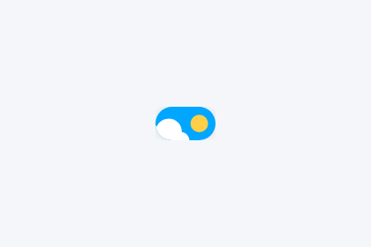</a> | <code>UIV-006</code> | Switch interattivo Uiverse, sorgente HTML/CSS non individuato | <a href="https://uiverse.io/JustCode14/red-dingo-61" target="_blank" rel="noopener noreferrer">UIVERSE</a> | SWITCH | 180flipcharge, annas-diary, battery-guard, easy-debloat, focussense, omni-cleaner, phone-guard, pocket-guard | Sorgente archiviata |
|  | <code>UIV-007</code> | Loader per processi reali, testo UX proposto: Stiamo facendo la magia; animazione specifica non verificata | <a href="https://uiverse.io/arthur_6104/orange-walrus-50" target="_blank" rel="noopener noreferrer">UIVERSE</a> | LOADER | annas-diary, app-factory-dashboard, cashmate-ai, framelab, notes-ecosistema, omni-cleaner, web-utility-factory, world-days | Sorgente archiviata |
|  | <code>UIV-008</code> | Quadrato arancio animato che sale una diagonale a gradini | <a href="https://uiverse.io/Shoh2008/cold-walrus-85" target="_blank" rel="noopener noreferrer">UIVERSE</a> | LOADER | battery-guard, camperboss, easy-debloat, notes-ecosistema, omni-cleaner, send-to-pc, world-days | Sorgente archiviata |
|  | <code>UIV-009</code> | Book card in CSS 3D con copertina che si apre su hover: preferenza utente per Ricordi Anna&#x27;s Diary | <a href="https://uiverse.io/eslam-hany/selfish-bobcat-73" target="_blank" rel="noopener noreferrer">UIVERSE</a> | BOOK_CARD | annas-diary, cooking-anime, framelab, notes-ecosistema, wonderlog, world-days | Sorgente archiviata |
|  | <code>UIV-010</code> | Scheda pubblica Uiverse classificata come CARD; il codice HTML/CSS non è presente nell&#x27;archivio Galaxy e non è stato acquisito. | <a href="https://uiverse.io/00Kubi/fluffy-jellyfish-87" target="_blank" rel="noopener noreferrer">UIVERSE</a> | CARD | annas-diary, beerclass-ai, cooking-anime, framelab, notes-ecosistema, wonderlog, world-days | Sorgente archiviata |
|  | <code>UIV-011</code> | Componente Uiverse nella categoria LOADER; HTML/CSS originale archiviato con blob SHA. L&#x27;effetto specifico richiede ispezione del sorgente e collaudo visivo. | <a href="https://uiverse.io/Admin12121/black-sheep-17" target="_blank" rel="noopener noreferrer">UIVERSE</a> | LOADER | app-factory-dashboard, battery-guard, cashmate-ai, easy-debloat, omni-cleaner, send-to-pc, world-days | Sorgente archiviata |
|  | <code>UIV-012</code> | Componente Uiverse nella categoria SWITCH; HTML/CSS originale archiviato con blob SHA. L&#x27;effetto specifico richiede ispezione del sorgente e collaudo visivo. | <a href="https://uiverse.io/Admin12121/massive-dodo-67" target="_blank" rel="noopener noreferrer">UIVERSE</a> | SWITCH | battery-guard, camperboss, easy-debloat, phone-guard, pocket-guard, sleepmax-coach, the-luminous-infinite-circle | Sorgente archiviata |
|  | <code>UIV-013</code> | Componente Uiverse nella categoria LOADER; HTML/CSS originale archiviato con blob SHA. L&#x27;effetto specifico richiede ispezione del sorgente e collaudo visivo. | <a href="https://uiverse.io/AqFox/young-dragon-29" target="_blank" rel="noopener noreferrer">UIVERSE</a> | LOADER | camperboss, cooking-anime, deskland-android, focussense, omni-cleaner, sleepmax-coach, wonderlog | Sorgente archiviata |
|  | <code>UIV-014</code> | Componente Uiverse nella categoria CARD; HTML/CSS originale archiviato con blob SHA. L&#x27;effetto specifico richiede ispezione del sorgente e collaudo visivo. | <a href="https://uiverse.io/ElSombrero2/tricky-robin-67" target="_blank" rel="noopener noreferrer">UIVERSE</a> | CARD | annas-diary, beerclass-ai, cooking-anime, framelab, notes-ecosistema, wonderlog, world-days | Sorgente archiviata |
|  | <code>UIV-015</code> | Scheda pubblica Uiverse classificata come BUTTON; il codice HTML/CSS non è presente nell&#x27;archivio Galaxy e non è stato acquisito. | <a href="https://uiverse.io/FColombati/spotty-snake-82" target="_blank" rel="noopener noreferrer">UIVERSE</a> | BUTTON | annas-diary, beerclass-ai, camperboss, cooking-anime, easy-debloat, framelab | Sorgente archiviata |
|  | <code>UIV-016</code> | Scheda pubblica Uiverse classificata come CARD; il codice HTML/CSS non è presente nell&#x27;archivio Galaxy e non è stato acquisito. | <a href="https://uiverse.io/Gidarx/clever-panther-6" target="_blank" rel="noopener noreferrer">UIVERSE</a> | CARD | app-factory-dashboard, beerclass-ai, camperboss, cashmate-ai, deskland-android, edu-01-corpo-umano, notes-ecosistema | Sorgente archiviata |
|  | <code>UIV-017</code> | Scheda pubblica Uiverse classificata come CARD; il codice HTML/CSS non è presente nell&#x27;archivio Galaxy e non è stato acquisito. | <a href="https://uiverse.io/Gidarx/moody-falcon-73" target="_blank" rel="noopener noreferrer">UIVERSE</a> | CARD | annas-diary, camperboss, deskland-android, edu-01-corpo-umano, notes-ecosistema, wonderlog, world-days | Sorgente archiviata |
|  | <code>UIV-018</code> | Componente Uiverse nella categoria SWITCH; HTML/CSS originale archiviato con blob SHA. L&#x27;effetto specifico richiede ispezione del sorgente e collaudo visivo. | <a href="https://uiverse.io/JaydipPrajapati1910/average-shrimp-57" target="_blank" rel="noopener noreferrer">UIVERSE</a> | SWITCH | battery-guard, camperboss, cashmate-ai, focussense, omni-cleaner, tabletop-motion-alarm, the-luminous-infinite-circle | Sorgente archiviata |
|  | <code>UIV-019</code> | Componente Uiverse nella categoria LOADER; HTML/CSS originale archiviato con blob SHA. L&#x27;effetto specifico richiede ispezione del sorgente e collaudo visivo. | <a href="https://uiverse.io/JkHuger/new-deer-97" target="_blank" rel="noopener noreferrer">UIVERSE</a> | LOADER | deskland-android, focussense, framelab, notes-ecosistema, omni-cleaner, sleepmax-coach, world-days | Sorgente archiviata |
|  | <code>UIV-020</code> | Componente Uiverse nella categoria LOADER; HTML/CSS originale archiviato con blob SHA. L&#x27;effetto specifico richiede ispezione del sorgente e collaudo visivo. | <a href="https://uiverse.io/JkHuger/selfish-bulldog-36" target="_blank" rel="noopener noreferrer">UIVERSE</a> | LOADER | app-factory-dashboard, battery-guard, framelab, notes-ecosistema, omni-cleaner, send-to-pc, world-days | Sorgente archiviata |
|  | <code>UIV-021</code> | Componente Uiverse nella categoria CARD; HTML/CSS originale archiviato con blob SHA. L&#x27;effetto specifico richiede ispezione del sorgente e collaudo visivo. | <a href="https://uiverse.io/JohnnyCSilva/black-rabbit-68" target="_blank" rel="noopener noreferrer">UIVERSE</a> | CARD | annas-diary, camperboss, deskland-android, edu-01-corpo-umano, notes-ecosistema, wonderlog, world-days | Sorgente archiviata |
|  | <code>UIV-022</code> | Componente Uiverse nella categoria INPUT; HTML/CSS originale archiviato con blob SHA. L&#x27;effetto specifico richiede ispezione del sorgente e collaudo visivo. | <a href="https://uiverse.io/Lakshay-art/curvy-earwig-22" target="_blank" rel="noopener noreferrer">UIVERSE</a> | INPUT | app-factory-dashboard, cashmate-ai, notes-ecosistema, omni-cleaner, wonderlog, world-days | Sorgente archiviata |
|  | <code>UIV-023</code> | Componente Uiverse nella categoria RADIO; HTML/CSS originale archiviato con blob SHA. L&#x27;effetto specifico richiede ispezione del sorgente e collaudo visivo. | <a href="https://uiverse.io/LilaRest/soft-baboon-75" target="_blank" rel="noopener noreferrer">UIVERSE</a> | RADIO | annas-diary, battery-guard, cashmate-ai, notes-ecosistema, wonderlog, world-days | Sorgente archiviata |
|  | <code>UIV-024</code> | Componente Uiverse nella categoria CARD; HTML/CSS originale archiviato con blob SHA. L&#x27;effetto specifico richiede ispezione del sorgente e collaudo visivo. | <a href="https://uiverse.io/MuhammadHasann/fast-badger-70" target="_blank" rel="noopener noreferrer">UIVERSE</a> | CARD | annas-diary, beerclass-ai, cooking-anime, framelab, notes-ecosistema, wonderlog, world-days | Sorgente archiviata |
|  | <code>UIV-025</code> | Componente Uiverse nella categoria LOADER; HTML/CSS originale archiviato con blob SHA. L&#x27;effetto specifico richiede ispezione del sorgente e collaudo visivo. | <a href="https://uiverse.io/Nawsome/ancient-yak-42" target="_blank" rel="noopener noreferrer">UIVERSE</a> | LOADER | app-factory-dashboard, camperboss, cashmate-ai, cooking-anime, easy-debloat, trailpath, wonderlog | Sorgente archiviata |
| <a href="../docs/assets/componenti/UIV-026.png">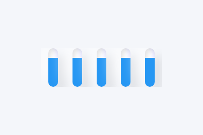</a> | <code>UIV-026</code> | Componente Uiverse nella categoria LOADER; HTML/CSS originale archiviato con blob SHA. L&#x27;effetto specifico richiede ispezione del sorgente e collaudo visivo. | <a href="https://uiverse.io/Nawsome/brave-turtle-26" target="_blank" rel="noopener noreferrer">UIVERSE</a> | LOADER | camperboss, cooking-anime, deskland-android, focussense, omni-cleaner, sleepmax-coach, wonderlog | Sorgente archiviata |
|  | <code>UIV-027</code> | Componente Uiverse nella categoria SWITCH; HTML/CSS originale archiviato con blob SHA. L&#x27;effetto specifico richiede ispezione del sorgente e collaudo visivo. | <a href="https://uiverse.io/Nawsome/empty-snail-69" target="_blank" rel="noopener noreferrer">UIVERSE</a> | SWITCH | 180flipcharge, annas-diary, battery-guard, focussense, notes-ecosistema, omni-cleaner, pocket-guard | Sorgente archiviata |
|  | <code>UIV-028</code> | Componente Uiverse nella categoria LOADER; HTML/CSS originale archiviato con blob SHA. L&#x27;effetto specifico richiede ispezione del sorgente e collaudo visivo. | <a href="https://uiverse.io/Nawsome/kind-mole-87" target="_blank" rel="noopener noreferrer">UIVERSE</a> | LOADER | app-factory-dashboard, battery-guard, framelab, notes-ecosistema, omni-cleaner, send-to-pc, world-days | Sorgente archiviata |
|  | <code>UIV-029</code> | Componente Uiverse nella categoria LOADER; HTML/CSS originale archiviato con blob SHA. L&#x27;effetto specifico richiede ispezione del sorgente e collaudo visivo. | <a href="https://uiverse.io/Nawsome/wet-mayfly-23" target="_blank" rel="noopener noreferrer">UIVERSE</a> | LOADER | app-factory-dashboard, battery-guard, cashmate-ai, easy-debloat, omni-cleaner, send-to-pc, world-days | Sorgente archiviata |
| <a href="../docs/assets/componenti/UIV-030.png">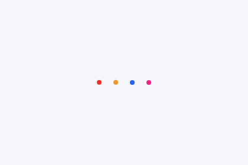</a> | <code>UIV-030</code> | Componente Uiverse nella categoria LOADER; HTML/CSS originale archiviato con blob SHA. L&#x27;effetto specifico richiede ispezione del sorgente e collaudo visivo. | <a href="https://uiverse.io/Nawsome/young-goat-78" target="_blank" rel="noopener noreferrer">UIVERSE</a> | LOADER | app-factory-dashboard, camperboss, cashmate-ai, cooking-anime, easy-debloat, omni-cleaner, wonderlog | Sorgente archiviata |
|  | <code>UIV-031</code> | Scheda pubblica Uiverse classificata come LOADER; il codice HTML/CSS non è presente nell&#x27;archivio Galaxy e non è stato acquisito. | <a href="https://uiverse.io/Novaxlo/rotten-lionfish-4" target="_blank" rel="noopener noreferrer">UIVERSE</a> | LOADER | camperboss, cooking-anime, deskland-android, focussense, omni-cleaner, sleepmax-coach, wonderlog | Sorgente archiviata |
|  | <code>UIV-032</code> | Componente Uiverse nella categoria LOADER; HTML/CSS originale archiviato con blob SHA. L&#x27;effetto specifico richiede ispezione del sorgente e collaudo visivo. | <a href="https://uiverse.io/Praashoo7/lucky-hound-44" target="_blank" rel="noopener noreferrer">UIVERSE</a> | LOADER | deskland-android, focussense, framelab, notes-ecosistema, omni-cleaner, sleepmax-coach, world-days | Sorgente archiviata |
|  | <code>UIV-033</code> | Componente Uiverse nella categoria BUTTON; HTML/CSS originale archiviato con blob SHA. L&#x27;effetto specifico richiede ispezione del sorgente e collaudo visivo. | <a href="https://uiverse.io/Praashoo7/smooth-crab-52" target="_blank" rel="noopener noreferrer">UIVERSE</a> | BUTTON | annas-diary, app-factory-dashboard, notes-ecosistema, web-utility-factory, wonderlog, world-days | Sorgente archiviata |
|  | <code>UIV-034</code> | Componente Uiverse nella categoria LOADER; HTML/CSS originale archiviato con blob SHA. L&#x27;effetto specifico richiede ispezione del sorgente e collaudo visivo. | <a href="https://uiverse.io/Pradeepsaranbishnoi/fast-cobra-20" target="_blank" rel="noopener noreferrer">UIVERSE</a> | LOADER | app-factory-dashboard, battery-guard, cashmate-ai, easy-debloat, omni-cleaner, send-to-pc, world-days | Sorgente archiviata |
|  | <code>UIV-035</code> | Componente Uiverse nella categoria RADIO; HTML/CSS originale archiviato con blob SHA. L&#x27;effetto specifico richiede ispezione del sorgente e collaudo visivo. | <a href="https://uiverse.io/Pradeepsaranbishnoi/hungry-bat-66" target="_blank" rel="noopener noreferrer">UIVERSE</a> | RADIO | annas-diary, battery-guard, cashmate-ai, notes-ecosistema, trailpath, world-days | Sorgente archiviata |
|  | <code>UIV-036</code> | Componente Uiverse nella categoria LOADER; HTML/CSS originale archiviato con blob SHA. L&#x27;effetto specifico richiede ispezione del sorgente e collaudo visivo. | <a href="https://uiverse.io/Pradeepsaranbishnoi/tall-fish-38" target="_blank" rel="noopener noreferrer">UIVERSE</a> | LOADER | camperboss, cooking-anime, deskland-android, focussense, omni-cleaner, sleepmax-coach, wonderlog | Sorgente archiviata |
|  | <code>UIV-037</code> | Componente Uiverse nella categoria CARD; HTML/CSS originale archiviato con blob SHA. L&#x27;effetto specifico richiede ispezione del sorgente e collaudo visivo. | <a href="https://uiverse.io/Prince4fff/slippery-baboon-37" target="_blank" rel="noopener noreferrer">UIVERSE</a> | CARD | app-factory-dashboard, beerclass-ai, cashmate-ai, cooking-anime, framelab, notes-ecosistema, wonderlog | Sorgente archiviata |
| <a href="../docs/assets/componenti/UIV-038.png">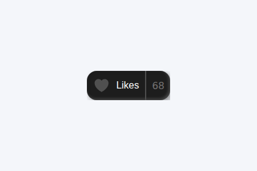</a> | <code>UIV-038</code> | Scheda pubblica Uiverse classificata come BUTTON; il codice HTML/CSS non è presente nell&#x27;archivio Galaxy e non è stato acquisito. | <a href="https://uiverse.io/Priyanshu02020/popular-puma-87" target="_blank" rel="noopener noreferrer">UIVERSE</a> | BUTTON | annas-diary, beerclass-ai, cooking-anime, framelab, wonderlog, world-days | Sorgente archiviata |
|  | <code>UIV-039</code> | Componente Uiverse nella categoria LOADER; HTML/CSS originale archiviato con blob SHA. L&#x27;effetto specifico richiede ispezione del sorgente e collaudo visivo. | <a href="https://uiverse.io/SelfMadeSystem/pretty-treefrog-77" target="_blank" rel="noopener noreferrer">UIVERSE</a> | LOADER | app-factory-dashboard, battery-guard, cashmate-ai, easy-debloat, omni-cleaner, send-to-pc, world-days | Sorgente archiviata |
|  | <code>UIV-040</code> | Componente Uiverse nella categoria LOADER; HTML/CSS originale archiviato con blob SHA. L&#x27;effetto specifico richiede ispezione del sorgente e collaudo visivo. | <a href="https://uiverse.io/Shoh2008/curvy-bulldog-27" target="_blank" rel="noopener noreferrer">UIVERSE</a> | LOADER | app-factory-dashboard, camperboss, cashmate-ai, cooking-anime, easy-debloat, omni-cleaner, wonderlog | Sorgente archiviata |
|  | <code>UIV-041</code> | Componente Uiverse nella categoria LOADER; HTML/CSS originale archiviato con blob SHA. L&#x27;effetto specifico richiede ispezione del sorgente e collaudo visivo. | <a href="https://uiverse.io/Shoh2008/ugly-elephant-80" target="_blank" rel="noopener noreferrer">UIVERSE</a> | LOADER | camperboss, cooking-anime, deskland-android, focussense, omni-cleaner, sleepmax-coach, wonderlog | Sorgente archiviata |
|  | <code>UIV-042</code> | Componente Uiverse nella categoria LOADER; HTML/CSS originale archiviato con blob SHA. L&#x27;effetto specifico richiede ispezione del sorgente e collaudo visivo. | <a href="https://uiverse.io/Shoh2008/yellow-dolphin-16" target="_blank" rel="noopener noreferrer">UIVERSE</a> | LOADER | deskland-android, focussense, framelab, notes-ecosistema, omni-cleaner, sleepmax-coach, world-days | Sorgente archiviata |
| <a href="../docs/assets/componenti/UIV-043.png">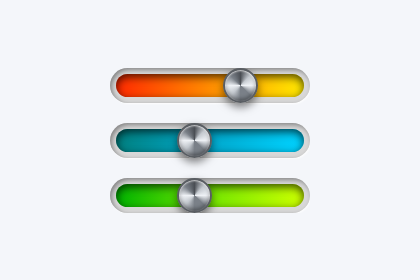</a> | <code>UIV-043</code> | Categoria INPUT confermata dall&#x27;endpoint pubblico Uiverse. Abbinamenti UI/UX proposti, non collaudati sui consumer. | <a href="https://uiverse.io/Stavros2410/wet-duck-69" target="_blank" rel="noopener noreferrer">UIVERSE</a> | INPUT | notes-ecosistema, omni-cleaner, world-days | Sorgente archiviata |
|  | <code>UIV-044</code> | Componente Uiverse nella categoria LOADER; HTML/CSS originale archiviato con blob SHA. L&#x27;effetto specifico richiede ispezione del sorgente e collaudo visivo. | <a href="https://uiverse.io/Subaashbala/average-horse-18" target="_blank" rel="noopener noreferrer">UIVERSE</a> | LOADER | app-factory-dashboard, battery-guard, cashmate-ai, easy-debloat, omni-cleaner, send-to-pc, world-days | Sorgente archiviata |
| <a href="../docs/assets/componenti/UIV-045.png">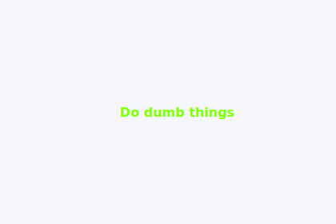</a> | <code>UIV-045</code> | Categoria CHECKBOX confermata dall&#x27;endpoint pubblico Uiverse. Abbinamenti UI/UX proposti, non collaudati sui consumer. | <a href="https://uiverse.io/Uncannypotato69/honest-starfish-32" target="_blank" rel="noopener noreferrer">UIVERSE</a> | CHECKBOX | app-factory-dashboard, notes-ecosistema, omni-cleaner | Sorgente archiviata |
| <a href="../docs/assets/componenti/UIV-046.png">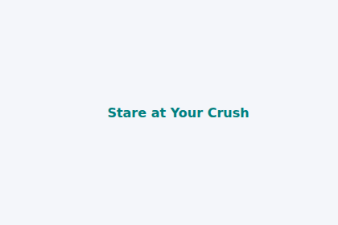</a> | <code>UIV-046</code> | Scheda pubblica Uiverse classificata come CHECKBOX; il codice HTML/CSS non è presente nell&#x27;archivio Galaxy e non è stato acquisito. | <a href="https://uiverse.io/Uncannypotato69/rotten-wasp-10" target="_blank" rel="noopener noreferrer">UIVERSE</a> | CHECKBOX | app-factory-dashboard, camperboss, easy-debloat, notes-ecosistema, wonderlog, world-days | Sorgente archiviata |
|  | <code>UIV-047</code> | Componente Uiverse nella categoria BUTTON; HTML/CSS originale archiviato con blob SHA. L&#x27;effetto specifico richiede ispezione del sorgente e collaudo visivo. | <a href="https://uiverse.io/Yaya12085/plastic-quail-42" target="_blank" rel="noopener noreferrer">UIVERSE</a> | BUTTON | annas-diary, app-factory-dashboard, camperboss, easy-debloat, notes-ecosistema, web-utility-factory | Sorgente archiviata |
|  | <code>UIV-048</code> | Componente Uiverse nella categoria CARD; HTML/CSS originale archiviato con blob SHA. L&#x27;effetto specifico richiede ispezione del sorgente e collaudo visivo. | <a href="https://uiverse.io/akshat-patel28/quick-baboon-29" target="_blank" rel="noopener noreferrer">UIVERSE</a> | CARD | annas-diary, beerclass-ai, cooking-anime, framelab, notes-ecosistema, wonderlog, world-days | Sorgente archiviata |
|  | <code>UIV-049</code> | Componente Uiverse nella categoria SWITCH; HTML/CSS originale archiviato con blob SHA. L&#x27;effetto specifico richiede ispezione del sorgente e collaudo visivo. | <a href="https://uiverse.io/andrew-demchenk0/honest-stingray-90" target="_blank" rel="noopener noreferrer">UIVERSE</a> | SWITCH | 180flipcharge, annas-diary, battery-guard, easy-debloat, notes-ecosistema, phone-guard, pocket-guard | Sorgente archiviata |
|  | <code>UIV-050</code> | Scheda pubblica Uiverse classificata come LOADER; il codice HTML/CSS non è presente nell&#x27;archivio Galaxy e non è stato acquisito. | <a href="https://uiverse.io/andrew-manzyk/fast-vampirebat-53" target="_blank" rel="noopener noreferrer">UIVERSE</a> | LOADER | deskland-android, focussense, framelab, notes-ecosistema, omni-cleaner, sleepmax-coach, world-days | Sorgente archiviata |
|  | <code>UIV-051</code> | Scheda pubblica Uiverse classificata come LOADER; il codice HTML/CSS non è presente nell&#x27;archivio Galaxy e non è stato acquisito. | <a href="https://uiverse.io/andrew-manzyk/young-walrus-64" target="_blank" rel="noopener noreferrer">UIVERSE</a> | LOADER | app-factory-dashboard, battery-guard, framelab, notes-ecosistema, omni-cleaner, send-to-pc, world-days | Sorgente archiviata |
| <a href="../docs/assets/componenti/UIV-052.png">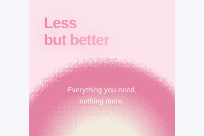</a> | <code>UIV-052</code> | Categoria CARD confermata dall&#x27;endpoint pubblico Uiverse. Abbinamenti UI/UX proposti, non collaudati sui consumer. | <a href="https://uiverse.io/ashif_6672/rare-bat-68" target="_blank" rel="noopener noreferrer">UIVERSE</a> | CARD | notes-ecosistema, omni-cleaner, world-days | Sorgente archiviata |
| <a href="../docs/assets/componenti/UIV-053.png">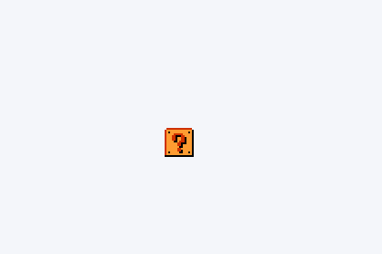</a> | <code>UIV-053</code> | Componente Uiverse nella categoria TOOLTIP; HTML/CSS originale archiviato con blob SHA. L&#x27;effetto specifico richiede ispezione del sorgente e collaudo visivo. | <a href="https://uiverse.io/barisdogansutcu/plastic-dolphin-67" target="_blank" rel="noopener noreferrer">UIVERSE</a> | TOOLTIP | app-factory-dashboard, battery-guard, edu-01-corpo-umano, notes-ecosistema, omni-cleaner, wonderlog | Sorgente archiviata |
|  | <code>UIV-054</code> | Scheda pubblica Uiverse classificata come CARD; il codice HTML/CSS non è presente nell&#x27;archivio Galaxy e non è stato acquisito. | <a href="https://uiverse.io/byllzz/great-wombat-13" target="_blank" rel="noopener noreferrer">UIVERSE</a> | CARD | app-factory-dashboard, beerclass-ai, cashmate-ai, cooking-anime, framelab, notes-ecosistema, wonderlog | Sorgente archiviata |
|  | <code>UIV-055</code> | Scheda pubblica Uiverse classificata come LOADER; il codice HTML/CSS non è presente nell&#x27;archivio Galaxy e non è stato acquisito. | <a href="https://uiverse.io/chase2k25/modern-stingray-54" target="_blank" rel="noopener noreferrer">UIVERSE</a> | LOADER | app-factory-dashboard, battery-guard, framelab, notes-ecosistema, omni-cleaner, send-to-pc, world-days | Sorgente archiviata |
|  | <code>UIV-056</code> | Scheda pubblica Uiverse classificata come CARD; il codice HTML/CSS non è presente nell&#x27;archivio Galaxy e non è stato acquisito. | <a href="https://uiverse.io/chase2k25/warm-chicken-23" target="_blank" rel="noopener noreferrer">UIVERSE</a> | CARD | annas-diary, camperboss, deskland-android, edu-01-corpo-umano, notes-ecosistema, wonderlog, world-days | Sorgente archiviata |
|  | <code>UIV-057</code> | Componente Uiverse nella categoria LOADER; HTML/CSS originale archiviato con blob SHA. L&#x27;effetto specifico richiede ispezione del sorgente e collaudo visivo. | <a href="https://uiverse.io/cohencoo/dry-rat-94" target="_blank" rel="noopener noreferrer">UIVERSE</a> | LOADER | app-factory-dashboard, camperboss, cashmate-ai, cooking-anime, easy-debloat, trailpath, wonderlog | Sorgente archiviata |
|  | <code>UIV-058</code> | Componente Uiverse nella categoria SWITCH; HTML/CSS originale archiviato con blob SHA. L&#x27;effetto specifico richiede ispezione del sorgente e collaudo visivo. | <a href="https://uiverse.io/cssbuttons-io/mean-dolphin-24" target="_blank" rel="noopener noreferrer">UIVERSE</a> | SWITCH | battery-guard, camperboss, easy-debloat, notes-ecosistema, phone-guard, pocket-guard, sleepmax-coach | Sorgente archiviata |
|  | <code>UIV-059</code> | Componente Uiverse nella categoria SWITCH; HTML/CSS originale archiviato con blob SHA. L&#x27;effetto specifico richiede ispezione del sorgente e collaudo visivo. | <a href="https://uiverse.io/cuzpq/gentle-goat-72" target="_blank" rel="noopener noreferrer">UIVERSE</a> | SWITCH | battery-guard, camperboss, cashmate-ai, easy-debloat, sleepmax-coach, tabletop-motion-alarm, the-luminous-infinite-circle | Sorgente archiviata |
|  | <code>UIV-060</code> | Scheda pubblica Uiverse classificata come BUTTON; il codice HTML/CSS non è presente nell&#x27;archivio Galaxy e non è stato acquisito. | <a href="https://uiverse.io/dexter-st/breezy-zebra-94" target="_blank" rel="noopener noreferrer">UIVERSE</a> | BUTTON | annas-diary, cooking-anime, framelab, notes-ecosistema, wonderlog, world-days | Sorgente archiviata |
|  | <code>UIV-061</code> | Scheda pubblica Uiverse classificata come LOADER; il codice HTML/CSS non è presente nell&#x27;archivio Galaxy e non è stato acquisito. | <a href="https://uiverse.io/dexter-st/bright-lizard-8" target="_blank" rel="noopener noreferrer">UIVERSE</a> | LOADER | app-factory-dashboard, battery-guard, cashmate-ai, easy-debloat, omni-cleaner, send-to-pc, world-days | Sorgente archiviata |
|  | <code>UIV-062</code> | Scheda pubblica Uiverse classificata come LOADER; il codice HTML/CSS non è presente nell&#x27;archivio Galaxy e non è stato acquisito. | <a href="https://uiverse.io/dexter-st/spicy-otter-30" target="_blank" rel="noopener noreferrer">UIVERSE</a> | LOADER | app-factory-dashboard, camperboss, cashmate-ai, cooking-anime, easy-debloat, omni-cleaner, wonderlog | Sorgente archiviata |
|  | <code>UIV-063</code> | Scheda pubblica Uiverse classificata come CARD; il codice HTML/CSS non è presente nell&#x27;archivio Galaxy e non è stato acquisito. | <a href="https://uiverse.io/dexter-st/tough-falcon-78" target="_blank" rel="noopener noreferrer">UIVERSE</a> | CARD | app-factory-dashboard, beerclass-ai, camperboss, cashmate-ai, deskland-android, edu-01-corpo-umano, notes-ecosistema | Sorgente archiviata |
|  | <code>UIV-064</code> | Categoria BUTTON confermata dall&#x27;endpoint pubblico Uiverse. Abbinamenti UI/UX proposti, non collaudati sui consumer. | <a href="https://uiverse.io/dopekid_9309/tiny-dog-80" target="_blank" rel="noopener noreferrer">UIVERSE</a> | BUTTON | notes-ecosistema, omni-cleaner, world-days | Sorgente archiviata |
|  | <code>UIV-065</code> | Scheda pubblica Uiverse classificata come LOADER; il codice HTML/CSS non è presente nell&#x27;archivio Galaxy e non è stato acquisito. | <a href="https://uiverse.io/dovatgabriel/massive-vampirebat-17" target="_blank" rel="noopener noreferrer">UIVERSE</a> | LOADER | app-factory-dashboard, battery-guard, framelab, notes-ecosistema, omni-cleaner, send-to-pc, world-days | Sorgente archiviata |
|  | <code>UIV-066</code> | Scheda pubblica Uiverse classificata come LOADER; il codice HTML/CSS non è presente nell&#x27;archivio Galaxy e non è stato acquisito. | <a href="https://uiverse.io/elijahgummer/polite-earwig-72" target="_blank" rel="noopener noreferrer">UIVERSE</a> | LOADER | app-factory-dashboard, battery-guard, cashmate-ai, easy-debloat, omni-cleaner, send-to-pc, world-days | Sorgente archiviata |
|  | <code>UIV-067</code> | Scheda pubblica Uiverse classificata come RADIO; il codice HTML/CSS non è presente nell&#x27;archivio Galaxy e non è stato acquisito. | <a href="https://uiverse.io/elijahgummer/young-horse-7" target="_blank" rel="noopener noreferrer">UIVERSE</a> | RADIO | annas-diary, beerclass-ai, cashmate-ai, notes-ecosistema, sleepmax-coach, web-utility-factory | Sorgente archiviata |
| <a href="../docs/assets/componenti/UIV-068.png">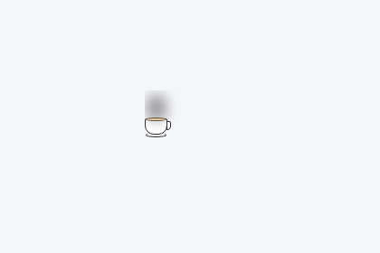</a> | <code>UIV-068</code> | Scheda pubblica Uiverse classificata come LOADER; il codice HTML/CSS non è presente nell&#x27;archivio Galaxy e non è stato acquisito. | <a href="https://uiverse.io/esraaabdel-kareem/bad-dragonfly-54" target="_blank" rel="noopener noreferrer">UIVERSE</a> | LOADER | deskland-android, focussense, framelab, notes-ecosistema, omni-cleaner, sleepmax-coach, world-days | Sorgente archiviata |
|  | <code>UIV-069</code> | Scheda pubblica Uiverse classificata come BUTTON; il codice HTML/CSS non è presente nell&#x27;archivio Galaxy e non è stato acquisito. | <a href="https://uiverse.io/fthisilak/bitter-termite-36" target="_blank" rel="noopener noreferrer">UIVERSE</a> | BUTTON | annas-diary, app-factory-dashboard, easy-debloat, notes-ecosistema, web-utility-factory, wonderlog | Sorgente archiviata |
| <a href="../docs/assets/componenti/UIV-070.png">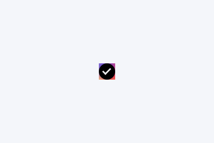</a> | <code>UIV-070</code> | Componente Uiverse nella categoria CHECKBOX; HTML/CSS originale archiviato con blob SHA. L&#x27;effetto specifico richiede ispezione del sorgente e collaudo visivo. | <a href="https://uiverse.io/gagan-gv/unlucky-yak-4" target="_blank" rel="noopener noreferrer">UIVERSE</a> | CHECKBOX | app-factory-dashboard, camperboss, cashmate-ai, notes-ecosistema, omni-cleaner, world-days | Sorgente archiviata |
|  | <code>UIV-071</code> | Componente Uiverse nella categoria SWITCH; HTML/CSS originale archiviato con blob SHA. L&#x27;effetto specifico richiede ispezione del sorgente e collaudo visivo. | <a href="https://uiverse.io/gharsh11032000/sour-vampirebat-66" target="_blank" rel="noopener noreferrer">UIVERSE</a> | SWITCH | battery-guard, camperboss, easy-debloat, notes-ecosistema, phone-guard, pocket-guard, sleepmax-coach | Sorgente archiviata |
|  | <code>UIV-072</code> | Componente Uiverse nella categoria LOADER; HTML/CSS originale archiviato con blob SHA. L&#x27;effetto specifico richiede ispezione del sorgente e collaudo visivo. | <a href="https://uiverse.io/gsperandio/shaggy-kangaroo-12" target="_blank" rel="noopener noreferrer">UIVERSE</a> | LOADER | camperboss, cooking-anime, deskland-android, focussense, omni-cleaner, sleepmax-coach, wonderlog | Sorgente archiviata |
|  | <code>UIV-073</code> | Scheda pubblica Uiverse classificata come CARD; il codice HTML/CSS non è presente nell&#x27;archivio Galaxy e non è stato acquisito. | <a href="https://uiverse.io/ilkhoeri/thin-bobcat-83" target="_blank" rel="noopener noreferrer">UIVERSE</a> | CARD | app-factory-dashboard, beerclass-ai, cashmate-ai, cooking-anime, framelab, notes-ecosistema, wonderlog | Sorgente archiviata |
| <a href="../docs/assets/componenti/UIV-074.png">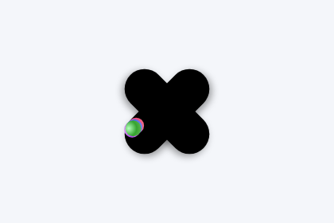</a> | <code>UIV-074</code> | Scheda pubblica Uiverse classificata come LOADER; il codice HTML/CSS non è presente nell&#x27;archivio Galaxy e non è stato acquisito. | <a href="https://uiverse.io/jeremy_4982/massive-falcon-52" target="_blank" rel="noopener noreferrer">UIVERSE</a> | LOADER | app-factory-dashboard, battery-guard, framelab, notes-ecosistema, omni-cleaner, send-to-pc, world-days | Sorgente archiviata |
|  | <code>UIV-075</code> | Componente Uiverse nella categoria CARD; HTML/CSS originale archiviato con blob SHA. L&#x27;effetto specifico richiede ispezione del sorgente e collaudo visivo. | <a href="https://uiverse.io/joe-watson-sbf/honest-bullfrog-6" target="_blank" rel="noopener noreferrer">UIVERSE</a> | CARD | annas-diary, camperboss, deskland-android, edu-01-corpo-umano, notes-ecosistema, wonderlog, world-days | Sorgente archiviata |
|  | <code>UIV-076</code> | Scheda pubblica Uiverse classificata come LOADER; il codice HTML/CSS non è presente nell&#x27;archivio Galaxy e non è stato acquisito. | <a href="https://uiverse.io/kat_2522/rude-robin-51" target="_blank" rel="noopener noreferrer">UIVERSE</a> | LOADER | app-factory-dashboard, camperboss, cashmate-ai, cooking-anime, easy-debloat, omni-cleaner, wonderlog | Sorgente archiviata |
|  | <code>UIV-077</code> | Componente Uiverse nella categoria CARD; HTML/CSS originale archiviato con blob SHA. L&#x27;effetto specifico richiede ispezione del sorgente e collaudo visivo. | <a href="https://uiverse.io/kennyotsu/fast-emu-70" target="_blank" rel="noopener noreferrer">UIVERSE</a> | CARD | app-factory-dashboard, beerclass-ai, cashmate-ai, cooking-anime, framelab, notes-ecosistema, wonderlog | Sorgente archiviata |
|  | <code>UIV-078</code> | Scheda pubblica Uiverse classificata come CARD; il codice HTML/CSS non è presente nell&#x27;archivio Galaxy e non è stato acquisito. | <a href="https://uiverse.io/kennyotsu/giant-sloth-18" target="_blank" rel="noopener noreferrer">UIVERSE</a> | CARD | app-factory-dashboard, beerclass-ai, camperboss, cashmate-ai, deskland-android, edu-01-corpo-umano, notes-ecosistema | Sorgente archiviata |
| <a href="../docs/assets/componenti/UIV-079.png">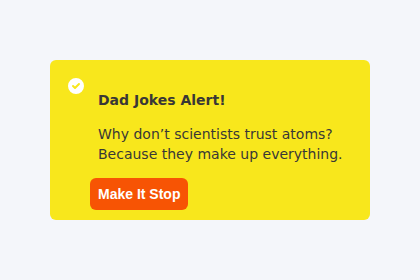</a> | <code>UIV-079</code> | Categoria CARD confermata dall&#x27;endpoint pubblico Uiverse. Abbinamenti UI/UX proposti, non collaudati sui consumer. | <a href="https://uiverse.io/kennyotsu/selfish-bear-69" target="_blank" rel="noopener noreferrer">UIVERSE</a> | CARD | notes-ecosistema, omni-cleaner, world-days | Sorgente archiviata |
|  | <code>UIV-080</code> | Componente Uiverse nella categoria CARD; HTML/CSS originale archiviato con blob SHA. L&#x27;effetto specifico richiede ispezione del sorgente e collaudo visivo. | <a href="https://uiverse.io/kennyotsu/short-ape-5" target="_blank" rel="noopener noreferrer">UIVERSE</a> | CARD | annas-diary, beerclass-ai, cooking-anime, framelab, notes-ecosistema, wonderlog, world-days | Sorgente archiviata |
|  | <code>UIV-081</code> | Scheda pubblica Uiverse classificata come CARD; il codice HTML/CSS non è presente nell&#x27;archivio Galaxy e non è stato acquisito. | <a href="https://uiverse.io/kennyotsu/tender-badger-21" target="_blank" rel="noopener noreferrer">UIVERSE</a> | CARD | app-factory-dashboard, beerclass-ai, cashmate-ai, cooking-anime, framelab, trailpath, wonderlog | Sorgente archiviata |
|  | <code>UIV-082</code> | Componente Uiverse nella categoria CARD; HTML/CSS originale archiviato con blob SHA. L&#x27;effetto specifico richiede ispezione del sorgente e collaudo visivo. | <a href="https://uiverse.io/kennyotsu/wise-rattlesnake-92" target="_blank" rel="noopener noreferrer">UIVERSE</a> | CARD | app-factory-dashboard, beerclass-ai, camperboss, cashmate-ai, deskland-android, edu-01-corpo-umano, notes-ecosistema | Sorgente archiviata |
| <a href="../docs/assets/componenti/UIV-083.png">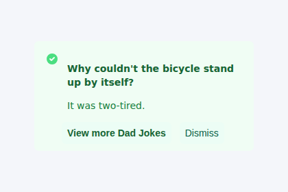</a> | <code>UIV-083</code> | Categoria CARD confermata dall&#x27;endpoint pubblico Uiverse. Abbinamenti UI/UX proposti, non collaudati sui consumer. | <a href="https://uiverse.io/kennyotsu/wonderful-firefox-31" target="_blank" rel="noopener noreferrer">UIVERSE</a> | CARD | notes-ecosistema, omni-cleaner, world-days | Sorgente archiviata |
| <a href="../docs/assets/componenti/UIV-084.png">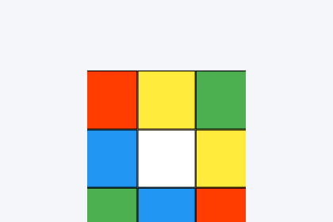</a> | <code>UIV-084</code> | Componente Uiverse nella categoria LOADER; HTML/CSS originale archiviato con blob SHA. L&#x27;effetto specifico richiede ispezione del sorgente e collaudo visivo. | <a href="https://uiverse.io/lukepadiachy/funny-moose-89" target="_blank" rel="noopener noreferrer">UIVERSE</a> | LOADER | app-factory-dashboard, battery-guard, framelab, notes-ecosistema, omni-cleaner, send-to-pc, world-days | Sorgente archiviata |
| <a href="../docs/assets/componenti/UIV-085.png">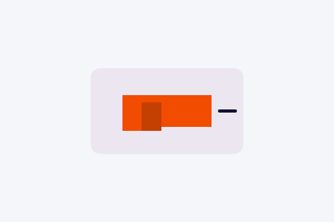</a> | <code>UIV-085</code> | Scheda pubblica Uiverse classificata come SWITCH; il codice HTML/CSS non è presente nell&#x27;archivio Galaxy e non è stato acquisito. | <a href="https://uiverse.io/m1her/odd-fireant-56" target="_blank" rel="noopener noreferrer">UIVERSE</a> | SWITCH | battery-guard, camperboss, easy-debloat, notes-ecosistema, phone-guard, pocket-guard, sleepmax-coach | Sorgente archiviata |
|  | <code>UIV-086</code> | Scheda pubblica Uiverse classificata come SWITCH; il codice HTML/CSS non è presente nell&#x27;archivio Galaxy e non è stato acquisito. | <a href="https://uiverse.io/mamyapro123/cuddly-warthog-66" target="_blank" rel="noopener noreferrer">UIVERSE</a> | SWITCH | battery-guard, camperboss, cashmate-ai, easy-debloat, sleepmax-coach, tabletop-motion-alarm, the-luminous-infinite-circle | Sorgente archiviata |
|  | <code>UIV-087</code> | Componente Uiverse nella categoria BUTTON; HTML/CSS originale archiviato con blob SHA. L&#x27;effetto specifico richiede ispezione del sorgente e collaudo visivo. | <a href="https://uiverse.io/marcelodolza/fat-zebra-11" target="_blank" rel="noopener noreferrer">UIVERSE</a> | BUTTON | annas-diary, app-factory-dashboard, camperboss, easy-debloat, notes-ecosistema, web-utility-factory | Sorgente archiviata |
| <a href="../docs/assets/componenti/UIV-088.png">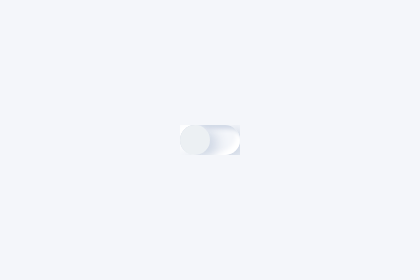</a> | <code>UIV-088</code> | Componente Uiverse nella categoria SWITCH; HTML/CSS originale archiviato con blob SHA. L&#x27;effetto specifico richiede ispezione del sorgente e collaudo visivo. | <a href="https://uiverse.io/mobinkakei/great-skunk-8" target="_blank" rel="noopener noreferrer">UIVERSE</a> | SWITCH | 180flipcharge, annas-diary, battery-guard, focussense, notes-ecosistema, omni-cleaner, pocket-guard | Sorgente archiviata |
|  | <code>UIV-089</code> | Componente Uiverse nella categoria LOADER; HTML/CSS originale archiviato con blob SHA. L&#x27;effetto specifico richiede ispezione del sorgente e collaudo visivo. | <a href="https://uiverse.io/mobinkakei/grumpy-turtle-41" target="_blank" rel="noopener noreferrer">UIVERSE</a> | LOADER | app-factory-dashboard, battery-guard, framelab, notes-ecosistema, omni-cleaner, send-to-pc, world-days | Sorgente archiviata |
|  | <code>UIV-090</code> | Componente Uiverse nella categoria SWITCH; HTML/CSS originale archiviato con blob SHA. L&#x27;effetto specifico richiede ispezione del sorgente e collaudo visivo. | <a href="https://uiverse.io/mobinkakei/strong-lizard-79" target="_blank" rel="noopener noreferrer">UIVERSE</a> | SWITCH | battery-guard, camperboss, easy-debloat, phone-guard, pocket-guard, sleepmax-coach, the-luminous-infinite-circle | Sorgente archiviata |
|  | <code>UIV-091</code> | Scheda pubblica Uiverse classificata come CARD; il codice HTML/CSS non è presente nell&#x27;archivio Galaxy e non è stato acquisito. | <a href="https://uiverse.io/monkey_8812/curly-moth-56" target="_blank" rel="noopener noreferrer">UIVERSE</a> | CARD | annas-diary, camperboss, deskland-android, edu-01-corpo-umano, notes-ecosistema, wonderlog, world-days | Sorgente archiviata |
|  | <code>UIV-092</code> | Scheda pubblica Uiverse classificata come CARD; il codice HTML/CSS non è presente nell&#x27;archivio Galaxy e non è stato acquisito. | <a href="https://uiverse.io/mymiamo/quiet-dragon-5" target="_blank" rel="noopener noreferrer">UIVERSE</a> | CARD | annas-diary, beerclass-ai, cooking-anime, framelab, notes-ecosistema, wonderlog, world-days | Sorgente archiviata |
| <a href="../docs/assets/componenti/UIV-093.png">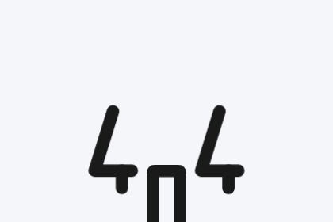</a> | <code>UIV-093</code> | Categoria CARD confermata dall&#x27;endpoint pubblico Uiverse. Abbinamenti UI/UX proposti, non collaudati sui consumer. | <a href="https://uiverse.io/preet_7613/new-cougar-63" target="_blank" rel="noopener noreferrer">UIVERSE</a> | CARD | app-factory-dashboard, notes-ecosistema, omni-cleaner | Sorgente archiviata |
|  | <code>UIV-094</code> | Componente Uiverse nella categoria LOADER; HTML/CSS originale archiviato con blob SHA. L&#x27;effetto specifico richiede ispezione del sorgente e collaudo visivo. | <a href="https://uiverse.io/satyamchaudharydev/splendid-husky-54" target="_blank" rel="noopener noreferrer">UIVERSE</a> | LOADER | app-factory-dashboard, battery-guard, framelab, notes-ecosistema, omni-cleaner, send-to-pc, world-days | Sorgente archiviata |
|  | <code>UIV-095</code> | Scheda pubblica Uiverse classificata come CARD; il codice HTML/CSS non è presente nell&#x27;archivio Galaxy e non è stato acquisito. | <a href="https://uiverse.io/seoulchik/funny-seahorse-89" target="_blank" rel="noopener noreferrer">UIVERSE</a> | CARD | annas-diary, camperboss, deskland-android, edu-01-corpo-umano, notes-ecosistema, wonderlog, world-days | Sorgente archiviata |
|  | <code>UIV-096</code> | Scheda pubblica Uiverse classificata come PATTERN; il codice HTML/CSS non è presente nell&#x27;archivio Galaxy e non è stato acquisito. | <a href="https://uiverse.io/solowzrd/wet-lionfish-63" target="_blank" rel="noopener noreferrer">UIVERSE</a> | PATTERN | app-factory-dashboard, battery-guard, deskland-android, focussense, omni-cleaner, web-utility-factory | Sorgente archiviata |
|  | <code>UIV-097</code> | Componente Uiverse nella categoria CARD; HTML/CSS originale archiviato con blob SHA. L&#x27;effetto specifico richiede ispezione del sorgente e collaudo visivo. | <a href="https://uiverse.io/vamsidevendrakumar/soft-shrimp-94" target="_blank" rel="noopener noreferrer">UIVERSE</a> | CARD | app-factory-dashboard, beerclass-ai, cashmate-ai, cooking-anime, framelab, notes-ecosistema, wonderlog | Sorgente archiviata |
|  | <code>UIV-098</code> | Scheda pubblica Uiverse classificata come PATTERN; il codice HTML/CSS non è presente nell&#x27;archivio Galaxy e non è stato acquisito. | <a href="https://uiverse.io/whoisyourdeadie/foolish-rabbit-13" target="_blank" rel="noopener noreferrer">UIVERSE</a> | PATTERN | annas-diary, battery-guard, cashmate-ai, deskland-android, notes-ecosistema, world-days | Sorgente archiviata |
|  | <code>UIV-099</code> | Componente Uiverse nella categoria LOADER; HTML/CSS originale archiviato con blob SHA. L&#x27;effetto specifico richiede ispezione del sorgente e collaudo visivo. | <a href="https://uiverse.io/xXJollyHAKERXx/lucky-falcon-75" target="_blank" rel="noopener noreferrer">UIVERSE</a> | LOADER | app-factory-dashboard, battery-guard, framelab, notes-ecosistema, omni-cleaner, send-to-pc, world-days | Sorgente archiviata |
| <a href="../docs/assets/componenti/UIV-100.png">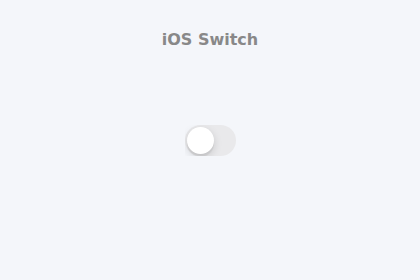</a> | <code>UIV-100</code> | Componente Uiverse nella categoria SWITCH; HTML/CSS originale archiviato con blob SHA. L&#x27;effetto specifico richiede ispezione del sorgente e collaudo visivo. | <a href="https://uiverse.io/zanina-yassine/afraid-eel-50" target="_blank" rel="noopener noreferrer">UIVERSE</a> | SWITCH | battery-guard, camperboss, cashmate-ai, easy-debloat, sleepmax-coach, tabletop-motion-alarm, the-luminous-infinite-circle | Sorgente archiviata |
|  | <code>UIV-101</code> | Blue modern login form; use only where an input or optional account flow already exists. Categoria FORM verificata nel post pubblico Uiverse. Tag originali: blue, form, login form, tailwind, rounded, input, button, blue, border, modern. | <a href="https://uiverse.io/Javierrocadev/chatty-ladybug-95" target="_blank" rel="noopener noreferrer">UIVERSE</a> | FORM | annas-diary, app-factory-dashboard, beerclass-ai, cashmate-ai, notes-ecosistema, wonderlog, world-days | Sorgente archiviata |
|  | <code>UIV-102</code> | Warm stitched beige/orange login form; adapt to product typography and contrast. Categoria FORM verificata nel post pubblico Uiverse. Tag originali: login, form, stitched, rounded, shadow, beige, orange, password, form, submit. | <a href="https://uiverse.io/Praashoo7/bitter-pig-24" target="_blank" rel="noopener noreferrer">UIVERSE</a> | FORM | annas-diary, app-factory-dashboard, camperboss, cooking-anime, notes-ecosistema, sleepmax-coach, wonderlog | Sorgente archiviata |
|  | <code>UIV-103</code> | Blue gradient and depth form; tone down gloss and 3D for readable mobile inputs. Categoria FORM verificata nel post pubblico Uiverse. Tag originali: simple, login, 3d, social, gradient, form, submit, login form, rounded, button. | <a href="https://uiverse.io/SyedShahzaib7/brave-dog-61" target="_blank" rel="noopener noreferrer">UIVERSE</a> | FORM | app-factory-dashboard, beerclass-ai, cashmate-ai, notes-ecosistema, send-to-pc, world-days | Sorgente archiviata |
| <a href="../docs/assets/componenti/UIV-104.png">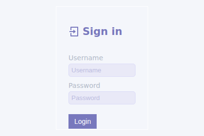</a> | <code>UIV-104</code> | Minimal purple login form; adapt palette and semantics rather than add authentication. Categoria FORM verificata nel post pubblico Uiverse. Tag originali: login, form, input, button, password, white, form, signin, username, purple. | <a href="https://uiverse.io/alexmaracinaru/tall-owl-30" target="_blank" rel="noopener noreferrer">UIVERSE</a> | FORM | annas-diary, app-factory-dashboard, cashmate-ai, cooking-anime, notes-ecosistema, wonderlog, world-days | Sorgente archiviata |
|  | <code>UIV-105</code> | Welcome/social login form; explicit consent and existing optional provider only. Categoria FORM verificata nel post pubblico Uiverse. Tag originali: login, email, social, form, submit, confirm, password, welcome, rounded, shadow. | <a href="https://uiverse.io/ayyjayy2/sour-dog-94" target="_blank" rel="noopener noreferrer">UIVERSE</a> | FORM | annas-diary, app-factory-dashboard, beerclass-ai, cashmate-ai, cooking-anime, framelab, notes-ecosistema, wonderlog | Sorgente archiviata |
|  | <code>UIV-106</code> | Red suspension-ball animation; requires actual running job, retry/timeout, reduced motion. Categoria LOADER verificata nel post pubblico Uiverse. Tag originali: simple, material design, neumorphism, skeuomorphism, glassmorphism, flashy, loader, animated, loader, red. | <a href="https://uiverse.io/doniaskima/cowardly-frog-28" target="_blank" rel="noopener noreferrer">UIVERSE</a> | LOADER | app-factory-dashboard, battery-guard, easy-debloat, framelab, notes-ecosistema, omni-cleaner, send-to-pc, trailpath, world-days | Sorgente archiviata |
| <a href="../docs/assets/componenti/UIV-108.png">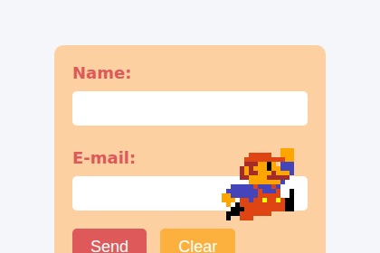</a> | <code>UIV-108</code> | Pixel-art character form: recognizable Mario/Nintendo reference; reference-only until IP review. Categoria FORM verificata nel post pubblico Uiverse. Tag originali: form, mario, input, animated, button, send, red, orange, yellow, email. | <a href="https://uiverse.io/guilhermeyohan/friendly-walrus-55" target="_blank" rel="noopener noreferrer">UIVERSE</a> | FORM | cooking-anime, deskland-android, edu-01-corpo-umano, framelab | Sorgente archiviata |
|  | <code>UIV-109</code> | Pink retro/pastel stars form; adapt to approved rose palette and reduced-motion. Categoria FORM verificata nel post pubblico Uiverse. Tag originali: form, button, bold, pink, password, email, retro, toggle, switch, login. | <a href="https://uiverse.io/mamyapro123/curvy-bear-51" target="_blank" rel="noopener noreferrer">UIVERSE</a> | FORM | annas-diary, beerclass-ai, camperboss, cooking-anime, notes-ecosistema, sleepmax-coach, wonderlog, world-days | Sorgente archiviata |
|  | <code>UIV-110</code> | Animated tooltip with real information; tap/focus/keyboard support, not hover-only. Categoria TOOLTIP verificata nel post pubblico Uiverse. Tag originali: tooltip. | <a href="https://uiverse.io/roroland/average-horse-2" target="_blank" rel="noopener noreferrer">UIVERSE</a> | TOOLTIP | app-factory-dashboard, battery-guard, cashmate-ai, edu-01-corpo-umano, focussense, notes-ecosistema, omni-cleaner, wonderlog, world-days | Sorgente archiviata |
|  | <code>UIV-111</code> | Minimal purple account form; use existing opt-in or non-auth input surfaces only. Categoria FORM verificata nel post pubblico Uiverse. Tag originali: purple, form, log in, button, modern, forgot, password, form, submit, username. | <a href="https://uiverse.io/vinodjangid07/horrible-warthog-14" target="_blank" rel="noopener noreferrer">UIVERSE</a> | FORM | annas-diary, app-factory-dashboard, camperboss, cashmate-ai, notes-ecosistema, wonderlog, world-days | Sorgente archiviata |
| <small>Non disponibile</small> · <a href="https://devlibraries.com/libraries/watermelon/carousel-slider" target="_blank" rel="noopener noreferrer">Fonte</a> | <code>WML-001</code> | Carousel Slider | <a href="https://devlibraries.com/libraries/watermelon/carousel-slider" target="_blank" rel="noopener noreferrer">DEVLIBRARIES_WATERMELON</a> | CAROUSEL_GESTURE | anna-s-diary, beerclass-ai, camperboss, cooking-anime, framelab, notes-ecosistema, omni-cleaner, wonderlog, world-days | Sorgente archiviata |
| <small>Non disponibile</small> · <a href="https://devlibraries.com/libraries/watermelon/fractional-picker" target="_blank" rel="noopener noreferrer">Fonte</a> | <code>WML-002</code> | Fractional Picker | <a href="https://devlibraries.com/libraries/watermelon/fractional-picker" target="_blank" rel="noopener noreferrer">DEVLIBRARIES_WATERMELON</a> | RULER_PICKER | anna-s-diary, battery-guard, beerclass-ai, camperboss, cooking-anime, focussense, sleepmax-coach, world-days | Sorgente archiviata |
| <small>Non disponibile</small> · <a href="https://devlibraries.com/libraries/watermelon/scrub-slider-base" target="_blank" rel="noopener noreferrer">Fonte</a> | <code>WML-003</code> | Scrub Slider (base) | <a href="https://devlibraries.com/libraries/watermelon/scrub-slider-base" target="_blank" rel="noopener noreferrer">DEVLIBRARIES_WATERMELON</a> | SCRUB_PRECISION | anna-s-diary, beerclass-ai, cooking-anime, focussense, framelab, notes-ecosistema, omni-cleaner, trailpath, wonderlog | Sorgente archiviata |
| <small>Non disponibile</small> · <a href="https://devlibraries.com/libraries/watermelon/range-selection-slider" target="_blank" rel="noopener noreferrer">Fonte</a> | <code>WML-004</code> | Range Selection Slider | <a href="https://devlibraries.com/libraries/watermelon/range-selection-slider" target="_blank" rel="noopener noreferrer">DEVLIBRARIES_WATERMELON</a> | TWO_HANDLE_RANGE | anna-s-diary, battery-guard, camperboss, cashmate-ai, focussense, framelab, notes-ecosistema, omni-cleaner, wonderlog, world-days | Sorgente archiviata |
| <small>Non disponibile</small> · <a href="https://devlibraries.com/libraries/watermelon/swap-form" target="_blank" rel="noopener noreferrer">Fonte</a> | <code>WML-005</code> | Swap Form | <a href="https://devlibraries.com/libraries/watermelon/swap-form" target="_blank" rel="noopener noreferrer">DEVLIBRARIES_WATERMELON</a> | AUTH_FORM_TRANSITION | anna-s-diary, app-factory-dashboard, cashmate-ai, cooking-anime, notes-ecosistema, wonderlog, world-days | Sorgente archiviata |
| <small>Non disponibile</small> · <a href="https://devlibraries.com/libraries/watermelon/text-gradient" target="_blank" rel="noopener noreferrer">Fonte</a> | <code>WML-006</code> | Text Gradient | <a href="https://devlibraries.com/libraries/watermelon/text-gradient" target="_blank" rel="noopener noreferrer">DEVLIBRARIES_WATERMELON</a> | TYPOGRAPHY_DECORATION | anna-s-diary, app-factory-dashboard, cooking-anime, framelab, web-utility-factory, wonderlog, world-days | Solo riferimento |
| <small>Non disponibile</small> · <a href="https://devlibraries.com/libraries/watermelon/dialog-stack-base" target="_blank" rel="noopener noreferrer">Fonte</a> | <code>WML-007</code> | Dialog Stack (base) | <a href="https://devlibraries.com/libraries/watermelon/dialog-stack-base" target="_blank" rel="noopener noreferrer">DEVLIBRARIES_WATERMELON</a> | MULTISTEP_MODAL | anna-s-diary, app-factory-dashboard, camperboss, cashmate-ai, cooking-anime, notes-ecosistema, wonderlog | Sorgente archiviata |
| <small>Non disponibile</small> · <a href="https://devlibraries.com/libraries/watermelon/notification-list" target="_blank" rel="noopener noreferrer">Fonte</a> | <code>WML-008</code> | Notification List | <a href="https://devlibraries.com/libraries/watermelon/notification-list" target="_blank" rel="noopener noreferrer">DEVLIBRARIES_WATERMELON</a> | TODAY_IN_APP_REMINDER_SUMMARY | anna-s-diary, app-factory-dashboard, camperboss, cashmate-ai, notes-ecosistema, sleepmax-coach, wonderlog, world-days | Solo riferimento |
| <small>Non disponibile</small> · <a href="https://devlibraries.com/libraries/watermelon/flip-clock" target="_blank" rel="noopener noreferrer">Fonte</a> | <code>WML-009</code> | Flip Clock | <a href="https://devlibraries.com/libraries/watermelon/flip-clock" target="_blank" rel="noopener noreferrer">DEVLIBRARIES_WATERMELON</a> | COUNTDOWN_CLOCK_VISUAL | anna-s-diary, camperboss, cooking-anime, focussense, sleepmax-coach, tabletop-motion-alarm, wonderlog, world-days | Solo riferimento |
