# Anteprime UIR — 99 riferimenti visivi

**Clicca il titolo UIR per espandere l'immagine nella stessa pagina GitHub.** L'anteprima è caricata dalla sua fonte Git; la stessa immagine è collegata una sola volta. Una vera sovrimpressione fullscreen con ricerca e navigazione è disponibile nel [visualizzatore HTML](../docs/index.html) dopo pubblicazione con GitHub Pages.

**Disponibilità:** 66 file su `main` (UIR-0036–UIR-0101); 33 nella [PR #17](https://github.com/riccardopinato/Design-App/pull/17) non ancora fusa (UIR-0001–UIR-0035, esclusi i duplicati UIR-0004 e UIR-0028). Gli ID duplicati non creano immagini ulteriori e sono rimandati all'originale.

Nota: caricare direttamente i 33 originali dalla PR #17 per la navigazione. Le immagini non sono componenti Golden.

## Indice rapido

[UIR-0001](#uir-0001) · [UIR-0002](#uir-0002) · [UIR-0003](#uir-0003) · [UIR-0005](#uir-0005) · [UIR-0006](#uir-0006) · [UIR-0007](#uir-0007) · [UIR-0008](#uir-0008) · [UIR-0009](#uir-0009) · [UIR-0010](#uir-0010) · [UIR-0011](#uir-0011) · [UIR-0012](#uir-0012) · [UIR-0013](#uir-0013) · [UIR-0014](#uir-0014) · [UIR-0015](#uir-0015) · [UIR-0016](#uir-0016) · [UIR-0017](#uir-0017) · [UIR-0018](#uir-0018) · [UIR-0019](#uir-0019) · [UIR-0020](#uir-0020) · [UIR-0021](#uir-0021) · [UIR-0022](#uir-0022) · [UIR-0023](#uir-0023) · [UIR-0024](#uir-0024) · [UIR-0025](#uir-0025) · [UIR-0026](#uir-0026) · [UIR-0027](#uir-0027) · [UIR-0029](#uir-0029) · [UIR-0030](#uir-0030) · [UIR-0031](#uir-0031) · [UIR-0032](#uir-0032) · [UIR-0033](#uir-0033) · [UIR-0034](#uir-0034) · [UIR-0035](#uir-0035) · [UIR-0036](#uir-0036) · [UIR-0037](#uir-0037) · [UIR-0038](#uir-0038) · [UIR-0039](#uir-0039) · [UIR-0040](#uir-0040) · [UIR-0041](#uir-0041) · [UIR-0042](#uir-0042) · [UIR-0043](#uir-0043) · [UIR-0044](#uir-0044) · [UIR-0045](#uir-0045) · [UIR-0046](#uir-0046) · [UIR-0047](#uir-0047) · [UIR-0048](#uir-0048) · [UIR-0049](#uir-0049) · [UIR-0050](#uir-0050) · [UIR-0051](#uir-0051) · [UIR-0052](#uir-0052) · [UIR-0053](#uir-0053) · [UIR-0054](#uir-0054) · [UIR-0055](#uir-0055) · [UIR-0056](#uir-0056) · [UIR-0057](#uir-0057) · [UIR-0058](#uir-0058) · [UIR-0059](#uir-0059) · [UIR-0060](#uir-0060) · [UIR-0061](#uir-0061) · [UIR-0062](#uir-0062) · [UIR-0063](#uir-0063) · [UIR-0064](#uir-0064) · [UIR-0065](#uir-0065) · [UIR-0066](#uir-0066) · [UIR-0067](#uir-0067) · [UIR-0068](#uir-0068) · [UIR-0069](#uir-0069) · [UIR-0070](#uir-0070) · [UIR-0071](#uir-0071) · [UIR-0072](#uir-0072) · [UIR-0073](#uir-0073) · [UIR-0074](#uir-0074) · [UIR-0075](#uir-0075) · [UIR-0076](#uir-0076) · [UIR-0077](#uir-0077) · [UIR-0078](#uir-0078) · [UIR-0079](#uir-0079) · [UIR-0080](#uir-0080) · [UIR-0081](#uir-0081) · [UIR-0082](#uir-0082) · [UIR-0083](#uir-0083) · [UIR-0084](#uir-0084) · [UIR-0085](#uir-0085) · [UIR-0086](#uir-0086) · [UIR-0087](#uir-0087) · [UIR-0088](#uir-0088) · [UIR-0089](#uir-0089) · [UIR-0090](#uir-0090) · [UIR-0091](#uir-0091) · [UIR-0092](#uir-0092) · [UIR-0093](#uir-0093) · [UIR-0094](#uir-0094) · [UIR-0095](#uir-0095) · [UIR-0096](#uir-0096) · [UIR-0097](#uir-0097) · [UIR-0098](#uir-0098) · [UIR-0099](#uir-0099) · [UIR-0100](#uir-0100) · [UIR-0101](#uir-0101)

---

### UIR-0001

<strong>📷 UIR-0001 — Retro student planner a finestre</strong> · RETRO DESKTOP · PR #17 (non su main)

<a href="https://github.com/riccardopinato/Design-App/blob/c064da7b5389938c1ea9825c573596fcd935e73d/UI-UX/RETRO%20DESKTOP/IMMAGINI/UIR-0001.jpg">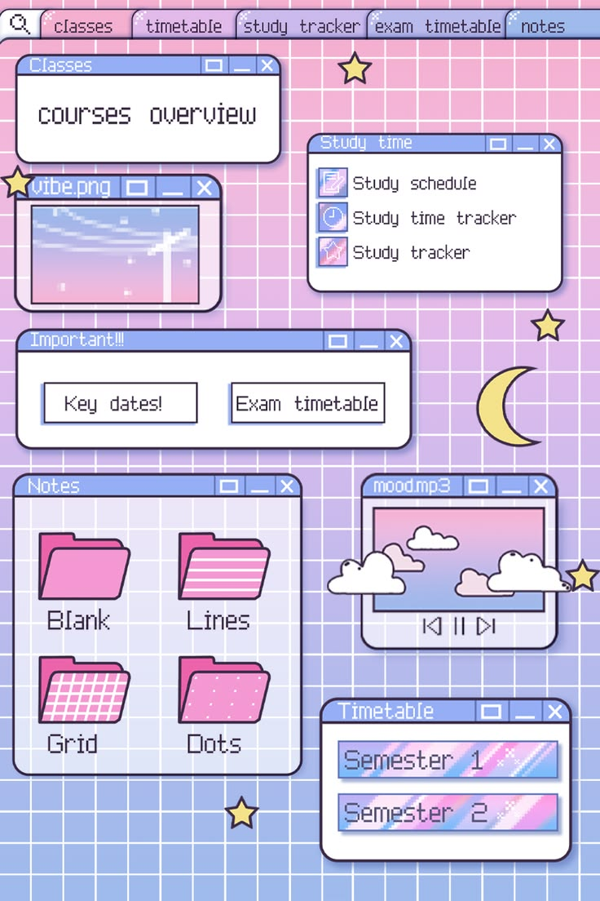</a>

App candidate: Notes-Ecosistema, 180FlipCharge, Cooking Anime. [JPG originale](https://github.com/riccardopinato/Design-App/blob/c064da7b5389938c1ea9825c573596fcd935e73d/UI-UX/RETRO%20DESKTOP/IMMAGINI/UIR-0001.jpg).

### UIR-0002

<strong>📷 UIR-0002 — Toggle volume arancione e argento</strong> · TOGGLE &amp; SWITCH · PR #17 (non su main)

<a href="https://github.com/riccardopinato/Design-App/blob/c064da7b5389938c1ea9825c573596fcd935e73d/UI-UX/TOGGLE%20%26%20SWITCH/IMMAGINI/UIR-0002.jpg">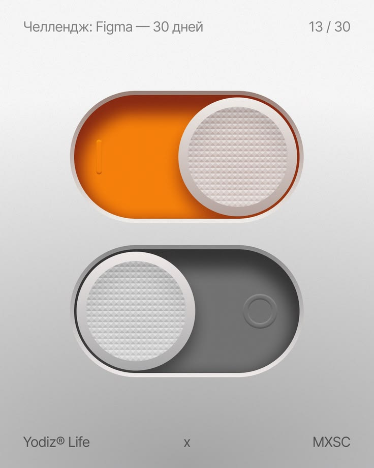</a>

App candidate: Battery Guard, Pocket Guard, Easy Debloat. [JPG originale](https://github.com/riccardopinato/Design-App/blob/c064da7b5389938c1ea9825c573596fcd935e73d/UI-UX/TOGGLE%20%26%20SWITCH/IMMAGINI/UIR-0002.jpg).

### UIR-0003

<strong>📷 UIR-0003 — Collage mint/pink Soft 3D</strong> · SOFT 3D · PR #17 (non su main)

<a href="https://github.com/riccardopinato/Design-App/blob/c064da7b5389938c1ea9825c573596fcd935e73d/UI-UX/SOFT%203D/IMMAGINI/UIR-0003.jpg">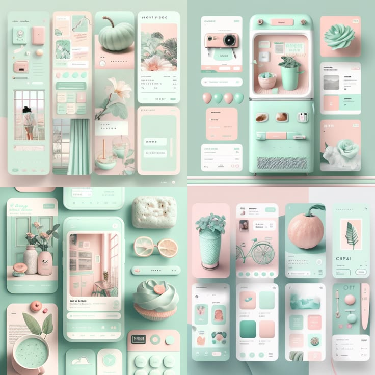</a>

App candidate: Anna's Diary, Notes-Ecosistema, Wonderlog. [JPG originale](https://github.com/riccardopinato/Design-App/blob/c064da7b5389938c1ea9825c573596fcd935e73d/UI-UX/SOFT%203D/IMMAGINI/UIR-0003.jpg).

### UIR-0005

<strong>📷 UIR-0005 — Widget Home Neumorphism</strong> · NEUMORPHISM · PR #17 (non su main)

<a href="https://github.com/riccardopinato/Design-App/blob/c064da7b5389938c1ea9825c573596fcd935e73d/UI-UX/NEUMORPHISM/IMMAGINI/UIR-0005.jpg">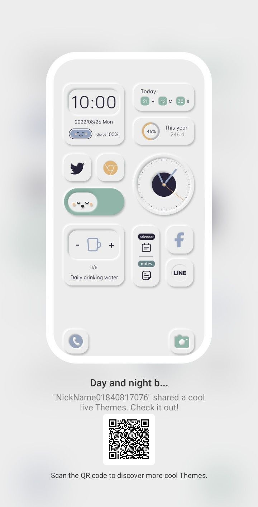</a>

App candidate: Battery Guard, SleepMax Coach, Pocket Guard. [JPG originale](https://github.com/riccardopinato/Design-App/blob/c064da7b5389938c1ea9825c573596fcd935e73d/UI-UX/NEUMORPHISM/IMMAGINI/UIR-0005.jpg).

### UIR-0006

<strong>📷 UIR-0006 — Dashboard paesaggistica dark</strong> · BENTO UI · PR #17 (non su main)

<a href="https://github.com/riccardopinato/Design-App/blob/c064da7b5389938c1ea9825c573596fcd935e73d/UI-UX/BENTO%20UI/IMMAGINI/UIR-0006.jpg">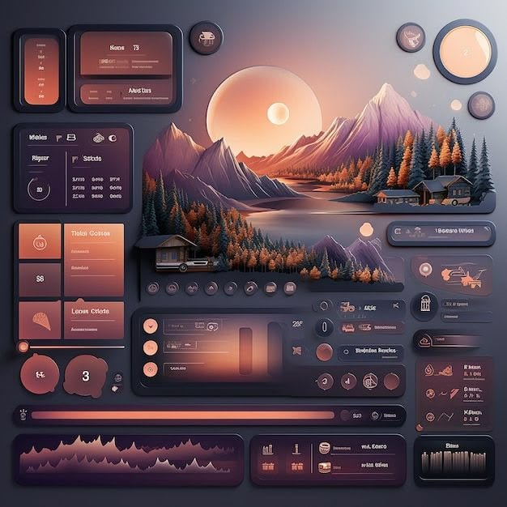</a>

App candidate: TrailPath, CamperBoss, FocusSense. [JPG originale](https://github.com/riccardopinato/Design-App/blob/c064da7b5389938c1ea9825c573596fcd935e73d/UI-UX/BENTO%20UI/IMMAGINI/UIR-0006.jpg).

### UIR-0007

<strong>📷 UIR-0007 — Atlante delle ombre Neumorphism</strong> · NEUMORPHISM · PR #17 (non su main)

<a href="https://github.com/riccardopinato/Design-App/blob/c064da7b5389938c1ea9825c573596fcd935e73d/UI-UX/NEUMORPHISM/IMMAGINI/UIR-0007.jpg">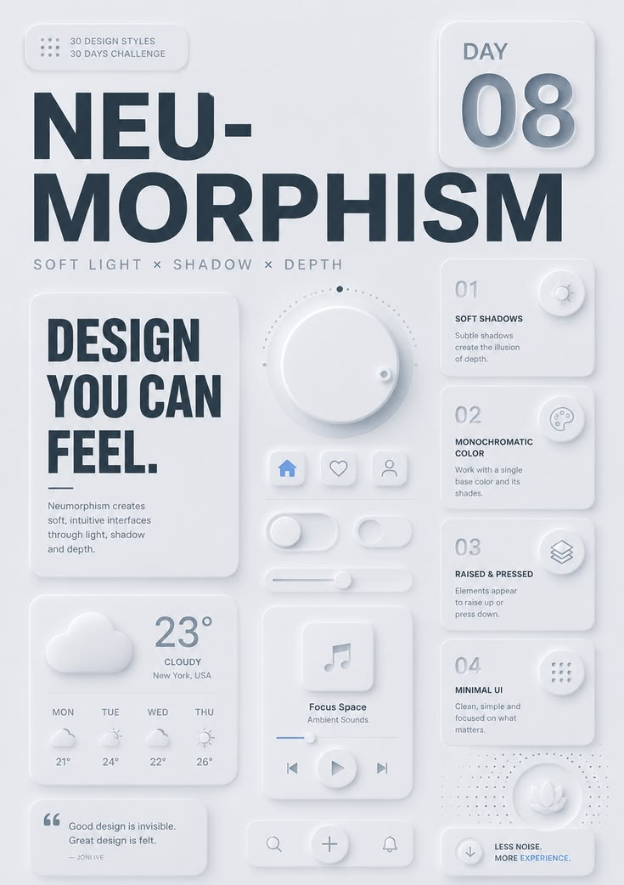</a>

App candidate: Battery Guard, SleepMax Coach, Notes-Ecosistema. [JPG originale](https://github.com/riccardopinato/Design-App/blob/c064da7b5389938c1ea9825c573596fcd935e73d/UI-UX/NEUMORPHISM/IMMAGINI/UIR-0007.jpg).

### UIR-0008

<strong>📷 UIR-0008 — Smart home neumorfica monocromatica</strong> · NEUMORPHISM · PR #17 (non su main)

<a href="https://github.com/riccardopinato/Design-App/blob/c064da7b5389938c1ea9825c573596fcd935e73d/UI-UX/NEUMORPHISM/IMMAGINI/UIR-0008.jpg">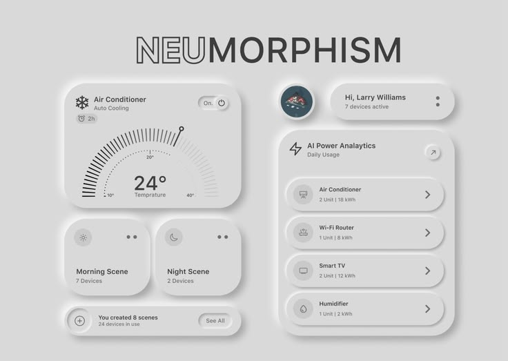</a>

App candidate: Battery Guard, FocusSense, Pocket Guard. [JPG originale](https://github.com/riccardopinato/Design-App/blob/c064da7b5389938c1ea9825c573596fcd935e73d/UI-UX/NEUMORPHISM/IMMAGINI/UIR-0008.jpg).

### UIR-0009

<strong>📷 UIR-0009 — Switch illustrati alba e notte</strong> · TOGGLE &amp; SWITCH · PR #17 (non su main)

<a href="https://github.com/riccardopinato/Design-App/blob/c064da7b5389938c1ea9825c573596fcd935e73d/UI-UX/TOGGLE%20%26%20SWITCH/IMMAGINI/UIR-0009.jpg">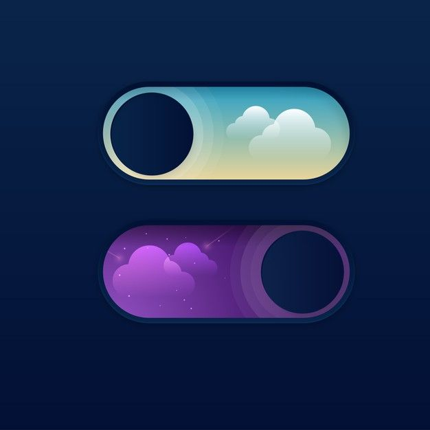</a>

App candidate: SleepMax Coach, Anna's Diary, 180FlipCharge. [JPG originale](https://github.com/riccardopinato/Design-App/blob/c064da7b5389938c1ea9825c573596fcd935e73d/UI-UX/TOGGLE%20%26%20SWITCH/IMMAGINI/UIR-0009.jpg).

### UIR-0010

<strong>📷 UIR-0010 — Switch paesaggi giorno/notte</strong> · TOGGLE &amp; SWITCH · PR #17 (non su main)

<a href="https://github.com/riccardopinato/Design-App/blob/c064da7b5389938c1ea9825c573596fcd935e73d/UI-UX/TOGGLE%20%26%20SWITCH/IMMAGINI/UIR-0010.jpg">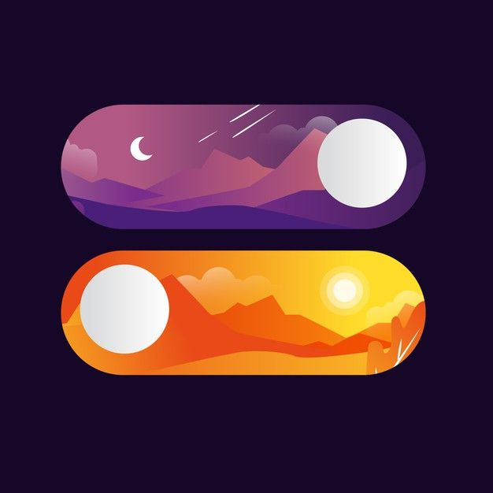</a>

App candidate: SleepMax Coach, Wonderlog, CamperBoss. [JPG originale](https://github.com/riccardopinato/Design-App/blob/c064da7b5389938c1ea9825c573596fcd935e73d/UI-UX/TOGGLE%20%26%20SWITCH/IMMAGINI/UIR-0010.jpg).

### UIR-0011

<strong>📷 UIR-0011 — Componenti tattili sage e lilla</strong> · DESIGN SYSTEM · PR #17 (non su main)

<a href="https://github.com/riccardopinato/Design-App/blob/c064da7b5389938c1ea9825c573596fcd935e73d/UI-UX/DESIGN%20SYSTEM/IMMAGINI/UIR-0011.jpg">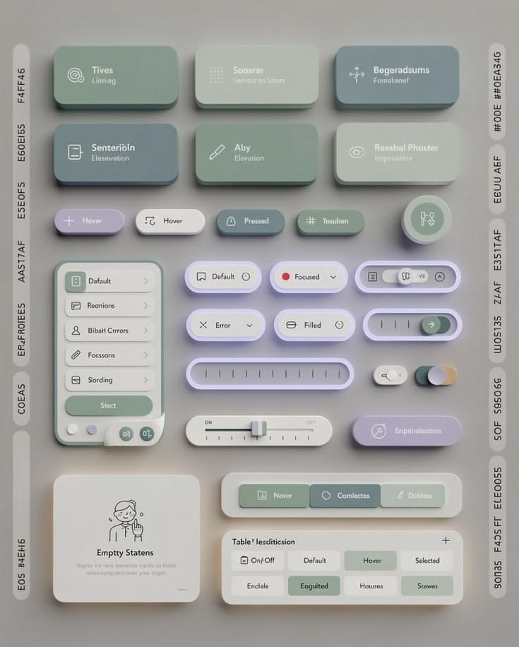</a>

App candidate: Battery Guard, Notes-Ecosistema, Anna's Diary. [JPG originale](https://github.com/riccardopinato/Design-App/blob/c064da7b5389938c1ea9825c573596fcd935e73d/UI-UX/DESIGN%20SYSTEM/IMMAGINI/UIR-0011.jpg).

### UIR-0012

<strong>📷 UIR-0012 — Kit GUI Windows rétro rosa</strong> · RETRO DESKTOP · PR #17 (non su main)

<a href="https://github.com/riccardopinato/Design-App/blob/c064da7b5389938c1ea9825c573596fcd935e73d/UI-UX/RETRO%20DESKTOP/IMMAGINI/UIR-0012.jpg">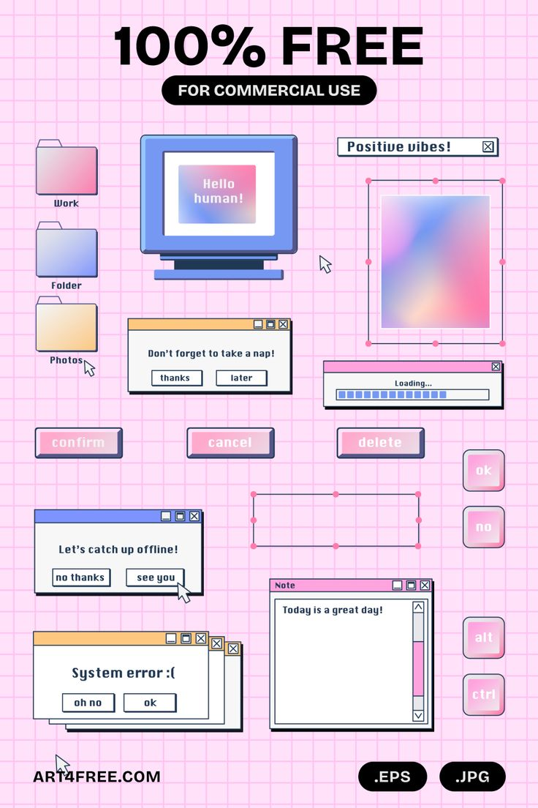</a>

App candidate: Notes-Ecosistema, Cooking Anime, 180FlipCharge. [JPG originale](https://github.com/riccardopinato/Design-App/blob/c064da7b5389938c1ea9825c573596fcd935e73d/UI-UX/RETRO%20DESKTOP/IMMAGINI/UIR-0012.jpg).

### UIR-0013

<strong>📷 UIR-0013 — 50 palette cromatiche</strong> · DESIGN SYSTEM · PR #17 (non su main)

<a href="https://github.com/riccardopinato/Design-App/blob/c064da7b5389938c1ea9825c573596fcd935e73d/UI-UX/DESIGN%20SYSTEM/IMMAGINI/UIR-0013.jpg">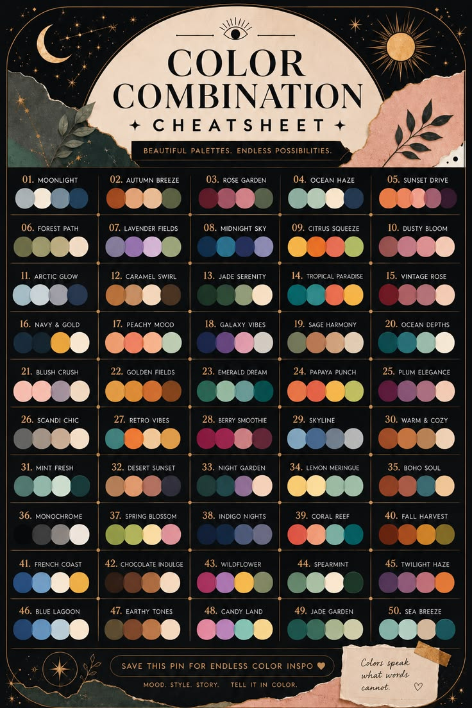</a>

App candidate: FrameLab, World Days, Anna's Diary. [JPG originale](https://github.com/riccardopinato/Design-App/blob/c064da7b5389938c1ea9825c573596fcd935e73d/UI-UX/DESIGN%20SYSTEM/IMMAGINI/UIR-0013.jpg).

### UIR-0014

<strong>📷 UIR-0014 — UI Kit Claymorphism peach/blue</strong> · SOFT 3D · PR #17 (non su main)

<a href="https://github.com/riccardopinato/Design-App/blob/c064da7b5389938c1ea9825c573596fcd935e73d/UI-UX/SOFT%203D/IMMAGINI/UIR-0014.jpg">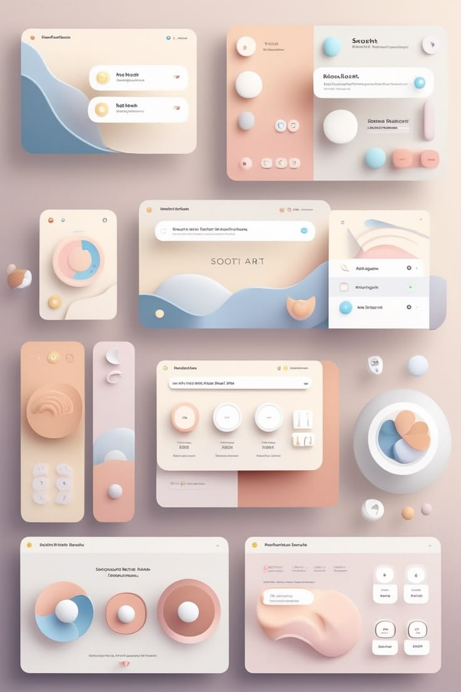</a>

App candidate: Anna's Diary, Notes-Ecosistema, Wonderlog. [JPG originale](https://github.com/riccardopinato/Design-App/blob/c064da7b5389938c1ea9825c573596fcd935e73d/UI-UX/SOFT%203D/IMMAGINI/UIR-0014.jpg).

### UIR-0015

<strong>📷 UIR-0015 — Foundations Liquid Glass</strong> · GLASSMORPHISM · PR #17 (non su main)

<a href="https://github.com/riccardopinato/Design-App/blob/c064da7b5389938c1ea9825c573596fcd935e73d/UI-UX/GLASSMORPHISM/IMMAGINI/UIR-0015.jpg">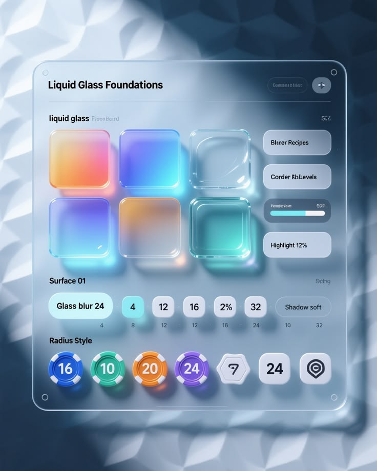</a>

App candidate: FocusSense, The Luminous Infinite Circle, CashMate AI. [JPG originale](https://github.com/riccardopinato/Design-App/blob/c064da7b5389938c1ea9825c573596fcd935e73d/UI-UX/GLASSMORPHISM/IMMAGINI/UIR-0015.jpg).

### UIR-0016

<strong>📷 UIR-0016 — Design system coral-teal scuro</strong> · DESIGN SYSTEM · PR #17 (non su main)

<a href="https://github.com/riccardopinato/Design-App/blob/c064da7b5389938c1ea9825c573596fcd935e73d/UI-UX/DESIGN%20SYSTEM/IMMAGINI/UIR-0016.jpg">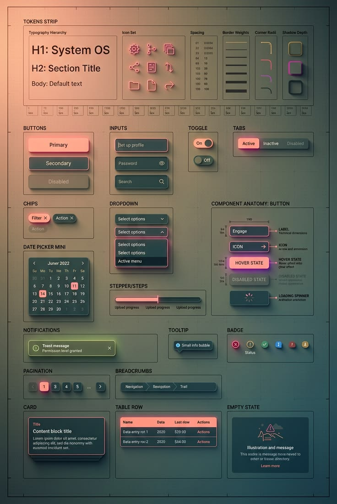</a>

App candidate: CashMate AI, Notes-Ecosistema, App Factory Dashboard. [JPG originale](https://github.com/riccardopinato/Design-App/blob/c064da7b5389938c1ea9825c573596fcd935e73d/UI-UX/DESIGN%20SYSTEM/IMMAGINI/UIR-0016.jpg).

### UIR-0017

<strong>📷 UIR-0017 — Neo-tactile blu/ciano</strong> · DESIGN SYSTEM · PR #17 (non su main)

<a href="https://github.com/riccardopinato/Design-App/blob/c064da7b5389938c1ea9825c573596fcd935e73d/UI-UX/DESIGN%20SYSTEM/IMMAGINI/UIR-0017.jpg">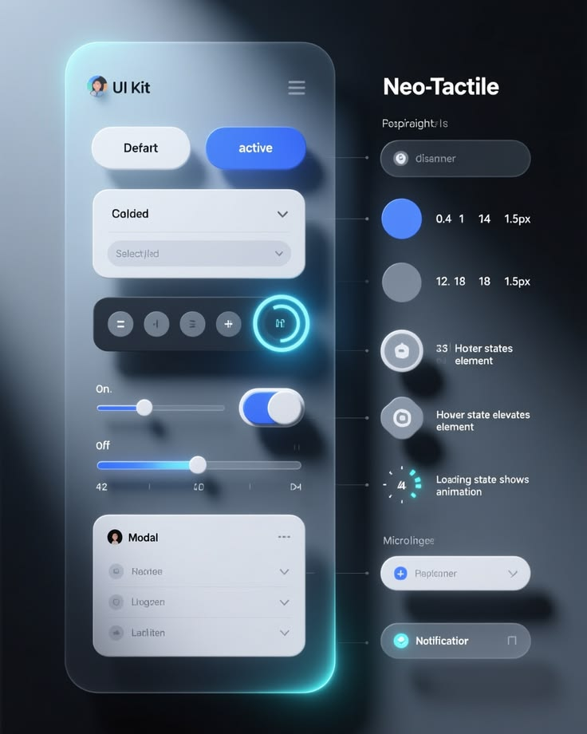</a>

App candidate: FocusSense, CashMate AI, Battery Guard. [JPG originale](https://github.com/riccardopinato/Design-App/blob/c064da7b5389938c1ea9825c573596fcd935e73d/UI-UX/DESIGN%20SYSTEM/IMMAGINI/UIR-0017.jpg).

### UIR-0018

<strong>📷 UIR-0018 — Toggle rosso/nero materico</strong> · TOGGLE &amp; SWITCH · PR #17 (non su main)

<a href="https://github.com/riccardopinato/Design-App/blob/c064da7b5389938c1ea9825c573596fcd935e73d/UI-UX/TOGGLE%20%26%20SWITCH/IMMAGINI/UIR-0018.jpg">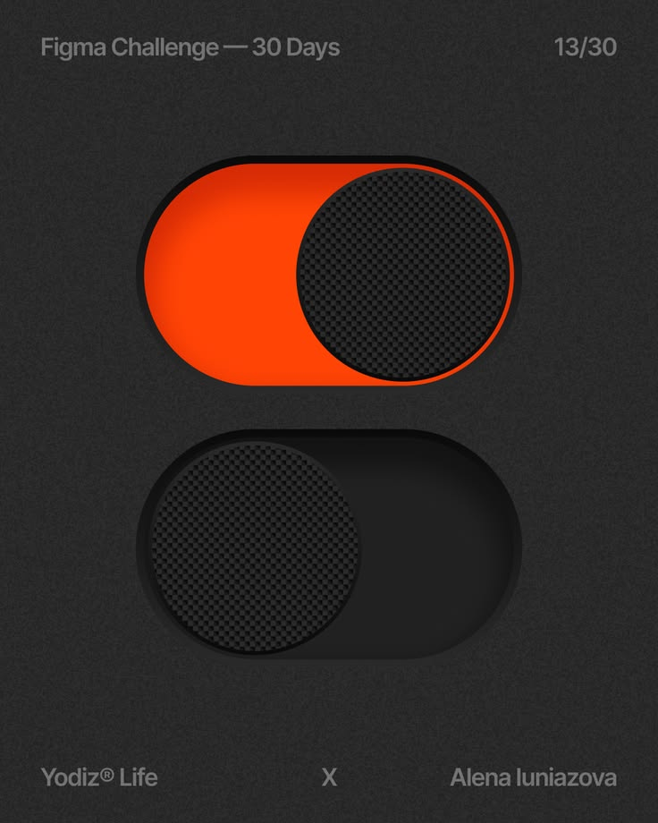</a>

App candidate: Tabletop Motion Alarm, Pocket Guard, The Luminous Infinite Circle. [JPG originale](https://github.com/riccardopinato/Design-App/blob/c064da7b5389938c1ea9825c573596fcd935e73d/UI-UX/TOGGLE%20%26%20SWITCH/IMMAGINI/UIR-0018.jpg).

### UIR-0019

<strong>📷 UIR-0019 — Confronto UI esteticamente ricca ma poco usabile</strong> · DESIGN SYSTEM · PR #17 (non su main)

<a href="https://github.com/riccardopinato/Design-App/blob/c064da7b5389938c1ea9825c573596fcd935e73d/UI-UX/DESIGN%20SYSTEM/IMMAGINI/UIR-0019.jpg">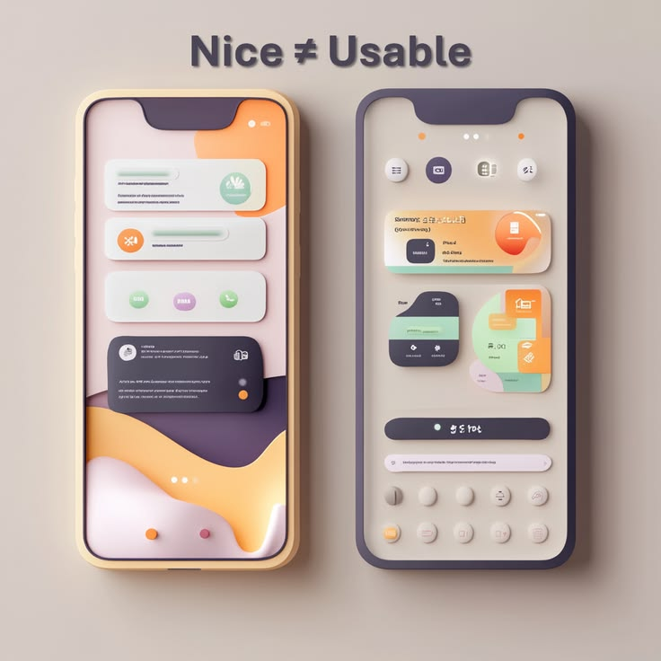</a>

App candidate: Notes-Ecosistema, Anna's Diary, App Factory Dashboard. [JPG originale](https://github.com/riccardopinato/Design-App/blob/c064da7b5389938c1ea9825c573596fcd935e73d/UI-UX/DESIGN%20SYSTEM/IMMAGINI/UIR-0019.jpg).

### UIR-0020

<strong>📷 UIR-0020 — Otto palette cinematiche</strong> · DESIGN SYSTEM · PR #17 (non su main)

<a href="https://github.com/riccardopinato/Design-App/blob/c064da7b5389938c1ea9825c573596fcd935e73d/UI-UX/DESIGN%20SYSTEM/IMMAGINI/UIR-0020.jpg">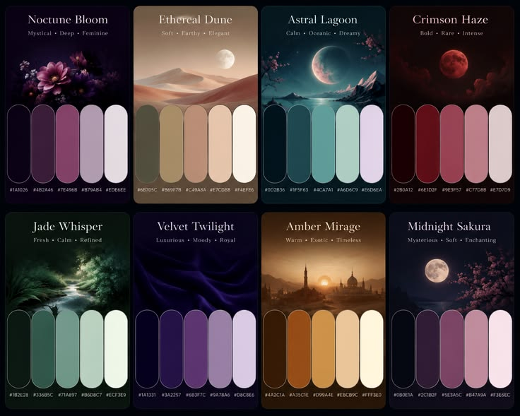</a>

App candidate: FrameLab, SleepMax Coach, Anna's Diary. [JPG originale](https://github.com/riccardopinato/Design-App/blob/c064da7b5389938c1ea9825c573596fcd935e73d/UI-UX/DESIGN%20SYSTEM/IMMAGINI/UIR-0020.jpg).

### UIR-0021

<strong>📷 UIR-0021 — Interfacce botaniche mint</strong> · SOFT 3D · PR #17 (non su main)

<a href="https://github.com/riccardopinato/Design-App/blob/c064da7b5389938c1ea9825c573596fcd935e73d/UI-UX/SOFT%203D/IMMAGINI/UIR-0021.jpg">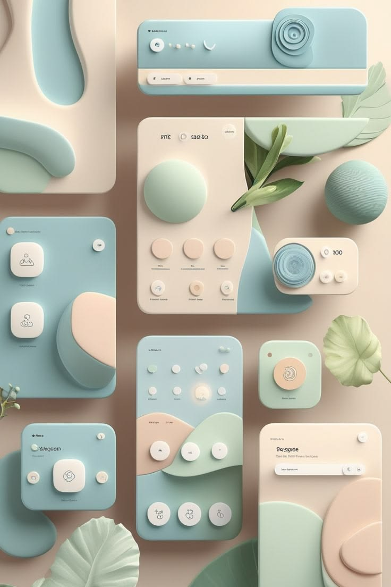</a>

App candidate: Anna's Diary, Wonderlog, CamperBoss. [JPG originale](https://github.com/riccardopinato/Design-App/blob/c064da7b5389938c1ea9825c573596fcd935e73d/UI-UX/SOFT%203D/IMMAGINI/UIR-0021.jpg).

### UIR-0022

<strong>📷 UIR-0022 — Palette Moon viola</strong> · DESIGN SYSTEM · PR #17 (non su main)

<a href="https://github.com/riccardopinato/Design-App/blob/c064da7b5389938c1ea9825c573596fcd935e73d/UI-UX/DESIGN%20SYSTEM/IMMAGINI/UIR-0022.jpg">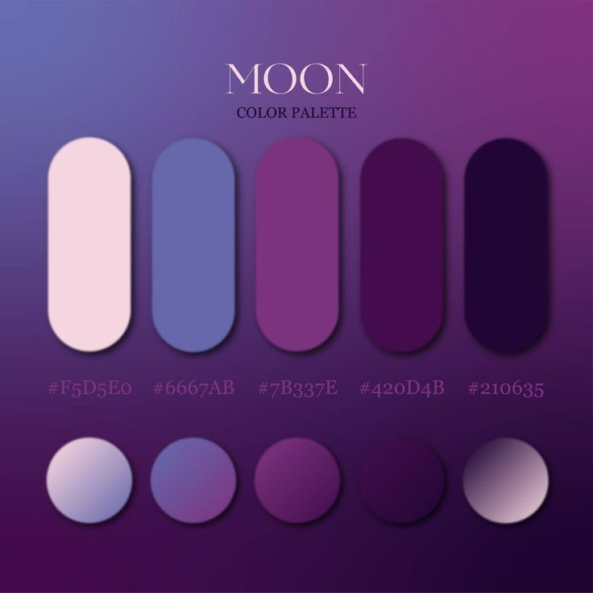</a>

App candidate: SleepMax Coach, Anna's Diary, FocusSense. [JPG originale](https://github.com/riccardopinato/Design-App/blob/c064da7b5389938c1ea9825c573596fcd935e73d/UI-UX/DESIGN%20SYSTEM/IMMAGINI/UIR-0022.jpg).

### UIR-0023

<strong>📷 UIR-0023 — Widget plush con marchi</strong> · SKEUOMORPHISM · PR #17 (non su main)

<a href="https://github.com/riccardopinato/Design-App/blob/c064da7b5389938c1ea9825c573596fcd935e73d/UI-UX/SKEUOMORPHISM/IMMAGINI/UIR-0023.jpg">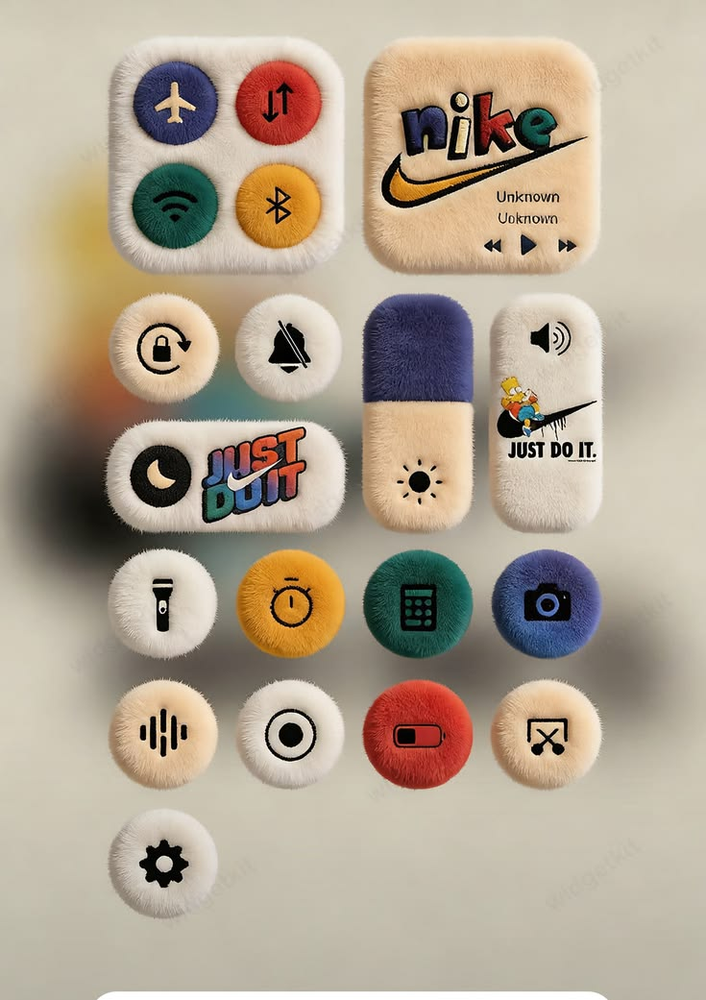</a>

App candidate: Cooking Anime, Anna's Diary, Deskland Android. [JPG originale](https://github.com/riccardopinato/Design-App/blob/c064da7b5389938c1ea9825c573596fcd935e73d/UI-UX/SKEUOMORPHISM/IMMAGINI/UIR-0023.jpg).

### UIR-0024

<strong>📷 UIR-0024 — Widget glossy con marchi</strong> · GLASSMORPHISM · PR #17 (non su main)

<a href="https://github.com/riccardopinato/Design-App/blob/c064da7b5389938c1ea9825c573596fcd935e73d/UI-UX/GLASSMORPHISM/IMMAGINI/UIR-0024.jpg">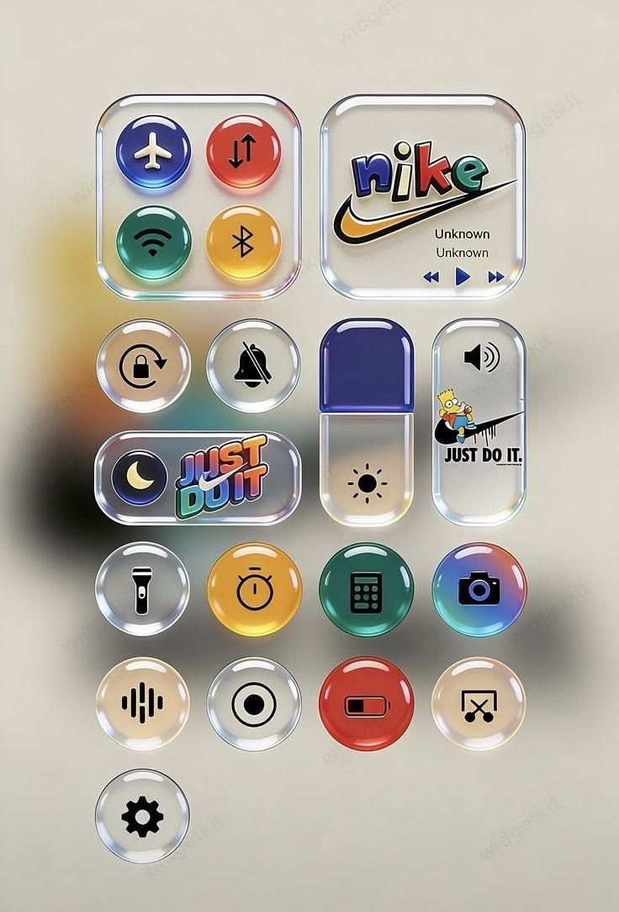</a>

App candidate: FocusSense, The Luminous Infinite Circle, CashMate AI. [JPG originale](https://github.com/riccardopinato/Design-App/blob/c064da7b5389938c1ea9825c573596fcd935e73d/UI-UX/GLASSMORPHISM/IMMAGINI/UIR-0024.jpg).

### UIR-0025

<strong>📷 UIR-0025 — Design system beige/teal completo</strong> · DESIGN SYSTEM · PR #17 (non su main)

<a href="https://github.com/riccardopinato/Design-App/blob/c064da7b5389938c1ea9825c573596fcd935e73d/UI-UX/DESIGN%20SYSTEM/IMMAGINI/UIR-0025.jpg">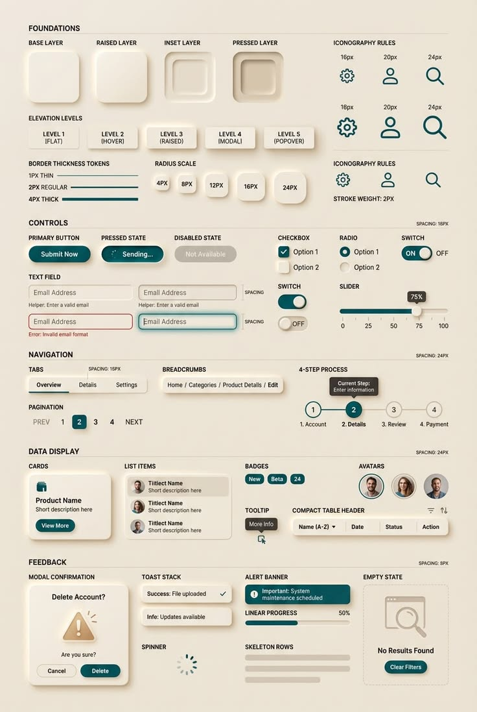</a>

App candidate: CashMate AI, Battery Guard, Easy Debloat. [JPG originale](https://github.com/riccardopinato/Design-App/blob/c064da7b5389938c1ea9825c573596fcd935e73d/UI-UX/DESIGN%20SYSTEM/IMMAGINI/UIR-0025.jpg).

### UIR-0026

<strong>📷 UIR-0026 — Liquid glass kit controlli</strong> · GLASSMORPHISM · PR #17 (non su main)

<a href="https://github.com/riccardopinato/Design-App/blob/c064da7b5389938c1ea9825c573596fcd935e73d/UI-UX/GLASSMORPHISM/IMMAGINI/UIR-0026.jpg">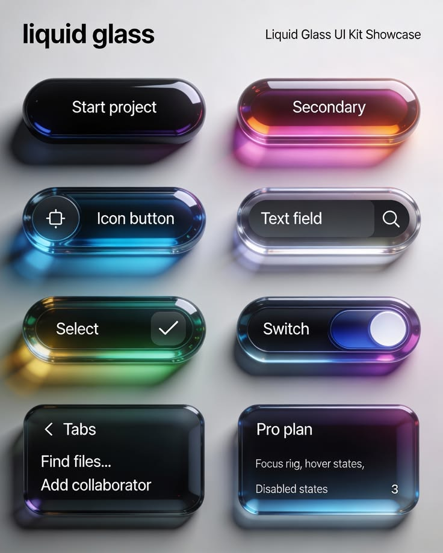</a>

App candidate: The Luminous Infinite Circle, FocusSense, CashMate AI. [JPG originale](https://github.com/riccardopinato/Design-App/blob/c064da7b5389938c1ea9825c573596fcd935e73d/UI-UX/GLASSMORPHISM/IMMAGINI/UIR-0026.jpg).

### UIR-0027

<strong>📷 UIR-0027 — Home soft bianco</strong> · NEUMORPHISM · PR #17 (non su main)

<a href="https://github.com/riccardopinato/Design-App/blob/c064da7b5389938c1ea9825c573596fcd935e73d/UI-UX/NEUMORPHISM/IMMAGINI/UIR-0027.jpg">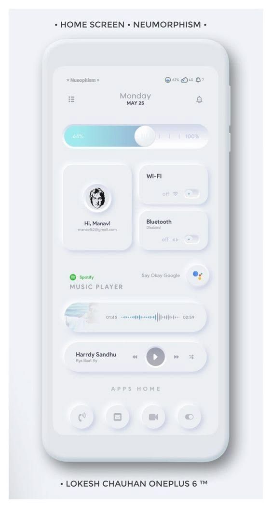</a>

App candidate: Battery Guard, Pocket Guard, SleepMax Coach. [JPG originale](https://github.com/riccardopinato/Design-App/blob/c064da7b5389938c1ea9825c573596fcd935e73d/UI-UX/NEUMORPHISM/IMMAGINI/UIR-0027.jpg).

### UIR-0029

<strong>📷 UIR-0029 — Hello March dashboard grigio</strong> · NEUMORPHISM · PR #17 (non su main)

<a href="https://github.com/riccardopinato/Design-App/blob/c064da7b5389938c1ea9825c573596fcd935e73d/UI-UX/NEUMORPHISM/IMMAGINI/UIR-0029.jpg">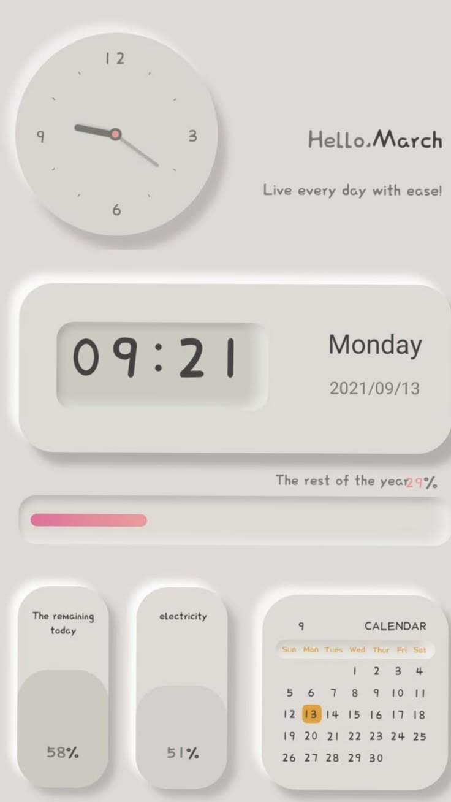</a>

App candidate: SleepMax Coach, Anna's Diary, Battery Guard. [JPG originale](https://github.com/riccardopinato/Design-App/blob/c064da7b5389938c1ea9825c573596fcd935e73d/UI-UX/NEUMORPHISM/IMMAGINI/UIR-0029.jpg).

### UIR-0030

<strong>📷 UIR-0030 — Single toggle minimale bianco</strong> · TOGGLE &amp; SWITCH · PR #17 (non su main)

<a href="https://github.com/riccardopinato/Design-App/blob/c064da7b5389938c1ea9825c573596fcd935e73d/UI-UX/TOGGLE%20%26%20SWITCH/IMMAGINI/UIR-0030.jpg">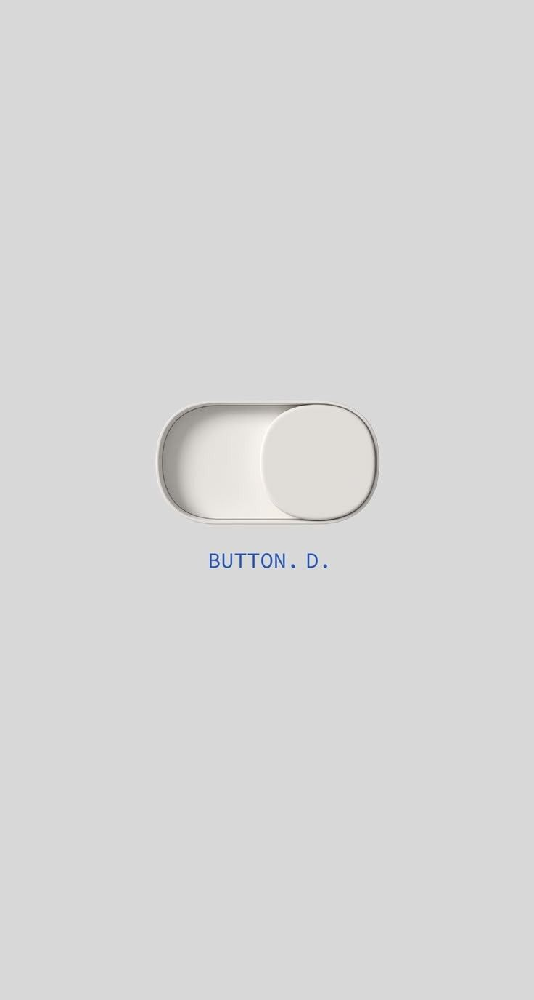</a>

App candidate: Battery Guard, Easy Debloat, Pocket Guard. [JPG originale](https://github.com/riccardopinato/Design-App/blob/c064da7b5389938c1ea9825c573596fcd935e73d/UI-UX/TOGGLE%20%26%20SWITCH/IMMAGINI/UIR-0030.jpg).

### UIR-0031

<strong>📷 UIR-0031 — Dark glass switch arancione</strong> · TOGGLE &amp; SWITCH · PR #17 (non su main)

<a href="https://github.com/riccardopinato/Design-App/blob/c064da7b5389938c1ea9825c573596fcd935e73d/UI-UX/TOGGLE%20%26%20SWITCH/IMMAGINI/UIR-0031.jpg">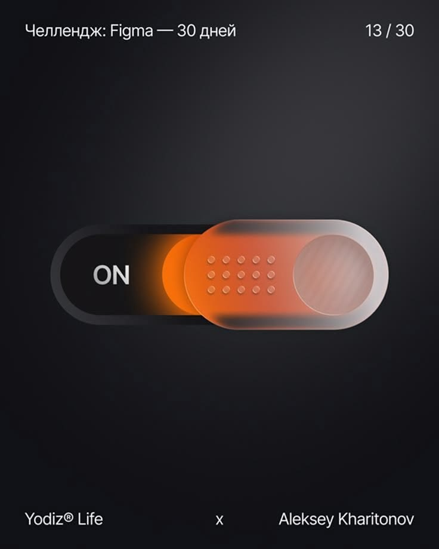</a>

App candidate: FocusSense, The Luminous Infinite Circle, CashMate AI. [JPG originale](https://github.com/riccardopinato/Design-App/blob/c064da7b5389938c1ea9825c573596fcd935e73d/UI-UX/TOGGLE%20%26%20SWITCH/IMMAGINI/UIR-0031.jpg).

### UIR-0032

<strong>📷 UIR-0032 — Interruttori tattici prato</strong> · TOGGLE &amp; SWITCH · PR #17 (non su main)

<a href="https://github.com/riccardopinato/Design-App/blob/c064da7b5389938c1ea9825c573596fcd935e73d/UI-UX/TOGGLE%20%26%20SWITCH/IMMAGINI/UIR-0032.jpg">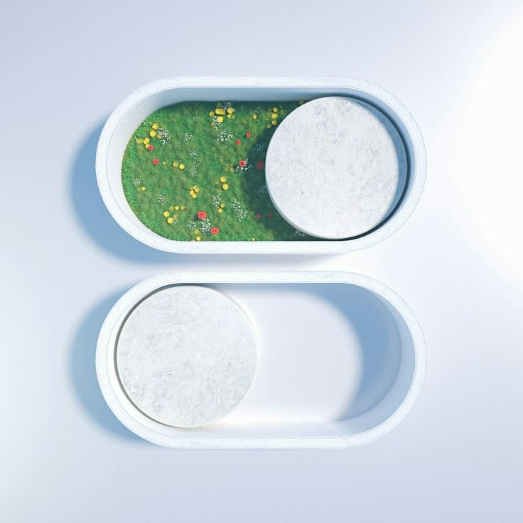</a>

App candidate: CamperBoss, TrailPath, Wonderlog. [JPG originale](https://github.com/riccardopinato/Design-App/blob/c064da7b5389938c1ea9825c573596fcd935e73d/UI-UX/TOGGLE%20%26%20SWITCH/IMMAGINI/UIR-0032.jpg).

### UIR-0033

<strong>📷 UIR-0033 — Lockscreen editoriale illustrata</strong> · EDITORIAL UI · PR #17 (non su main)

<a href="https://github.com/riccardopinato/Design-App/blob/c064da7b5389938c1ea9825c573596fcd935e73d/UI-UX/EDITORIAL%20UI/IMMAGINI/UIR-0033.jpg">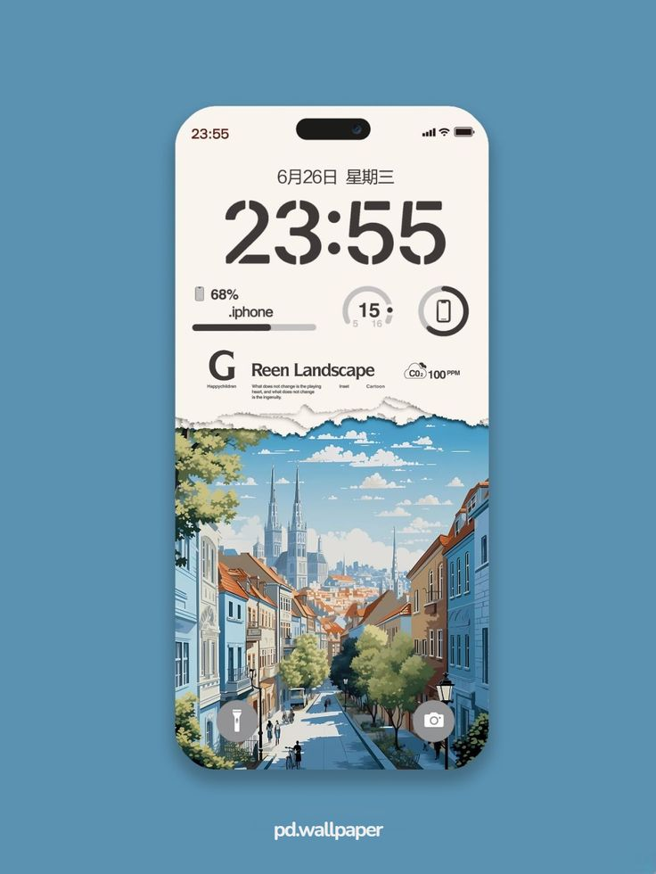</a>

App candidate: Wonderlog, World Days, FrameLab. [JPG originale](https://github.com/riccardopinato/Design-App/blob/c064da7b5389938c1ea9825c573596fcd935e73d/UI-UX/EDITORIAL%20UI/IMMAGINI/UIR-0033.jpg).

### UIR-0034

<strong>📷 UIR-0034 — Tassonomia bottom navigation</strong> · NAVIGATION UI · PR #17 (non su main)

<a href="https://github.com/riccardopinato/Design-App/blob/c064da7b5389938c1ea9825c573596fcd935e73d/UI-UX/NAVIGATION%20UI/IMMAGINI/UIR-0034.jpg">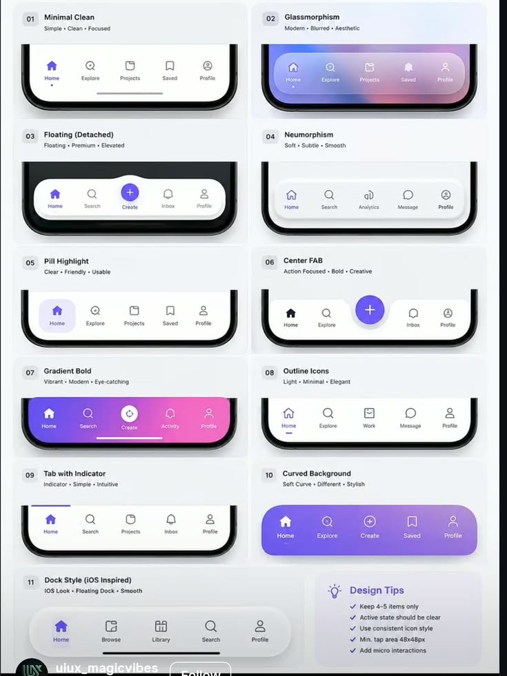</a>

App candidate: Anna's Diary, Notes-Ecosistema, Wonderlog. [JPG originale](https://github.com/riccardopinato/Design-App/blob/c064da7b5389938c1ea9825c573596fcd935e73d/UI-UX/NAVIGATION%20UI/IMMAGINI/UIR-0034.jpg).

### UIR-0035

<strong>📷 UIR-0035 — Toggle turchese e grigio con pattern</strong> · TOGGLE &amp; SWITCH · PR #17 (non su main)

<a href="https://github.com/riccardopinato/Design-App/blob/c064da7b5389938c1ea9825c573596fcd935e73d/UI-UX/TOGGLE%20%26%20SWITCH/IMMAGINI/UIR-0035.jpg">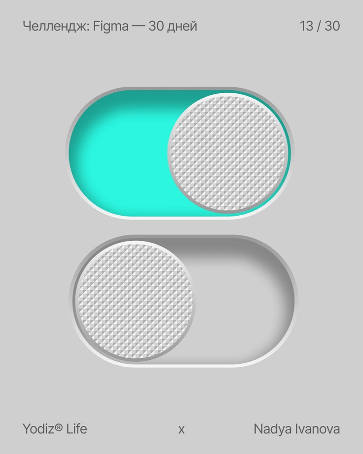</a>

App candidate: Battery Guard, 180FlipCharge, Easy Debloat. [JPG originale](https://github.com/riccardopinato/Design-App/blob/c064da7b5389938c1ea9825c573596fcd935e73d/UI-UX/TOGGLE%20%26%20SWITCH/IMMAGINI/UIR-0035.jpg).

### UIR-0036

<strong>📷 UIR-0036 — Luxury Berry &amp; Blush</strong> · PALETTE · main

<a href="https://github.com/riccardopinato/Design-App/blob/main/UI-UX/PALETTE/IMMAGINI/UIR-0036.jpg">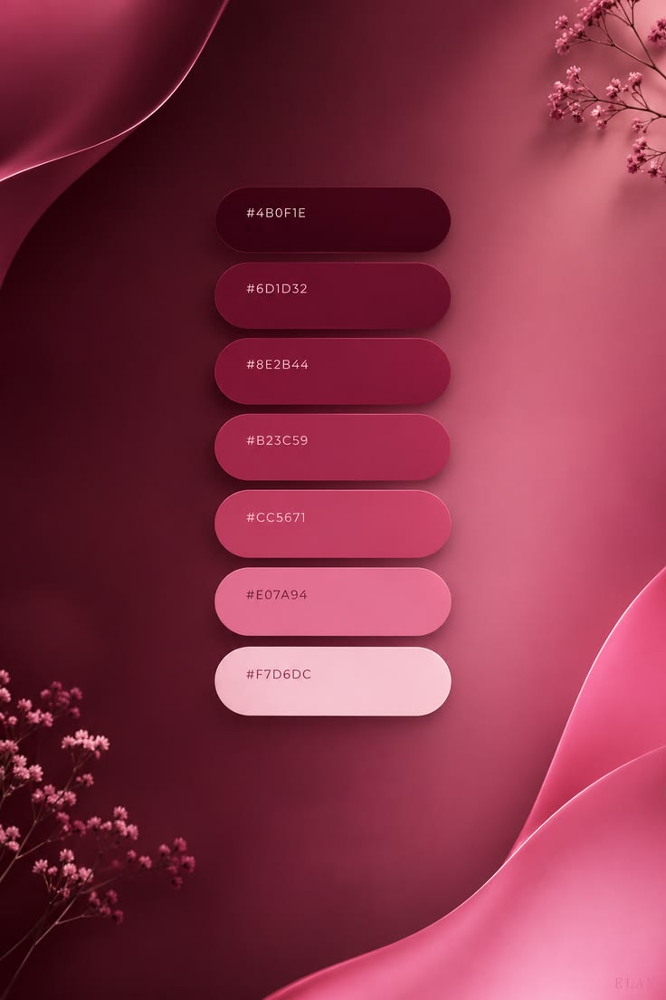</a>

App candidate: Anna's Diary, Notes-Ecosistema. [JPG originale](https://github.com/riccardopinato/Design-App/blob/main/UI-UX/PALETTE/IMMAGINI/UIR-0036.jpg).

### UIR-0037

<strong>📷 UIR-0037 — Burgundy Dark Romance</strong> · PALETTE · main

<a href="https://github.com/riccardopinato/Design-App/blob/main/UI-UX/PALETTE/IMMAGINI/UIR-0037.jpg">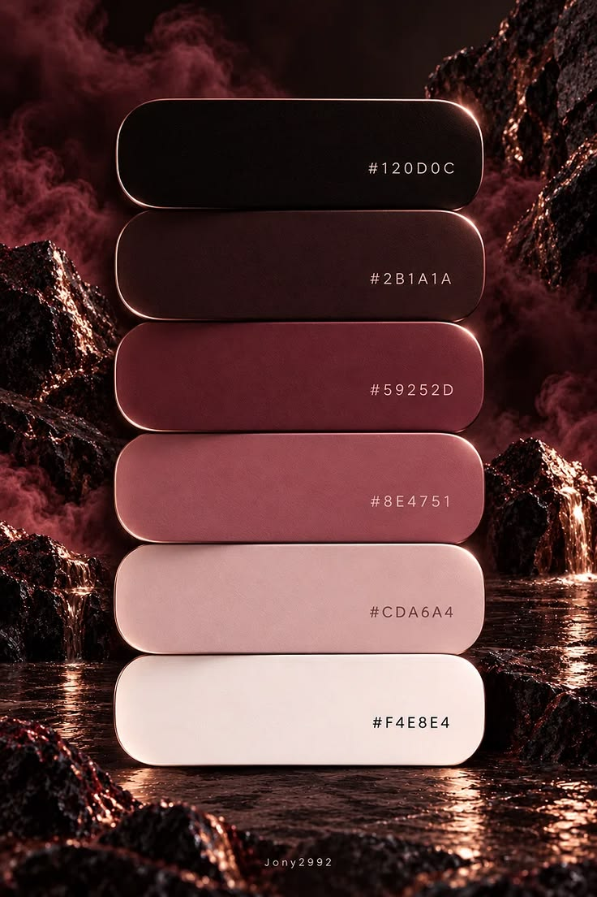</a>

App candidate: Anna's Diary, World Days. [JPG originale](https://github.com/riccardopinato/Design-App/blob/main/UI-UX/PALETTE/IMMAGINI/UIR-0037.jpg).

### UIR-0038

<strong>📷 UIR-0038 — Misty Fjord Nordic</strong> · PALETTE · main

<a href="https://github.com/riccardopinato/Design-App/blob/main/UI-UX/PALETTE/IMMAGINI/UIR-0038.jpg">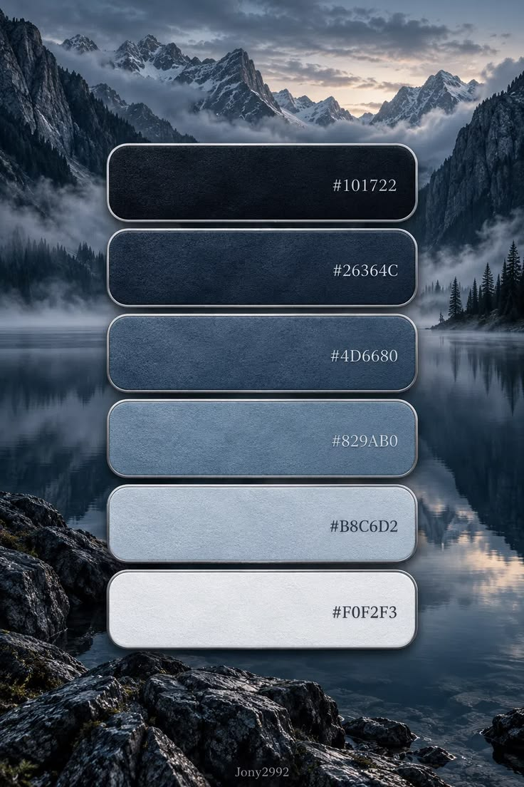</a>

App candidate: Wonderlog, TrailPath, CamperBoss. [JPG originale](https://github.com/riccardopinato/Design-App/blob/main/UI-UX/PALETTE/IMMAGINI/UIR-0038.jpg).

### UIR-0039

<strong>📷 UIR-0039 — Volcanic Terracotta</strong> · PALETTE · main

<a href="https://github.com/riccardopinato/Design-App/blob/main/UI-UX/PALETTE/IMMAGINI/UIR-0039.jpg">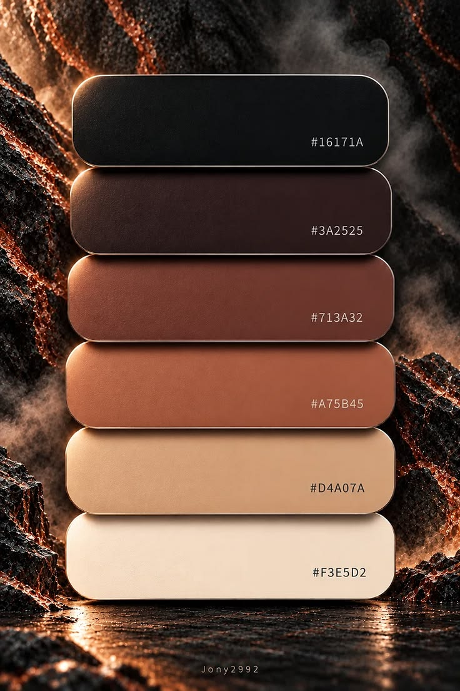</a>

App candidate: Wonderlog, Cooking Anime. [JPG originale](https://github.com/riccardopinato/Design-App/blob/main/UI-UX/PALETTE/IMMAGINI/UIR-0039.jpg).

### UIR-0040

<strong>📷 UIR-0040 — Serene Ocean Blue</strong> · PALETTE · main

<a href="https://github.com/riccardopinato/Design-App/blob/main/UI-UX/PALETTE/IMMAGINI/UIR-0040.jpg">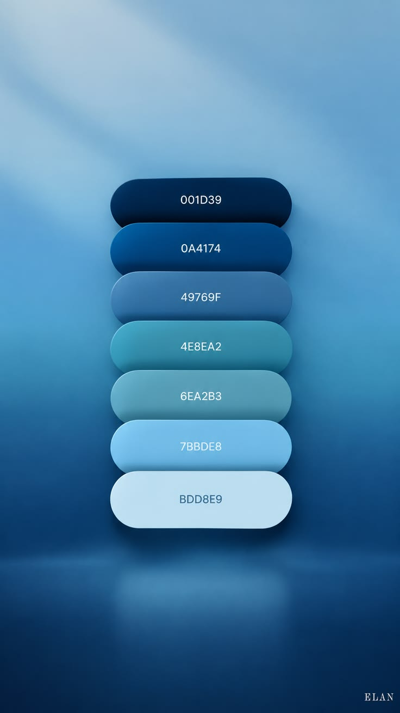</a>

App candidate: FocusSense, CashMate AI, Battery Guard. [JPG originale](https://github.com/riccardopinato/Design-App/blob/main/UI-UX/PALETTE/IMMAGINI/UIR-0040.jpg).

### UIR-0041

<strong>📷 UIR-0041 — Christmas Editorial</strong> · PALETTE · main

<a href="https://github.com/riccardopinato/Design-App/blob/main/UI-UX/PALETTE/IMMAGINI/UIR-0041.jpg">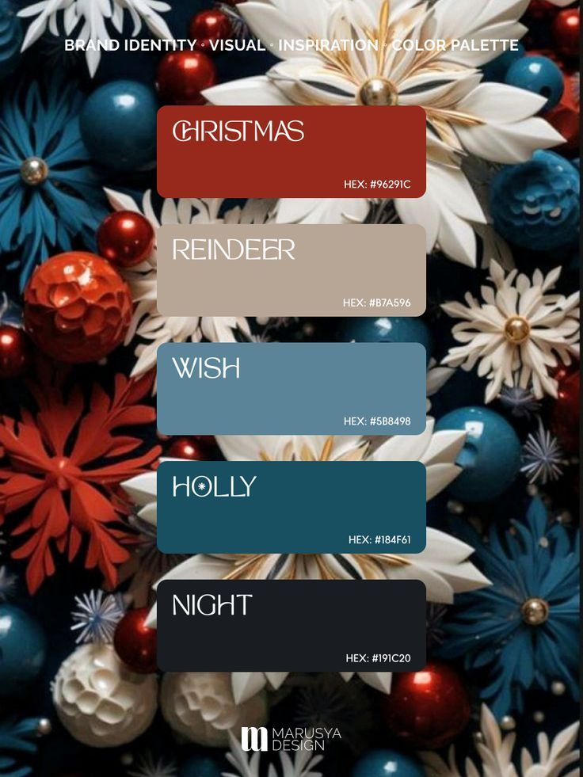</a>

App candidate: World Days, Cooking Anime. [JPG originale](https://github.com/riccardopinato/Design-App/blob/main/UI-UX/PALETTE/IMMAGINI/UIR-0041.jpg).

### UIR-0042

<strong>📷 UIR-0042 — Emerald &amp; Antique Gold</strong> · PALETTE · main

<a href="https://github.com/riccardopinato/Design-App/blob/main/UI-UX/PALETTE/IMMAGINI/UIR-0042.jpg">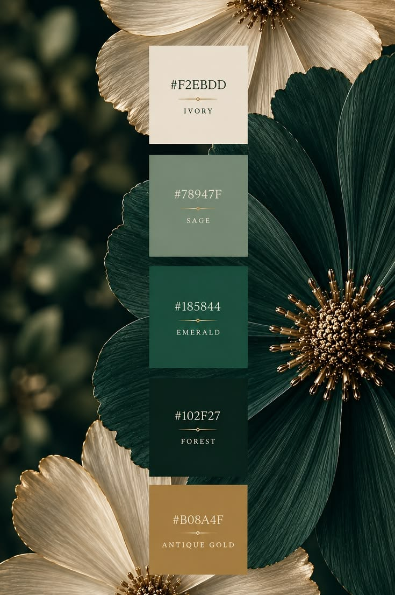</a>

App candidate: Notes-Ecosistema, CashMate AI, Anna's Diary. [JPG originale](https://github.com/riccardopinato/Design-App/blob/main/UI-UX/PALETTE/IMMAGINI/UIR-0042.jpg).

### UIR-0043

<strong>📷 UIR-0043 — Sienna Design System</strong> · DESIGN SYSTEM · main

<a href="https://github.com/riccardopinato/Design-App/blob/main/UI-UX/DESIGN%20SYSTEM/IMMAGINI/UIR-0043.jpg">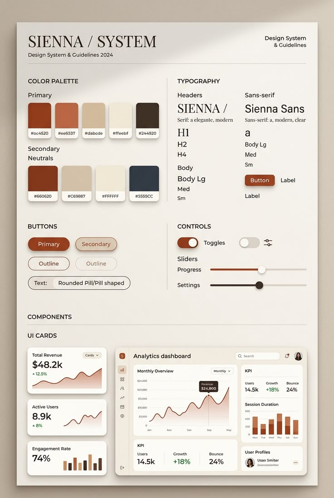</a>

App candidate: App Factory Dashboard, CashMate AI. [JPG originale](https://github.com/riccardopinato/Design-App/blob/main/UI-UX/DESIGN%20SYSTEM/IMMAGINI/UIR-0043.jpg).

### UIR-0044

<strong>📷 UIR-0044 — Twilight Lavender &amp; Blue</strong> · PALETTE · main

<a href="https://github.com/riccardopinato/Design-App/blob/main/UI-UX/PALETTE/IMMAGINI/UIR-0044.jpg">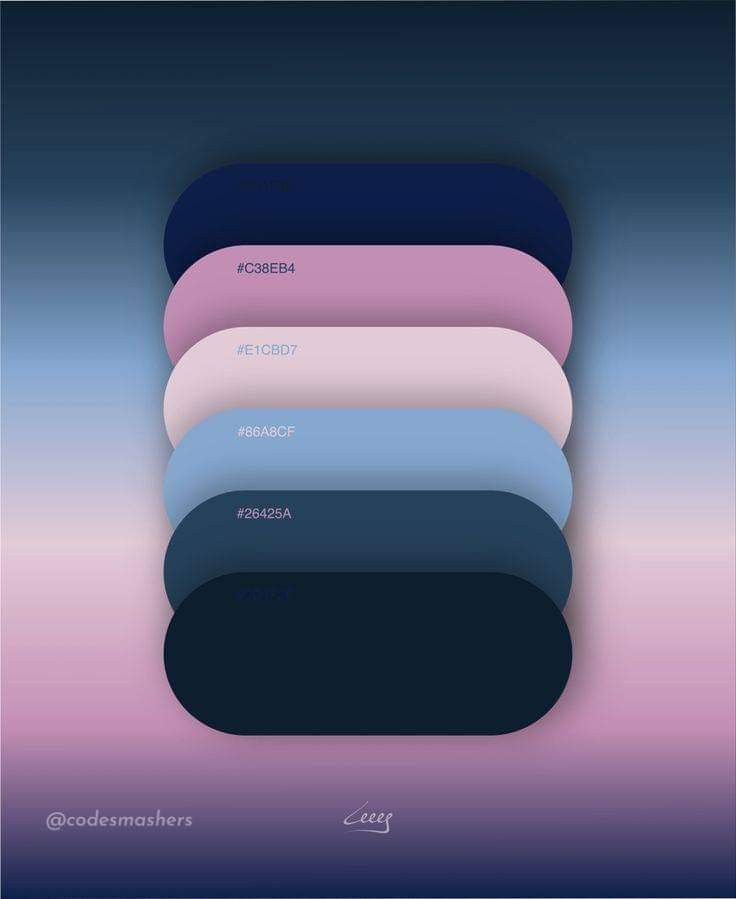</a>

App candidate: Anna's Diary, Notes-Ecosistema. [JPG originale](https://github.com/riccardopinato/Design-App/blob/main/UI-UX/PALETTE/IMMAGINI/UIR-0044.jpg).

### UIR-0045

<strong>📷 UIR-0045 — Plum Sunset</strong> · PALETTE · main

<a href="https://github.com/riccardopinato/Design-App/blob/main/UI-UX/PALETTE/IMMAGINI/UIR-0045.jpg">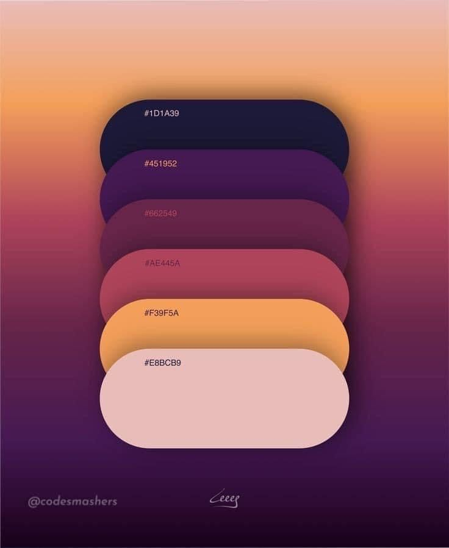</a>

App candidate: Wonderlog, World Days. [JPG originale](https://github.com/riccardopinato/Design-App/blob/main/UI-UX/PALETTE/IMMAGINI/UIR-0045.jpg).

### UIR-0046

<strong>📷 UIR-0046 — Deep Teal Editorial</strong> · PALETTE · main

<a href="https://github.com/riccardopinato/Design-App/blob/main/UI-UX/PALETTE/IMMAGINI/UIR-0046.jpg">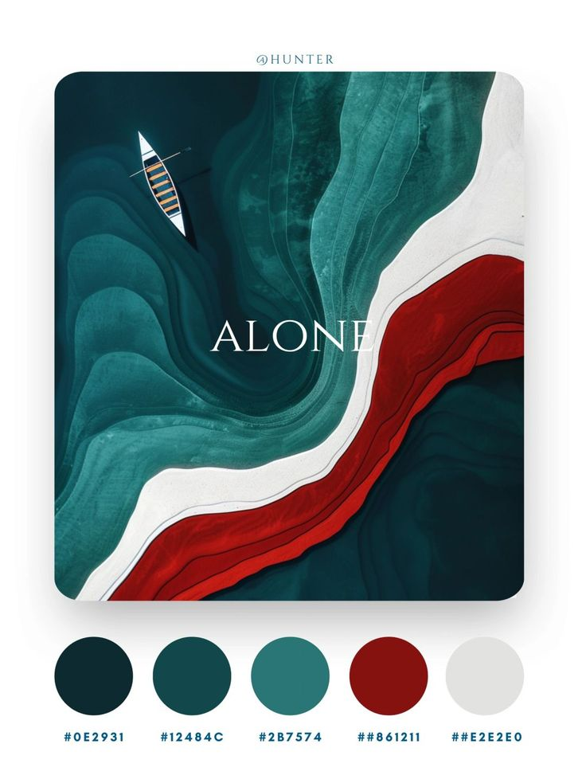</a>

App candidate: Wonderlog, TrailPath. [JPG originale](https://github.com/riccardopinato/Design-App/blob/main/UI-UX/PALETTE/IMMAGINI/UIR-0046.jpg).

### UIR-0047

<strong>📷 UIR-0047 — Forest Amber Earth</strong> · PALETTE · main

<a href="https://github.com/riccardopinato/Design-App/blob/main/UI-UX/PALETTE/IMMAGINI/UIR-0047.jpg">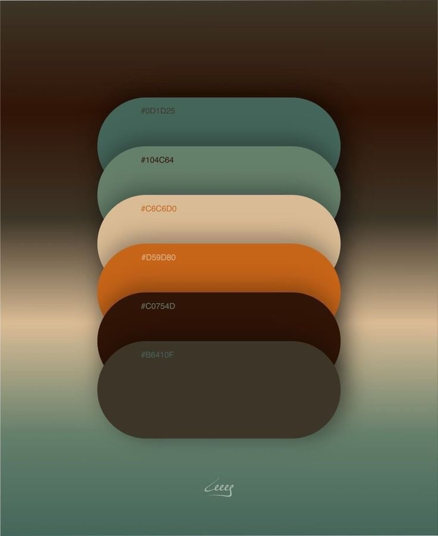</a>

App candidate: CamperBoss, TrailPath. [JPG originale](https://github.com/riccardopinato/Design-App/blob/main/UI-UX/PALETTE/IMMAGINI/UIR-0047.jpg).

### UIR-0048

<strong>📷 UIR-0048 — Midnight Coral</strong> · PALETTE · main

<a href="https://github.com/riccardopinato/Design-App/blob/main/UI-UX/PALETTE/IMMAGINI/UIR-0048.jpg">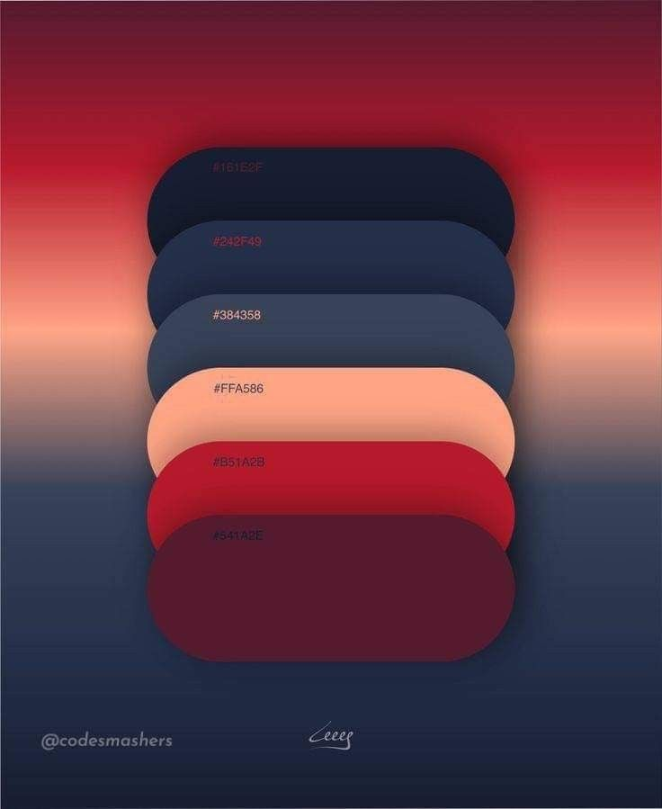</a>

App candidate: Deskland Android, FocusSense. [JPG originale](https://github.com/riccardopinato/Design-App/blob/main/UI-UX/PALETTE/IMMAGINI/UIR-0048.jpg).

### UIR-0049

<strong>📷 UIR-0049 — Mint Soft 3D Product Styleguide</strong> · DESIGN SYSTEM · main

<a href="https://github.com/riccardopinato/Design-App/blob/main/UI-UX/DESIGN%20SYSTEM/IMMAGINI/UIR-0049.jpg">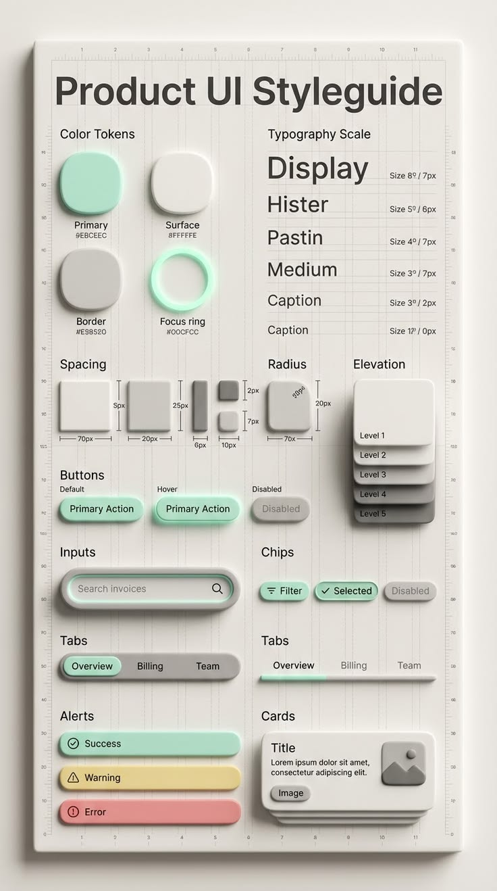</a>

App candidate: App Factory Dashboard, Notes-Ecosistema, CashMate AI. [JPG originale](https://github.com/riccardopinato/Design-App/blob/main/UI-UX/DESIGN%20SYSTEM/IMMAGINI/UIR-0049.jpg).

### UIR-0050

<strong>📷 UIR-0050 — Visual Noise Comparison</strong> · DESIGN SYSTEM · main

<a href="https://github.com/riccardopinato/Design-App/blob/main/UI-UX/DESIGN%20SYSTEM/IMMAGINI/UIR-0050.jpg">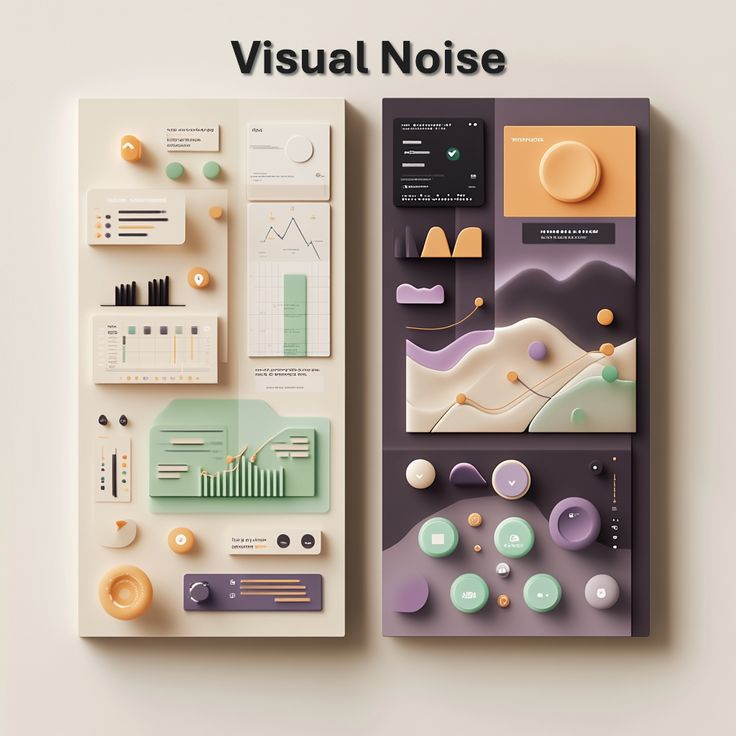</a>

App candidate: Deskland Android, FocusSense. [JPG originale](https://github.com/riccardopinato/Design-App/blob/main/UI-UX/DESIGN%20SYSTEM/IMMAGINI/UIR-0050.jpg).

### UIR-0051

<strong>📷 UIR-0051 — Soft 3D Human-Centered UI</strong> · SOFT 3D · main

<a href="https://github.com/riccardopinato/Design-App/blob/main/UI-UX/SOFT%203D/IMMAGINI/UIR-0051.jpg">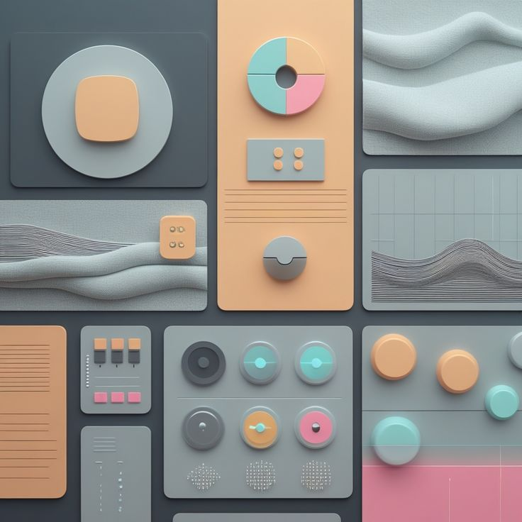</a>

App candidate: Notes-Ecosistema, Anna's Diary, FocusSense. [JPG originale](https://github.com/riccardopinato/Design-App/blob/main/UI-UX/SOFT%203D/IMMAGINI/UIR-0051.jpg).

### UIR-0052

<strong>📷 UIR-0052 — Emotional UI Dashboard</strong> · SOFT 3D · main

<a href="https://github.com/riccardopinato/Design-App/blob/main/UI-UX/SOFT%203D/IMMAGINI/UIR-0052.jpg">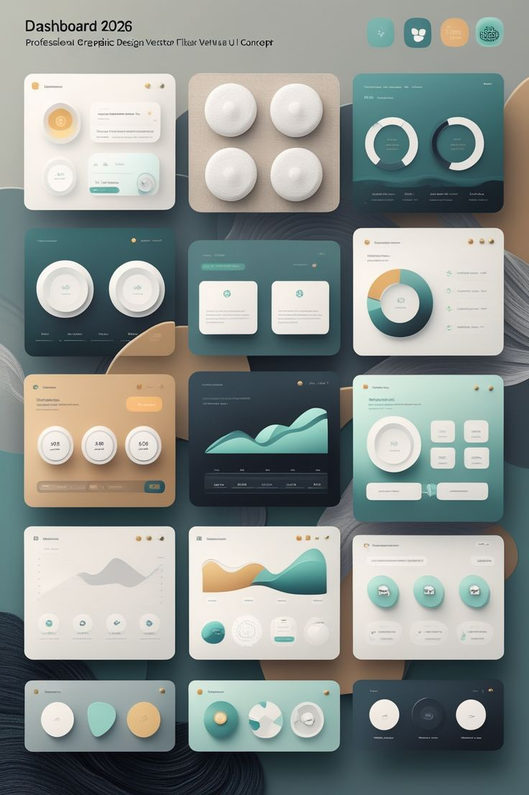</a>

App candidate: App Factory Dashboard, CashMate AI, FocusSense. [JPG originale](https://github.com/riccardopinato/Design-App/blob/main/UI-UX/SOFT%203D/IMMAGINI/UIR-0052.jpg).

### UIR-0053

<strong>📷 UIR-0053 — Metallic Skeuomorphic Controls</strong> · SKEUOMORPHISM · main

App candidate: Deskland Android, Battery Guard, FocusSense. [JPG originale](https://github.com/riccardopinato/Design-App/blob/main/UI-UX/SKEUOMORPHISM/IMMAGINI/UIR-0053.jpg).

### UIR-0054

<strong>📷 UIR-0054 — Skeuomorphic Kit Neon</strong> · SKEUOMORPHISM · main

App candidate: Deskland Android, SleepMax Coach, FocusSense. [JPG originale](https://github.com/riccardopinato/Design-App/blob/main/UI-UX/SKEUOMORPHISM/IMMAGINI/UIR-0054.jpg).

### UIR-0055

<strong>📷 UIR-0055 — Retro Industrial Controls</strong> · SKEUOMORPHISM · main

App candidate: Deskland Android, FocusSense. [JPG originale](https://github.com/riccardopinato/Design-App/blob/main/UI-UX/SKEUOMORPHISM/IMMAGINI/UIR-0055.jpg).

### UIR-0056

<strong>📷 UIR-0056 — KNOB Timer</strong> · MINIMAL CONTROLS · main

App candidate: SleepMax Coach, FocusSense. [JPG originale](https://github.com/riccardopinato/Design-App/blob/main/UI-UX/MINIMAL%20CONTROLS/IMMAGINI/UIR-0056.jpg).

### UIR-0057

<strong>📷 UIR-0057 — CMF Minimal Widgets</strong> · MINIMAL CONTROLS · main

App candidate: Deskland Android, Battery Guard. [JPG originale](https://github.com/riccardopinato/Design-App/blob/main/UI-UX/MINIMAL%20CONTROLS/IMMAGINI/UIR-0057.jpg).

### UIR-0058

<strong>📷 UIR-0058 — Red Dial Industrial Minimalism</strong> · MINIMAL CONTROLS · main

App candidate: FocusSense, Deskland Android. [JPG originale](https://github.com/riccardopinato/Design-App/blob/main/UI-UX/MINIMAL%20CONTROLS/IMMAGINI/UIR-0058.jpg).

### UIR-0059

<strong>📷 UIR-0059 — Braun Functional Industrial</strong> · MINIMAL CONTROLS · main

App candidate: Deskland Android, Battery Guard. [JPG originale](https://github.com/riccardopinato/Design-App/blob/main/UI-UX/MINIMAL%20CONTROLS/IMMAGINI/UIR-0059.jpg).

### UIR-0060

<strong>📷 UIR-0060 — Orange Segmented Rotary Knob</strong> · MINIMAL CONTROLS · main

App candidate: FocusSense, SleepMax Coach. [JPG originale](https://github.com/riccardopinato/Design-App/blob/main/UI-UX/MINIMAL%20CONTROLS/IMMAGINI/UIR-0060.jpg).

### UIR-0061

<strong>📷 UIR-0061 — Multicolor Rotary Dial</strong> · MINIMAL CONTROLS · main

App candidate: Notes-Ecosistema, FocusSense. [JPG originale](https://github.com/riccardopinato/Design-App/blob/main/UI-UX/MINIMAL%20CONTROLS/IMMAGINI/UIR-0061.jpg).

### UIR-0062

<strong>📷 UIR-0062 — Vivid Fall Journal</strong> · EDITORIAL UI · main

App candidate: Anna's Diary, Notes-Ecosistema. [JPG originale](https://github.com/riccardopinato/Design-App/blob/main/UI-UX/EDITORIAL%20UI/IMMAGINI/UIR-0062.jpg).

### UIR-0063

<strong>📷 UIR-0063 — Minimal Planner Dashboard</strong> · BENTO UI · main

App candidate: Anna's Diary, App Factory Dashboard. [JPG originale](https://github.com/riccardopinato/Design-App/blob/main/UI-UX/BENTO%20UI/IMMAGINI/UIR-0063.jpg).

### UIR-0064

<strong>📷 UIR-0064 — Mindora Wellness Design System</strong> · DESIGN SYSTEM · main

App candidate: SleepMax Coach, FocusSense, Anna's Diary. [JPG originale](https://github.com/riccardopinato/Design-App/blob/main/UI-UX/DESIGN%20SYSTEM/IMMAGINI/UIR-0064.jpg).

### UIR-0065

<strong>📷 UIR-0065 — Blue Product UI Styleguide</strong> · DESIGN SYSTEM · main

App candidate: App Factory Dashboard, CashMate AI, Battery Guard. [JPG originale](https://github.com/riccardopinato/Design-App/blob/main/UI-UX/DESIGN%20SYSTEM/IMMAGINI/UIR-0065.jpg).

### UIR-0066

<strong>📷 UIR-0066 — Teal Neumorphic Foundations</strong> · NEUMORPHISM · main

App candidate: Notes-Ecosistema, FocusSense, Deskland Android. [JPG originale](https://github.com/riccardopinato/Design-App/blob/main/UI-UX/NEUMORPHISM/IMMAGINI/UIR-0066.jpg).

### UIR-0067

<strong>📷 UIR-0067 — Coral &amp; Navy Interactive UI</strong> · MINIMAL CONTROLS · main

App candidate: Deskland Android, Battery Guard. [JPG originale](https://github.com/riccardopinato/Design-App/blob/main/UI-UX/MINIMAL%20CONTROLS/IMMAGINI/UIR-0067.jpg).

### UIR-0068

<strong>📷 UIR-0068 — Coral Neumorphic Controls</strong> · NEUMORPHISM · main

App candidate: FocusSense, SleepMax Coach. [JPG originale](https://github.com/riccardopinato/Design-App/blob/main/UI-UX/NEUMORPHISM/IMMAGINI/UIR-0068.jpg).

### UIR-0069

<strong>📷 UIR-0069 — White Neumorphic Control Kit</strong> · NEUMORPHISM · main

App candidate: Battery Guard, Deskland Android. [JPG originale](https://github.com/riccardopinato/Design-App/blob/main/UI-UX/NEUMORPHISM/IMMAGINI/UIR-0069.jpg).

### UIR-0070

<strong>📷 UIR-0070 — Orange Product UI Styleguide</strong> · DESIGN SYSTEM · main

App candidate: App Factory Dashboard, Battery Guard. [JPG originale](https://github.com/riccardopinato/Design-App/blob/main/UI-UX/DESIGN%20SYSTEM/IMMAGINI/UIR-0070.jpg).

### UIR-0071

<strong>📷 UIR-0071 — Sandstone Design System</strong> · DESIGN SYSTEM · main

App candidate: Cooking Anime, World Days. [JPG originale](https://github.com/riccardopinato/Design-App/blob/main/UI-UX/DESIGN%20SYSTEM/IMMAGINI/UIR-0071.jpg).

### UIR-0072

<strong>📷 UIR-0072 — Olive Mediterranean System</strong> · DESIGN SYSTEM · main

App candidate: CamperBoss, TrailPath, Wonderlog. [JPG originale](https://github.com/riccardopinato/Design-App/blob/main/UI-UX/DESIGN%20SYSTEM/IMMAGINI/UIR-0072.jpg).

### UIR-0073

<strong>📷 UIR-0073 — Physical Ring Calendar</strong> · MINIMAL CONTROLS · main

App candidate: Anna's Diary, World Days. [JPG originale](https://github.com/riccardopinato/Design-App/blob/main/UI-UX/MINIMAL%20CONTROLS/IMMAGINI/UIR-0073.jpg).

### UIR-0074

<strong>📷 UIR-0074 — Misty Nature Mobile UI</strong> · NATURE-TECH · main

App candidate: Wonderlog, TrailPath. [JPG originale](https://github.com/riccardopinato/Design-App/blob/main/UI-UX/NATURE-TECH/IMMAGINI/UIR-0074.jpg).

### UIR-0075

<strong>📷 UIR-0075 — Fantasy Landscape Dashboard</strong> · NATURE-TECH · main

App candidate: Wonderlog, Deskland Android. [JPG originale](https://github.com/riccardopinato/Design-App/blob/main/UI-UX/NATURE-TECH/IMMAGINI/UIR-0075.jpg).

### UIR-0076

<strong>📷 UIR-0076 — Peach &amp; Teal Soft 3D</strong> · SOFT 3D · main

App candidate: App Factory Dashboard, FocusSense. [JPG originale](https://github.com/riccardopinato/Design-App/blob/main/UI-UX/SOFT%203D/IMMAGINI/UIR-0076.jpg).

### UIR-0077

<strong>📷 UIR-0077 — Smart Home Glass Dashboard</strong> · GLASSMORPHISM · main

App candidate: Deskland Android, CamperBoss. [JPG originale](https://github.com/riccardopinato/Design-App/blob/main/UI-UX/GLASSMORPHISM/IMMAGINI/UIR-0077.jpg).

### UIR-0078

<strong>📷 UIR-0078 — Aqua Paper Cut Layers</strong> · SCENIC BACKGROUND · main

App candidate: Notes-Ecosistema, SleepMax Coach. [JPG originale](https://github.com/riccardopinato/Design-App/blob/main/UI-UX/SCENIC%20BACKGROUND/IMMAGINI/UIR-0078.jpg).

### UIR-0079

<strong>📷 UIR-0079 — Warm Sunset Paper Cut</strong> · SCENIC BACKGROUND · main

App candidate: Anna's Diary, World Days. [JPG originale](https://github.com/riccardopinato/Design-App/blob/main/UI-UX/SCENIC%20BACKGROUND/IMMAGINI/UIR-0079.jpg).

### UIR-0080

<strong>📷 UIR-0080 — Textured Terracotta Layers</strong> · SCENIC BACKGROUND · main

App candidate: Cooking Anime, Wonderlog. [JPG originale](https://github.com/riccardopinato/Design-App/blob/main/UI-UX/SCENIC%20BACKGROUND/IMMAGINI/UIR-0080.jpg).

### UIR-0081

<strong>📷 UIR-0081 — Midnight Amber Layers</strong> · SCENIC BACKGROUND · main

App candidate: Deskland Android, Wonderlog. [JPG originale](https://github.com/riccardopinato/Design-App/blob/main/UI-UX/SCENIC%20BACKGROUND/IMMAGINI/UIR-0081.jpg).

### UIR-0082

<strong>📷 UIR-0082 — Colorful Organic Flow</strong> · SCENIC BACKGROUND · main

App candidate: World Days, Notes-Ecosistema. [JPG originale](https://github.com/riccardopinato/Design-App/blob/main/UI-UX/SCENIC%20BACKGROUND/IMMAGINI/UIR-0082.jpg).

### UIR-0083

<strong>📷 UIR-0083 — Retro Flow Stripes</strong> · SCENIC BACKGROUND · main

App candidate: Deskland Android, World Days. [JPG originale](https://github.com/riccardopinato/Design-App/blob/main/UI-UX/SCENIC%20BACKGROUND/IMMAGINI/UIR-0083.jpg).

### UIR-0084

<strong>📷 UIR-0084 — Liquid Marble Abstract</strong> · SCENIC BACKGROUND · main

App candidate: Deskland Android, Wonderlog. [JPG originale](https://github.com/riccardopinato/Design-App/blob/main/UI-UX/SCENIC%20BACKGROUND/IMMAGINI/UIR-0084.jpg).

### UIR-0085

<strong>📷 UIR-0085 — Soft System Cobalt</strong> · DESIGN SYSTEM · main

App candidate: Battery Guard, App Factory Dashboard. [JPG originale](https://github.com/riccardopinato/Design-App/blob/main/UI-UX/DESIGN%20SYSTEM/IMMAGINI/UIR-0085.jpg).

### UIR-0086

<strong>📷 UIR-0086 — Lilac Flow Violet UI</strong> · DESIGN SYSTEM · main

App candidate: Anna's Diary, Notes-Ecosistema. [JPG originale](https://github.com/riccardopinato/Design-App/blob/main/UI-UX/DESIGN%20SYSTEM/IMMAGINI/UIR-0086.jpg).

### UIR-0087

<strong>📷 UIR-0087 — AI-Ready Design System Guide</strong> · DESIGN SYSTEM · main

App candidate: App Factory Dashboard, Notes-Ecosistema. [JPG originale](https://github.com/riccardopinato/Design-App/blob/main/UI-UX/DESIGN%20SYSTEM/IMMAGINI/UIR-0087.jpg).

### UIR-0088

<strong>📷 UIR-0088 — Fitness &amp; Nutrition Design System</strong> · DESIGN SYSTEM · main

App candidate: Cooking Anime, FocusSense. [JPG originale](https://github.com/riccardopinato/Design-App/blob/main/UI-UX/DESIGN%20SYSTEM/IMMAGINI/UIR-0088.jpg).

### UIR-0089

<strong>📷 UIR-0089 — Deep Forest &amp; Golden Hour</strong> · PALETTE · main

App candidate: TrailPath, CamperBoss. [JPG originale](https://github.com/riccardopinato/Design-App/blob/main/UI-UX/PALETTE/IMMAGINI/UIR-0089.jpg).

### UIR-0090

<strong>📷 UIR-0090 — Modern Retro Interior</strong> · PALETTE · main

App candidate: Cooking Anime, Notes-Ecosistema. [JPG originale](https://github.com/riccardopinato/Design-App/blob/main/UI-UX/PALETTE/IMMAGINI/UIR-0090.jpg).

### UIR-0091

<strong>📷 UIR-0091 — Bold Editorial Pop</strong> · PALETTE · main

App candidate: World Days, Cooking Anime. [JPG originale](https://github.com/riccardopinato/Design-App/blob/main/UI-UX/PALETTE/IMMAGINI/UIR-0091.jpg).

### UIR-0092

<strong>📷 UIR-0092 — Reef Pink &amp; Indigo Ocean</strong> · PALETTE · main

App candidate: Wonderlog, Anna's Diary. [JPG originale](https://github.com/riccardopinato/Design-App/blob/main/UI-UX/PALETTE/IMMAGINI/UIR-0092.jpg).

### UIR-0093

<strong>📷 UIR-0093 — Navy &amp; Peach Floral</strong> · PALETTE · main

App candidate: Anna's Diary, Notes-Ecosistema. [JPG originale](https://github.com/riccardopinato/Design-App/blob/main/UI-UX/PALETTE/IMMAGINI/UIR-0093.jpg).

### UIR-0094

<strong>📷 UIR-0094 — Sakura Cyan Watercolor</strong> · SCENIC ILLUSTRATION · main

App candidate: Cooking Anime, Wonderlog, Anna's Diary. [JPG originale](https://github.com/riccardopinato/Design-App/blob/main/UI-UX/SCENIC%20ILLUSTRATION/IMMAGINI/UIR-0094.jpg).

### UIR-0095

<strong>📷 UIR-0095 — Crimson Autumn Ink</strong> · SCENIC ILLUSTRATION · main

App candidate: Wonderlog, World Days, Deskland Android. [JPG originale](https://github.com/riccardopinato/Design-App/blob/main/UI-UX/SCENIC%20ILLUSTRATION/IMMAGINI/UIR-0095.jpg).

### UIR-0096

<strong>📷 UIR-0096 — Sakura Fantasy Landscape</strong> · SCENIC ILLUSTRATION · main

App candidate: Wonderlog, Deskland Android, Cooking Anime. [JPG originale](https://github.com/riccardopinato/Design-App/blob/main/UI-UX/SCENIC%20ILLUSTRATION/IMMAGINI/UIR-0096.jpg).

### UIR-0097

<strong>📷 UIR-0097 — Pink Sakura Ink Wash</strong> · SCENIC ILLUSTRATION · main

App candidate: Anna's Diary, Wonderlog, Cooking Anime. [JPG originale](https://github.com/riccardopinato/Design-App/blob/main/UI-UX/SCENIC%20ILLUSTRATION/IMMAGINI/UIR-0097.jpg).

### UIR-0098

<strong>📷 UIR-0098 — Lone Samurai Sakura</strong> · SCENIC ILLUSTRATION · main

App candidate: Cooking Anime, Deskland Android. [JPG originale](https://github.com/riccardopinato/Design-App/blob/main/UI-UX/SCENIC%20ILLUSTRATION/IMMAGINI/UIR-0098.jpg).

### UIR-0099

<strong>📷 UIR-0099 — Fuji Sunrise Minimalism</strong> · SCENIC ILLUSTRATION · main

App candidate: Deskland Android, Anna's Diary, Wonderlog. [JPG originale](https://github.com/riccardopinato/Design-App/blob/main/UI-UX/SCENIC%20ILLUSTRATION/IMMAGINI/UIR-0099.jpg).

### UIR-0100

<strong>📷 UIR-0100 — Dark Fuji &amp; Torii</strong> · SCENIC ILLUSTRATION · main

App candidate: Deskland Android, Cooking Anime. [JPG originale](https://github.com/riccardopinato/Design-App/blob/main/UI-UX/SCENIC%20ILLUSTRATION/IMMAGINI/UIR-0100.jpg).

### UIR-0101

<strong>📷 UIR-0101 — Japanese Retro Illustration</strong> · SCENIC ILLUSTRATION · main

App candidate: Anna's Diary, Notes-Ecosistema, Wonderlog. [JPG originale](https://github.com/riccardopinato/Design-App/blob/main/UI-UX/SCENIC%20ILLUSTRATION/IMMAGINI/UIR-0101.jpg).

