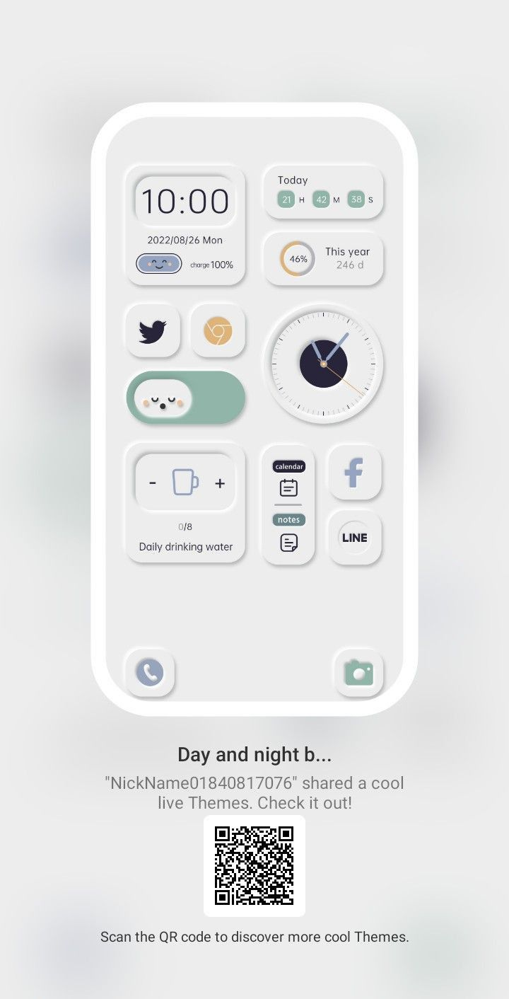
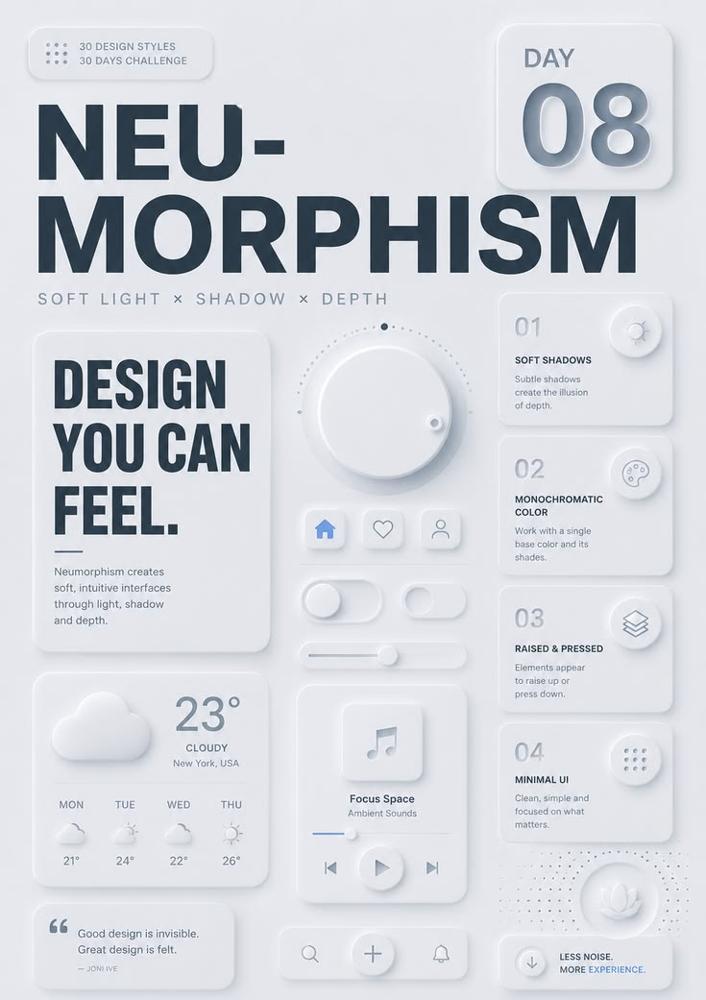
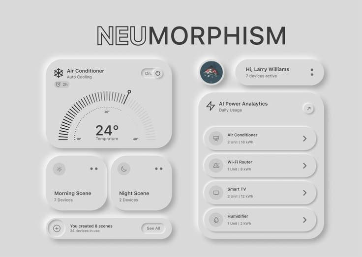
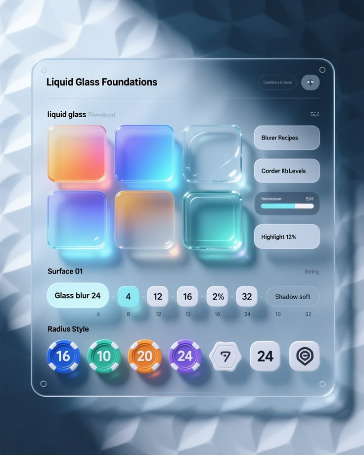
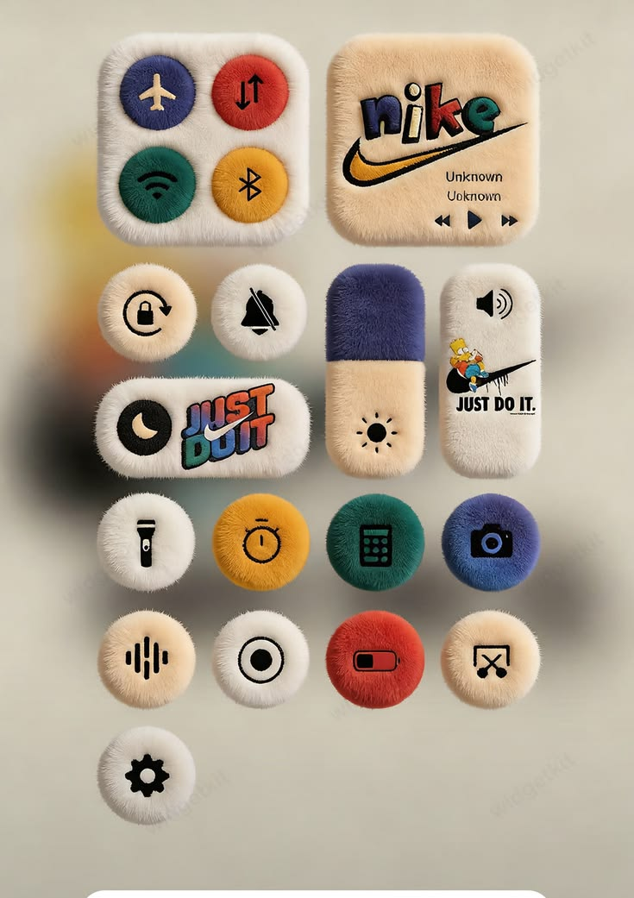
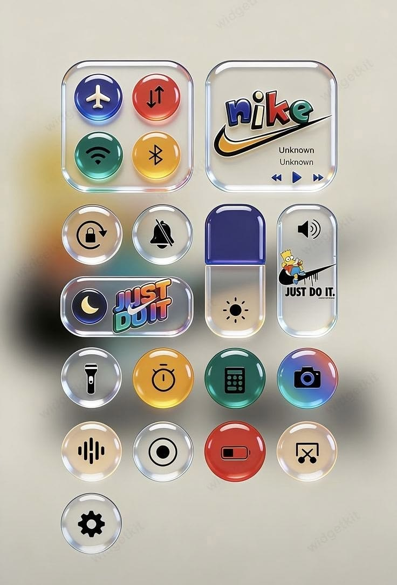
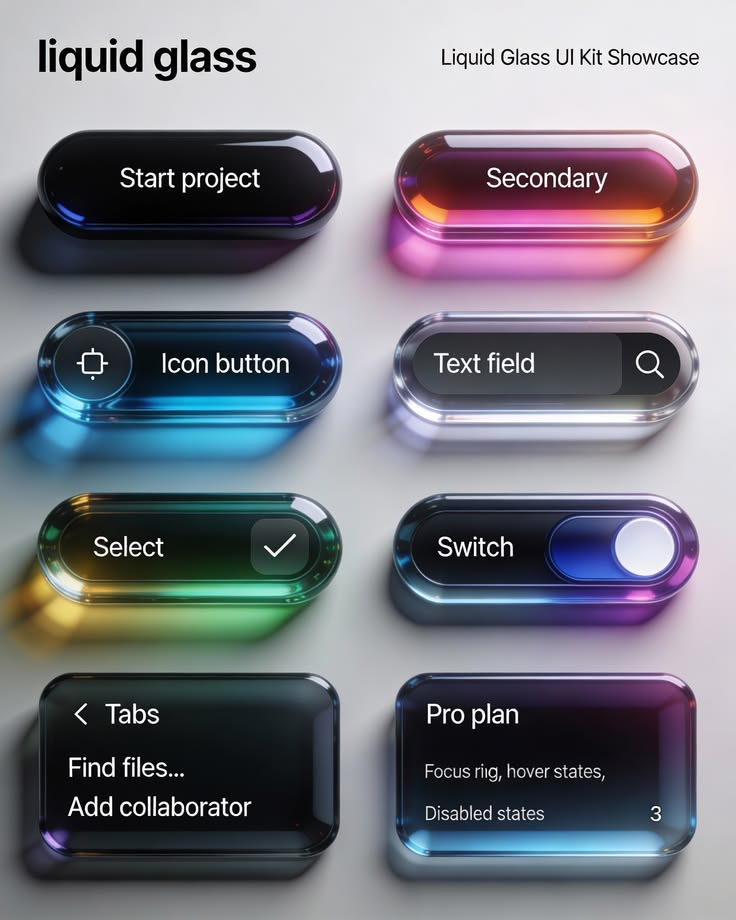
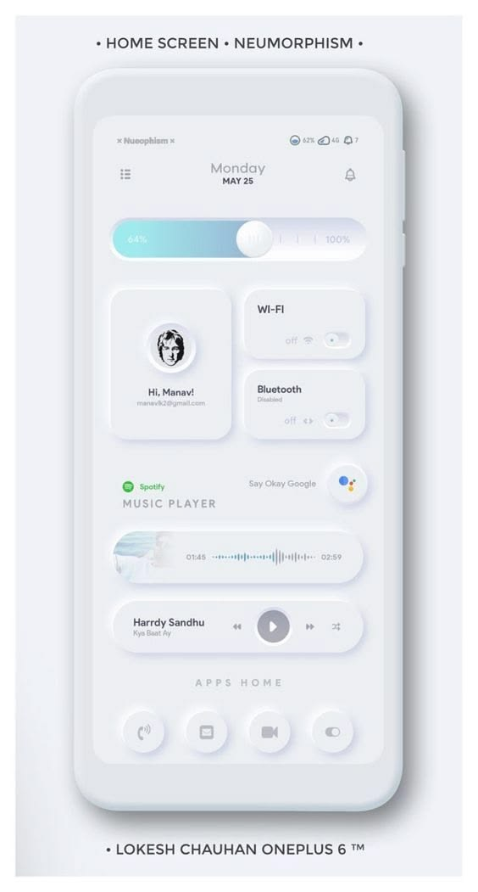
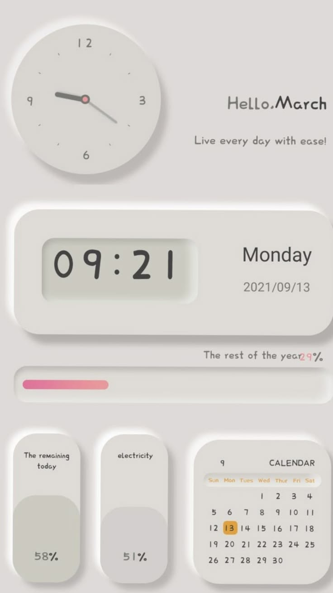

# Galleria visuale - App Factory

Riferimenti forniti dall utente, classificati per UI/UX ed estetica.

## UIR-0001 - Retro student planner a finestre

UI/UX: RETRO DESKTOP, BENTO UI, MINIMAL CONTROLS

Estetica: Y2K RETRO, PIXEL ART, AESTHETIC

App: Notes-Ecosistema, 180FlipCharge, Cooking Anime

## UIR-0002 - Toggle volume arancione e argento

UI/UX: TOGGLE & SWITCH, NEUMORPHISM, MINIMAL CONTROLS

Estetica: AESTHETIC

App: Battery Guard, Pocket Guard, Easy Debloat

## UIR-0003 - Collage mint/pink Soft 3D

UI/UX: SOFT 3D, PASTEL UI, BENTO UI

Estetica: ORGANIC, AESTHETIC

App: Anna's Diary, Notes-Ecosistema, Wonderlog

## UIR-0005 - Widget Home Neumorphism

UI/UX: NEUMORPHISM, BENTO UI, MINIMAL CONTROLS

Estetica: AESTHETIC

App: Battery Guard, SleepMax Coach, Pocket Guard

## UIR-0006 - Dashboard paesaggistica dark

UI/UX: BENTO UI, NATURE-TECH, EDITORIAL UI

Estetica: CINEMATIC, NEON, ORGANIC

App: TrailPath, CamperBoss, FocusSense

## UIR-0007 - Atlante delle ombre Neumorphism

UI/UX: NEUMORPHISM, DESIGN SYSTEM, MINIMAL CONTROLS

Estetica: AESTHETIC

App: Battery Guard, SleepMax Coach, Notes-Ecosistema

## UIR-0008 - Smart home neumorfica monocromatica

UI/UX: NEUMORPHISM, BENTO UI, MINIMAL CONTROLS

Estetica: AESTHETIC

App: Battery Guard, FocusSense, Pocket Guard

## UIR-0009 - Switch illustrati alba e notte

UI/UX: TOGGLE & SWITCH, ILLUSTRATED CONTROLS, PASTEL UI

Estetica: ILLUSTRATED, CINEMATIC

App: SleepMax Coach, Anna's Diary, 180FlipCharge

## UIR-0010 - Switch paesaggi giorno/notte

UI/UX: TOGGLE & SWITCH, ILLUSTRATED CONTROLS, NATURE-TECH

Estetica: ILLUSTRATED, CINEMATIC

App: SleepMax Coach, Wonderlog, CamperBoss

## UIR-0011 - Componenti tattili sage e lilla

UI/UX: DESIGN SYSTEM, NEUMORPHISM, MINIMAL CONTROLS

Estetica: ORGANIC, AESTHETIC

App: Battery Guard, Notes-Ecosistema, Anna's Diary

## UIR-0012 - Kit GUI Windows rétro rosa

UI/UX: RETRO DESKTOP, MINIMAL CONTROLS, DESIGN SYSTEM

Estetica: Y2K RETRO, PIXEL ART, AESTHETIC

App: Notes-Ecosistema, Cooking Anime, 180FlipCharge

## UIR-0013 - 50 palette cromatiche

UI/UX: DESIGN SYSTEM, PASTEL UI

Estetica: CINEMATIC, AESTHETIC, VINTAGE

App: FrameLab, World Days, Anna's Diary

## UIR-0014 - UI Kit Claymorphism peach/blue

UI/UX: SOFT 3D, BENTO UI, PASTEL UI

Estetica: AESTHETIC, ORGANIC

App: Anna's Diary, Notes-Ecosistema, Wonderlog

## UIR-0015 - Foundations Liquid Glass

UI/UX: GLASSMORPHISM, DESIGN SYSTEM, NEO-APPLE

Estetica: NEON, AESTHETIC

App: FocusSense, The Luminous Infinite Circle, CashMate AI

## UIR-0016 - Design system coral-teal scuro

UI/UX: DESIGN SYSTEM, MINIMAL CONTROLS, NEO-APPLE

Estetica: NEON, VINTAGE

App: CashMate AI, Notes-Ecosistema, App Factory Dashboard

## UIR-0017 - Neo-tactile blu/ciano

UI/UX: DESIGN SYSTEM, NEUMORPHISM, GLASSMORPHISM

Estetica: NEON, AESTHETIC

App: FocusSense, CashMate AI, Battery Guard

## UIR-0018 - Toggle rosso/nero materico

UI/UX: TOGGLE & SWITCH, NEUMORPHISM, MINIMAL CONTROLS

Estetica: NEON

App: Tabletop Motion Alarm, Pocket Guard, The Luminous Infinite Circle

## UIR-0019 - Confronto UI esteticamente ricca ma poco usabile

UI/UX: DESIGN SYSTEM, BENTO UI, NAVIGATION UI

Estetica: AESTHETIC

App: Notes-Ecosistema, Anna's Diary, App Factory Dashboard

## UIR-0020 - Otto palette cinematiche

UI/UX: DESIGN SYSTEM, PASTEL UI

Estetica: CINEMATIC, AESTHETIC, NEON

App: FrameLab, SleepMax Coach, Anna's Diary

## UIR-0021 - Interfacce botaniche mint

UI/UX: SOFT 3D, NATURE-TECH, PASTEL UI

Estetica: ORGANIC, AESTHETIC

App: Anna's Diary, Wonderlog, CamperBoss

## UIR-0022 - Palette Moon viola

UI/UX: DESIGN SYSTEM, PASTEL UI

Estetica: AESTHETIC, NEON

App: SleepMax Coach, Anna's Diary, FocusSense

## UIR-0023 - Widget plush con marchi

UI/UX: SKEUOMORPHISM, SOFT 3D, MINIMAL CONTROLS

Estetica: AESTHETIC, ANIME

App: Cooking Anime, Anna's Diary, Deskland Android

## UIR-0024 - Widget glossy con marchi

UI/UX: GLASSMORPHISM, SKEUOMORPHISM, MINIMAL CONTROLS

Estetica: NEON, AESTHETIC

App: FocusSense, The Luminous Infinite Circle, CashMate AI

## UIR-0025 - Design system beige/teal completo

UI/UX: DESIGN SYSTEM, NEUMORPHISM, MINIMAL CONTROLS

Estetica: AESTHETIC, VINTAGE

App: CashMate AI, Battery Guard, Easy Debloat

## UIR-0026 - Liquid glass kit controlli

UI/UX: GLASSMORPHISM, NEO-APPLE, MINIMAL CONTROLS

Estetica: NEON, AESTHETIC

App: The Luminous Infinite Circle, FocusSense, CashMate AI

## UIR-0027 - Home soft bianco

UI/UX: NEUMORPHISM, BENTO UI, MINIMAL CONTROLS

Estetica: AESTHETIC

App: Battery Guard, Pocket Guard, SleepMax Coach

## UIR-0029 - Hello March dashboard grigio

UI/UX: NEUMORPHISM, BENTO UI, MINIMAL CONTROLS

Estetica: AESTHETIC, VINTAGE

App: SleepMax Coach, Anna's Diary, Battery Guard

## UIR-0030 - Single toggle minimale bianco

UI/UX: TOGGLE & SWITCH, NEUMORPHISM, MINIMAL CONTROLS

Estetica: AESTHETIC

App: Battery Guard, Easy Debloat, Pocket Guard

## UIR-0031 - Dark glass switch arancione

UI/UX: TOGGLE & SWITCH, GLASSMORPHISM, NEO-APPLE

Estetica: NEON

App: FocusSense, The Luminous Infinite Circle, CashMate AI

## UIR-0032 - Interruttori tattici prato

UI/UX: TOGGLE & SWITCH, NATURE-TECH, SKEUOMORPHISM

Estetica: ORGANIC, AESTHETIC

App: CamperBoss, TrailPath, Wonderlog

## UIR-0033 - Lockscreen editoriale illustrata

UI/UX: EDITORIAL UI, PASTEL UI, MINIMAL CONTROLS

Estetica: ILLUSTRATED, CINEMATIC, POLAROID

App: Wonderlog, World Days, FrameLab

## UIR-0034 - Tassonomia bottom navigation

UI/UX: NAVIGATION UI, DESIGN SYSTEM, MINIMAL CONTROLS

Estetica: AESTHETIC

App: Anna's Diary, Notes-Ecosistema, Wonderlog

## UIR-0035 - Toggle turchese e grigio con pattern

UI/UX: TOGGLE & SWITCH, NEUMORPHISM, MINIMAL CONTROLS

Estetica: AESTHETIC

App: Battery Guard, 180FlipCharge, Easy Debloat

