# Galleria visuale — 66 riferimenti, 13/11/2026

Questo file accompagna il lotto del 13 novembre; le immagini sono caricate una sola volta nello stile UI primario, e gli indici app/stile si collegano allo stesso ID.

> La presenza online non autorizza automaticamente la redistribuzione. Pubblicare soltanto dopo la verifica dei diritti di ogni opera.

## Reference

### UIR-0036 — PALETTE

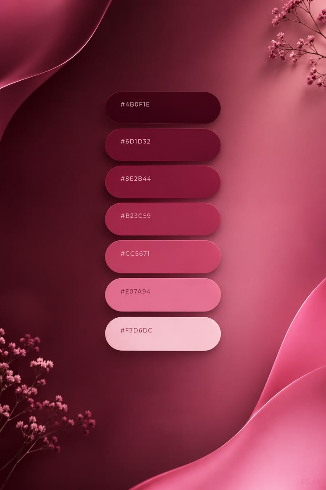

Path: `UI-UX/PALETTE/IMMAGINI/UIR-0036.jpg` · SHA-256 `8dc157c238e5fc3f2844fb04670781344b06e7d16ba6e54ea473124e7b7d7f15`

### UIR-0037 — PALETTE

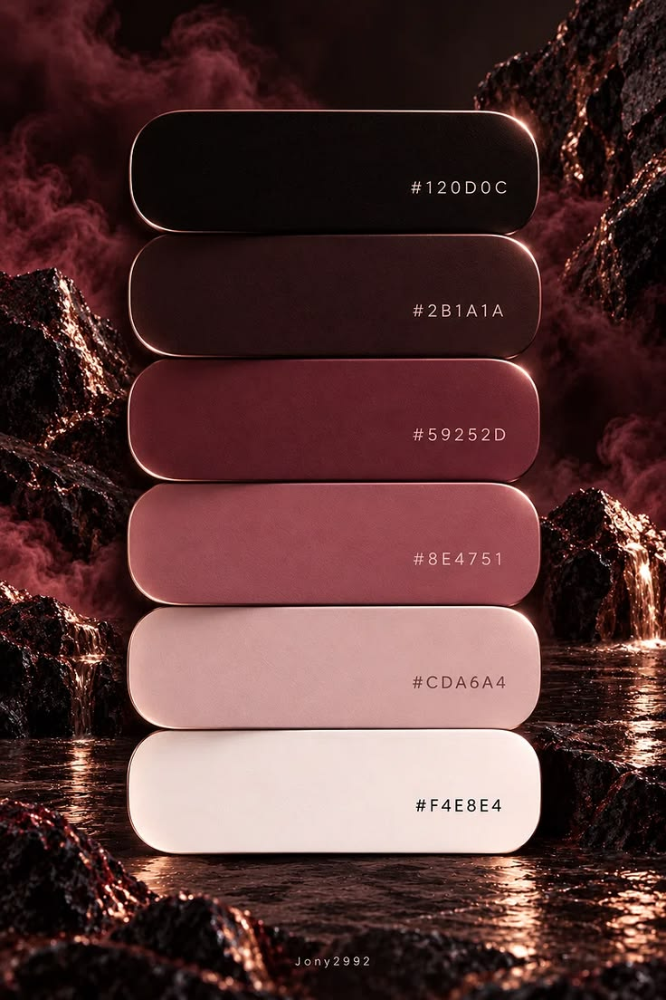

Path: `UI-UX/PALETTE/IMMAGINI/UIR-0037.jpg` · SHA-256 `344ecc8ffd7a2f2018d69aa8fa07c0a56040bdae7563edf28c53e9547ebf932d`

### UIR-0038 — PALETTE

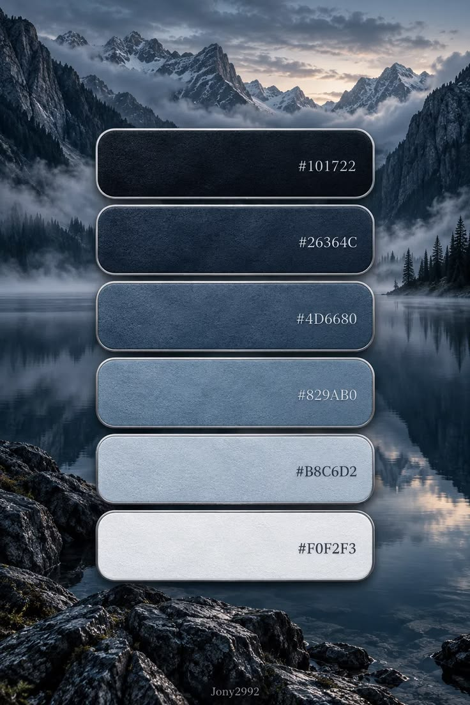

Path: `UI-UX/PALETTE/IMMAGINI/UIR-0038.jpg` · SHA-256 `81b0e1887ff75c3da663b5e07fd648d2a312a90dc36f5a58221b347e3980b6af`

### UIR-0039 — PALETTE

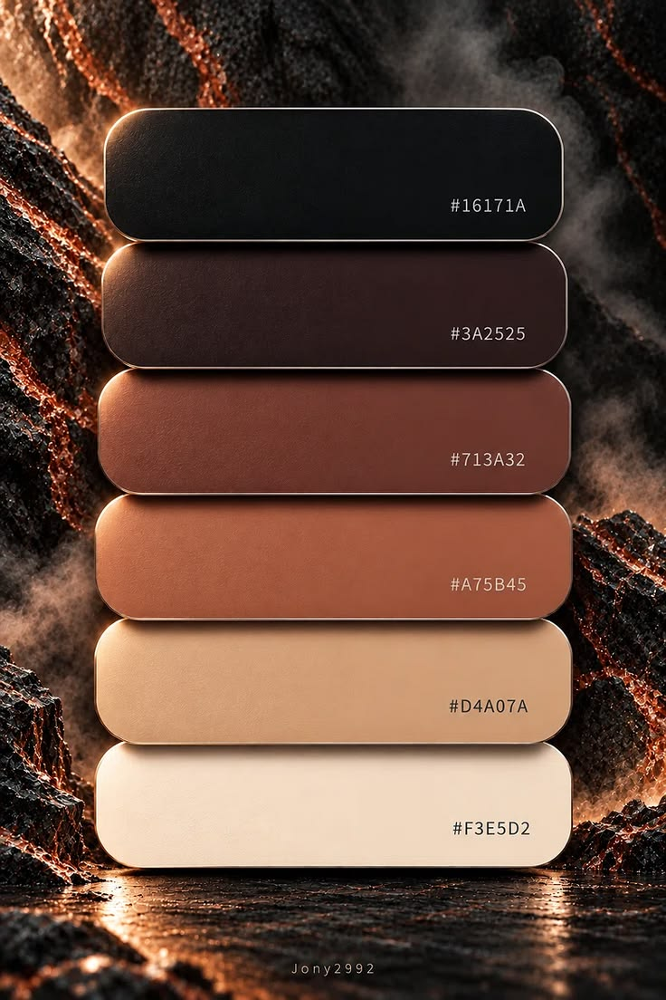

Path: `UI-UX/PALETTE/IMMAGINI/UIR-0039.jpg` · SHA-256 `60cd021dc8c5e16f01c20960885431b3add7a42e2c7e4ee7fb8db7b2bb1f40b7`

### UIR-0040 — PALETTE

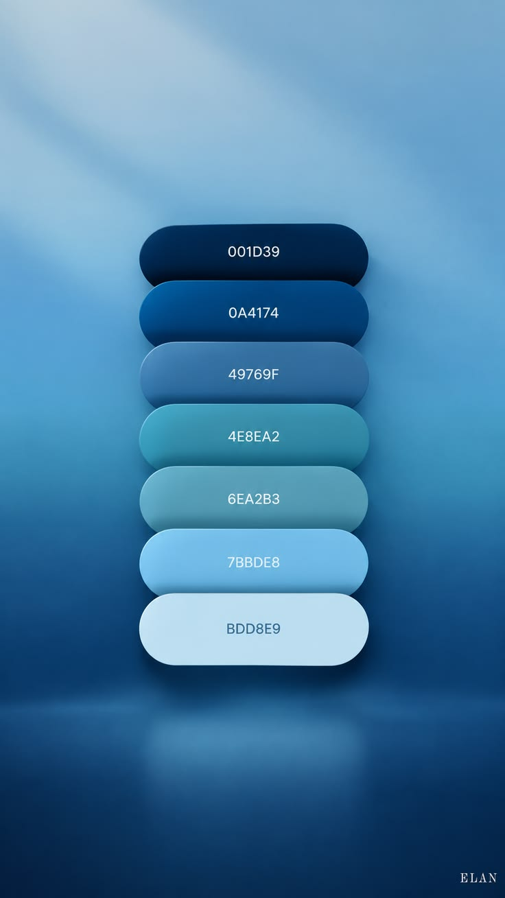

Path: `UI-UX/PALETTE/IMMAGINI/UIR-0040.jpg` · SHA-256 `a1c471a11b68372d9ebafd28ca268420623aff0d49d49bf526dcf1e6425d06c0`

### UIR-0041 — PALETTE

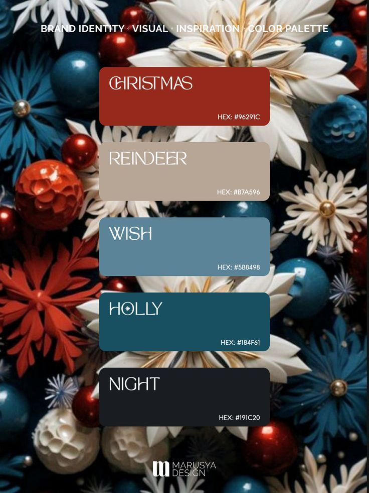

Path: `UI-UX/PALETTE/IMMAGINI/UIR-0041.jpg` · SHA-256 `b11451af6c16d0f844433f8d2c9ff5883d939eb48bb2983034fd7b505ac88a0b`

### UIR-0042 — PALETTE

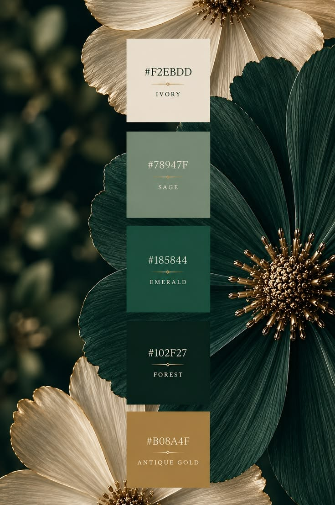

Path: `UI-UX/PALETTE/IMMAGINI/UIR-0042.jpg` · SHA-256 `43d5291340da8eda1a50e4bf7bbe56734f8be5006c16df357fd7dee56d49cea5`

### UIR-0043 — DESIGN SYSTEM

Path: `UI-UX/DESIGN SYSTEM/IMMAGINI/UIR-0043.jpg` · SHA-256 `2b009fed372a4303e6e49170c64e9aedd675e899e3facad5003167dd65108f56`

### UIR-0044 — PALETTE

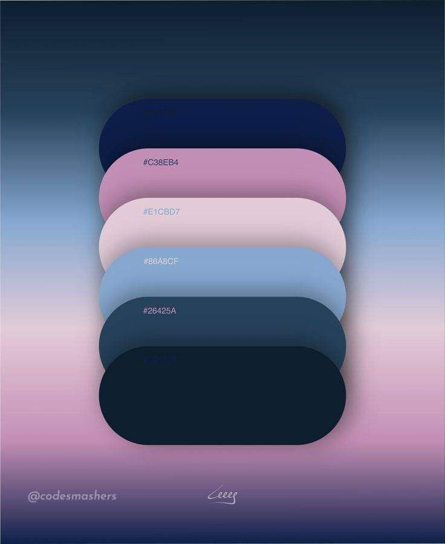

Path: `UI-UX/PALETTE/IMMAGINI/UIR-0044.jpg` · SHA-256 `aed8c67525602611929784c6007f2710972a3d3ab7189b3673f8a5ce8bce3060`

### UIR-0045 — PALETTE

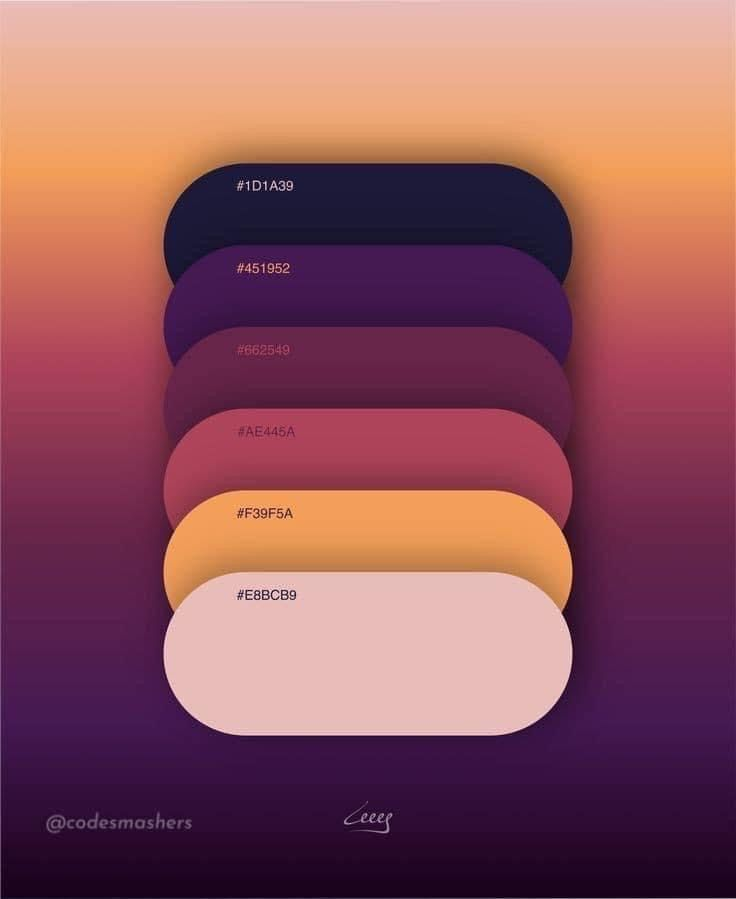

Path: `UI-UX/PALETTE/IMMAGINI/UIR-0045.jpg` · SHA-256 `4efeecafbf093aef3e6a2f691470c1f5847b3a97fb8f682fc2b25fedc1eec902`

### UIR-0046 — PALETTE

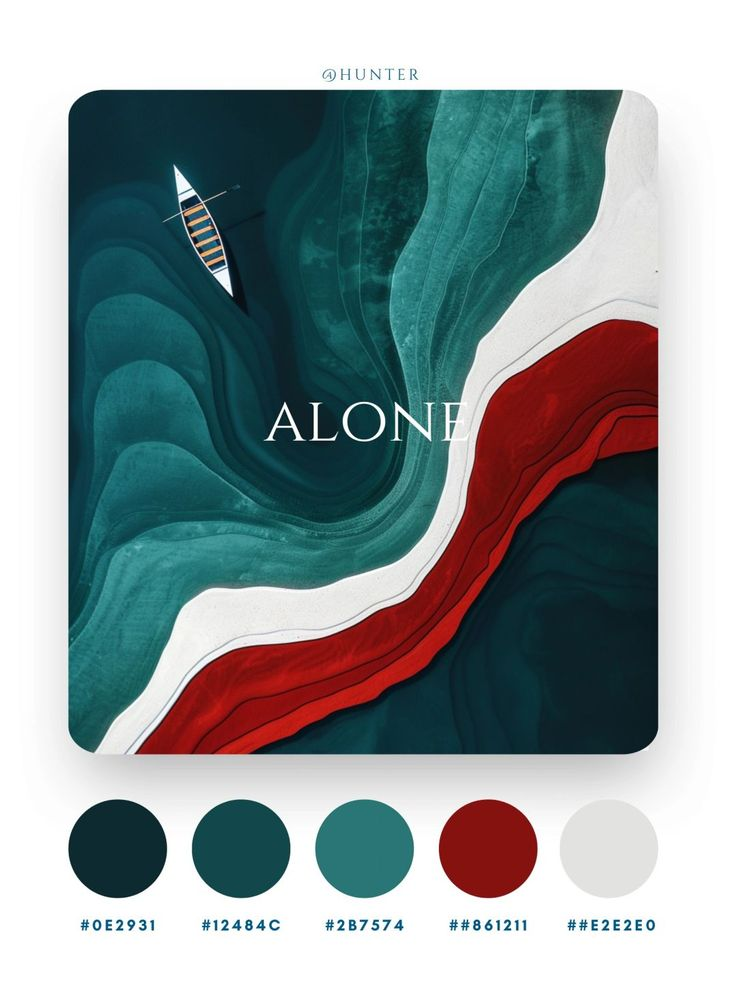

Path: `UI-UX/PALETTE/IMMAGINI/UIR-0046.jpg` · SHA-256 `8868191976de8c9dfeb96383e1ab08413af24d916289a94d8bc206f247cf8eef`

### UIR-0047 — PALETTE

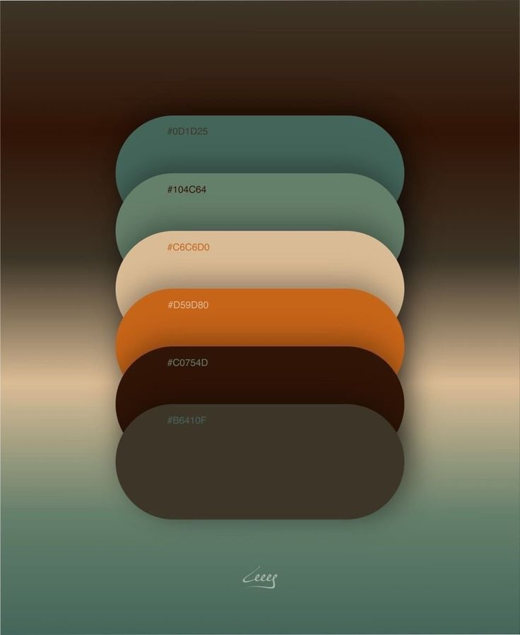

Path: `UI-UX/PALETTE/IMMAGINI/UIR-0047.jpg` · SHA-256 `bb109c85e8af4583fceacdbf9f4c05d0ff04ff49cd6e4617fa87e20c97d4bca2`

### UIR-0048 — PALETTE

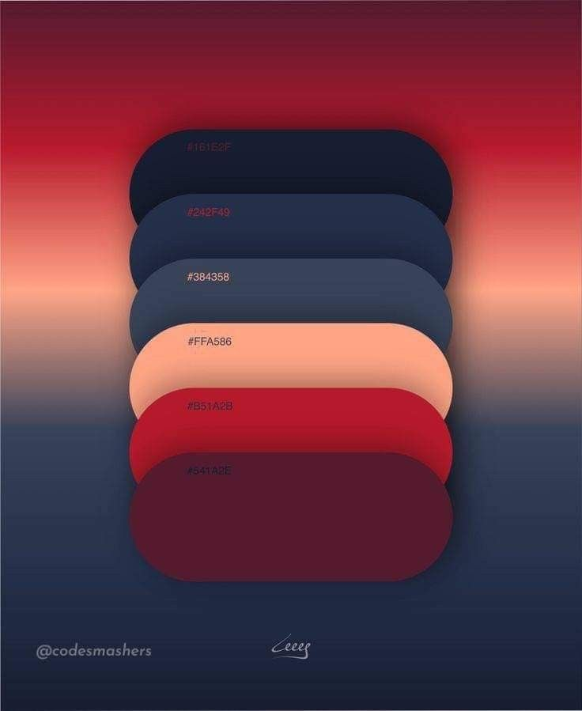

Path: `UI-UX/PALETTE/IMMAGINI/UIR-0048.jpg` · SHA-256 `489d5530d0e08d54905511d3696037d3c22e4c8ec09edac0863276bc09eb3e25`

### UIR-0049 — DESIGN SYSTEM

Path: `UI-UX/DESIGN SYSTEM/IMMAGINI/UIR-0049.jpg` · SHA-256 `b7e0117c11b2797bc5fc9c64acf8929995339ab84f0e6d2713bddbc0558a1e85`

### UIR-0050 — DESIGN SYSTEM

Path: `UI-UX/DESIGN SYSTEM/IMMAGINI/UIR-0050.jpg` · SHA-256 `b3f285241b92fc5eaf828f37680ebf1973c3f1a7587bf2bd1f66f8b600077e3c`

### UIR-0051 — SOFT 3D

Path: `UI-UX/SOFT 3D/IMMAGINI/UIR-0051.jpg` · SHA-256 `ff6a351807fdae6db86c91ea0b0c4d0889a0e0e077a655708406046ea07f3a47`

### UIR-0052 — SOFT 3D

Path: `UI-UX/SOFT 3D/IMMAGINI/UIR-0052.jpg` · SHA-256 `023530611178b55c5b696aea0dfcca9fbf294070e87c08fd521de97f52211945`

### UIR-0053 — SKEUOMORPHISM

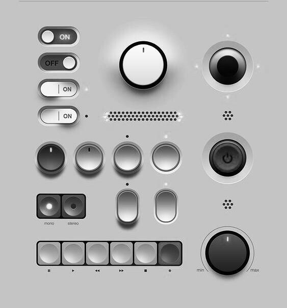

Path: `UI-UX/SKEUOMORPHISM/IMMAGINI/UIR-0053.jpg` · SHA-256 `947738805dd3f42e2eb2a87303ad46b10533c90d91ef560f32853972600d9cb8`

### UIR-0054 — SKEUOMORPHISM

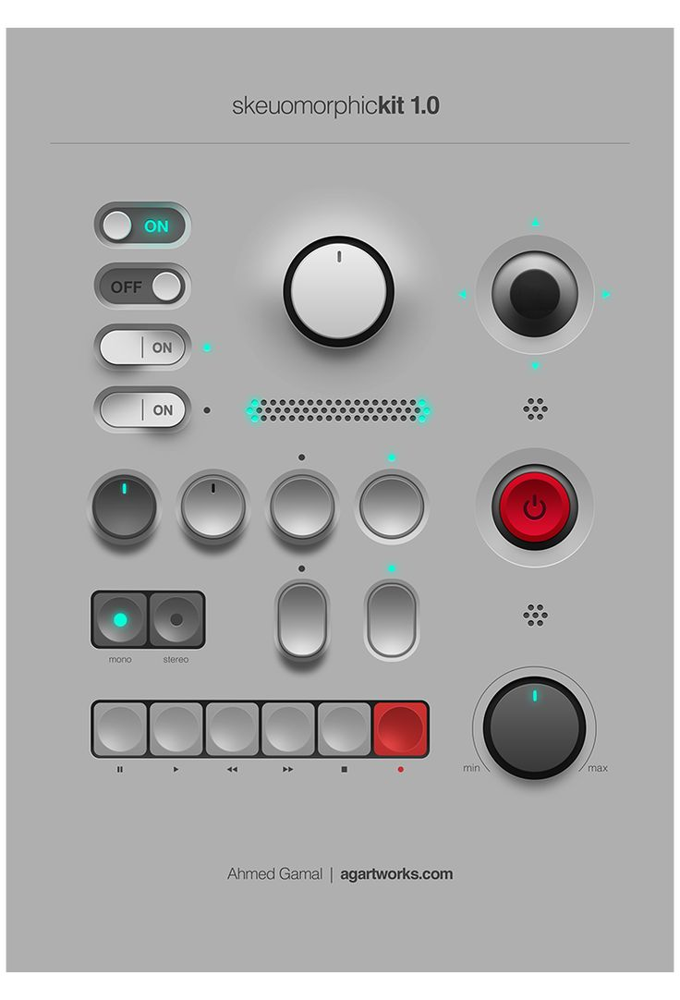

Path: `UI-UX/SKEUOMORPHISM/IMMAGINI/UIR-0054.jpg` · SHA-256 `52ec55e6cf8f6d5bbffb08dedac620cf44745cae16c15ecefc273093569b568e`

### UIR-0055 — SKEUOMORPHISM

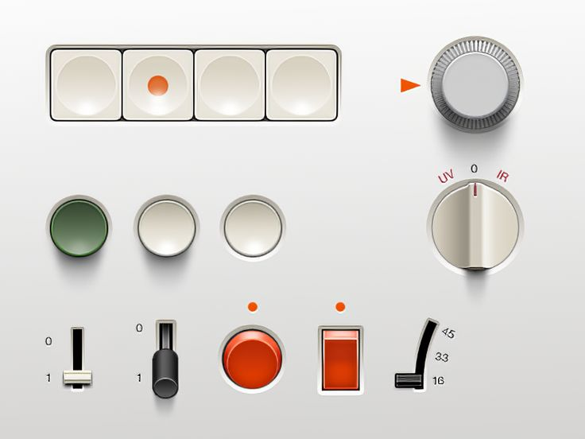

Path: `UI-UX/SKEUOMORPHISM/IMMAGINI/UIR-0055.jpg` · SHA-256 `07c909a11efc2f3a7c75d6a1567bdd3b0a5bb445146dae4ec5c05431c3ba4333`

### UIR-0056 — MINIMAL CONTROLS

Path: `UI-UX/MINIMAL CONTROLS/IMMAGINI/UIR-0056.jpg` · SHA-256 `b946fdafdadfb3104139aeebb0d9be5eab32aaaf0838c9d4be35aabc60f21756`

### UIR-0057 — MINIMAL CONTROLS

Path: `UI-UX/MINIMAL CONTROLS/IMMAGINI/UIR-0057.jpg` · SHA-256 `deccf4dc05e0a2d51a7b75b79fb8518b075347173946f2e32b852a24b0ffc261`

### UIR-0058 — MINIMAL CONTROLS

Path: `UI-UX/MINIMAL CONTROLS/IMMAGINI/UIR-0058.jpg` · SHA-256 `fc94f5f7dbdcca5161cdab0e93093b738ceb524baee876008fddda49d26bcb4d`

### UIR-0059 — MINIMAL CONTROLS

Path: `UI-UX/MINIMAL CONTROLS/IMMAGINI/UIR-0059.jpg` · SHA-256 `b0555ad5df5cbc5f0147532ce82cdf43db0f073109e593aa4665dac1130bee6b`

### UIR-0060 — MINIMAL CONTROLS

Path: `UI-UX/MINIMAL CONTROLS/IMMAGINI/UIR-0060.jpg` · SHA-256 `f22f13288ed0e3619ae91024f8979366971cebf62573d14bade454d4e3d970d5`

### UIR-0061 — MINIMAL CONTROLS

Path: `UI-UX/MINIMAL CONTROLS/IMMAGINI/UIR-0061.jpg` · SHA-256 `bb2877efa8a3a4567de0494c4cb41e1a089a6652b24bd8e7c597449114628a70`

### UIR-0062 — EDITORIAL UI

Path: `UI-UX/EDITORIAL UI/IMMAGINI/UIR-0062.jpg` · SHA-256 `9c924f899a42a2dcf6c5775e7d7063043e898b56cd7776da2430771bdb8d4ab9`

### UIR-0063 — BENTO UI

Path: `UI-UX/BENTO UI/IMMAGINI/UIR-0063.jpg` · SHA-256 `fcbc0c7b0c8300a9bc489839275e43893eaacc057c73aaa92090ae353f27e483`

### UIR-0064 — DESIGN SYSTEM

Path: `UI-UX/DESIGN SYSTEM/IMMAGINI/UIR-0064.jpg` · SHA-256 `444539a14dad0ea0d5c108eb11cc74debdbbf7b88f1a4552aee7643071363dff`

### UIR-0065 — DESIGN SYSTEM

Path: `UI-UX/DESIGN SYSTEM/IMMAGINI/UIR-0065.jpg` · SHA-256 `8c5940c148a80f2830a745ca6f531f3e86fd1d667b2ea6c57c879c164c731e36`

### UIR-0066 — NEUMORPHISM

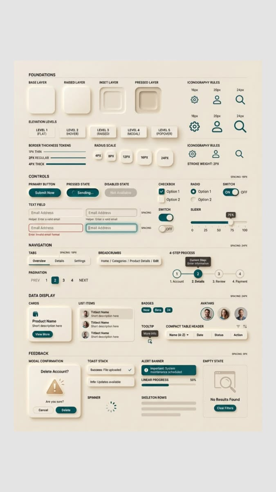

Path: `UI-UX/NEUMORPHISM/IMMAGINI/UIR-0066.jpg` · SHA-256 `585c3704baabdd9f47f43266779642ac5e5411e7084827a0fe4293f7f4db709a`

### UIR-0067 — MINIMAL CONTROLS

Path: `UI-UX/MINIMAL CONTROLS/IMMAGINI/UIR-0067.jpg` · SHA-256 `37279eaab14a01b2c1e5101202b47c26ad5effc9ef9461b498e04cdc9741b1df`

### UIR-0068 — NEUMORPHISM

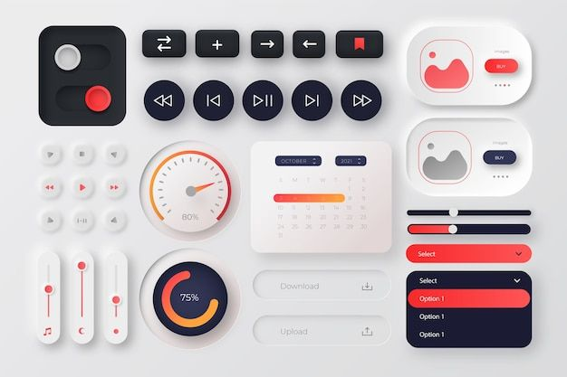

Path: `UI-UX/NEUMORPHISM/IMMAGINI/UIR-0068.jpg` · SHA-256 `44491193c3221e0720e2de1c39ffa19c54b4a88235e36ebeb4b65d5fbc1d0f80`

### UIR-0069 — NEUMORPHISM

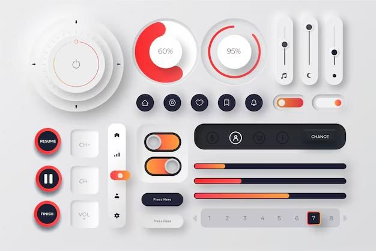

Path: `UI-UX/NEUMORPHISM/IMMAGINI/UIR-0069.jpg` · SHA-256 `9f3b236286362854e2aaed1c408a7d7e18943636a2dd310ca5db2d9b6544fb94`

### UIR-0070 — DESIGN SYSTEM

Path: `UI-UX/DESIGN SYSTEM/IMMAGINI/UIR-0070.jpg` · SHA-256 `65765082cc3458bdf3caa9f9b817b090e1c3eba26f2f611e253c510143364558`

### UIR-0071 — DESIGN SYSTEM

Path: `UI-UX/DESIGN SYSTEM/IMMAGINI/UIR-0071.jpg` · SHA-256 `0262c1c919422491fffea632c51e0206365875ea8858f52b8173f462baf106d1`

### UIR-0072 — DESIGN SYSTEM

Path: `UI-UX/DESIGN SYSTEM/IMMAGINI/UIR-0072.jpg` · SHA-256 `36641de64746b6a884edb2c76af4146c0708ff2d78abfc579b8aa630fc1240b8`

### UIR-0073 — MINIMAL CONTROLS

Path: `UI-UX/MINIMAL CONTROLS/IMMAGINI/UIR-0073.jpg` · SHA-256 `5890f11b0aabda9f7fff49b30e2915d39bd8060a61208c5bdfe33d6e4d62cde2`

### UIR-0074 — NATURE-TECH

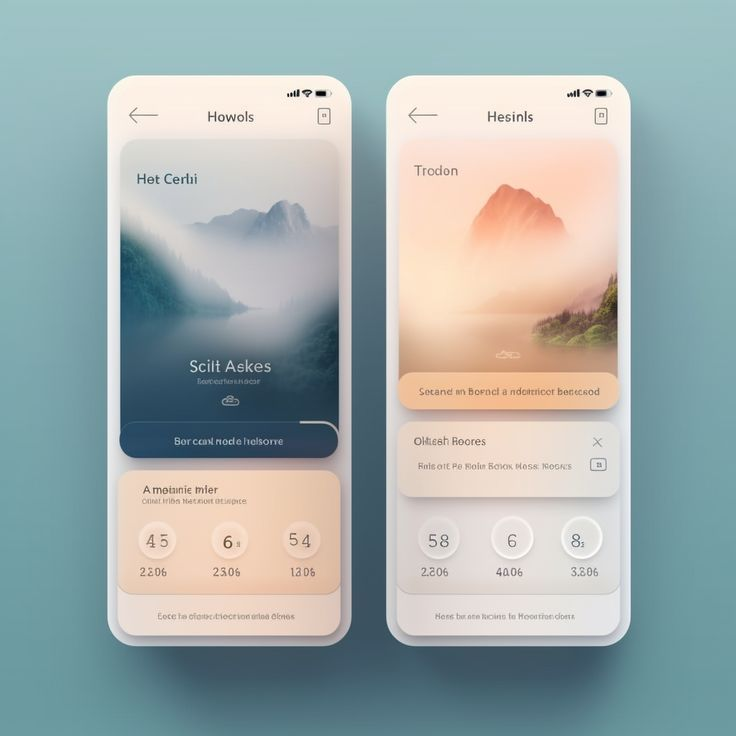

Path: `UI-UX/NATURE-TECH/IMMAGINI/UIR-0074.jpg` · SHA-256 `6a7601c0d7db53fd738323bb020756c3919ef605f0e11a7caac0761a89e6c4ff`

### UIR-0075 — NATURE-TECH

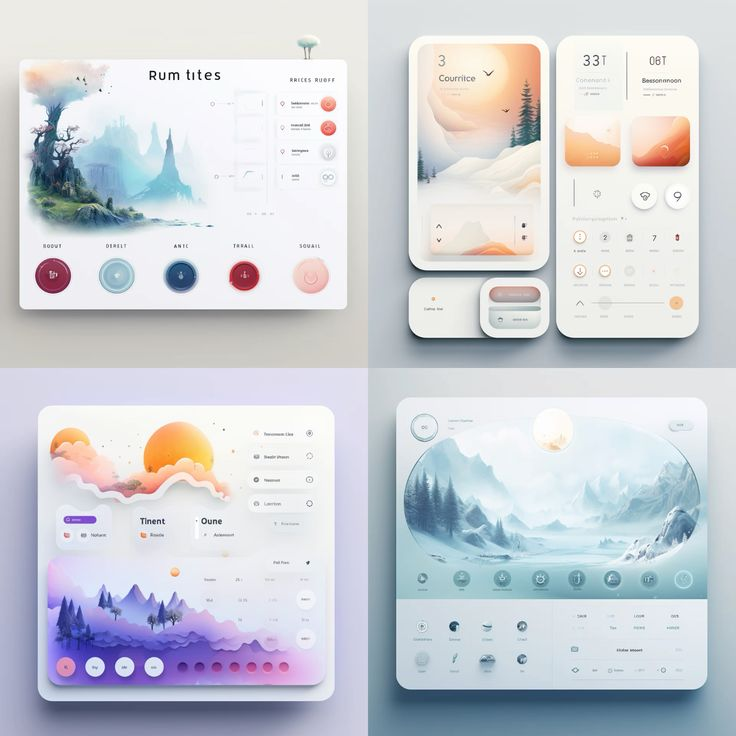

Path: `UI-UX/NATURE-TECH/IMMAGINI/UIR-0075.jpg` · SHA-256 `b886b62cc4bf0c54185de051360e36e627b25d0cc3cb2b61b0c07f9078211f9d`

### UIR-0076 — SOFT 3D

Path: `UI-UX/SOFT 3D/IMMAGINI/UIR-0076.jpg` · SHA-256 `c1bfd8e5a23d312488af6e02c6aff5222551a8d26fe259d38ae79d21d17cc22f`

### UIR-0077 — GLASSMORPHISM

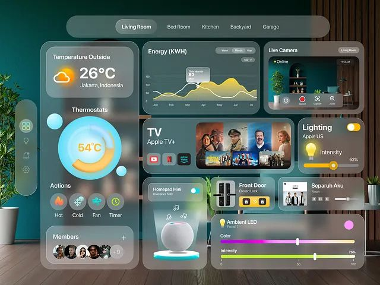

Path: `UI-UX/GLASSMORPHISM/IMMAGINI/UIR-0077.jpg` · SHA-256 `20b7b36cfe14fc7ad64a4c8290ab4866dd9f94c25801c6cbd7df593dc47c8ee1`

### UIR-0078 — SCENIC BACKGROUND

Path: `UI-UX/SCENIC BACKGROUND/IMMAGINI/UIR-0078.jpg` · SHA-256 `79398debd764154294579ca45c335b9d28dcf03ef112339a334bbfa56957a24f`

### UIR-0079 — SCENIC BACKGROUND

Path: `UI-UX/SCENIC BACKGROUND/IMMAGINI/UIR-0079.jpg` · SHA-256 `ebbbc3a3cc61d8435b4f686aa4c8bdc0fcb2edaa9ce5d58152055b0805a9f717`

### UIR-0080 — SCENIC BACKGROUND

Path: `UI-UX/SCENIC BACKGROUND/IMMAGINI/UIR-0080.jpg` · SHA-256 `6e1c05ae5d4575729bdaeba8cb00467dd414845eb4a72d98bb8d779e01937906`

### UIR-0081 — SCENIC BACKGROUND

Path: `UI-UX/SCENIC BACKGROUND/IMMAGINI/UIR-0081.jpg` · SHA-256 `a9c9741374f552e97bae5757330490748a9babdc83c9dec2cef9f46e498ac324`

### UIR-0082 — SCENIC BACKGROUND

Path: `UI-UX/SCENIC BACKGROUND/IMMAGINI/UIR-0082.jpg` · SHA-256 `67b874d75c577f9114a76c81caf24814ab86ad4132c3942986065ae350aaaf40`

### UIR-0083 — SCENIC BACKGROUND

Path: `UI-UX/SCENIC BACKGROUND/IMMAGINI/UIR-0083.jpg` · SHA-256 `e719d86e83ff70d3a49c639e7eae91e40c9b1491c4e2081a389da9f4aa1c828e`

### UIR-0084 — SCENIC BACKGROUND

Path: `UI-UX/SCENIC BACKGROUND/IMMAGINI/UIR-0084.jpg` · SHA-256 `947d2e16d3ec16ce31c8e99abe01256d9858c87cd3714463519d5760f2a42c5a`

### UIR-0085 — DESIGN SYSTEM

Path: `UI-UX/DESIGN SYSTEM/IMMAGINI/UIR-0085.jpg` · SHA-256 `0d1ba8b01a099460712010891c1b6d4ee6fa4669734006cb412b2dc94815d425`

### UIR-0086 — DESIGN SYSTEM

Path: `UI-UX/DESIGN SYSTEM/IMMAGINI/UIR-0086.jpg` · SHA-256 `9fe1f514e1963b29b64a8b1bbb27bee80f9e0ca9ea359153adbe98f5d2e12dd0`

### UIR-0087 — DESIGN SYSTEM

Path: `UI-UX/DESIGN SYSTEM/IMMAGINI/UIR-0087.jpg` · SHA-256 `1019104f8ae1a55935f579005e3fcf297b7322ef85f005f885cd0a17f9467441`

### UIR-0088 — DESIGN SYSTEM

Path: `UI-UX/DESIGN SYSTEM/IMMAGINI/UIR-0088.jpg` · SHA-256 `1fe35182085b9775d9382bd78321eadef44341c1fcd8efddf71824adb170647a`

### UIR-0089 — PALETTE

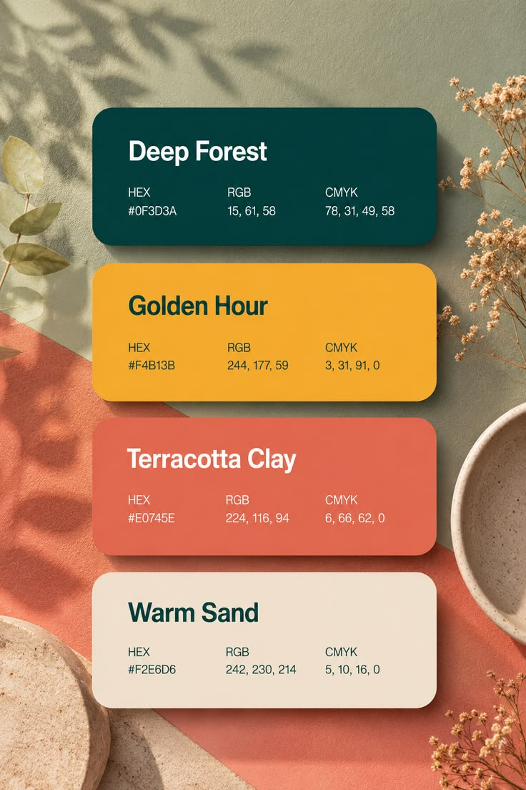

Path: `UI-UX/PALETTE/IMMAGINI/UIR-0089.jpg` · SHA-256 `b6214282b079767ae1b0a7f0c92c5a594b678af14875c5703fcdd7be84f89b06`

### UIR-0090 — PALETTE

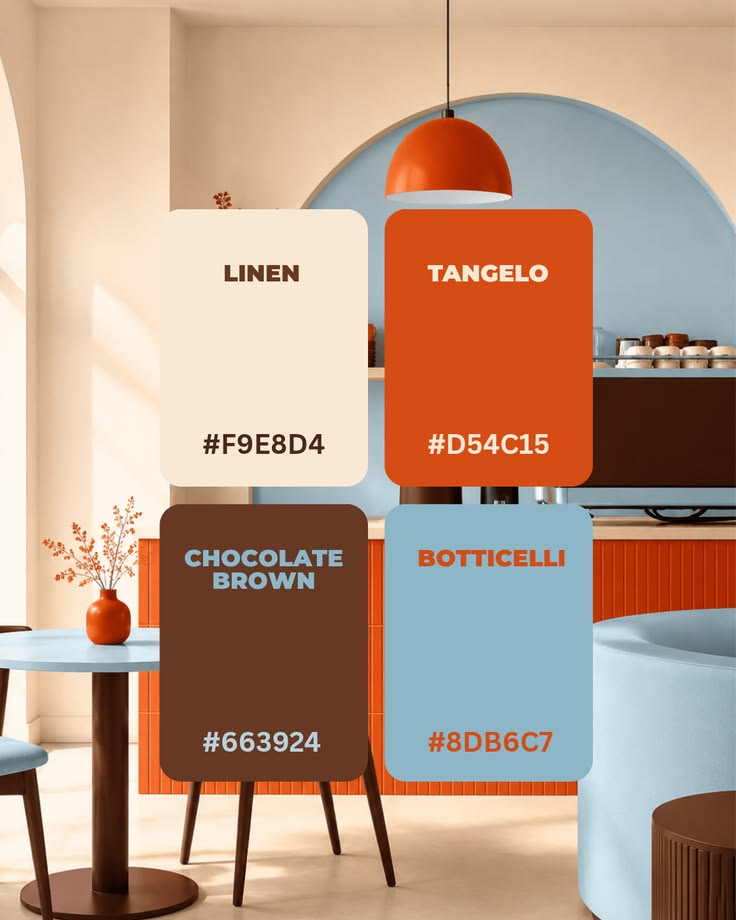

Path: `UI-UX/PALETTE/IMMAGINI/UIR-0090.jpg` · SHA-256 `046a2802e512764dfe499debb819769ba45a89ae186c305a7fa11b431b699c77`

### UIR-0091 — PALETTE

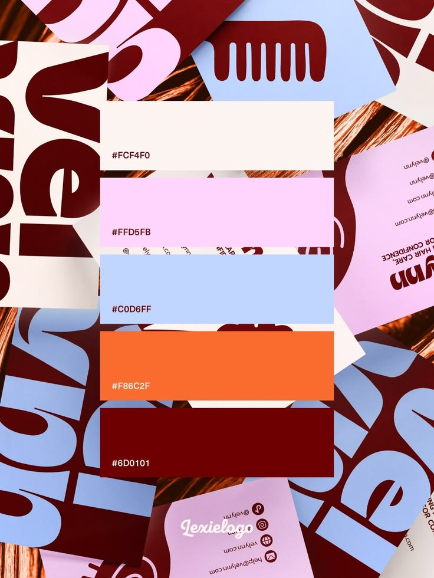

Path: `UI-UX/PALETTE/IMMAGINI/UIR-0091.jpg` · SHA-256 `b5fac779c720e2824539a428ebc61ba110673c0ce836cbdf0000efc93828c6cd`

### UIR-0092 — PALETTE

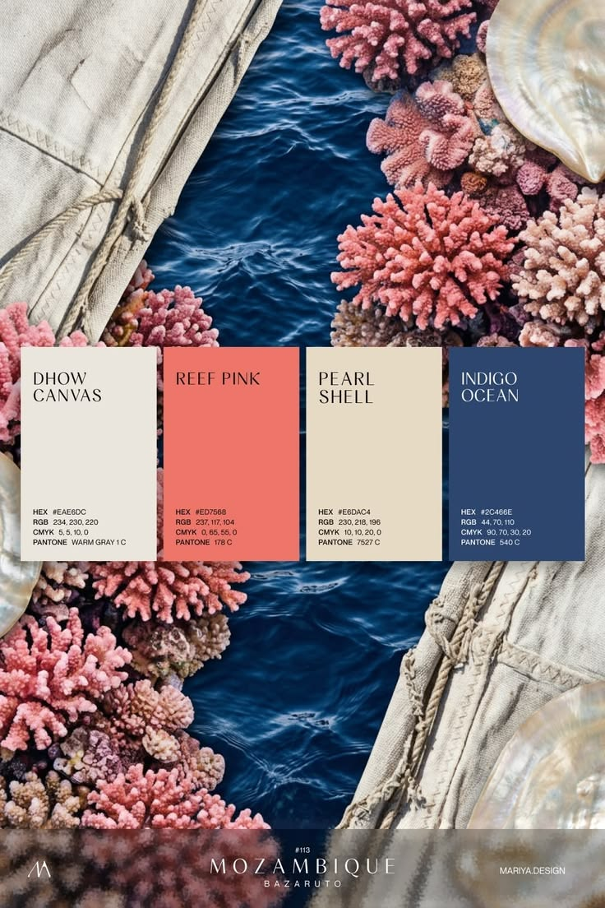

Path: `UI-UX/PALETTE/IMMAGINI/UIR-0092.jpg` · SHA-256 `f7fe6aa8c77aa5774e3227218cc3af2bb9da51f4d52ed2eaf7349c8151d053de`

### UIR-0093 — PALETTE

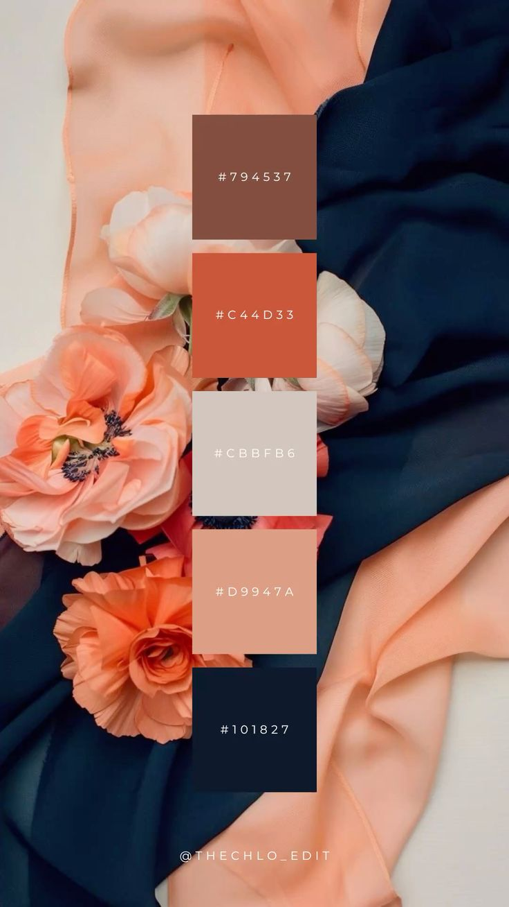

Path: `UI-UX/PALETTE/IMMAGINI/UIR-0093.jpg` · SHA-256 `0820fc87ff5d89308df6db6f031c83a459bd858db1486af56dd2ab407b8172d2`

### UIR-0094 — SCENIC ILLUSTRATION

Path: `UI-UX/SCENIC ILLUSTRATION/IMMAGINI/UIR-0094.jpg` · SHA-256 `5cfdf4efb6b8d14cb4d126a6425331af8f0a04f6a871266b0b630b88fd79de94`

### UIR-0095 — SCENIC ILLUSTRATION

Path: `UI-UX/SCENIC ILLUSTRATION/IMMAGINI/UIR-0095.jpg` · SHA-256 `0081bc79e4cca5846ec4ef7fe17930ee0e182d93005f9923aada0e498cefae7b`

### UIR-0096 — SCENIC ILLUSTRATION

Path: `UI-UX/SCENIC ILLUSTRATION/IMMAGINI/UIR-0096.jpg` · SHA-256 `cac488256fe6e9b540284b6c1a6a5099381a80727d6038df4b143f69ba3e062a`

### UIR-0097 — SCENIC ILLUSTRATION

Path: `UI-UX/SCENIC ILLUSTRATION/IMMAGINI/UIR-0097.jpg` · SHA-256 `421afb352a9303d242885dbcc1f49b63f4f3a5c299cd51c44281ca1250e886c7`

### UIR-0098 — SCENIC ILLUSTRATION

Path: `UI-UX/SCENIC ILLUSTRATION/IMMAGINI/UIR-0098.jpg` · SHA-256 `e9ead345e63c592228e476336ebfb3926fd8a83ae967a2946aa335f3193f136c`

### UIR-0099 — SCENIC ILLUSTRATION

Path: `UI-UX/SCENIC ILLUSTRATION/IMMAGINI/UIR-0099.jpg` · SHA-256 `bafeb9d21a6a4050c77ab6e612c27e400bc3a1e8447da48ded31b0c503412d70`

### UIR-0100 — SCENIC ILLUSTRATION

Path: `UI-UX/SCENIC ILLUSTRATION/IMMAGINI/UIR-0100.jpg` · SHA-256 `da3cbc5d464d5d1b6887396e36fe5628e01cd98fedf0fbade8d91fb0d620f858`

### UIR-0101 — SCENIC ILLUSTRATION

Path: `UI-UX/SCENIC ILLUSTRATION/IMMAGINI/UIR-0101.jpg` · SHA-256 `36bb354d78f97316650b920b253a9ef55a53061dd0e376715cd13d4bd66934a2`

Per aprire le stesse reference come anteprime espandibili consulta [Anteprime UIR 99](./ANTEPRIME_99.md); per la sovrimpressione HTML vedi [docs](../docs/README.md).
